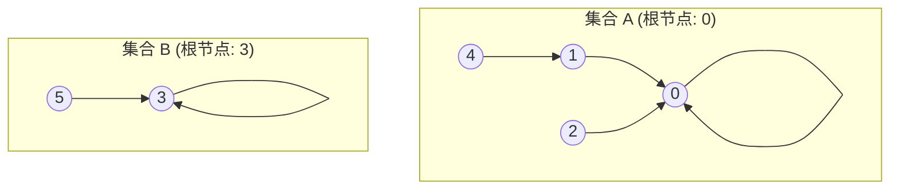

> **课程体系**：UC Berkeley CS61B: Data Structures (Spring 2024)  
> **所属模块**：Module 3: 算法渐进复杂度与不相交集 (Asymptotics & Disjoint Sets)  
> **主讲教师**：Prof. Justin Yokota & Prof. Peyrin Kao (UC Berkeley)  
> **视频时长**：51:00 ｜ **官方原版**：Lecture 14 - Disjoint Sets  
> **视频直达**：[📺 在 B 站观看本讲原视频 (P14)](https://www.bilibili.com/video/BV1hJ4m1M7ZA/?p=14) ｜ [📑 官方课件 Slides (Google Presentation)](https://docs.google.com/presentation/d/18pzklQAvV94ODFpjeB60Rzj79wFHdkIB-ePWR_MeClk) ｜ [📖 官方教材章节](https://cs61b-2.gitbook.io/cs61b-textbook/14.-disjoint-sets)  
> **快速导航**：[← 上一讲 (P13 期中复习：Midterm 1 核心考点沙盘与大题剖析)](/notes/cs61b/lecture-13) ｜ [📚 返回全书目录](/notes/topics/CS61B) ｜ [下一讲 (P15 并查集 II：加权并查集、路径压缩与均摊分析) →](/notes/cs61b/lecture-15)

---

## 1. 动态连通性问题（Dynamic Connectivity）：并查集 ADT 定义

*(参考时间：00:01:30 · [视频跳转 (P14 00:01:30)](https://www.bilibili.com/video/BV1hJ4m1M7ZA/?p=14&t=90))*

在实际计算机网络、社交关系图谱或物理连通性模拟中，我们经常面临如下核心需求：
- 系统最初包含 $N$ 个互相孤立的元素对象（编号为 $0, 1, 2, \dots, N-1$）；
- 随着时间推移，不断有新的连接在两个对象之间建立；
- 系统需要以极致的性能，快速判定任意两个对象之间是否存在连通路径。

这就是计算机科学中著名的**动态连通性问题（Dynamic Connectivity Problem）**。

### 连通关系的数学等价性（Equivalence Relation）
动态连通性中的“连通”是一种严格的等价关系，满足三条数学公理：
1. **自反性（Reflexive）**：对象 $p$ 与自身总是连通的（$p \sim p$）；
2. **对称性（Symmetric）**：若 $p$ 与 $q$ 连通，则 $q$ 也与 $p$ 连通（$p \sim q \implies q \sim p$）；
3. **传递性（Transitive）**：若 $p$ 与 $q$ 连通，且 $q$ 与 $r$ 连通，则 $p$ 与 $r$ 必然间接连通（$p \sim q \land q \sim r \implies p \sim r$）。

由等价关系划分出的互不相交的子集，被称为**连通分量（Connected Components）**。

## 2. 并查集抽象数据类型（ADT）接口契约：DisjointSets

*(参考时间：00:08:40 · [视频跳转 (P14 00:08:40)](https://www.bilibili.com/video/BV1hJ4m1M7ZA/?p=14&t=520))*

我们定义支持该问题的最高抽象接口——`DisjointSets`：

```java
public interface DisjointSets {
    /** 
     * 在元素 p 和元素 q 之间建立连接（将两者所在的集合合并）
     */
    void connect(int p, int q);

    /** 
     * 判断元素 p 和元素 q 是否连通（是否属于同一个集合）
     */
    boolean isConnected(int p, int q);
}
```

注意：并查集 ADT **并不关心具体的连接路径是如何弯弯绕绕铺设的**（那属于图遍历的最短路径课题），它**只关心两点之间到底通不通（宏观连通状态）**！

## 3. 演进阶段一：Quick Find 架构设计（数组存储集合 ID）

*(参考时间：00:15:30 · [视频跳转 (P14 00:15:30)](https://www.bilibili.com/video/BV1hJ4m1M7ZA/?p=14&t=930))*

我们的第一个实现思路追求极致简单的查询性能——**Quick Find**。

### 核心物理模型
使用一个整型数组 `int[] id`，数组下标表示元素编号，数组的值表示该元素所属的**集合编号（Set ID）**。
> **核心法则**：**当且仅当 `id[p] == id[q]` 时，元素 $p$ 和 $q$ 处于连通状态！**

```java
public class QuickFindDS implements DisjointSets {
    private int[] id;

    public QuickFindDS(int N) {
        id = new int[N];
        // 初始时，每个元素自成一个独立集合
        for (int i = 0; i < N; i++) {
            id[i] = i;
        }
    }

    @Override
    public boolean isConnected(int p, int q) {
        // 瞬时 O(1) 判定！
        return id[p] == id[q];
    }

    @Override
    public void connect(int p, int q) {
        int pid = id[p];
        int qid = id[q];
        if (pid == qid) return;

        // 必须遍历整个数组，将所有属于 pid 的元素全部“刷漆”改为 qid！
        for (int i = 0; i < id.length; i++) {
            if (id[i] == pid) {
                id[i] = qid;
            }
        }
    }
}
```

### 复杂度分析与致命缺陷
- **查询操作 `isConnected`**：仅仅是一次数组索引读取，时间复杂度是惊人的 **$\Theta(1)$**；
- **连接操作 `connect`**：每次合并两个集合，都必须用一个 `for` 循环全量遍历长度为 $N$ 的整个数组，时间复杂度是极其沉重的 **$\Theta(N)$**！
- 如果我们要对 $N$ 个元素执行 $N$ 次连接操作，总时间开销是 $\Theta(N^2)$，在大规模动态网络中性能崩溃。

## 4. 演进阶段二：Quick Union 架构（树形拓扑与父指针模型）

*(参考时间：00:24:10 · [视频跳转 (P14 00:24:10)](https://www.bilibili.com/video/BV1hJ4m1M7ZA/?p=14&t=1450))*

为了避免每次 `connect` 都要遍历整个数组，算法大师们提出了**树形森林模型——Quick Union**。

### 核心物理模型
- 我们不再平铺存储集合 ID，而是将每个连通集合组织为一棵**树（Tree）**；
- 同样使用一个整型数组 `int[] parent`，但数组中保存的不再是集合 ID，而是**当前节点的父节点（Parent）索引**！
- **根节点（Root）**：树的根节点没有父节点，约定其父指针指向自己（即 `parent[root] == root`），或者存为负数；
- **连通等价法则**：**两个元素连通，当且仅当它们向上追溯拥有完全相同的树根节点（Same Root）！**



## 5. Quick Union 的代码实现与连接常数突破

*(参考时间：00:32:00 · [视频跳转 (P14 00:32:00)](https://www.bilibili.com/video/BV1hJ4m1M7ZA/?p=14&t=1920))*

让我们编写 Quick Union 的核心逻辑：

```java
public class QuickUnionDS implements DisjointSets {
    private int[] parent;

    public QuickUnionDS(int N) {
        parent = new int[N];
        for (int i = 0; i < N; i++) {
            parent[i] = i; // 初始时，每个节点都是自己的根
        }
    }

    /** 寻找元素 p 所在树的根节点 */
    private int find(int p) {
        while (parent[p] != p) {
            p = parent[p]; // 顺着父指针向上攀爬
        }
        return p;
    }

    @Override
    public boolean isConnected(int p, int q) {
        return find(p) == find(q);
    }

    @Override
    public void connect(int p, int q) {
        int rootP = find(p);
        int rootQ = find(q);
        if (rootP == rootQ) return;

        // 绝妙的常数连接：只需让其中一个根节点成为另一个根节点的子节点！
        parent[rootP] = rootQ;
    }
}
```

### 为什么 Quick Union 的 `connect` 潜在性能更强？
观察 `connect(p, q)`：找到两个根节点之后，**只需要执行单次赋值 `parent[rootP] = rootQ;` 即可将两棵大树合并**！再也不需要像 Quick Find 那样用 for 循环遍历全量数组了！

## 6. 极端退化灾难：细长竹竿树导致单次操作退化为 O(N)

*(参考时间：00:40:15 · [视频跳转 (P14 00:40:15)](https://www.bilibili.com/video/BV1hJ4m1M7ZA/?p=14&t=2415))*

Quick Union 真的彻底解决性能问题了吗？  
并没有！在最坏情况下，它甚至比 Quick Find 还要恶劣。

### 致命的最坏情况构造
假设我们按如下顺序连续执行连接：
```java
connect(0, 1);
connect(1, 2);
connect(2, 3);
...
connect(N - 2, N - 1);
```

由于我们盲目地让 `parent[rootP] = rootQ`，树的形态完全不受控制地退化为一条**细长无比的线性单链表（竹竿树 Tall Spindly Tree）**！

```text
0 -> 1 -> 2 -> 3 -> ... -> (N - 1)
```

此时：
- 树的高度膨胀到了 $N$；
- 每次调用 `find(0)`，都必须从头向上攀爬 $N$ 层；
- `isConnected` 和 `connect` 的时间复杂度全部退化为悲惨的 **$O(N)$**！

如何打破树高失控的魔咒？我们将在下一讲引入并查集的终极进化——加权与路径压缩！

## 7. 本讲小结与课后自测

*(参考时间：00:46:00 · [视频跳转 (P14 00:46:00)](https://www.bilibili.com/video/BV1hJ4m1M7ZA/?p=14&t=2760))*

### 早期并查集性能对决

| 算法架构 | 构造复杂度 | 查询复杂度 `isConnected` | 连接复杂度 `connect` |
| :--- | :--- | :--- | :--- |
| **Quick Find** | $\Theta(N)$ | $\Theta(1)$ (秒查) | $\Theta(N)$ (慢刷) |
| **Quick Union** | $\Theta(N)$ | $O(H)$ (取决于树高 $H$) | $O(H)$ (取决于树高 $H$，最坏 $O(N)$) |

---

### 课后综合自测题

#### 题目 1（状态追踪）
给定初始大小为 6 的 Quick Find 集合。依次执行 `connect(0, 1)`, `connect(2, 3)`, `connect(0, 2)`。请写出此时 `id` 数组的内容（假设 `connect(p, q)` 将属于 `id[p]` 的所有项改为 `id[q]`）。  
**答案与解析**：  
1. `connect(0, 1)`：`id[0]` 变为 1。数组：`[1, 1, 2, 3, 4, 5]`；  
2. `connect(2, 3)`：`id[2]` 变为 3。数组：`[1, 1, 3, 3, 4, 5]`；  
3. `connect(0, 2)`：`pid = id[0] = 1`, `qid = id[2] = 3`。将所有值为 1 的项改为 3。数组变为：`[3, 3, 3, 3, 4, 5]`。此时 0, 1, 2, 3 属于同一个集合 3。

---

## 附录：UC Berkeley 官方教材深度研读 (Official Textbook In-Depth Chapters)

> **导读说明**：本节内容整合自 UC Berkeley CS61B 官方教材库（GitBook Textbook），针对本讲的核心数据结构与算法提供原汁原味的英文理论推导、形式化代码范例与配套章节习题，与前文视频精讲相互补充印证。

## 14. Disjoint Sets

By Dhruti Pandya and Mihir Mirchandani

---

## 14.1 Introduction

🚨 New Data Structure Alert 🚨: Disjoint Sets

People like you and I reside in our countries and live here. We can think of each country as a set and all of the people within it as elements within that set. The same person cannot live in two different countries simultaneously. What we have just modeled is a **disjoint set**. 

> Two sets are named *disjoint sets* if they have no elements in common. A Disjoint-Sets (or Union-Find) data structure keeps track of a fixed number of elements partitioned into a number of *disjoint sets*. The data structure has two operations:

1. `connect(x, y)`: connect `x` and `y`. Also known as `union`

2. `isConnected(x, y)`: returns true if `x` and `y` are connected (i.e. part of the same set).

Professor Hug's Explanation of an Introduction to Disjoin Sets


A Disjoint Sets data structure has a fixed number of elements that each start out in their own subset. By calling `connect(x, y)` for some elements `x` and `y`, we merge subsets together.

For example, say we have four elements which we'll call A, B, C, D. To start off, each element is in its own set:

<figure><figcaption><p>{A} {B} {C} {D}</p></figcaption></figure>

After calling `connect(A, B)`:

\ <br>

<figure><figcaption><p>{A, B} {C} {D}</p></figcaption></figure>

Note that the subsets A and B were merged. Let's check the output some `isConnected` calls:

\

`isConnected(A, B) -> true`

`isConnected(A, C) -> false`

After calling `connect(A, D)`:

\ <br>

<figure><figcaption><p>{A, B, D} {C}</p></figcaption></figure>

\

We find the set A is part of and merge it with the set D is part of, creating one big A, B, D set. C is left alone.

`isConnected(A, D) -> true`\

`isConnected(A, C) -> false`

<br>

With this intuition in mind, let's formally define what our DisjointSets interface looks like. As a reminder, an **interface** determines *what* behaviors a data structure should have (but not *how* to accomplish it). In this way, any class that implements the `DisjointSets` interface knows to always include functions: `connect(int p, int q)` and `isConnected(int p, int q)` as seen below. For now, we'll only deal with sets of non-negative integers. This is not a limitation because in production we can assign integer values to anything we would like to represent.

```java

public interface DisjointSets {

    /** connects two items P and Q */

    void connect(int p, int q);

    /** checks to see if two items are connected */

    boolean isConnected(int p, int q); 

}

```

\

But how are we going to save data for these Disjoint sets to see which member belongs to it's corresponding set? What data structures are we going to use to represent this awesome data structure? In addition to learning about how to implement a fascinating data structure, this chapter will be a chance to see how an implementation of a data structure evolves. We will discuss four iterations of a Disjoint Sets design before being satisfied: [*Quick Find*](https://cs61b-2.gitbook.io/cs61b-textbook/14.-disjoint-sets/14.2-quick-find) *→* [*Quick Union*](https://cs61b-2.gitbook.io/cs61b-textbook/14.-disjoint-sets/14.3-quick-union) *→* [*Weighted Quick Union (WQU)*](https://cs61b-2.gitbook.io/cs61b-textbook/14.-disjoint-sets/14.4-weighted-quick-union-wqu) *→* [*WQU with Path Compression*](https://cs61b-2.gitbook.io/cs61b-textbook/14.-disjoint-sets/14.5-weighted-quick-union-with-path-compression). **We will see how design decisions greatly affect asymptotic runtime and code complexity.**

---

## 14.2 Quick Find

Keeping track of set membership...

Professor Hug's explanation on Quick Find


#### List of Sets

Intuitively, we might first consider representing Disjoint Sets as a list of sets, e.g, `List<Set<Integer>>`.

For instance, if we have N=6 elements and nothing has been connected yet, our list of sets looks like: `[{0}, {1}, {2}, {3}, {4}, {5}, {6}]`. Looks good. However, consider how to complete an operation like `connect(5, 6)`. We'd have to iterate through up to `N` sets to find 5 and `N` sets to find 6. Our runtime becomes `O(N)`. And, if you were to try and implement this, the code would be quite complex.

> The lesson to take away is that **initial design decisions determine our code complexity and runtime.**

#### Quick Find

Let's consider another approach using a *single array of integers*.

* The **indices of the array** represent the elements of our set.

* The **value at an index** is the set number it belongs to.

For example, we represent `{0, 1, 2, 4}, {3, 5}, {6}` as:<br>

<figure><figcaption><p>Set 4: {0, 1, 2, 4} | Set 5: {3, 5} | Set 6: {6}</p></figcaption></figure>

The array indices (0...6) are the elements. The value at `id[i]` is the set it belongs to. *The specific set number doesn't matter as long as all elements in the same set share the same id.*

#### **`connect(x, y)`**

Let's see how the connect operation would work. Right now, `id[2] = 4` and `id[3] = 5`. After calling `connect(2, 3)`, all the elements with id 4 and 5 should have the same id. Let's assign them all the value 5 for now:<br>

<figure><figcaption><p>Set 5: {0, 1, 2, 3, 4, 5} | Set 6: {6}</p></figcaption></figure>

**`isConnected(x, y)`**

To check `isConnected(x, y)`, we simply check if `id[x] == id[y]`. Note this is a constant time operation!

\

We call this implementation "Quick Find" because finding if elements are connected takes constant time.

#### Code & Runtimes

```java

public class QuickFindDS implements DisjointSets {

    private int[] id;

    /* Θ(N) */

    public QuickFindDS(int N){

        id = new int[N];

        for (int i = 0; i < N; i++){

            id[i] = i;

        }

    }

    /* need to iterate through the array => Θ(N) */

    public void connect(int p, int q){

        int pid = id[p];

        int qid = id[q];

        for (int i = 0; i < id.length; i++){

            if (id[i] == pid){

                id[i] = qid;

            }

        }

    }

    /* Θ(1) */

    public boolean isConnected(int p, int q){

        return (id[p] == id[q]);

    }

}

```

N = number of elements in our DisjointSets data structure<br>

| Implementation | Constructor    | `connect` | `isConnected` |

| -------------- | -------------- | --------- | ------------- |

| ListOfSets     | Θ(N)[¹](#note) | O(N)      | O(N)          |

| QuickFind      | Θ(N)           | Θ(N)      | Θ(1)          |

#### Note

1\. We didn't discuss this but you can reason that having to create N distinct sets initially is Θ(N)[ ↩](https://joshhug.gitbooks.io/hug61b/content/chap9/chap92.html#reffn_1)

---

## 14.3 Quick Union

Professor Hug's explanation on Quick Union


Suppose we prioritize making the `connect` operation fast. We will still represent our sets with an array. Instead of an id, we assign each item the index of its parent. If an item has no parent, then it is a 'root' and we assign it a negative value.

This approach allows us to imagine each of our sets as a tree. For example, we represent `{0, 1, 2, 4}, {3, 5}, {6}` as:

 Note that we represent the sets using **only an array**. We visualize it ourselves as trees.

<figure><figcaption></figcaption></figure>

For QuickUnion we define a helper function `find(int item)` which returns the root of the tree `item` is in. For example, for the sets above, `find(4) == 0`, `find(1) == 0`, `find(5) == 3`, etc. Each element has a unique root.

**`connect(x, y)`**

To connect two items, we find the set that each item belongs to (the roots of their respective trees), and make one the child of the other. Example:

`connect(5, 2)`:

1. `find(5)` -> 3

2. `find(2)` -> 0

3. Set `find(5)`'s value to `find(2)` aka `parent[3] = 0`

 Note how element 3 now points to element 0, combining the two trees/sets into one.

<figure><figcaption></figcaption></figure>

In the best case, if `x` and `y` are both roots of their trees, then `connect(x, y)` just makes `x` point to `y`, a Θ(1) operation! (Hence the name QuickUnion)

**`isConnected(x, y)`**

If two elements are part of the same set, then they will be in the same tree. Thus, they will have the same root. So for `isConnected(x, y)` we simply check if `find(x) == find(y)`.

#### Performance 

There is a potential performance issue with QuickUnion: the tree can become very long. In this case, finding the root of an item (`find(item)`) becomes very expensive. Consider the tree below:


In the worst case, we have to traverse all the items to get to the root, which is a Θ(N) runtime. Since we have to call `find` for both `connect` and `isConnected`, the runtime for both is upper bounded by O(N).

#### Summary and Code 

N = number of elements in our DisjointSets data structure

| Implementation | Constructor | `connect` | `isConnected` |

| -------------- | ----------- | --------- | ------------- |

| QuickUnion     | Θ(N)        | O(N)      | O(N)          |

| QuickFind      | Θ(N)        | Θ(N)      | Θ(1)          |

| QuickUnion     | Θ(N)        | O(N)      | O(N)          |

From the runtime chart, QuickUnion seems worse than QuickFind! Note however that O(N) as an **upper bound**. When our trees are balanced, both `connect` and `isConnected` perform reasonably well. In the next section we'll see how to *guarantee* they perform well.

```java

public class QuickUnionDS implements DisjointSets {

    private int[] parent;

    public QuickUnionDS(int num) {

        parent = new int[num];

        for (int i = 0; i < num; i++) {

            parent[i] = -1;

        }

    }

    private int find(int p) {

        while (parent[p] >= 0) {

            p = parent[p];

        }

        return p;

    }

    @Override

    public void connect(int p, int q) {

        int i = find(p);

        int j= find(q);

        parent[i] = j;

    }

    @Override

    public boolean isConnected(int p, int q) {

        return find(p) == find(q);

    }

}

```

---

## 14.4 Weighted Quick Union (WQU)

Improving on Quick Union relies on a key insight: whenever we call `find`, we have to climb to the root of a tree. Thus, the shorter the tree the faster it takes!

**New rule:** whenever we call `connect`, we always link the root of the smaller tree to the larger tree.

Following this rule will give your trees a maximum height of $$log N$$, where N is the number of elements in our Disjoint Sets. How does this affect the runtime of `connect` and `isConnected`?

Professor Hug's explanation on Weighted Quick Union


Let's illustrate the benefit of this with an example. Consider connecting the two sets T1 and T2 below:


We have two options for connecting them:

 The first option we link T1 to T2. In the second, we link T2 to T1.

<figure><figcaption></figcaption></figure>

The **second option is preferable** as it only has a height of 2, rather than 3. By our new rule, we would choose the second option as well because T2 is smaller than T1 (size of 3 compared to 6).

We determine smaller / larger by the number of items in a tree. Thus, when connecting two trees we need to know their size (or weight). We can store this information in the root of the tree by replacing the `-1`'s with `-(size of tree)`. 

**Maximum height: Log N**

Following the above rule ensures that the *maximum* height of any tree is Θ(log N). N is the number of elements in our Disjoint Sets. **By extension, the runtimes of `connect` and `isConnected` are bounded by O(log N).** 

Why $$logN$$? The video above presents a more visual explanation. Here's an optional mathematical explanation why the maximum height is $$log\_{2}N$$. Imagine any element $$x$$ in tree $$T1$$. The depth of $$x$$ increases by 1 only when $$T1$$ is placed below another tree $$T2$$. When that happens, the size of the resulting tree will be at least double the size of $$T1$$ because $$size(T2)\geq size(T1)$$. The tree with $$x$$ can double at most $$log\_{2}N$$ times until we've reached a total of N items ($$2^{log\_{2}N} = N$$). So we can double up to $$log\_{2}N$$​​ times and each time, our tree adds a level → maximum $$log\_{2}N$$ levels. 

You may be wondering why we don't link trees based off of height instead of weight. It turns out this is more complicated to implement and gives us the same Θ(log N) height limit.

#### Summary 

| Implementation       | Constructor | `connect` | `isConnected` |

| -------------------- | ----------- | --------- | ------------- |

| QuickUnion           | Θ(N)        | O(N)      | O(N)          |

| QuickFind            | Θ(N)        | Θ(N)      | Θ(1)          |

| QuickUnion           | Θ(N)        | O(N)      | O(N)          |

| Weighted Quick Union | Θ(N)        | O(log N)  | O(log N)      |

N = number of elements in our DisjointSets data structure

---

## 14.5 Weighted Quick Union with Path Compression

Weighted Quick Union is pretty good, but we can do even better!

Professor Hug's explanation on Weighted Quick Union with Path Compression


The clever insight is realizing that whenever we call `find(x)` we have to traverse the path from `x` to root. So, along the way we can connect all the items we visit to their root at no extra asymptotic cost.

Connecting all the items along the way to the root will help make our tree shorter with each call to `find`.

Recall that **both `connect(x, y)` and `isConnected(x, y)` always call `find(x)` and `find(y)`.** Thus, after calling `connect` or `isConnected` enough, essentially all elements will point directly to their root.

By extension, the average runtime of `connect` and `isConnected` becomes **almost constant** in the long term! This is called the *amortized runtime*.

More specifically, for M operations on N elements, WQU with Path Compression is in $$O(N + M (lg\cdot  N))$$. lg\* is the [iterated logarithm](https://en.wikipedia.org/wiki/Iterated_logarithm) which is less than 5 for any real-world input.

#### Summary 

N: number of elements in Disjoint Set

| Implementation             | `isConnected` | `connect` |

| -------------------------- | ------------- | --------- |

| Quick Find                 | Θ(1)          | Θ(N)      |

| Quick Union                | O(N)          | O(N)      |

| Weighted Quick Union (WQU) | O(log N)      | O(log N)  |

| WQU with Path Compression  | O(α(N))\*     | O(α(N))\* |

\*behaves as constant in long term.

---

## 14.6 Exercises

### Factual

1. [Problem 2](https://drive.google.com/file/d/1GuTG5O-2SSudWgm47rIi4orkmmpU4Apa/view?usp=share_link) from the Spring 2016 Midterm 2.

2. [Problem 1d ](https://drive.google.com/file/d/1uE1QlF4YguWVp8m8UJ97R2xPC4b1NnQ5/view?usp=sharing)from the Spring 2015 Midterm 2.

3. Suppose we have the following WQU with path compression. What is the height of the tree after we call `isConnected(8, 9)`?

<figure><figcaption></figcaption></figure>

<details>

<summary>Problem 1</summary>

[Solutions](https://drive.google.com/file/d/1KXLkjx1e8QPiu-waBJFwmcT5IToMHQK5/view?usp=sharing) are linked here and on the course website.

</details>

<details>

<summary>Problem 2</summary>

[Solutions](https://drive.google.com/file/d/1IYt4VbzdX4dTekh6cYAC8tigpJ_LgljV/view?usp=sharing) are linked here and on the course website.

</details>

<details>

<summary>Problem 3</summary>

The resulting tree will have height 1. Every node along the path from `0` to `9` will now have parent `0`, and similarly every node along the path from `0` to `8` will also have parent `0`.

</details>

### Conceptual

1. Which of the following arrays could represent a valid weighted quick union structure?

   * [ ] `[8, 0, 4, 0, 0, 4, 0, 4, 2, 0]`

   * [ ] `[4, -8, 8, 2, 1, -2, 1, 1, 4, 5]`

   * [ ] `[3, 3, 5, 9, 3, 6, 3, 4, 1, -10]`

   * [ ] `[2, -10, 1, 1, 1, 1, 1, 2, 1, 7]`

<details>

<summary>Problem 1</summary>

* [ ] `[8, 0, 4, 0, 0, 4, 0, 4, 2, 0]`: invalid. There is a cycle 8 --> 2 --> 4 --> 0 --> 8.

* [ ] `[4, -8, 8, 2, 1, -2, 1, 1, 4, 5]`: invalid. The maximum height is $$4 > \log\_2 (10)$$.

* [ ] `[3, 3, 5, 9, 3, 6, 3, 4, 1, -10]`: invalid. The size of the tree rooted at 9 (excluding the subtree rooted at 3) is less than the size of the tree rooted at 3. As such, when we connected the two trees, 3 should have been the parent of 9 instead of the other way around.

* [ ] `[2, -10, 1, 1, 1, 1, 1, 2, 1, 7]`: valid.

</details>

### Procedural

1. Define a *fully connected* WQU as one where all elements are in the same set. What is the maximum and minimum height of a fully connected WQU with 6 elements?

2. Suppose we have a WQU of height H. What is the minimum number of elements that must be in the WQU?

<details>

<summary>Problem 1</summary>

The minimum height is always 1 (all elements are connected to the root). The maximum height is 2 (we take the floor of $$\log\_2 6$$).

</details>

<details>

<summary>Problem 2</summary>

We know that $$H \leq \log\_2 N$$, where $$N$$ is the number of elements in the WQU. As such, $$N \geq 2^H$$.

</details>

### Metacognitive

1. [Problem 3](https://drive.google.com/file/d/1yWyRp7QTizspTp9dsKz5yxE6bSf9YUIi/view?usp=sharing) from the Spring 2017 Midterm 2.

2. Suppose we create a WQU with $$N$$items, then we perform $$M\_C$$ union operations and $$M\_U$$ union operations. Using big O notation, what is the runtime of this sequence of operations?

3. Using the same variables as problem 2, describe a sequence of operations that would result in a runtime of $$O(N + M\_U + M\_C)$$.

4. Write a `int find(int p)` method for the WQU with path compression. It should perform path compression as described in lecture: any node on the path from root to our target node should have its parent reset to the root. It takes in the target node `p` and returns the root of the tree `p` is in.

<details>

<summary>Problem 1</summary>

[Solutions](https://drive.google.com/file/d/1b99XARlZxg3NMfeSAVt2yzDzwSEcASq3/view?usp=sharing) are linked here and on the course website.

</details>

<details>

<summary>Problem 2</summary>

$$O(N + (M\_U + M\_C)\log N)$$. Each operation takes $$\log N$$ time, and we need $$N$$ time to initialize an empty array of size $$N$$.

</details>

<details>

<summary>Problem 3</summary>

Initialize the array as usual. Then, connect the items in sequence: `connect(0, 1)`, `connect(0, 2)`, `connect(0, 3)`, up to `connect(0, N)`. This results in a height-1 tree, on which `connect` and `isConnected` run in constant time.

</details>

<details>

<summary>Problem 4</summary>

```java

public int find(int p) {

    int root = p;

    while (root != parent[root]) {

        root = parent[root];

    }

    while (p != root) {

        int newp = parent[p];

        parent[p] = root;

        p = newp;

    }

    return root;

}

```

</details>


---

## 课程导航与跳转

| 上一讲 | 目录 | 下一讲 | 原视频 |
| :--- | :---: | :--- | :--- |
| [← 上一讲：期中复习：Midterm 1 核心考点沙盘与大题剖析](/notes/cs61b/lecture-13) | [📚 返回 CS61B 全书目录](/notes/topics/CS61B) | [下一讲：并查集 II：加权并查集、路径压缩与均摊分析 →](/notes/cs61b/lecture-15) | [🎬 在 B 站观看本讲 (P14)](https://www.bilibili.com/video/BV1hJ4m1M7ZA/?p=14) |
