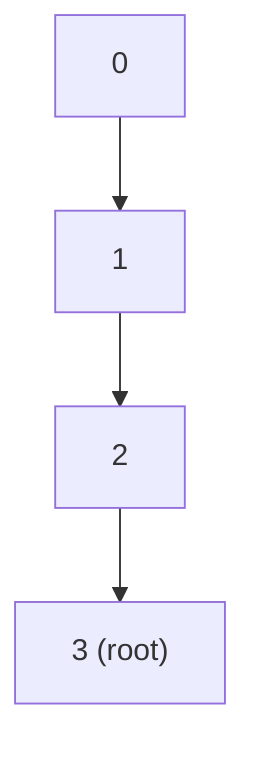

> **课程体系**：UC Berkeley CS61B: Data Structures (Spring 2024)  
> **所属模块**：Module 3: 算法渐进复杂度与不相交集 (Asymptotics & Disjoint Sets)  
> **主讲教师**：Prof. Justin Yokota & Prof. Peyrin Kao (UC Berkeley)  
> **视频时长**：51:00 ｜ **官方原版**：Lecture 14 - Disjoint Sets  
> **视频直达**：[📺 在 B 站观看本讲原视频 (P14)](https://www.bilibili.com/video/BV1hJ4m1M7ZA/?p=14) ｜ [📑 官方课件 Slides (Google Presentation)](https://docs.google.com/presentation/d/18pzklQAvV94ODFpjeB60Rzj79wFHdkIB-ePWR_MeClk) ｜ [📖 官方教材章节](https://cs61b-2.gitbook.io/cs61b-textbook/14.-disjoint-sets)  
> **快速导航**：[← 上一讲 (P13 期中核心串讲与复习实战)](/notes/cs61b/lecture-13) ｜ [📚 返回全书目录](/notes/topics/CS61B) ｜ [下一讲 (P15 并查集进阶与渐进分析 II) →](/notes/cs61b/lecture-15)

---

## 1. 动态连通性问题（Dynamic Connectivity）

*(参考时间：00:02:20 · [视频跳转 (P14 00:02:20)](https://www.bilibili.com/video/BV1hJ4m1M7ZA/?p=14&t=140))*

在现实网络系统中，我们经常需要处理动态连通性判定：
- 社交网络中两个人之间是否存在好友链路？
- 计算机局域网中两台主机是否彼此可达？
- 芯片电路中的两个引脚是否导通？

我们将其抽象为**不相交集（Disjoint Sets，俗称并查集）ADT**。它管理一组元素，每个元素初始属于独立的单元素集合，支持两大核心操作：
1. `connect(p, q)`：将包含 $p$ 和 $q$ 的两个集合合并为一个连通集合；
2. `isConnected(p, q)`：判断 $p$ 和 $q$ 是否处于同一个连通分量中。

## 2. 方案一：Quick-Find 算法与瓶颈

*(参考时间：00:12:40 · [视频跳转 (P14 00:12:40)](https://www.bilibili.com/video/BV1hJ4m1M7ZA/?p=14&t=760))*

最直观的想法是用一个一维数组 `int[] id`，其中 `id[i]` 表示元素 $i$ 所属的集合编号：

```java
public class QuickFindDS implements DisjointSets {
    private int[] id;

    public QuickFindDS(int N) {
        id = new int[N];
        for (int i = 0; i < N; i++) {
            id[i] = i; // 初始每个元素自成一派
        }
    }

    public boolean isConnected(int p, int q) {
        return id[p] == id[q]; // 极速 O(1) 判定！
    }

    public void connect(int p, int q) {
        int pid = id[p];
        int qid = id[q];
        // 痛点：必须完整扫描整张数组，把所有等于 pid 的项修改为 qid！
        for (int i = 0; i < id.length; i++) {
            if (id[i] == pid) {
                id[i] = qid;
            }
        }
    }
}
```

**性能瓶颈**：  
虽然 `isConnected` 是常数时间 $\Theta(1)$，但 `connect` 每次都要遍历全数组，耗时为 $\Theta(N)$！连续执行 $N$ 次合并将耗费 $\Theta(N^2)$，在海量节点下完全不可行！

## 3. 方案二：Quick-Union 算法与树形森林

*(参考时间：00:24:15 · [视频跳转 (P14 00:24:15)](https://www.bilibili.com/video/BV1hJ4m1M7ZA/?p=14&t=1455))*

为了加速合并操作，我们改变数组元素的物理含义：**将集合表示为一棵树，数组存放父节点的索引（Parent Pointer）！**

- 数组 `int[] parent`：`parent[i]` 存放节点 $i$ 的父节点索引；
- 根节点的父指针存放负数（如 `-1`），代表自己就是这棵树的树根；
- 两个节点连通，当且仅当它们**拥有完全相同的树根节点**！

```java
public class QuickUnionDS implements DisjointSets {
    private int[] parent;

    public QuickUnionDS(int N) {
        parent = new int[N];
        for (int i = 0; i < N; i++) {
            parent[i] = -1; // 初始都是孤立树根
        }
    }

    // 顺着父指针一路攀爬到树根
    private int root(int p) {
        while (parent[p] >= 0) {
            p = parent[p];
        }
        return p;
    }

    public boolean isConnected(int p, int q) {
        return root(p) == root(q);
    }

    public void connect(int p, int q) {
        int rootP = root(p);
        int rootQ = root(q);
        if (rootP != rootQ) {
            parent[rootP] = rootQ; // 将 p 的根直接挂到 q 的根下方！
        }
    }
}
```

## 4. Quick-Union 的退化危机：高瘦树陷阱

*(参考时间：00:36:20 · [视频跳转 (P14 00:36:20)](https://www.bilibili.com/video/BV1hJ4m1M7ZA/?p=14&t=2180))*

在 Quick-Union 中，`connect` 操作本身只需要修改一个指针（$O(1)$），但它必须先调用 `root()` 找到根节点。

如果使用者按顺序执行 `connect(0, 1)`, `connect(1, 2)`, `connect(2, 3)` ...  
树将会退化成一条细长的单向链表，树深达到 $N$！



此时每次查找根节点都要攀爬 $N$ 步，**`isConnected` 和 `connect` 在最坏情况下双双退化为 $\Theta(N)$！**

## 5. 本讲小结与算法对比

*(参考时间：00:46:50 · [视频跳转 (P14 00:46:50)](https://www.bilibili.com/video/BV1hJ4m1M7ZA/?p=14&t=2810))*

| 算法实现 | 构造函数 | `isConnected` 查询 | `connect` 合并 |
| :--- | :---: | :---: | :---: |
| **Quick-Find** | $\Theta(N)$ | $\Theta(1)$ | $\Theta(N)$ |
| **Quick-Union** | $\Theta(N)$ | $O(N)$ (受树高制约) | $O(N)$ (受树高制约) |

下一讲我们将看到如何通过**加权合并**与**路径压缩**，将树高彻底压制到令人难以置信的绝对常数水平！

---

## 课程导航与跳转

| 上一讲 | 目录 | 下一讲 | 原视频 |
| :--- | :---: | :--- | :--- |
| [← 上一讲：期中核心串讲与复习实战](/notes/cs61b/lecture-13) | [📚 返回 CS61B 全书目录](/notes/topics/CS61B) | [下一讲：并查集进阶与渐进分析 II →](/notes/cs61b/lecture-15) | [🎬 在 B 站观看本讲 (P14)](https://www.bilibili.com/video/BV1hJ4m1M7ZA/?p=14) |
