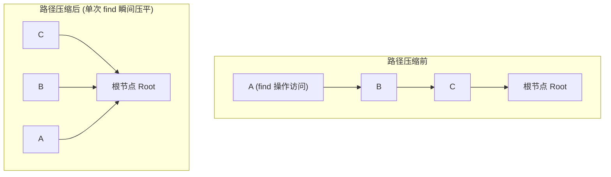

> **课程体系**：UC Berkeley CS61B: Data Structures (Spring 2024)  
> **所属模块**：Module 3: 算法渐进复杂度与不相交集 (Asymptotics & Disjoint Sets)  
> **主讲教师**：Prof. Justin Yokota & Prof. Peyrin Kao (UC Berkeley)  
> **视频时长**：53:18 ｜ **官方原版**：Lecture 15 - Disjoint Sets + Asymptotics 2  
> **视频直达**：[📺 在 B 站观看本讲原视频 (P15)](https://www.bilibili.com/video/BV1hJ4m1M7ZA/?p=15) ｜ [📑 官方课件 Slides (Google Presentation)](https://docs.google.com/presentation/d/1zlmNjzu42WAEmyJFG2tYRZJIguExSFq5B__equ3-GaM) ｜ [📖 官方教材章节](https://cs61b-2.gitbook.io/cs61b-textbook/15.-asymptotics-ii)  
> **快速导航**：[← 上一讲 (P14 不相交集：动态连通性与 Quick-Union)](/notes/cs61b/lecture-14) ｜ [📚 返回全书目录](/notes/topics/CS61B) ｜ [下一讲 (P16 二叉搜索树：ADT 抽象与树形检索) →](/notes/cs61b/lecture-16)

---

## 1. 规避树退化：加权快速合并（Weighted Quick-Union, WQU）

*(参考时间：00:02:15 · [视频跳转 (P15 00:02:15)](https://www.bilibili.com/video/BV1hJ4m1M7ZA/?p=15&t=135))*

Quick-Union 退化的根本原因在于**盲目合并**：随意把大树挂在小树下面，导致整体树高疯狂增长。

加权合并（Weighted Quick-Union, WQU）确立了一条铁律：
> **永远将较小规模的树挂在较大规模的树的根节点下方！**  
> 只有当两棵树合并时，小树所有节点的深度才会加 1；而大树上所有节点的深度完全保持不变！

为了记录每棵树的规模，我们可以巧妙地利用根节点的 `parent[root]` 槽位：  
用**负数存储该树包含的节点总数**（例如 `-5` 表示自身是根节点，且旗下共有 5 个节点）。

## 2. 树高上界的数学证明：严格保证 O(log N)

*(参考时间：00:13:40 · [视频跳转 (P15 00:13:40)](https://www.bilibili.com/video/BV1hJ4m1M7ZA/?p=15&t=820))*

**定理**：包含 $N$ 个节点的加权快速合并（WQU）树，其树高最大不超过 $\lfloor \log_2 N \rfloor + 1$。

**精妙数学归纳**：
- 节点 $x$ 的深度要想从 $d$ 增加到 $d + 1$，包含 $x$ 的树 $T_1$ 必须被合并到另一棵树 $T_2$ 之下；
- 根据加权规则，必然要求 $Size(T_2) \ge Size(T_1)$；
- 此时合并后的新树规模至少为 $Size(T_1) + Size(T_2) \ge 2 \cdot Size(T_1)$！
- 即：**节点的深度每增加 1，其所在树的规模至少翻一倍！**

规模翻倍最多能发生几次？由 $2^k \le N$ 得 $k \le \log_2 N$。  
因此树高被死死限制在 $O(\log N)$ 之内！

## 3. 终极杀招：路径压缩（Path Compression）

*(参考时间：00:25:30 · [视频跳转 (P15 00:25:30)](https://www.bilibili.com/video/BV1hJ4m1M7ZA/?p=15&t=1530))*

既然查询根节点时已经花费时间把路径上的节点全部走了一遍，为什么不顺手把这些节点**直接挂到最终根节点下面**呢？这就是**路径压缩（Path Compression）**！



只需要在递归 `root()` 方法中追加极度简短的一行赋值：
```java
private int root(int p) {
    if (parent[p] < 0) {
        return p;
    }
    // 递归赋值：把当前节点直接挂到真正的根节点上！
    parent[p] = root(parent[p]);
    return parent[p];
}
```

## 4. 复杂度极境：反阿克曼函数 alpha(N)

*(参考时间：00:37:10 · [视频跳转 (P15 00:37:10)](https://www.bilibili.com/video/BV1hJ4m1M7ZA/?p=15&t=2230))*

结合了加权合并（WQU）与路径压缩（Path Compression）的并查集算法，其单次操作的平摊时间复杂度为：
$$\Theta(\alpha(N))$$

其中 $\alpha(N)$ 是著名的**反阿克曼函数（Inverse Ackermann Function）**。阿克曼函数的增长速度之凶猛甚至超越了阶乘和超指数运算：
- $A(1) = 2$
- $A(2) = 4$
- $A(3) = 16$
- $A(4) = 2^{65536}$（这个数字已经远超全宇宙所有基本粒子的总和 $10^{80}$！）

因此，对于现实世界中任何可以想象的输入规模 $N$，**$\alpha(N)$ 的值永远不会超过 4**！  
在所有工程实践中，我们可以自信地将 WQU with Path Compression 视作**真正的常数时间 $O(1)$ 算法**。

## 5. 本讲小结与并查集全版本大决战

*(参考时间：00:47:00 · [视频跳转 (P15 00:47:00)](https://www.bilibili.com/video/BV1hJ4m1M7ZA/?p=15&t=2820))*

| 版本名称 | 数据结构核心 | `connect` 合并耗时 | `isConnected` 查询耗时 |
| :--- | :--- | :---: | :---: |
| **Quick-Find** | 扁平编号数组 | $\Theta(N)$ | $\Theta(1)$ |
| **Quick-Union** | 父指针树林 | $O(N)$ (最坏退化) | $O(N)$ (最坏退化) |
| **Weighted QU (WQU)** | 按规模加权合并 | $O(\log N)$ | $O(\log N)$ |
| **WQU + Path Compression** | 加权合并 + 路径压平 | $\Theta(\alpha(N)) \approx O(1)$ | $\Theta(\alpha(N)) \approx O(1)$ |

---

## 课程导航与跳转

| 上一讲 | 目录 | 下一讲 | 原视频 |
| :--- | :---: | :--- | :--- |
| [← 上一讲：不相交集：动态连通性与 Quick-Union](/notes/cs61b/lecture-14) | [📚 返回 CS61B 全书目录](/notes/topics/CS61B) | [下一讲：二叉搜索树：ADT 抽象与树形检索 →](/notes/cs61b/lecture-16) | [🎬 在 B 站观看本讲 (P15)](https://www.bilibili.com/video/BV1hJ4m1M7ZA/?p=15) |
