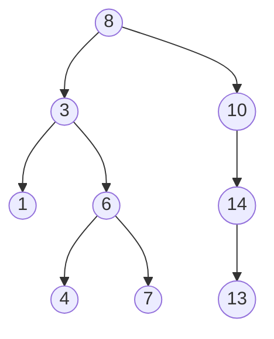

> **课程体系**：UC Berkeley CS61B: Data Structures (Spring 2024)  
> **所属模块**：Module 4: 树结构与散列表 (Search Trees & Hashing)  
> **主讲教师**：Prof. Justin Yokota & Prof. Peyrin Kao (UC Berkeley)  
> **视频时长**：50:58 ｜ **官方原版**：Lecture 16 - BST 1  
> **视频直达**：[📺 在 B 站观看本讲原视频 (P16)](https://www.bilibili.com/video/BV1hJ4m1M7ZA/?p=16) ｜ [📑 官方课件 Slides (Google Presentation)](https://docs.google.com/presentation/d/1tAXgjwVKsnH7AR-iCvkDM-rQFwrg4OnKVZzqPixZWI8) ｜ [📖 官方教材章节](https://cs61b-2.gitbook.io/cs61b-textbook/16.-adts-and-bsts)  
> **快速导航**：[← 上一讲 (P15 并查集 II：加权并查集、路径压缩与均摊分析)](/notes/cs61b/lecture-15) ｜ [📚 返回全书目录](/notes/topics/CS61B) ｜ [下一讲 (P17 树结构 II：B 树与 2-3 树的绝对自平衡哲学) →](/notes/cs61b/lecture-17)

---

## 1. 抽象数据类型（ADT）的双子星：Set（集合）与 Map（字典）

*(参考时间：00:01:20 · [视频跳转 (P16 00:01:20)](https://www.bilibili.com/video/BV1hJ4m1M7ZA/?p=16&t=80))*

在深入树结构之前，我们先审视现代软件中最频繁使用的两大抽象数据类型（ADT）：

### 1. Set（集合）
- 形式化契约：一组不包含任何重复元素的无序或有序集合；
- 核心操作：`add(x)`、`contains(x)`、`remove(x)`。

### 2. Map（映射 / 字典 / 关联数组）
- 形式化契约：存储键值对（Key-Value Pairs），每个唯一的键对应一个值；
- 核心操作：`put(key, val)`、`get(key)`、`containsKey(key)`。

### 线性结构的性能困境
- **链表（DLList）**：插入头部虽然快（$O(1)$），但查找元素必须线性遍历，耗时 $\Theta(N)$；
- **有序数组（Sorted Array）**：借助二分查找（Binary Search），查找元素可以达到极速的 $\Theta(\log N)$！  
  **但是：在有序数组中插入一个新元素，必须将插入点之后的所有元素全部向后平移一位，耗时仍然是极其缓慢的 $\Theta(N)$**！

我们是否能够设计一种既能享受二分查找的 $\Theta(\log N)$ 极速检索，又能像链表一样在 $\Theta(1)$ 局部指针重接完成动态插入的数据结构？  
**答案就是二叉搜索树（Binary Search Tree, BST）！**

## 2. 二叉搜索树（BST）的形式化定义与结构不变量

*(参考时间：00:09:40 · [视频跳转 (P16 00:09:40)](https://www.bilibili.com/video/BV1hJ4m1M7ZA/?p=16&t=580))*

一棵**二叉树（Binary Tree）**是由节点组成的有限层次集合，每个节点至多拥有两个子节点（分别称为左子节点和右子节点）。

### 二叉搜索树（BST）的核心不变量
> **BST 结构定理**：  
> 对于树中的任意节点 $X$：  
> 1. 其**左子树（Left Subtree）中的所有节点的键值，都严格小于（$<$）节点 $X$ 的键值**；  
> 2. 其**右子树（Right Subtree）中的所有节点的键值，都严格大于（$>$）节点 $X$ 的键值**；  
> 3. 它的左子树和右子树本身也必须是合法的二叉搜索树。



### 中序遍历（In-order Traversal）的数学奇迹
如果你对一棵二叉搜索树执行**中序遍历**（左子树 $\to$ 当前根节点 $\to$ 右子树）：
输出的序列必定是**严格单调递增的有序序列**！
- 对上图执行中序遍历：`1, 3, 4, 6, 7, 8, 10, 13, 14`。

## 3. 核心操作实现：`find(key)` 与 `insert(key)` 递归算法

*(参考时间：00:17:30 · [视频跳转 (P16 00:17:30)](https://www.bilibili.com/video/BV1hJ4m1M7ZA/?p=16&t=1050))*

BST 的拓扑结构是天生递归的，因此其核心算法可以用极度对称优美的递归代码实现：

```java
public class BST<Key extends Comparable<Key>, Value> {
    private class Node {
        private Key key;
        private Value val;
        private Node left, right;

        public Node(Key k, Value v) {
            key = k;
            val = v;
        }
    }

    private Node root;

    /** 检索操作 */
    public Value get(Key key) {
        return get(root, key);
    }

    private Value get(Node x, Key key) {
        if (x == null) return null;
        int cmp = key.compareTo(x.key);
        if (cmp < 0) {
            return get(x.left, key);  // 往左找
        } else if (cmp > 0) {
            return get(x.right, key); // 往右找
        } else {
            return x.val;             // 命中！
        }
    }

    /** 插入操作：永远返回更新后的子树根节点 */
    public void put(Key key, Value val) {
        root = put(root, key, val);
    }

    private Node put(Node x, Key key, Value val) {
        if (x == null) return new Node(key, val); // 到底空位，诞生新节点
        int cmp = key.compareTo(x.key);
        if (cmp < 0) {
            x.left = put(x.left, key, val);
        } else if (cmp > 0) {
            x.right = put(x.right, key, val);
        } else {
            x.val = val; // 键已存在，更新值
        }
        return x;
    }
}
```

## 4. 节点删除操作的终极挑战：Hibbard Deletion 算法

*(参考时间：00:26:15 · [视频跳转 (P16 00:26:15)](https://www.bilibili.com/video/BV1hJ4m1M7ZA/?p=16&t=1575))*

在 BST 中，删除节点（`delete`）是最复杂的逻辑，因为删除某个节点后，必须重新拼接树枝，并确保 BST 的大小顺序不变量绝对不受破坏。

Thomas Hibbard 在 1962 年提出了经典的 **Hibbard Deletion 算法**，按被删除节点的孩子数量分为三类场景：

### 场景一：被删除节点是叶子节点（0 个孩子）
- 最简单！直接将其父节点指向它的指针置为 `null` 即可。

### 场景二：被删除节点只有 1 个孩子（单亲家庭）
- 让被删除节点的父节点，直接越过该节点，指向其唯一的孩子节点。

```text
    P                 P
    |                 |
  [Del]     ===>      C
    |
    C
```

### 场景三：被删除节点同时拥有 2 个孩子（最棘手！）
如果节点 $X$ 同时有左孩子和右孩子，删除 $X$ 之后，应该由谁来继承 $X$ 的王位？  
**答案：必须由全局最接近 $X$ 大小的节点来顶替！**  
通常选择 **$X$ 的中序后继（Inorder Successor）——即 $X$ 的右子树中的最小节点**！

```java
public void delete(Key key) {
    root = delete(root, key);
}

private Node delete(Node x, Key key) {
    if (x == null) return null;
    int cmp = key.compareTo(x.key);
    if (cmp < 0)      x.left = delete(x.left, key);
    else if (cmp > 0) x.right = delete(x.right, key);
    else {
        // 场景 1 & 2：只有 0 或 1 个孩子
        if (x.right == null) return x.left;
        if (x.left == null)  return x.right;

        // 场景 3：拥有 2 个孩子
        Node t = x;
        x = min(t.right); // 找到右子树中的最小值（中序后继）
        x.right = deleteMin(t.right); // 删掉原来的后继，并作为 x 的新右子树
        x.left = t.left;              // 继承原来的左子树
    }
    return x;
}
```

## 5. 随机插入 vs 最坏情况退化分析：竹竿树的梦魇

*(参考时间：00:35:00 · [视频跳转 (P16 00:35:00)](https://www.bilibili.com/video/BV1hJ4m1M7ZA/?p=16&t=2100))*

BST 的操作性能完全取决于树的高度（Height $H$）：
- 在一棵完美的平衡 BST 中，树的高度约为 $\log_2 N$；
- 每次比较都能砍掉一半的搜索空间，`get` 和 `put` 的耗时为严格的 **$\Theta(\log N)$**。

### 极端退化灾难
然而，朴素 BST 的树形完全受制于**输入数据的到达顺序**！

假设我们按照升序依次插入数据：`1, 2, 3, 4, 5, 6, 7`：
```text
1
 \
  2
   \
    3
     \
      4 ...
```
树彻底退化为了一条单向链表！树高 $H = N$！  
此时，查找或插入一个元素的耗时退化为悲惨的 **$\Theta(N)$ 线性时间**。

### 为什么我们必须追求自平衡？
在实际业务中，数据经常是局部有序或批量导入的。朴素 BST 无法自我纠偏，为了保证对数性能，必须发明具有“自我平衡修复能力”的先进树结构！

## 6. 本讲小结与课后自测

*(参考时间：00:43:00 · [视频跳转 (P16 00:43:00)](https://www.bilibili.com/video/BV1hJ4m1M7ZA/?p=16&t=2580))*

### 课后综合自测题

#### 题目 1（BST 不变量辨析）
观察下列树形结构，判断它是否是一棵合法的 BST？
```text
      10
     /  \
    5    15
        /  \
       6    20
```
**答案与解析**：  
- **不是合法的 BST！**
- **致命陷阱**：虽然节点 6 小于其直接父节点 15（满足局部左孩子小于父节点），但节点 6 位于根节点 10 的**右子树内部**！
- BST 不变量要求：**根节点右子树中的每一个节点，都必须绝对严格大于根节点！** 由于 $6 < 10$，它出现在右子树中彻底摧毁了 BST 的全局不变量。

---

## 附录：UC Berkeley 官方教材深度研读 (Official Textbook In-Depth Chapters)

> **导读说明**：本节内容整合自 UC Berkeley CS61B 官方教材库（GitBook Textbook），针对本讲的核心数据结构与算法提供原汁原味的英文理论推导、形式化代码范例与配套章节习题，与前文视频精讲相互补充印证。

## 16. ADTs and BSTs

In this Chapter we will discuss:

* Abstract Data Types

* Binary Search Tree

* BST Definitions

* BST Operations

* Sets vs. Maps, Summary

Additionally the video playlist is one that accompanies this chapter is the following:

---

## 16.1 Abstract Data Types

An Abstract Data Type (ADT) is defined only by its operations, not by its implementation. 

For example in Project 1A, we developed an `ArrayDeque` and a `LinkedListDeque` that had the same methods, but how those methods were written was very different. In this case, we say that `ArrayDeque` and `LinkedListDeque` are *implementations* of the `Deque` ADT. 

From this description, we see that ADT's and interfaces are somewhat related. Conceptually, `Deque` is an interface for which `ArrayDeque` and `LinkedListDeque` are its implementations. In code, in order to express this relationship, we have the `ArrayDeque` and `LinkedListDeque` classes inherit from the `Deque` interface.

Some commonly used ADT's are:

* Stacks: Structures that support last-in first-out retrieval of elements

  * `push(int x)`: puts x on the top of the stack

  * `int pop()`: takes the element on the top of the stack

* **Lists**: an ordered set of elements

  * `add(int i)`: adds an element

  * `int get(int i)`: gets element at index i

* **Sets**: an unordered set of unique elements (no repeats)

  * `add(int i)`: adds an element

  * `contains(int i)`: returns a boolean for whether or not the set contains the value

* **Maps**: set of key/value pairs

  * `put(K key, V value)`: puts a key value pair into the map

  * `V get(K key)`: gets the value corresponding to the key

Note: the bolded ADT's are a subinterfaces of a bigger overarching interface called `Collections.`

Below we show the relationships between the interfaces and classes. Interfaces are in white, classes are in blue.

<figure><figcaption><p>Common interfaces in Java and their implementations</p></figcaption></figure>

ADT's allow us to make use of object oriented programming in an efficient and elegant way. For example, you saw in Project 1C how you can use an ArrayDeque or a LinkedListArrayDeque interchangeably because they are both part of the Deque ADT.

In the following chapters, we will work on defining some more ADT's and enumerating their different implementations.

---

## 16.2 Binary Search Trees

Linked Lists are great, but it takes a long time to search for an item, even if the list is sorted! What if the item is at the end of the list? That would take linear time!

We know that for an array, we can use binary search to find an element faster. Specifically, in $$\log n$$ time. For a short explanation of binary search, check out this [link](https://www.geeksforgeeks.org/binary-search/).

In binary search, we know the list is sorted, so we can use this information to narrow our search. First, we look at the middle element. If it is bigger than the element we are searching for, we look to the left of it. If it is smaller than the element we are searching for, we look to the right. We then look at the middle element of the respective halves and repeat the process until we find the element we are looking for (or don't find it because the list doesn't contain it).

But how do we run binary search for a linked list? We would have to traverse all the way to the middle in order to check the element there, which takes linear time just on its own!

One optimization we can implement is to have a reference to the middle node. This way, we can get to the middle in constant time. Then, if we flip the nodes' pointers, which allows us to traverse to both the left and right halves, we can decrease our runtime by half!

<figure><figcaption><p>A linked list with a middle pointer</p></figcaption></figure>

But we can further optimize by adding pointers to the middle of each recursive half like so. Now, if you stretch this structure vertically, you will see a tree! This specific tree is called a **binary tree** because each juncture splits in 2.

<figure><figcaption><p>A linked list with recursive middle pointers is a binary tree!</p></figcaption></figure>

---

## 16.3 BST Definitions

Trees are composed of nodes and edges that connect those nodes. 

**Constraint**: there is only one path between any two nodes.

In some trees, we select a **root** node which is a node that has no parents.

A tree also has **leaves**, which are nodes with no children.

In the picture below, the green structures are valid trees, while the pink structure is not (since it has a cycle).

<figure><figcaption><p>Examples of valid and invalid trees</p></figcaption></figure>

Relating this to the original tree structure we came up with earlier, we can now introduce new constraints to the already existing constraints. This creates more specific types of trees, two examples being Binary Trees and Binary Search Trees.

* **Binary Trees**: in addition to the above requirements, also hold the binary property constraint. That is, each node has either 0, 1, or 2 children.

* **Binary Search Trees**: in addition to all of the above requirements, also hold the property that For every node X in the tree:

  * Every key in the left subtree is less than X’s key.

  * Every key in the right subtree is greater than X’s key. \*\*Remember this property!! We will reference it a lot throughout the duration of this module and 61B.

<figure><figcaption><p>A valid BST: every key in the left subtree is smaller than its parent, and every key in the right subtree is larger.</p></figcaption></figure>

Here is the BST module we'll be using for the rest of this chapter:

```java

private class BST<Key> {

    private Key key;

    private BST left;

    private BST right;

    public BST(Key key, BST left, BST Right) {

        this.key = key;

        this.left = left;

        this.right = right;

    }

    public BST(Key key) {

        this.key = key;

    }

}

```

---

## 16.4 BST Operations

#### Search

To search for something, we employ binary search, which is made easy due to the BST property. 

We know that the BST is structured such that all elements to the right of a node are greater and all elements to the left are smaller. Knowing this, we can start at the root node and compare it with the element, X, that we are looking for. If X is greater to the root, we move on to the root's right child. If its smaller, we move on to the root's left child. We repeat this process recursively until we either find the item or we get to a leaf, in which case the tree does not contain the item.

```java

static BST find(BST T, Key sk) {

   if (T == null)

      return null;

   if (sk.equals(T.key))

      return T;

   else if (sk < T.key)

      return find(T.left, sk);

   else

      return find(T.right, sk);

}

```

If our tree is relatively "bushy", the find operation will run in $$\log n$$ time because the height of the tree is $$\log n$$.

#### Insert

We **always** insert at a leaf node!

First, we search in the tree for the node. If we find it, then we don't do anything. If we don't find it, we will be at a leaf node already. At this point, we can just add the new element to either the left or right of the leaf, preserving the BST property.

```java

static BST insert(BST T, Key ik) {

  if (T == null)

    return new BST(ik);

  if (ik < T.key)

    T.left = insert(T.left, ik);

  else if (ik > T.key)

    T.right = insert(T.right, ik);

  return T;

}

```

#### Delete

Deleting from a binary tree is a little bit more complicated because whenever we delete, we need to make sure we reconstruct the tree and still maintain its BST property. Let's break this problem down into three categories:

* the node we are trying to delete has no children

* has 1 child

* has 2 children

##### Deletion: No Children

If the node has no children, it is a leaf, and we can just delete its parent pointer and the node will eventually be swept away by the [garbage collector](https://stackoverflow.com/questions/3798424/what-is-the-garbage-collector-in-java).

##### Deletion: One Child

If the node only has one child, we know that the child maintains the BST property with the parent of the node because the property is recursive to the right and left subtrees. Therefore, we can just reassign the parent's child pointer to the node's child and the node will eventually be garbage collected.

##### Deletion: Two Children

If the node has two children, the process becomes a little more complicated because we can't just assign one of the children to be the new root. This might break the BST property.

Instead, we choose a new node to replace the deleted one.

We know that the new node must:

* be > than everything in left subtree.

* be < than everything right subtree.

In the below tree, we show which nodes would satisfy these requirements given that we are trying to delete the `dog` node.

<figure><figcaption><p>Possible candidates to replace <code>dog</code> after deletion</p></figcaption></figure>

To find these nodes, you can just take the right-most node in the left subtree or the left-most node in the right subtree. Then, we replace the `dog` node with either `cat` or `elf` and then remove the old `cat` or `elf` node.

This is called **Hibbard deletion**, and it gloriously maintains the BST property amidst a deletion.

---

## 16.5 BSTs as Sets and Maps

We can use a BST to implement the `Set` ADT. If we use a BST, we can decrease the runtime of `contains` to $$\log(n)$$ because of the BST property which enables us to use binary search!

We can also make a binary tree into a map by having each BST node hold `(key,value)` pairs instead of singular values. We will compare each element's key in order to determine where to place it within our tree.

---

## 16.6 Summary

Abstract data types (ADTs) are defined in terms of operations, not implementation.Several useful ADTs:

* Disjoint Sets, Map, Set, List.

* Java provides Map, Set, List interfaces, along with several implementations.

We’ve seen two ways to implement a Set (or Map):

* ArraySet: Θ(N) operations in the worst case.

* BST: Θ(logN) operations if tree is balanced.

BST Implementations:

* Search and insert are straightforward (but insert is a little tricky).

* Deletion is more challenging. Typical approach is “Hibbard deletion”.

---

## 16.7 Exercises

### Factual

1. What is the best and worst-case height of a BST?

<details>

<summary>Problem 1</summary>

If we insert everything in order, the worst-case height of $$\Theta(N)$$ results. In the best case of a perfectly balanced BST, the best-case height is $$\Theta(\log N)$$.

</details>

### Procedural

1. Suppose that a certain BST has keys that are integers between 1 and 10. During the search for 5, which of the following sequences of keys are possible?

   * [ ] 10, 9, 8, 7, 6, 5

   * [ ] 4, 10, 8, 7, 5, 3

   * [ ] 1, 10, 2, 9, 3, 8, 4, 7, 6, 5

   * [ ] 1, 2, 6, 8, 9, 5

2. Consider the below BST. What is the result after deleting 4 using Hibbard deletion, choosing the sucessor as the replacement?

<figure><figcaption></figcaption></figure>

3. Suppose we implement the Stack ADT using an array. What is the worst case runtime of a `push` operation with this underlying data structure?

<details>

<summary>Problem 1</summary>

* [x] `10, 9, 8, 7, 6, 5`: possible; this is the situation where we have a worst-case linear BST.

* [ ] `4, 10, 8, 7, 5, 3`: not possible; we terminate our search once we reach the desired node.

* [x] `1, 10, 2, 9, 3, 8, 4, 7, 6, 5`: possible; the idea is that we should always search in the correct "direction" of our target node. If our target node is greater than our current node, then we should go to the right, and our next node should be larger. If our target node is less than our current node, then we should go to the left, and our next node should be smaller.

* [ ] `1, 2, 6, 8, 9, 5`: not possible; note that this violates the constraint described above. When we reach `8`, we should move to its left branch since our target node `5` is smaller, so we would never search `9`.

</details>

<details>

<summary>Problem 2</summary>


</details>

<details>

<summary>Problem 3</summary>

The worst-case runtime is $$\Theta(N)$$, since a `push` might cause us to resize the underlying array.

</details>

### Metacognitive

1. If inserting our data into a BST in random order yields $$\log N$$ height with high probability, why don't we just shuffle our data before inserting into the BST?

2. When we do Hibbard deletion from a BST, we always choose the successor as a replacement. The successor is guaranteed to only have zero or one child--why?

<details>

<summary>Problem 1</summary>

Often in real-world applications, we don't have all our data at once. For example, imagine you're collecting time-based data that you insert into a BST each time a new value is reported. There is no easy way to shuffle your data when you only get one or a few points at a time.

</details>

<details>

<summary>Problem 2</summary>

By definition, the successor is the maximum value in the subtree. Suppose, for the sake of contradiction, that the sucessor had two children. Then, it is not the maximum, since it is less than its right child. This is a contradiction, since we said the sucessor is the maximum value in the subtree. As such, the successor is guaranteed to have one child or less (if it has one child, it is its left child). Previous 16.6 Summary Next 17. Tree Traversals and Graphs

</details>


---

## 课程导航与跳转

| 上一讲 | 目录 | 下一讲 | 原视频 |
| :--- | :---: | :--- | :--- |
| [← 上一讲：并查集 II：加权并查集、路径压缩与均摊分析](/notes/cs61b/lecture-15) | [📚 返回 CS61B 全书目录](/notes/topics/CS61B) | [下一讲：树结构 II：B 树与 2-3 树的绝对自平衡哲学 →](/notes/cs61b/lecture-17) | [🎬 在 B 站观看本讲 (P16)](https://www.bilibili.com/video/BV1hJ4m1M7ZA/?p=16) |
