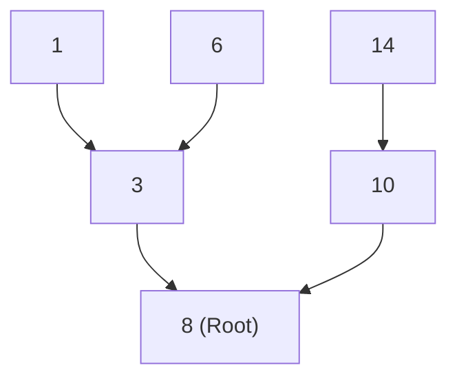
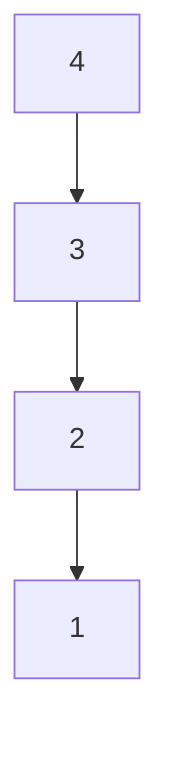

> **课程体系**：UC Berkeley CS61B: Data Structures (Spring 2024)  
> **所属模块**：Module 4: 树结构与散列表 (Search Trees & Hashing)  
> **主讲教师**：Prof. Justin Yokota & Prof. Peyrin Kao (UC Berkeley)  
> **视频时长**：50:58 ｜ **官方原版**：Lecture 16 - BST 1  
> **视频直达**：[📺 在 B 站观看本讲原视频 (P16)](https://www.bilibili.com/video/BV1hJ4m1M7ZA/?p=16) ｜ [📑 官方课件 Slides (Google Presentation)](https://docs.google.com/presentation/d/1tAXgjwVKsnH7AR-iCvkDM-rQFwrg4OnKVZzqPixZWI8) ｜ [📖 官方教材章节](https://cs61b-2.gitbook.io/cs61b-textbook/16.-adts-and-bsts)  
> **快速导航**：[← 上一讲 (P15 并查集进阶与渐进分析 II)](/notes/cs61b/lecture-15) ｜ [📚 返回全书目录](/notes/topics/CS61B) ｜ [下一讲 (P17 平衡树：2-3 树与 2-3-4 树) →](/notes/cs61b/lecture-17)

---

## 1. 抽象数据类型（ADT）：Set 与 Map

*(参考时间：00:02:15 · [视频跳转 (P16 00:02:15)](https://www.bilibili.com/video/BV1hJ4m1M7ZA/?p=16&t=135))*

在深入具体数据结构之前，先确立高层行为抽象：
- **Set（集合）**：只允许存放互不重复的唯一元素集合，核心操作为 `add(x)` 和 `contains(x)`；
- **Map（映射 / 字典）**：维护键值对（Key-Value Pair）的关联关系，核心操作为 `put(key, value)` 和 `get(key)`。

之前我们基于有序数组实现的二分查找虽然可以在 $O(\log N)$ 时间内检索，但在中间插入或删除元素必须平移数组，耗时为 $\Theta(N)$。链表虽然能实现 $O(1)$ 局部插入，但查找必须逐个遍历（$O(N)$）。我们需要一种**兼具快速查找与快速插入**的数据结构：**二叉搜索树（Binary Search Tree, BST）**。

## 2. 二叉搜索树（BST）的结构不变性（Invariants）

*(参考时间：00:11:40 · [视频跳转 (P16 00:11:40)](https://www.bilibili.com/video/BV1hJ4m1M7ZA/?p=16&t=700))*

一棵二叉搜索树是由节点构成的分层树形结构，每个节点包含一个键（Key），以及左孩子指针 `left` 和右孩子指针 `right`。

**BST 的核心结构不变性**：
> 对于树中的任意节点 $X$：
> 1. $X$ 的**左子树**中的所有节点的键值，都严格**小于** $X$ 的键值；
> 2. $X$ 的**右子树**中的所有节点的键值，都严格**大于** $X$ 的键值；
> 3. $X$ 的左右子树各自本身又是一棵合法的二叉搜索树。



## 3. BST 核心操作：查找（find）与插入（insert）

*(参考时间：00:23:20 · [视频跳转 (P16 00:23:20)](https://www.bilibili.com/video/BV1hJ4m1M7ZA/?p=16&t=1400))*

利用 BST 的有序性质，查找过程天然如同二分查找：

### 递归查找 `find(BST T, Key sk)`
```java
static BST find(BST T, Key sk) {
    if (T == null) {
        return null; // 未命中，键不存在
    }
    int cmp = sk.compareTo(T.key);
    if (cmp == 0) return T;
    else if (cmp < 0) return find(T.left, sk);
    else return find(T.right, sk);
}
```

### 递归插入 `insert(BST T, Key ik)`
> **黄金法则**：新节点永远被插入在整棵树的**叶子空缺位置（Leaf Level）**，原有树形骨架保持不变！

```java
static BST insert(BST T, Key ik) {
    if (T == null) {
        return new BST(ik);
    }
    int cmp = ik.compareTo(T.key);
    if (cmp < 0) T.left = insert(T.left, ik);
    else if (cmp > 0) T.right = insert(T.right, ik);
    return T;
}
```

## 4. 树形退化危机：高瘦树的 $\Theta(N)$ 梦魇

*(参考时间：00:35:45 · [视频跳转 (P16 00:35:45)](https://www.bilibili.com/video/BV1hJ4m1M7ZA/?p=16&t=2145))*

BST 的运行时间完全取决于**树的高度（Height）**：
- 如果树保持完全平衡（形如饱满的金字塔），树高为 $\Theta(\log N)$，单次操作耗时仅为对数级别；
- **但是，普通 BST 的树形极度脆弱，完全依赖于键的插入顺序！**

如果我们按从小到大的升序顺序插入数据：`1, 2, 3, 4, 5, 6, 7`：  
每个新节点都会作为右孩子挂入，整棵树退化为一条笔直的单向链表，树高达到 $N$！



此时的 BST 不仅没能提供对数检索，反而白白浪费了树形指针的内存开销。

## 5. 本讲小结与平衡之道伏笔

*(参考时间：00:46:15 · [视频跳转 (P16 00:46:15)](https://www.bilibili.com/video/BV1hJ4m1M7ZA/?p=16&t=2775))*

- **中序遍历（In-order Traversal）**：对 BST 执行 `左 -> 根 -> 右` 递归遍历，输出的键必然是严格升序排列的！
- **最坏情况防范**：为了防止极端插入顺序引发的性能雪崩，计算机科学家必须设计能够**自我平衡（Self-Balancing）**的树结构。这正是接下来 2-3 树与红黑树的辉煌舞台！

---

## 课程导航与跳转

| 上一讲 | 目录 | 下一讲 | 原视频 |
| :--- | :---: | :--- | :--- |
| [← 上一讲：并查集进阶与渐进分析 II](/notes/cs61b/lecture-15) | [📚 返回 CS61B 全书目录](/notes/topics/CS61B) | [下一讲：平衡树：2-3 树与 2-3-4 树 →](/notes/cs61b/lecture-17) | [🎬 在 B 站观看本讲 (P16)](https://www.bilibili.com/video/BV1hJ4m1M7ZA/?p=16) |
