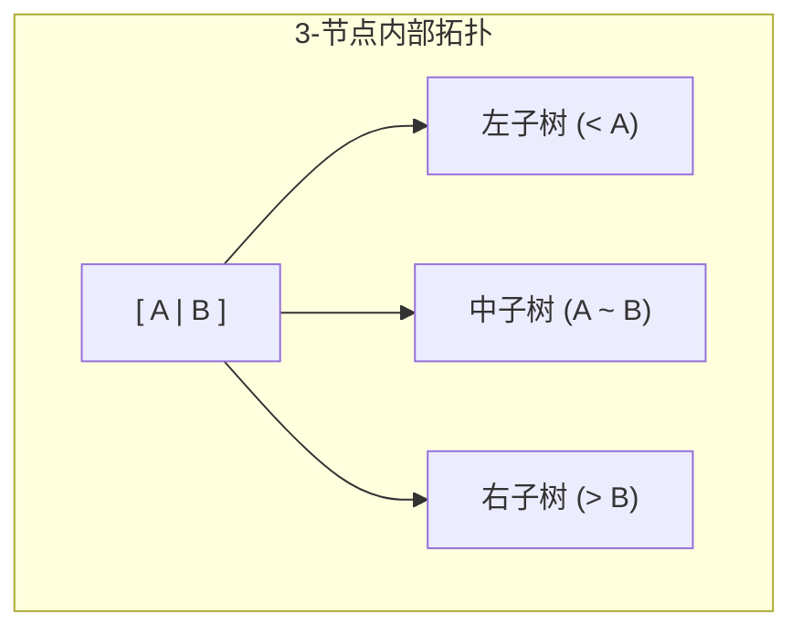
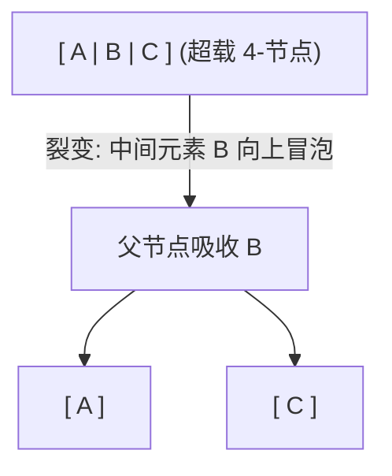

> **课程体系**：UC Berkeley CS61B: Data Structures (Spring 2024)  
> **所属模块**：Module 4: 树结构与散列表 (Search Trees & Hashing)  
> **主讲教师**：Prof. Justin Yokota & Prof. Peyrin Kao (UC Berkeley)  
> **视频时长**：51:27 ｜ **官方原版**：Lecture 17 - B-Trees (2-3 2-3-4 Trees)  
> **视频直达**：[📺 在 B 站观看本讲原视频 (P17)](https://www.bilibili.com/video/BV1hJ4m1M7ZA/?p=17) ｜ [📑 官方课件 Slides (Google Presentation)](https://docs.google.com/presentation/d/1uQYk0Hxhf0jhnp-aXxoIGNGM2w_yILMyukRctRPc9Uo) ｜ [📖 官方教材章节](https://cs61b-2.gitbook.io/cs61b-textbook/17.-b-trees)  
> **快速导航**：[← 上一讲 (P16 树结构 I：二叉搜索树、操作实现与 Hibbard 删除)](/notes/cs61b/lecture-16) ｜ [📚 返回全书目录](/notes/topics/CS61B) ｜ [下一讲 (P18 树结构 III：左倾红黑树（LLRB）与等价同构映射) →](/notes/cs61b/lecture-18)

---

## 1. 自平衡的破局之道：绝不允许树向下生长！

*(参考时间：00:01:30 · [视频跳转 (P17 00:01:30)](https://www.bilibili.com/video/BV1hJ4m1M7ZA/?p=17&t=90))*

在上一讲中，我们看到朴素 BST 退化的根本原因在于：**新节点总是作为叶子节点，盲目地向下追加悬挂**。输入数据一旦有序，树枝就会越挂越长，最终变成线性链条。

计算机科学大师 Rudolf Bayer 提出了一个逆向颠覆思维：
> **自平衡树终极哲学**：  
> **当插入新数据时，绝不向下开辟新的叶子节点！新数据必须直接塞入已有的叶子节点内部！**  
> **树只能且必须“向上生长（Grow Upwards）”！**

## 2. 2-3 树（2-3 Trees）的形式化规范与节点结构

*(参考时间：00:10:15 · [视频跳转 (P17 00:10:15)](https://www.bilibili.com/video/BV1hJ4m1M7ZA/?p=17&t=615))*

为了容纳多个数据项，2-3 树打破了“一个节点只能存一个值”的桎梏，允许存在两种合法的节点形态：

### 1. 2-节点（2-Node）
- 内部容纳 **1 个键值**；
- 拥有 **2 个孩子分支**（左孩子的值 $<$ 键值 $<$ 右孩子的值）。本质与标准 BST 节点完全一致。

### 2. 3-节点（3-Node）
- 内部容纳 **2 个键值**（按升序记为 $A$ 和 $B$）；
- 拥有 **3 个孩子分支**：
  - 左子树的所有值 $< A$；
  - 中子树的所有值介于 $A$ 和 $B$ 之间（$A < \text{Middle} < B$）；
  - 右子树的所有值 $> B$。

## 3. 2-3 树插入全流程推演：过载与裂变（Overstuffing & Splitting）

*(参考时间：00:19:00 · [视频跳转 (P17 00:19:00)](https://www.bilibili.com/video/BV1hJ4m1M7ZA/?p=17&t=1140))*

让我们通过一个完整案例，观察 2-3 树是如何在插入过程中始终保持完美平衡的：

### 步骤 1：插入到 2-节点
- 如果新元素落入一个现有的 2-节点，直接将其吸纳，该节点就地升级为一个 **3-节点**！
- 树的高度分毫未变。

### 步骤 2：插入到 3-节点（触发临时 4-节点）
- 如果新元素落入一个现有的 3-节点，节点暂时容纳了 3 个键值，成为一个非法的 **4-节点 `[A, B, C]`**；
- **裂变规则（Splitting Rule）**：
  1. 中间大小的元素 $B$ **向上冒泡，推入父节点中**；
  2. 较小的元素 $A$ 独立为一个 2-节点（作为 $B$ 的左孩子）；
  3. 较大的元素 $C$ 独立为一个 2-节点（作为 $B$ 的右孩子）。

### 步骤 3：根节点裂变——树向上生长的唯一时刻
如果裂变沿着树一路向上传导，最终导致**根节点也变成了 4-节点**：
- 根节点发生裂变，中间元素孤身一人成为全新的树根！
- **整个树的所有分支，高度同步均匀增加 1**！

## 4. 绝对完美平衡定理：为什么 2-3 树的叶子深度永远完全相等？

*(参考时间：00:28:40 · [视频跳转 (P17 00:28:40)](https://www.bilibili.com/video/BV1hJ4m1M7ZA/?p=17&t=1720))*

> **2-3 树完美平衡定理**：  
> **在一棵合法的 2-3 树中，从根节点出发到达任意一个叶子节点的路径长度，绝对严格相等！**

### 证明要点：
1. 插入新元素时，要么直接在叶子节点吸收，树高不变；
2. 要么叶子节点分裂，将中间元素推给父节点，叶子本身的绝对深度不变；
3. 树高度发生变化的唯一可能，是根节点裂变催生出新的全局祖先根节点；
4. 当根节点向上分裂时，所有现存的子树同时作为新根的子节点被向下挂载，**所有叶子节点的深度在同一时刻同步加 1**！

因此，2-3 树永远不可能出现一侧长、一侧短的偏斜退化！其树高在最坏情况下（全部为 2-节点）为 $\log_2 N$，在最好情况下（全部为 3-节点）为 $\log_3 N$。单次查找和插入耗时严格为 **$\Theta(\log N)$**！

## 5. B 树在现代工业数据库与文件系统中的伟大应用

*(参考时间：00:36:20 · [视频跳转 (P17 00:36:20)](https://www.bilibili.com/video/BV1hJ4m1M7ZA/?p=17&t=2180))*

2-3 树是 **B 树（B-Tree）** 理论在最小分支因子下的特例（阶数 $M = 3$）。

在现代工业数据库（MySQL InnoDB、Oracle、PostgreSQL）以及操作系统文件系统（Linux ext4、macOS APFS）中，数据的持久化存储基于磁盘或固态硬盘（SSD）。
- 访问磁盘物理扇区的耗时比访问内存慢几十万倍；
- 为了减少磁盘 I/O 次数，工业级 B 树通常采用巨大的分支因子（例如 $M = 1024$ 或更高，一个节点包含几百个键值）；
- 树的高度被极致压缩到 3 到 4 层，存储数十亿条数据只需 3 次磁盘 I/O 即可定位！

## 6. 本讲小结与课后自测

*(参考时间：00:44:00 · [视频跳转 (P17 00:44:00)](https://www.bilibili.com/video/BV1hJ4m1M7ZA/?p=17&t=2640))*

### 课后自测思考题
为什么在工业级编程语言（如 Java 的 `java.util.TreeSet` 或 C++ 的 `std::set`）的标准类库中，大家并不直接用面向对象代码实现 2-3 树？  
**核心痛点**：实现 2-3 树极其痛苦！需要定义不同类型的节点类，在插入和删除时涉及极其复杂的父子指针断开、临时节点创建与多分支类型转换。下一讲的红黑树将展现如何用极简二叉树模拟 2-3 树！

---

## 附录：UC Berkeley 官方教材深度研读 (Official Textbook In-Depth Chapters)

> **导读说明**：本节内容整合自 UC Berkeley CS61B 官方教材库（GitBook Textbook），针对本讲的核心数据结构与算法提供原汁原味的英文理论推导、形式化代码范例与配套章节习题，与前文视频精讲相互补充印证。

## 17. B-Trees

In this section, we build off our knowledge of binary search trees to understand a new self-balancing search tree structure: B-Trees.

---

## 17.1 BST Performance

### Tree Height

One unforunate feature of BSTs is that they range from a best-case "bushy" tree to a worst-case "spindly" tree. 

In the best case, our tree will have height $$\Theta(log N)$$, whereas in the worst case our tree has a height of $$\Theta(N)$$, at which point it basically becomes a linked list. For example, `contains` on a "spindly" BST would take linear time.

Both trees below have a height H = 3, yet the left tree is able to hold many more items than the left.

<figure><figcaption></figcaption></figure>

---

## 17.2 Big O vs. Worst Case

A short digression on asymptotics

Consider the following statements about BSTs. Which of the following are true?

1. The worst-case height of a BST is $$\Theta(N)$$.

2. BST height is $$O(N)$$.

3. BST height is $$O(N^2)$$.

The answer is that all three statements are true. BSTs always have a height that is linear or better, and a linear height is obviously "less than" the quadratic upper bound in the last point.

However, a more tricky question is which of the three statements is *the most informative*. 

The answer here is the first statement: it gives an *exact* upper and lower bound unlike the other statements. $$O(N)$$ could mean linear, logarithmic, square-root, or constant, but $$\Theta(N)$$ can only mean linear.

For an analogy, consider the following statements about the worst-case cost of a hotel room:

1. The most expensive room is $639/night.

2. The most expensive room is less than or equal to $2000/night. 

Here, we see that the first statement gives us exact information, whereas the second statement does not. In the second statement, the most expensive room could be $2000, $10, or anywhere in between. 

However, *both are statements about the worst case*. Applying this to asymptotic notation,  this means that we can refer to the worst case with $$\Theta$$, $$O$$, or even $$\Omega$$. **Big O is not the same as the worst case!**

### Using Big O

If $$\Theta$$ is always more informative than $$O$$, then why do we bother using Big O notation at all? There are several reasons:

* We can make broader statements. For example, saying "binary search is $$O(\log N)$$ is correct, but saying "binary search tree is $$\Theta(log N)$$" would not be correct, since it can be constant in certain scenarios.

* Sometimes, it is not possible or extremely difficult to determine the exact runtime. In such cases, we would still like to provide a generalized upper bound.

---

## 17.3 B-Tree Operations

### Height and Depth

The average height and depth of a BST are important properties in determining performance. **Height** refers to the depth of the deepest leaf and is a tree-wide property, whereas **depth** refers to the distance from the root of a particular node and is node-specific.

The **average depth** of a tree is the mean of the depth of every node.

<figure><figcaption>
Heights and depths of a binary tree
</figcaption></figure>

#### BSTs in Practice

Height and average depth determine the runtime of BST operations. The height determines the worst-case runtime to fine a node, while the average depth determines the average-case runtime of search operations.

The order in which we insert nodes has a major impact on the height and average depth of a BST. For example, consider inserting nodes `1, 2, 3, 4, 5, 6, 7`. This results in a spindly BST with height 6 and average depth 3. If we insert the same nodes in the order  `4, 2, 1, 3, 6, 5, 7`, we get a much better height of 2 and an average depth of 1.43.

<figure><figcaption>
Height and depth variations based on insertion order
</figcaption></figure>

#### Real-World BSTs

In considering how BSTs operate in real-life applications, we may want to start by considering randomized BSTs. 

Luckily, on average, randomly generated insertion orders have $$\log N$$ height and average depth. In fact, you can prove that $$E\[d] = 2 \ln N$$ and $$E\[h] = 4.311 \ln N$$ (such a proof is beyond the scope of this course). Such properties hold even when considering both insertion and deletion.

However, it is not always possible to randomize the order of insertions. For example, if we have real-time data that comes in sequentially, there is no way to shuffle the data since we do not have all the points at once. 

As such, we need a different way to maintain "bushiness" in our search trees.

### B-Trees

#### Avoiding Imbalance

If we could simply avoid adding new leaves in our BST, the height would never increase. Such an idea, however, would be infeasible, since we do need to insert values at some point.

One idea that we might approach is that of "overstuffing" the leaf nodes. Instead of adding a new node upon insertion, we simply stack the new value into an existing leaf node at the appropriate location. 

<figure><figcaption>
Overstuffing a node upon <code>insert(17)</code>
</figcaption></figure>

However, a clear problem with this approach is that it results in large leaf nodes that basically become a list of values, going back to the problem of linear search.

#### Moving Items Up

To ameliorate the issue of overly stuffed leaf nodes, we may consider "moving up" a value when a leaf node reaches a certain number of values. 

<figure><figcaption>
Moving <code>17</code> from a leaf node to its parent
</figcaption></figure>

However, this runs into the issue that our binary search property is no longer preserved--`16` is to the right of `17`. As such, we need a second fix: 

<figure><figcaption>
Splitting the children of an overstuffed node
</figcaption></figure>

Above, we split the children of an overstuffed node into ranges: $$(-\infty, 15)$$, $$\[15, 17]$$, and $$(18, \infty)$$. A search on this structure would operate exactly the same as a BST, except for a value between 15 and 17, we go to the middle child instead of the left or right.

If we set some constant $$L$$ as a limit on our node size, our search time only increases by a constant factor (in other words, there is no asymptotic change).

Adding to a node may cause a cascading chain reaction, as shown in the image below where we add `25` and `26`. 

<figure><figcaption>
Adding <code>25</code> and <code>26</code> causes multiple node splittings
</figcaption></figure>

In the case when our root is above the limit, we are forced to increase the tree height.

<figure><figcaption>
Root has four items
</figcaption></figure>

<figure><figcaption>
Splitting the root
</figcaption></figure>

#### Perfect Balance

Observe that our new splitting-tree data structure has perfect balance. 

If we split the root, every node is pushed down by one level. If we split a leaf or internal node, the height does not change. There is never a change that results in imbalance.

The real name for this data structure is a **B-Tree**. B-Trees with a limit of 3 items per node are also called **2-3-4 trees** or **2-4** trees (a node can have 2, 3, or 4 children). Setting a limit of 2 items per node results in a **2-3 tree.**

#### B-Tree Usage

B-Trees are used mostly in two specific contexts: first, with a small L for conceptually balancing search trees, or secondly, with L in the thousands for databases and filesystems with large records.

---

## 17.4 B-Tree Invariants

### B-Tree Invariants

Because of the way B-Trees are constructed, they have two invariants:

1. All leaves are the same distance from the root.

2. A non-leaf node with k items must have exactly k + 1 children.

These two invariants guarantee a "bushy" tree with $$\log N$$ height.

---

## 17.5 B-Tree Performance

### B-Tree Runtime Analysis

To consider the runtime of B-Trees, let $$L$$ be the maximum items per node. Based on our invariants, the maximum height must be somewhere between $$\log\_{L + 1} N$$ (best case, when all nodes have $$L$$ items) and $$\log\_2 N$$ (worst case, when each node has 1 item). 

The overall height, then, is always on the order of $$\Theta(\log N)$$

<figure><figcaption>
Worst-case B-Tree height
</figcaption></figure>

<figure><figcaption>
Best-case B-Tree height
</figcaption></figure>

#### Runtime for `contains`

In the worst case, we have to examine up to $$L$$ items per node. We know that height is logarithmic, so the runtime of `contains` is bounded by $$O(L \log N)$$. Since $$L$$ is a constant, we can drop the multiplicative factor, resulting in a runtime of $$O(\log N)$$.

#### Runtime for `add`

A similar analysis can be done for `add`, except we have to consider the case in which we must split a leaf node. Since the height of the tree is $$O(\log N)$$, at worst, we do $$\log N$$ split operations (cascading from the leaf to the root). This simply adds an additive factor of $$\log N$$ to our runtime, which still results in an overall runtime of $$O(\log N)$$.

---

## 17.6 Summary

* BSTs have best-case height $$\Theta(\log N)$$, and worst-case height $$\Theta(N)$$.

* Big O is *not* the same as worst-case!

* B-Trees are a modification of the BST that maintain $$\Theta(\log N)$$ runtime for `add` and `contains` in the worst case. They maintain perfect balance during insertion.

* A B-Tree has a limit $$L$$ on the number of values a node can hold, instead of having one item per node like a BST.

* Upon `add` in a B-Tree, we simply append the value to an existing leaf node in the correct location instead of creating a new leaf node. If the node is too full, it splits and pushes a value up.

---

## 17.7 Exercises

### Factual

1. Which of the following are valid 2-3 trees?

<figure><figcaption></figcaption></figure>

Problem 1

Only (a).

A 2-3 tree only allows up to 3 children, which means a node can only have at most 2 values. (b) has an extra value in the rightmost node.

A 2-3 tree must also be perfectly balanced. (c) is imbalanced.

A B-Tree node always has one more child than the number of values. So in a 2-3 tree, a node with 1 value has 2 children, and a node with 2 values has 3 children. (d) violates this with the node `21`, which has one value but 3 children.

### Procedural

1. Draw the 2-3 tree that results from inserting `1, 2, 3, 4, 5, 6, 7` in order.

2. [Problem 1](https://drive.google.com/file/d/1Vo8p4vbOGt7eY5TtalvAEnk4ignpTVvm/view?usp=sharing) of the Spring 2018 Midterm 2

Problem 1

Check your answers using this [interactive visualizer.](https://www.cs.usfca.edu/~galles/visualization/BTree.html)

Problem 2

[Solutions](https://drive.google.com/file/d/1LIyFXwHYCWXNqIgKTsTyKiOYnB79_ykk/view?usp=sharing) and [walkthrough](https://www.youtube.com/watch?v=nMZn4EV0gGw) are linked here and on the course website.

---

## 课程导航与跳转

| 上一讲 | 目录 | 下一讲 | 原视频 |
| :--- | :---: | :--- | :--- |
| [← 上一讲：树结构 I：二叉搜索树、操作实现与 Hibbard 删除](/notes/cs61b/lecture-16) | [📚 返回 CS61B 全书目录](/notes/topics/CS61B) | [下一讲：树结构 III：左倾红黑树（LLRB）与等价同构映射 →](/notes/cs61b/lecture-18) | [🎬 在 B 站观看本讲 (P17)](https://www.bilibili.com/video/BV1hJ4m1M7ZA/?p=17) |
