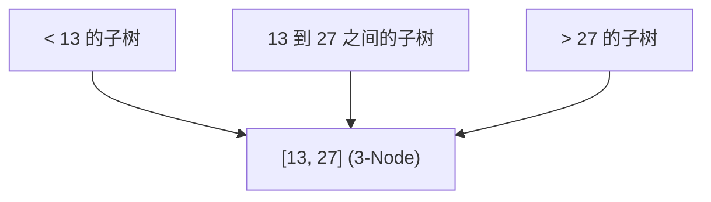
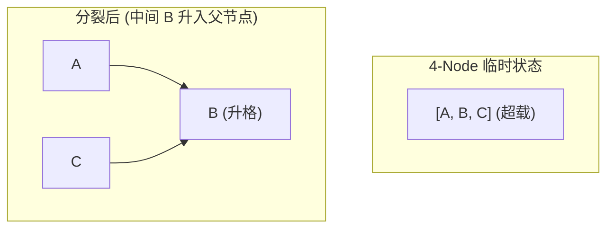

> **课程体系**：UC Berkeley CS61B: Data Structures (Spring 2024)  
> **所属模块**：Module 4: 树结构与散列表 (Search Trees & Hashing)  
> **主讲教师**：Prof. Justin Yokota & Prof. Peyrin Kao (UC Berkeley)  
> **视频时长**：51:27 ｜ **官方原版**：Lecture 17 - B-Trees (2-3 2-3-4 Trees)  
> **视频直达**：[📺 在 B 站观看本讲原视频 (P17)](https://www.bilibili.com/video/BV1hJ4m1M7ZA/?p=17) ｜ [📑 官方课件 Slides (Google Presentation)](https://docs.google.com/presentation/d/1uQYk0Hxhf0jhnp-aXxoIGNGM2w_yILMyukRctRPc9Uo) ｜ [📖 官方教材章节](https://cs61b-2.gitbook.io/cs61b-textbook/17.-b-trees)  
> **快速导航**：[← 上一讲 (P16 二叉搜索树：ADT 抽象与树形检索)](/notes/cs61b/lecture-16) ｜ [📚 返回全书目录](/notes/topics/CS61B) ｜ [下一讲 (P18 红黑树：左倾红黑二叉树 LLRB) →](/notes/cs61b/lecture-18)

---

## 1. 寻求绝对平衡：让叶子节点永远处于同一深度

*(参考时间：00:02:10 · [视频跳转 (P17 00:02:10)](https://www.bilibili.com/video/BV1hJ4m1M7ZA/?p=17&t=130))*

普通二叉搜索树之所以会退化，是因为每次新增节点都在底层追加叶子，使得某些分支无限伸长。

如果我们立下一条铁律：
> **永远不要在树的最底层新增一层叶子节点！**

如果最底层已经有节点了，新元素就强行塞进已有的叶子节点中去！这就是 B 树家族的终极思想基石。

## 2. 2-3 树的节点模型：2-Nodes 与 3-Nodes

*(参考时间：00:12:30 · [视频跳转 (P17 00:12:30)](https://www.bilibili.com/video/BV1hJ4m1M7ZA/?p=17&t=750))*

在 2-3 树中，允许存在两种类型的节点：
1. **2-Node**：拥有 1 个数据键值，和 2 棵子树（同普通二叉树）；
2. **3-Node**：拥有 2 个数据键值（$A < B$），和 3 棵子树：
   - 最左子树的所有元素 $< A$；
   - 中间子树的所有元素满足 $A < x < B$；
   - 最右子树的所有元素 $> B$。

## 3. 插入、临时 4-Node 与向上分裂（Splitting）

*(参考时间：00:24:15 · [视频跳转 (P17 00:24:15)](https://www.bilibili.com/video/BV1hJ4m1M7ZA/?p=17&t=1455))*

在 2-3 树中插入新元素遵循以下严格步骤：

1. **查找归宿**：通过二叉检索找到新元素应当落入的叶子节点；
2. **直接并入**：若目标叶子是 2-Node，直接并入升级为 3-Node；
3. **临时超载**：若目标叶子已经是 3-Node，新元素并入后形成临时的 **4-Node（包含 3 个键）**；
4. **分裂上推（Split & Push Up）**：
   - 4-Node 无法持久存在，其**中间的键（Middle Key）被强制向上推给父节点**；
   - 剩余的左右两个键分裂为两个独立的 2-Node，分别作为左右子树！

如果父节点也是 3-Node，则继续向上级级传导分裂。当且仅当**根节点本身也是 4-Node 分裂时，整棵树的高度才会整体增加 1 层**！

## 4. 完美平衡不变性（Perfect Balance）

*(参考时间：00:36:20 · [视频跳转 (P17 00:36:20)](https://www.bilibili.com/video/BV1hJ4m1M7ZA/?p=17&t=2180))*

2-3 树拥有令人赞叹的数学不变性：
> **从根节点出发，到任意一个叶子节点的路径长度严格绝对相等！**

因为树高增加的唯一方式是根节点分裂向上长出新根，这种生长是**整棵树自底向上、全局对称统一升高**的。

### 复杂度分析
- 最坏情况（全部节点都是 2-Node）：树高为 $\log_2 N$；
- 最好情况（全部节点都是 3-Node）：树高为 $\log_3 N$；
- **无论以何种顺序插入数据，单次查找与插入的最坏时间复杂度都被牢牢锁定在 $O(\log N)$！**

## 5. 本讲小结与向红黑树的过渡

*(参考时间：00:46:40 · [视频跳转 (P17 00:46:40)](https://www.bilibili.com/video/BV1hJ4m1M7ZA/?p=17&t=2800))*

| 特性 | 普通 BST | 2-3 平衡树 |
| :--- | :--- | :--- |
| **节点容量** | 严格 1 个键、2 个分支 | 允许 1~2 个键、2~3 个分支 |
| **树高保证** | 最坏 $O(N)$ 退化成链表 | 严格保证 $O(\log N)$ 完美平衡 |
| **工程实现难度** | 极简 (~50 行代码) | 异常繁琐（节点类型判断、指针重连极为痛苦） |

如何既保留 2-3 树完美的 $O(\log N)$ 平衡保障，又沿用普通二叉树极其简单的二叉指针结构？下一讲的**左倾红黑树（LLRB）**将给出天才般的解答！

---

## 课程导航与跳转

| 上一讲 | 目录 | 下一讲 | 原视频 |
| :--- | :---: | :--- | :--- |
| [← 上一讲：二叉搜索树：ADT 抽象与树形检索](/notes/cs61b/lecture-16) | [📚 返回 CS61B 全书目录](/notes/topics/CS61B) | [下一讲：红黑树：左倾红黑二叉树 LLRB →](/notes/cs61b/lecture-18) | [🎬 在 B 站观看本讲 (P17)](https://www.bilibili.com/video/BV1hJ4m1M7ZA/?p=17) |
