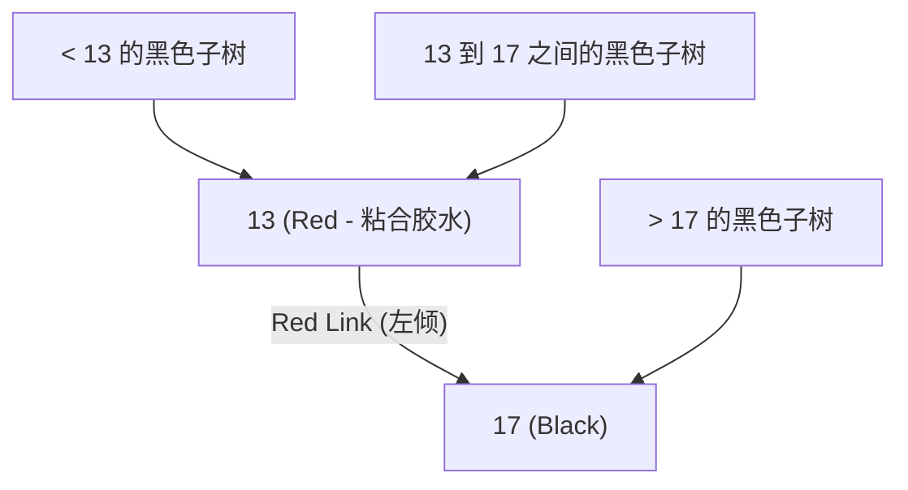

> **课程体系**：UC Berkeley CS61B: Data Structures (Spring 2024)  
> **所属模块**：Module 4: 树结构与散列表 (Search Trees & Hashing)  
> **主讲教师**：Prof. Justin Yokota & Prof. Peyrin Kao (UC Berkeley)  
> **视频时长**：51:25 ｜ **官方原版**：Lecture 18 - Red Black Trees  
> **视频直达**：[📺 在 B 站观看本讲原视频 (P18)](https://www.bilibili.com/video/BV1hJ4m1M7ZA/?p=18) ｜ [📑 官方课件 Slides (Google Presentation)](https://docs.google.com/presentation/d/1WJze5Odoy4ZR1vqPM8X6duaZ5GGm_D7SaYrtOa5RnsA) ｜ [📖 官方教材章节](https://cs61b-2.gitbook.io/cs61b-textbook/18.-red-black-trees)  
> **快速导航**：[← 上一讲 (P17 平衡树：2-3 树与 2-3-4 树)](/notes/cs61b/lecture-17) ｜ [📚 返回全书目录](/notes/topics/CS61B) ｜ [下一讲 (P19 散列表 I：直接寻址与拉链法) →](/notes/cs61b/lecture-19)

---

## 1. 2-3 树的二叉化梦想：红链接充当粘合胶水

*(参考时间：00:02:15 · [视频跳转 (P18 00:02:15)](https://www.bilibili.com/video/BV1hJ4m1M7ZA/?p=18&t=135))*

2-3 树在数学上是完美的，但在代码工程实现上极其痛苦。Robert Sedgewick 教授提出了著名的**左倾红黑二叉树（Left-Leaning Red-Black Tree, LLRB）**：
> **用普通的二叉树结构来 1:1 完美模拟 2-3 树！**

如何用普通的二叉节点表示 3-Node `[A, B]`？  
答案是：把 `A` 作为 `B` 的左孩子，并在两者之间连上一根**特殊的红色链接（Red Link）**！
红链接就像胶水一样，在逻辑上向我们声明：“这两个二叉节点本质上属于同一个 2-3 树大节点”！

## 2. 左倾红黑树（LLRB）的核心不变量

*(参考时间：00:12:40 · [视频跳转 (P18 00:12:40)](https://www.bilibili.com/video/BV1hJ4m1M7ZA/?p=18&t=760))*

一棵合法的 LLRB 必须满足以下不变量：
1. **左倾性质（Left-Leaning）**：红链接必须永远出现在左侧（代表 3-Node 的内部连接倾斜方向）；
2. **无连续红链接**：任何节点不能同时拥有两条连续的红链接（即不能有红父与红子，因为 2-3 树中没有 4-Node）；
3. **黑高绝对完美平衡（Black Balance）**：从根节点到任意 null 节点的任意路径上，所经过的**黑色链接数量严格完全相同**（直接对应 2-3 树的完美平衡！）。



## 3. 三大基本变换原语：左旋、右旋与颜色反转

*(参考时间：00:23:50 · [视频跳转 (P18 00:23:50)](https://www.bilibili.com/video/BV1hJ4m1M7ZA/?p=18&t=1430))*

LLRB 的所有自平衡修复操作，全部由三个基础代码原语组合而成：

### 1. 左旋（Rotate Left）：修复右倾红链接
当红链接出现在右侧时，通过左旋将其矫正为合法的左倾红链接：
```java
private Node rotateLeft(Node h) {
    Node x = h.right;
    h.right = x.left;
    x.left = h;
    x.color = h.color;
    h.color = RED;
    return x;
}
```

### 2. 右旋（Rotate Right）：化解连续双红链
当一个节点拥有红色的左孩子，而该左孩子自身又有红色的左孩子时，通过右旋将中间节点升格：
```java
private Node rotateRight(Node h) {
    Node x = h.left;
    h.left = x.right;
    x.right = h;
    x.color = h.color;
    h.color = RED;
    return x;
}
```

### 3. 颜色反转（Color Flip）：模拟 4-Node 向上分裂
当一个节点的左右孩子同时为红色时，代表对应 2-3 树中的临时 4-Node，直接将两孩子变黑、自身变红推给父节点：
```java
private void flipColors(Node h) {
    h.color = RED;
    h.left.color = BLACK;
    h.right.color = BLACK;
}
```

## 4. LLRB 极简插入循环：三行 if 语句定乾坤

*(参考时间：00:36:10 · [视频跳转 (P18 00:36:10)](https://www.bilibili.com/video/BV1hJ4m1M7ZA/?p=18&t=2170))*

令人拍案叫绝的是，在完成二叉树标准的递归插入后，只需要按序执行以下三行 `if` 逻辑，即可自底向上递归修复一切不合规结构：

```java
private Node put(Node h, Key key, Value val) {
    if (h == null) return new Node(key, val, RED); // 新节点永远以红色链接接入！

    int cmp = key.compareTo(h.key);
    if (cmp < 0) h.left = put(h.left, key, val);
    else if (cmp > 0) h.right = put(h.right, key, val);
    else h.val = val;

    // 核心平衡三部曲：
    if (isRed(h.right) && !isRed(h.left))      h = rotateLeft(h);  // 1. 右倾转左倾
    if (isRed(h.left) && isRed(h.left.left))   h = rotateRight(h); // 2. 双红转平衡
    if (isRed(h.left) && isRed(h.right))       flipColors(h);      // 3. 4-Node 向上分裂

    return h;
}
```

## 5. 本讲小结与红黑树设计之美

*(参考时间：00:46:50 · [视频跳转 (P18 00:46:50)](https://www.bilibili.com/video/BV1hJ4m1M7ZA/?p=18&t=2810))*

- **直觉来源于 2-3 树**：永远记住红链接只是 2-3 树内部节点的胶水虚拟标记；
- **最坏时间复杂度**：因为一棵 2-3 树的高最多为 $\log_2 N$，红链接不会连续出现，因此红黑树的树高严格小于 $2 \log_2 N$；
- **工业界地位**：Java 的 `java.util.TreeMap` 与 `java.util.TreeSet` 底层正是基于红黑树实现，提供永不退化的 $O(\log N)$ 稳健查询。

---

## 课程导航与跳转

| 上一讲 | 目录 | 下一讲 | 原视频 |
| :--- | :---: | :--- | :--- |
| [← 上一讲：平衡树：2-3 树与 2-3-4 树](/notes/cs61b/lecture-17) | [📚 返回 CS61B 全书目录](/notes/topics/CS61B) | [下一讲：散列表 I：直接寻址与拉链法 →](/notes/cs61b/lecture-19) | [🎬 在 B 站观看本讲 (P18)](https://www.bilibili.com/video/BV1hJ4m1M7ZA/?p=18) |
