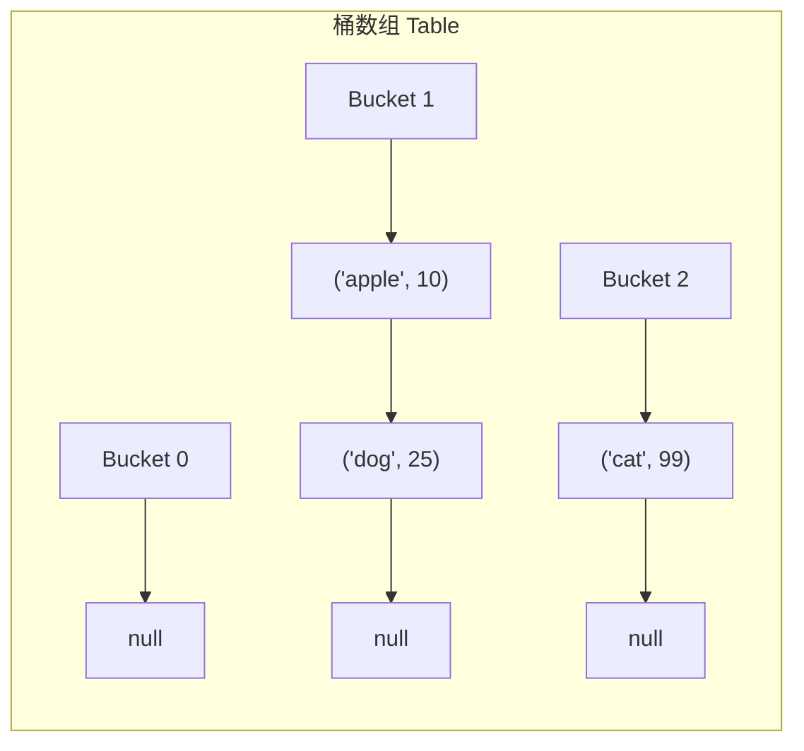

> **课程体系**：UC Berkeley CS61B: Data Structures (Spring 2024)  
> **所属模块**：Module 4: 树结构与散列表 (Search Trees & Hashing)  
> **主讲教师**：Prof. Justin Yokota & Prof. Peyrin Kao (UC Berkeley)  
> **视频时长**：49:31 ｜ **官方原版**：Lecture 19 - Hashing I  
> **视频直达**：[📺 在 B 站观看本讲原视频 (P19)](https://www.bilibili.com/video/BV1hJ4m1M7ZA/?p=19) ｜ [📑 官方课件 Slides (Google Presentation)](https://docs.google.com/presentation/d/12Su6RdBjVCGd5MrKE6Y5s-J4OyBgv--v-4LHjEwtJbU) ｜ [📖 官方教材章节](https://cs61b-2.gitbook.io/cs61b-textbook/19.-hashing)  
> **快速导航**：[← 上一讲 (P18 红黑树：左倾红黑二叉树 LLRB)](/notes/cs61b/lecture-18) ｜ [📚 返回全书目录](/notes/topics/CS61B) ｜ [下一讲 (P20 散列表 II：装载因子与重散列机制) →](/notes/cs61b/lecture-20)

---

## 1. 突破对数界限：我们能做到 O(1) 查找吗？

*(参考时间：00:02:15 · [视频跳转 (P19 00:02:15)](https://www.bilibili.com/video/BV1hJ4m1M7ZA/?p=19&t=135))*

无论平衡二叉树多么完美，查找操作都必须沿着树深进行 $\Theta(\log N)$ 次键的大小比较。  
但对于计算机底层的随机存取存储器（RAM）而言，**数组按索引访问是绝对的 $O(1)$ 常数时间**！

如果我们想存入一系列单词，能否像数组查找 `arr[index]` 那样，在 $O(1)$ 时间内瞬间定位任意键呢？
这就是**散列表（Hash Table / 散列映射）**的宏大愿景。

## 2. 鸽巢原理与直接寻址的破产

*(参考时间：00:12:40 · [视频跳转 (P19 00:12:40)](https://www.bilibili.com/video/BV1hJ4m1M7ZA/?p=19&t=760))*

假设我们要存储英文单词，最朴素的尝试是为每个可能的单词分配一个专属的数组槽位：
- 单个字母：26 个槽位；
- 两个字母：$26^2 = 676$ 个槽位；
- 八个字母的单词：$26^8 \approx 2088$ 亿个槽位！

**内存爆炸与鸽巢原理（Pigeonhole Principle）**：  
计算机的物理内存有限，而潜在的字符串、对象和数据组合是无穷无尽的。我们不可能为每一个潜在输入保留唯一的静态内存槽位。**有限的槽位必然要容纳无限的数据，冲突（Collision）在数学上具有不可避免的绝对必然性！**

## 3. 散列函数：将任意对象降维为整数

*(参考时间：00:24:20 · [视频跳转 (P19 00:24:20)](https://www.bilibili.com/video/BV1hJ4m1M7ZA/?p=19&t=1460))*

散列表通过两步走完成对象到存储槽位的映射：
1. **`hashCode()`**：将任意 Java 对象通过算法映射为一个 32 位有符号整数（范围在 $-2^{31}$ 到 $2^{31}-1$）；
2. **索引映射（Index Mapping）**：将整数散列码压缩映射到底层数组的合法下标区间 $[0, M-1]$：

```java
int index = Math.floorMod(key.hashCode(), M);
```

> **注意**：Java 的 `%` 是取余而不是数学取模。若 `hashCode()` 为负数，`hash % M` 结果依然为负，会导致 `ArrayIndexOutOfBoundsException`！因此必须使用 `Math.floorMod()` 或位运算 `(hash & 0x7fffffff) % M`。

## 4. 冲突解决之道：拉链法（Separate Chaining）

*(参考时间：00:35:10 · [视频跳转 (P19 00:35:10)](https://www.bilibili.com/video/BV1hJ4m1M7ZA/?p=19&t=2110))*

当两个不同的键通过散列函数映射到了同一个数组下标槽位时，我们称之为**哈希碰撞（Collision）**。

拉链法（Separate Chaining）是最经典、工业界最通用的碰撞解决策略：
> 底层数组的每一个槽位（称为“桶 Bucket”）不再直接存放数据，而是**维护一个链表（或红黑树）**！  
> 当碰撞发生时，新元素直接追加到对应桶槽位的链表中。



## 5. 本讲小结与性能警钟

*(参考时间：00:46:00 · [视频跳转 (P19 00:46:00)](https://www.bilibili.com/video/BV1hJ4m1M7ZA/?p=19&t=2760))*

- **查找性能依赖桶深**：如果共有 $N$ 个元素，底层数组大小为 $M$，且哈希函数极其优秀、分布均匀，则每个桶的平均链表长度为 $\frac{N}{M}$；
- **退化陷阱**：如果哈希函数极差（例如所有对象的 `hashCode()` 都返回 `42`），所有元素都会挤在同一个桶里，**散列表彻底退化为普通单向链表，查找耗时雪崩为 $\Theta(N)$！**

下一讲我们将研究如何通过**动态扩容**与**优雅的哈希设计**，确保散列表在任何负载下都死守 $O(1)$ 的巅峰性能！

---

## 课程导航与跳转

| 上一讲 | 目录 | 下一讲 | 原视频 |
| :--- | :---: | :--- | :--- |
| [← 上一讲：红黑树：左倾红黑二叉树 LLRB](/notes/cs61b/lecture-18) | [📚 返回 CS61B 全书目录](/notes/topics/CS61B) | [下一讲：散列表 II：装载因子与重散列机制 →](/notes/cs61b/lecture-20) | [🎬 在 B 站观看本讲 (P19)](https://www.bilibili.com/video/BV1hJ4m1M7ZA/?p=19) |
