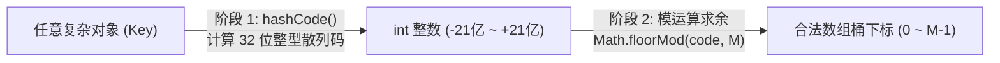

> **课程体系**：UC Berkeley CS61B: Data Structures (Spring 2024)  
> **所属模块**：Module 4: 树结构与散列表 (Search Trees & Hashing)  
> **主讲教师**：Prof. Justin Yokota & Prof. Peyrin Kao (UC Berkeley)  
> **视频时长**：49:31 ｜ **官方原版**：Lecture 19 - Hashing I  
> **视频直达**：[📺 在 B 站观看本讲原视频 (P19)](https://www.bilibili.com/video/BV1hJ4m1M7ZA/?p=19) ｜ [📑 官方课件 Slides (Google Presentation)](https://docs.google.com/presentation/d/12Su6RdBjVCGd5MrKE6Y5s-J4OyBgv--v-4LHjEwtJbU) ｜ [📖 官方教材章节](https://cs61b-2.gitbook.io/cs61b-textbook/19.-hashing)  
> **快速导航**：[← 上一讲 (P18 树结构 III：左倾红黑树（LLRB）与等价同构映射)](/notes/cs61b/lecture-18) ｜ [📚 返回全书目录](/notes/topics/CS61B) ｜ [下一讲 (P20 散列 II：负载因子、动态扩容与 Java HashMap 内核) →](/notes/cs61b/lecture-20)

---

## 1. 搜索数据结构的圣杯：打破比较排序的 O(log N) 边界

*(参考时间：00:01:20 · [视频跳转 (P19 00:01:20)](https://www.bilibili.com/video/BV1hJ4m1M7ZA/?p=19&t=80))*

在前面的二叉搜索树与平衡红黑树中，我们达到了极其优秀的 $O(\log N)$ 检索速度。

然而，计算机科学家提出了一个看似不可能实现的奢望：  
**能否设计一种完全不依赖任何大小比较（无需 `compareTo`），能够在 $O(1)$ 瞬时常数时间内完成任意键值查找的数据结构？**

**答案就是散列表（Hash Table）！**

## 2. 从直接寻址法到哈希函数：将任意对象映射为数组索引

*(参考时间：00:09:30 · [视频跳转 (P19 00:09:30)](https://www.bilibili.com/video/BV1hJ4m1M7ZA/?p=19&t=570))*

如果所有的键都是小整数（例如 $0 \sim 99$），我们可以直接分配一个长度为 100 的数组 `items[100]`，通过 `items[key]` 实现瞬时 $\Theta(1)$ 访问。

### 现实世界的巨大鸿沟
在现实应用中，键可能是任意数据形态：
- 学生的姓名字符串（如 `"Peyrin"`）；
- 包含多种属性的自定义对象（如 `Dog`、`Transaction`）；
- 甚至是长达几千字的文档。

### 散列的两阶段转换架构
为了让任意对象都能直接用于数组寻址，Java 确立了两阶段散列体系：



1. **第一阶段：计算哈希码 `hashCode()`**  
   将内存中由各种字段组成的对象，通过数学散列算法压榨为一个 32 位有符号整型 `int`。
2. **第二阶段：映射到桶索引（Index Mapping）**  
   使用数组容量 $M$ 进行求余运算。注意：由于 `hashCode()` 可能是负数，Java 中必须使用：
   ```java
   int bucketIndex = Math.floorMod(key.hashCode(), M);
   ```

## 3. 鸽巢原理（Pigeonhole Principle）与碰撞的不可避免性

*(参考时间：00:18:15 · [视频跳转 (P19 00:18:15)](https://www.bilibili.com/video/BV1hJ4m1M7ZA/?p=19&t=1095))*

很多初学者天真地认为：“只要设计足够精妙的哈希函数，就能让不同的对象产生不同的数组下标”。

### 严谨的数学破灭：鸽巢原理
- Java 的 32 位整型 `int` 总共只能表示 $2^{32} \approx 42.9$ 亿个不同的数值；
- 但现实世界中可能出现的字符串或对象数量是**无穷无尽的**！
- 把无穷多的可能对象映射到有限的 42 亿个槽位中，根据数学鸽巢原理，**必然存在至少两个内容完全不同的对象，被分配到了完全相同的哈希码或数组下标！**

这种现象被称为**哈希碰撞（Hash Collision）**。任何工业级散列表必须具备处理碰撞的能力。

## 4. 碰撞解决主流策略：拉链法（Separate Chaining）

*(参考时间：00:26:40 · [视频跳转 (P19 00:26:40)](https://www.bilibili.com/video/BV1hJ4m1M7ZA/?p=19&t=1600))*

拉链法是现代最经典的碰撞解决方案（也是 Java 标准库 `HashMap` 的核心底座）：
- 底层数组的每个槽位不再直接存放单个数据项，而是**存放一个指向单向链表（或红黑树）的指针桶（Bucket）**；
- 当发生哈希碰撞时，所有映射到同一个桶下标的键值对，依次追加挂载到该槽位的链表之中。

```text
桶数组 buckets:
[0] -> null
[1] -> [Key: "cat", Val: 10] -> [Key: "dog", Val: 20] -> null
[2] -> [Key: "eel", Val: 30] -> null
[3] -> null
```

### 检索流程：
1. 计算 `key` 的哈希桶下标；
2. 找到对应槽位的链表头节点；
3. 顺着链表逐个使用 `equals()` 比对键；
4. 找到匹配键则返回其值，到达末尾仍未找到则说明键不存在。

## 5. 本讲小结与课后自测

*(参考时间：00:35:00 · [视频跳转 (P19 00:35:00)](https://www.bilibili.com/video/BV1hJ4m1M7ZA/?p=19&t=2100))*

### 课后综合自测题
在 Java 中，如果直接写 `key.hashCode() % M` 计算桶索引，在什么情况下会爆发严重运行时异常？  
**答案与解析**：  
- 当 `key.hashCode()` 返回**负数**时，Java 的 `%` 取模运算符会得到一个负数下标（例如 `-5 % 4 = -1`），随后访问 `buckets[-1]` 会瞬间抛出 `ArrayIndexOutOfBoundsException`！  
- 正确做法是使用 `Math.floorMod(code, M)`，或者使用位运算清洗符号位 `(code & 0x7fffffff) % M`。

---

## 附录：UC Berkeley 官方教材深度研读 (Official Textbook In-Depth Chapters)

> **导读说明**：本节内容整合自 UC Berkeley CS61B 官方教材库（GitBook Textbook），针对本讲的核心数据结构与算法提供原汁原味的英文理论推导、形式化代码范例与配套章节习题，与前文视频精讲相互补充印证。

## 19. Hashing I

By William Lee and Angel Aldaco

---

## 19.1 Introduction to Hashing: Data Indexed Arrays

So far in the course, we've taken a look at many ways to store things in data structures, but they're not always the most efficient in terms of runtime. Enter an incredible data structure that can provide insertion, removal, and contains checks, regardless of how many elements are inside of it (even if theres millions of items)– all in O(1) runtime in the best case! Sound too good to be true? 

We will explore the magic of hashing in this chapter to see how this is possible.

#### Quick Recap of Data Structures we've seen so far

We've looked at a few data structures that efficiently search for the existence of items within the data structure. We looked at Binary Search Trees, then made them balanced using 2-3 Trees.

However, there are some limitations that these structures impose (yes, even 2-3 trees!)

1. They require that items be comparable. How do you decide where a new item goes in a BST? You have to answer the question "are you smaller than or bigger than the root"? For some objects, this question may make no sense.

2. They give a complexity of $$\Theta(logN)$$. Is this good? Absolutely. But maybe we can do better.

Professor Hug's Lecture on Hash Tables.


#### Using Data as Indices

Arrays have amazing runtime for its basic operations. Is there a good way to convert data into indices and store them in an array? In the next couple of sub-sections, we will walk through the steps that will eventually lead us to our final creation -- the hash table. Watching the videos linked in the subsections is helpful for understanding the process through which we arrived at the invention of hash tables. Hash tables will be the main focus of the rest of the chapter. 

---

## 19.1.1 A first attempt: DataIndexedIntegerSet

Let us begin by considering the following approach. This approach was introduced in [Hashing Video 1](https://youtu.be/rSqSlu8sEkI).

For now, we're only going to try to improve complexity from $$\Theta(logN)$$ to $$\Theta(1)$$. We're going to not worry about comparability. In fact, we're going to only consider storing and searching for `int`s.

Here's an idea: let's create an ArrayList of type `boolean` and size 2 billion. Let everything be false by default.

* The `add(int x)` method simply sets the `x` position in our ArrayList to true. This takes $$\Theta(1)$$ time.

* The `contains(int x)` method simply returns whether the `x` position in our ArrayList is `true` or `false`. This also takes $$\Theta(1)$$ time!

```

public class DataIndexedIntegerSet {

    private boolean[] present;

    public DataIndexedIntegerSet() {

        present = new boolean[2000000000];

    }

    public void add(int x) {

        present[i] = true;

    }

    public boolean contains(int x) {

        return present[i];

    }

}

```

There we have it. That's all folks.

Well, not really. What are some potential **issues** with this approach?

* Extremely wasteful. If we assume that a `boolean` takes 1 byte to store, the above needs `2GB` of space per `new DataIndexedIntegerSet()`. Moreover, the user may only insert a handful of items...

* What do we do if someone wants to insert a `String`? Or other data types?

  * Let's look at this next. Of course, we may want to insert other things, like `Dog`s. That'll come soon!

---

## 19.1.2 A second attempt: DataIndexedWordSet

Our `DataIndexedIntegerSet` only allowed for integers, but now we want to insert the `String` `"cat"` into it. We'll call our data structure that can insert strings `DataIntexedEnglishWordSet` Here's a crazy idea: let's give every string a number. Maybe "cat" can be `1`, "dog" can be `2` and "turtle" can be `3`.

(The way this would work is –– if someone wanted to add a "cat" to our data structure, we would 'figure out' that the number for "cat" is 1, and then set `present[1]` to be `true`. If someone wanted to ask us if "cat" is in our data structure, we would 'figure out' that "cat" is 1, and check if `present[1]` is true.)

But then if someone tries to insert the word "potatocactus", we don't know what to do. We need to develop a general strategy so that given a string, we can figure out a number representation for it.

Here are the two main strategies we chose to use:

##### Strategy 1: Use the first letter. 

A simple idea is to just use the first character of any given string to convert it to its number representation. However, if someone tried to insert two words with the same first letter, we have a **collision**, which we deal with using the next strategy.

##### Strategy 2: Avoid Collisions. 

There are $$26$$ unique characters in the English lowercase alphabet. We assign each one a number: $$a=1, b=2, ...,z=26$$. Now, we can write any unique lowercase string in **base 26**. (Note that **base 26** simply means that we will use **26** as the multiplier, much like we used **10** and **2** as examples above.)

* $$\text{"cat"}=3*26^2+1*26^1+20 \cdot  26^0$$

**This representation gives a unique integer to every English word containing lowercase letters, much like using base 10 gives a unique representation to every number. We are guaranteed to not have collisions.**<br>

---

## 19.1.3 A third attempt: DataIndexedStringSet

There is a character format called **ASCII**, which has an integer per character. Here, we see that the largest value (i.e., the base/multiplier we need to use) is 126. Let's just do that. The same thing as `DataIndexedEnglishWordSet`, but just with base `126`.

```

public static int asciiToInt(String s) {

    int intRep = 0;

    for (int i = 0; i < s.length(); i += 1) {           

        intRep = intRep * 126;

        intRep = intRep + s.charAt(i);

    }

    return intRep;

}

```

What about adding support for Chinese? The largest possible representation is 40959, so we need to use that as the base. 

So... to store a 3-character Chinese word, we need an array of size larger than **39 trillion** (with a T)!. This is getting out of hand... so let's explore what we can do to improve this, namely, using hashCode.

---

## 19.2 Hash Code

The core mechanism of hashing!

We face the problem that not every object in Java can easily be converted to a number. However, the key idea behind hashing is the transformation of any object into a numeric representation. The key is to have a hashing function transform our keys into different values, and convert that number into an index to then access the array. 

We achieve this through our own implementation of a `hashCode()` function, with a return value of an `int` type. This `int` type is our *hash value*. 

The built-in String class in Java, for example, might have the following code block:

```java

public class String {

    public int hashCode() {

        //implementation here

    }

}

```

Based on this example, we can call `key.hashCode()` to generate an integer hash code for a `String` instance called `key`. 

Professor Hug's Lecture on Hash Codes


### Memory Inefficiency in Hash Codes

An issue mentioned earlier is memory inefficiency: for a small range of hash values, we can get away with an array that individuates each hash value. That is, every index in the array would represent a unique hash value. This works well if our indices are small and close to zero. But remember that Java’s 32-bit integer type can support numbers anywhere between -2,147,483,648 and 2,147,483,647. Now, most of the time, our data won’t use anywhere near that many values. But even if we only wanted to support special characters, our array would still need to be 1,112,064 elements long!

Instead, we'll slightly modify our indexing strategy. Let's say we only want to support an array of length 10 so as to avoid allocating excessive amounts of memory. How can we turn a number that is potentially millions or billions large into a value between 0 and 9, inclusive?

#### Wrapping!

The **modulus operator (%)** allows us to achieve this. 

*Review*: The result of the modulo operator is like a remainder in fractional division. For example, `65 % 10` returns `5` because after dividing 65 by 10, we are left with a remainder of 5. Thus as other examples, `3 % 10 = 3`, `20 % 10 = 0`, and `19 % 10 = 9`. For an intuitive understanding of this, think about how we used the modulo operator in Project 1: Deques to ensure you avoided `IndexOutOfBounds` Exceptions and could accurately index into your deque via the concept of "wrapping around" the array. 

Returning back to our original problem, we want to be able to convert any number to a value between 0 and 9, inclusive. Given our discussion on the modulo operator, we can see that any number mod 10 will return an integer value between 0 and 9. This is what we need to index into an array of size 10!

More generally, we can locate the correct index for any key with the following:

```java

Math.floorMod(key.hashCode(), array.length)

```

where `array` is the underlying array representing our hash table.

*Quick Note*: In Java, the `Math.floorMod` function will perform the modulus operation while correctly accounting for negative integers, whereas `%` does not.

---

## 19.3 "Valid" & "Good" Hashcodes

Professor Hug's Lecture on Valid/Good Hashcodes


### Valid Hashcodes!

You may see this term in discussions and potentially on exams. What exactly makes a hash code "valid"? There are two properties:

1. ***Deterministic*****:** The `hashCode()` function of two objects A and B who are equal to each other (`A.equals(B) == true`) have the same hashcode. *This also means the hash function cannot rely on attributes of the object that are not reflected in the* `.equals()` *method.*

2. ***Consistent*****:** The `hashCode()` function returns the same integer every time it is called on the same instance of an object. This means the `hashCode()` function must be independent of time/stopwatches, random number generators, or any methods that would not give us a consistent `hashCode()` across multiple `hashCode()` function calls on the same object instance.

Note that there are no requirements that state that unequal objects should have different hash function values.

One could argue that these two requirements are in fact the same requirement. We can restate the requirement of consistency. Imagine we make a pointer named `A` to an object `O` at 12:00 pm and a pointer named `B` to this same object `O` at 1:00 pm. We know that the hash code should return the same integer for both objects, due to the consistency requirement. However, how do we formally define our statement “this same object `O`” above? Technically, the only reason we consider `B` to be pointing to the same thing as `A` is because of the `.equals()`method! This is starting to sound a lot like the determinism requirement.

### Good Hashcodes!

You'll probably see this term a lot as well. But what makes a hashcode "good"? There are a few properties that can make a good `hashCode()`:

1. The `hashCode()` function must be valid.

2. The `hashCode()` function values should be spread as uniformly as possible over the set of all integers.

3. The `hashCode()` function should be relatively quick to compute \[ideally O(1) constant time mathematical operations]

Now let’s think more specifically about the impact of the hashing function. In general, we assume most hash functions will be “relatively quick”. Why do we make this assumption? Given how intrinsic the hashing function is to our data structure, the runtime of this function will have a significant effect on the overall runtime of our data structure. This means we want our hash code to be “easily” computable (ideally constant time), so that we may maintain the O(1) runtime characteristic that makes hashing so special and efficient!

---

## 19.4 Handling Collisions: Linear Probing and External Chaining

In hashing, a collision occurs when we have multiple elements that have the same index in our array.

Professor Hug's Lecture on Collisions


There are two common methods to deal with collisions in hash tables:

1. **Linear Probing:** Store the colliding keys elsewhere in the array, potentially in the next open array space. This method can be seen with distributed hash tables, which you will see in later computer science courses that you may take.

2. **External Chaining:** A simpler solution is to store all the keys with the same hash value together in a collection of their own, such as a `LinkedList`. This collection of entries sharing a single index is called a **bucket**.

---

## 19.5 Resizing & Hash Table Performance

No matter how good our `hashCode()` method is, if the underlying array of our hash table is small and we add a lot of keys to it, then we will start getting more and more collisions. Because of this, a hash table should expand its underlying array once it starts to fill up (much like how an `ArrayList` expands once it fills up).

Professor Hug's Lecture on why we have resizing and how it works!


To keep track of how full our hash table is, we define the term **load factor**, which is the ratio of the number of elements inserted over the total physical length of the array.

<figure><figcaption><p>A very important equation</p></figcaption></figure>

For our hash table, we will define the maximum load factor that we will allow. **If adding another key-value pair would cause the load factor to exceed the specified maximum load factor, then the hash table should resize.** This is usually done by doubling the underlying array length. Java’s default maximum load factor is 0.75 which provides a good balance between a reasonably-sized array and reducing collisions.

Note that if we are trying to add a key-value pair and the key already exists in the hash map, the corresponding value should be updated but no resizing should occur.

As an example, let’s consider what happens if our hash table has an array length of 10 and currently contains 7 elements. Each of these 7 elements are hashed modulo 10 because we want to get an index within the range of 0 through 9. The current load factor is 7/10, or 0.7, just under the threshold.

If we try to insert one more element, we would have a total of 8 elements in our hash table and a load factor of 0.8. Because this would cause the load factor to exceed the maximum load factor, we must resize the underlying array to length 20 before we insert the element. Remember that since our procedure for locating an entry in the hash table is to take the `hashCode() % array.length` and our array’s length has changed from 10 to 20, all the elements in the hash table need to be relocated. Once all the elements have been relocated and our new element has been added, we will have a load factor of 8/20, or 0.4, which is below the maximum load factor.

---

## 19.6 Summary

In this chapter, we learned about hashing, a powerful technique for turning a more complex object like a `String` into a numerically representable value like an `int`. 

The *hash table* is a data structure that combines the *hash function* with the fact that arrays can be indexed in constant time. Using the hash table and the map abstract data type, we can build a `HashMap` which allows for amortized constant time access to any key-value pair so long as we know which bucket the key falls into.

However, we quickly demonstrated that this naive implementation has several drawbacks: the ability to represent all different kinds of objects, memory efficiency, and collisions. 

We investigated the importance of the `hashCode()` function to gain an understanding of how it affects the runtime of the hash table. To allow for smaller `size()` in the array, we used the modulo operator to shrink hash values down to a specified range of numbers. We then added external chaining to solve collisions by allowing multiple entries to live in a single bucket in the form of a LinkedList, and explored resizing functionality based on the load factor!

---

## 19.7 Exercises

### 1. Potpourri

(a) True or False: Resizes are triggered if adding a key-value pair causes the load factor to be greater than or equal to the specified maximum load factor.

<details>

<summary>Answer to Q1(a)</summary>

**False**. A resize will be triggered if adding another key value pair would cause the load factor to **exceed** the specified maximum load factor. A resize is not triggered when the load factor is equal to the specified maximum load factor.

</details>

(b) True or False: The `hashCode()` function can have varied return types.

<details>

<summary>Answer to Q1(b)</summary>

**False**. In Java, the hashCode() function can **only** have an `int` return type to serve as a hash value.

</details>

### 2. hashCode()....

In order for a hash code to be valid, objects that are equivalent to each other (i.e. .equals() returns true) must return equivalent hash codes. If an object does not explicitly override the `hashCode()` method, it will inherit the `hashCode()` method defined in the Object class, which returns the object’s address in memory.

Here are four potential implementations of Integer's `hashCode()` function. Assume that `intValue()` returns the value represented by the Integer object. 

Categorize each `hashCode()` implementation as either a valid or an invalid hash function. If it is valid, point out a flaw or disadvantage. If it is invalid, explain why. 

Question (a)

```java

public int hashCode() {

    return -1;

}

```

<details>

<summary>Answer for Q2(a)</summary>

Valid. As required, this hash function returns the same hash code for Integers that are .equals() to each other. However, this is a terrible hash code because collisions are extremely frequent and occur 100% of the time.

</details>

Question (b)

```java

public int hashCode() {

    return intValue() * intValue();

}

```

<details>

<summary>Answer for Q2(b)</summary>

Valid. Similar to (a), this hash function returns the same hash code for Integers that are .equals(). However, Integers that share the same absolute values will collide (for example, x = 5 and x = -5 will both return the same hashcode). A better hash function would be to just return intValue() itself.

</details>

Question (c)

```java

public int hashCode() {

    Random rand = new Random();

    return rand.nextInt();

}

```

<details>

<summary>Answer for Q2(c)</summary>

Invalid. If we call hashCode() multiple times on the same Integer object, we will get different hash codes returned each time.

</details>

Question (d)

```java

public int hashCode() {

    return super.hashCode();

}

```

<details>

<summary>Answer for Q2(d)</summary>

Invalid. This hash function returns some integer corresponding to the Integer object’s location in memory. Different Integer objects will exist in different locations in memory, so even if they represent the same value they will return different hash codes.

</details>

### 3. Hashin' and Resizin'

Given the provided `hashCode()` implementation, hash the items listed below with external chaining (the first item is already inserted for you). Assume the load factor is 1, and the initial underlying array has size of 4. Use geometric resizing with a resize factor of 2. You may draw more boxes to extend the array when you need to resize.

```java

/** Returns 0 if word begins with ’a’, 1 if it begins with ’b’, etc. */

public int hashCode() {

    return word.charAt(0) - 'a';

}

```

```

["apple", "cherry", "fig", "guava", "durian", "apricot", "banana"]

```

<details>

<summary>Answer for Question 3</summary>

Here is what the hash table should look like after inserting `guava`:


Here is what the hash table should look like after inserting `durian`:


Here is what the hash table should look like after all insertions have been completed:


</details>


---

## 课程导航与跳转

| 上一讲 | 目录 | 下一讲 | 原视频 |
| :--- | :---: | :--- | :--- |
| [← 上一讲：树结构 III：左倾红黑树（LLRB）与等价同构映射](/notes/cs61b/lecture-18) | [📚 返回 CS61B 全书目录](/notes/topics/CS61B) | [下一讲：散列 II：负载因子、动态扩容与 Java HashMap 内核 →](/notes/cs61b/lecture-20) | [🎬 在 B 站观看本讲 (P19)](https://www.bilibili.com/video/BV1hJ4m1M7ZA/?p=19) |
