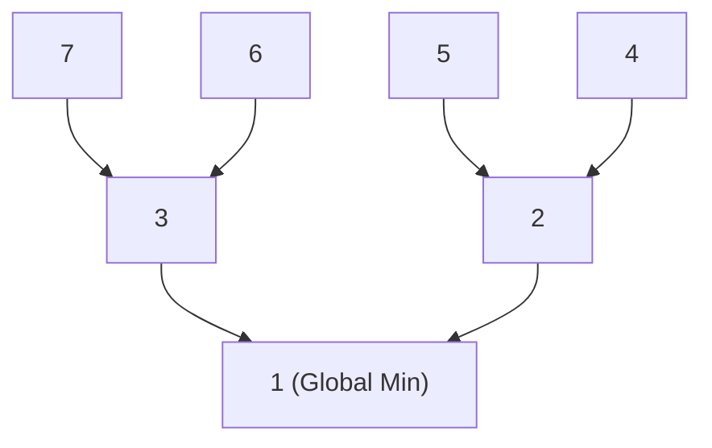

> **课程体系**：UC Berkeley CS61B: Data Structures (Spring 2024)  
> **所属模块**：Module 5: 优先队列与图算法 (Priority Queues & Graph Algorithms)  
> **主讲教师**：Prof. Justin Yokota & Prof. Peyrin Kao (UC Berkeley)  
> **视频时长**：52:37 ｜ **官方原版**：Lecture 21 - Heaps and Priority Queues  
> **视频直达**：[📺 在 B 站观看本讲原视频 (P21)](https://www.bilibili.com/video/BV1hJ4m1M7ZA/?p=21) ｜ [📑 官方课件 Slides (Google Presentation)](https://docs.google.com/presentation/d/1XVJfoSYH2ItiD1rz9yvyEf_HelejbfkYxQgukbgclSY) ｜ [📖 官方教材章节](https://cs61b-2.gitbook.io/cs61b-textbook/21.-heaps-and-priority-queues)  
> **快速导航**：[← 上一讲 (P20 散列表 II：装载因子与重散列机制)](/notes/cs61b/lecture-20) ｜ [📚 返回全书目录](/notes/topics/CS61B) ｜ [下一讲 (P22 树与图遍历：DFS、BFS 与连通性探索) →](/notes/cs61b/lecture-22)

---

## 1. 优先队列（Priority Queue）ADT

*(参考时间：00:02:10 · [视频跳转 (P21 00:02:10)](https://www.bilibili.com/video/BV1hJ4m1M7ZA/?p=21&t=130))*

在日常工程与操作系统调度中，我们往往并不关心“谁先来（FIFO 队列）”或“谁后到（LIFO 栈）”，而是关注**“谁的优先级最高/数值最小”**：
- 医院急诊室按病情危急程度优先分诊；
- 操作系统的进程调度器优先执行最高优先级的任务；
- 导航软件在海量路线中优先探索当前预估代价最小的节点。

**最小优先队列（Min-Priority Queue）的核心接口**：
```java
public interface MinPQ<Item> {
    void insert(Item x); // 插入新元素
    Item getSmallest();  // 查看优先级最高（值最小）的元素
    Item removeSmallest(); // 弹出并返回优先级最高（值最小）的元素
    int size();
}
```

## 2. 二叉堆（Binary Heap）两大核心不变量

*(参考时间：00:12:40 · [视频跳转 (P21 00:12:40)](https://www.bilibili.com/video/BV1hJ4m1M7ZA/?p=21&t=760))*

用普通数组或无序链表实现优先队列，插入和查找删除必有一方退化为 $O(N)$。二叉堆通过维护两大严格不变量，使所有核心操作都被锁定在 $O(\log N)$ 之内：

1. **结构不变量：完全二叉树（Complete Binary Tree）**：  
   树的所有层（除了可能的最底层）全部被节点紧密填满；最底层的叶子节点严格**从左向右连续排列，中间绝无任何空缺气泡**！
2. **堆有序性（Heap Invariant / Min-Heap Property）**：  
   对于树中的每一个节点 $P$，其存储的键值都**小于或等于（$\le$）其左右孩子节点的键值**（根节点永远是全局绝对最小值！）。



## 3. 扁平化魔法：完全二叉树的数组紧凑表示

*(参考时间：00:24:15 · [视频跳转 (P21 00:24:15)](https://www.bilibili.com/video/BV1hJ4m1M7ZA/?p=21&t=1455))*

因为完全二叉树没有任何空洞，我们完全不需要任何指针节点！**直接按层序遍历把节点平铺放进一个 Java 原生数组中即可！**

为了计算方便，我们通常弃用下标 0，从**下标 1 开始存放根节点**：
- **节点 $k$ 的左孩子**：`2 * k`
- **节点 $k$ 的右孩子**：`2 * k + 1`
- **节点 $k$ 的父节点**：`k / 2`（整数向下取整除法）

| 下标 `idx` | 0 | 1 | 2 | 3 | 4 | 5 | 6 | 7 |
| :--- | :---: | :---: | :---: | :---: | :---: | :---: | :---: | :---: |
| **存放节点** | *(空)* | **1 (Root)** | 3 | 2 | 7 | 6 | 5 | 4 |

只需极其纯粹的数学下标运算，瞬时在父子节点间自由穿梭，完全消除对象指针带来的内存碎片与间接寻址开销！

## 4. 堆平衡维护原语：Swim（上浮）与 Sink（下沉）

*(参考时间：00:36:20 · [视频跳转 (P21 00:36:20)](https://www.bilibili.com/video/BV1hJ4m1M7ZA/?p=21&t=2180))*

### 1. 插入新元素：先插末尾，再 Swim 上浮
新元素直接追加到数组的下一个空闲末尾（保持完全二叉树外形）。若新元素比其父节点小，则与父节点交换，一路“上浮”，直至满足堆有序性：
```java
private void swim(int k) {
    while (k > 1 && smaller(k, k / 2)) {
        swap(k, k / 2);
        k = k / 2;
    }
}
```

### 2. 删除最小值：首尾交换，再 Sink 下沉
弹出根节点 `items[1]`。将数组最末尾的叶子节点挪至根节点槽位，然后与其较小的那个孩子比较；若比孩子大，则与较小孩子交换，一路“下沉”：
```java
private void sink(int k) {
    while (2 * k <= size) {
        int j = 2 * k;
        if (j < size && smaller(j + 1, j)) j++; // 取较小的孩子
        if (!smaller(j, k)) break;
        swap(k, j);
        k = j;
    }
}
```

## 5. 本讲小结与时间复杂度一览

*(参考时间：00:46:50 · [视频跳转 (P21 00:46:50)](https://www.bilibili.com/video/BV1hJ4m1M7ZA/?p=21&t=2810))*

由于完全二叉树的树高严格等于 $\lfloor \log_2 N \rfloor$，`swim` 与 `sink` 路径上的最大跳跃步数绝不会超过树高！

| 操作 | 逻辑步骤 | 时间复杂度 |
| :--- | :--- | :---: |
| **`insert`** | 数组末尾追加后执行 `swim` | $O(\log N)$ |
| **`getSmallest`** | 直接读取根节点 `items[1]` | $\Theta(1)$ |
| **`removeSmallest`** | 顶末交换后执行 `sink` | $O(\log N)$ |

---

## 课程导航与跳转

| 上一讲 | 目录 | 下一讲 | 原视频 |
| :--- | :---: | :--- | :--- |
| [← 上一讲：散列表 II：装载因子与重散列机制](/notes/cs61b/lecture-20) | [📚 返回 CS61B 全书目录](/notes/topics/CS61B) | [下一讲：树与图遍历：DFS、BFS 与连通性探索 →](/notes/cs61b/lecture-22) | [🎬 在 B 站观看本讲 (P21)](https://www.bilibili.com/video/BV1hJ4m1M7ZA/?p=21) |
