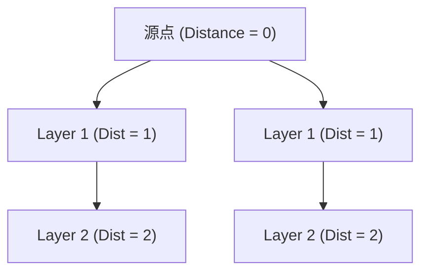

> **课程体系**：UC Berkeley CS61B: Data Structures (Spring 2024)  
> **所属模块**：Module 5: 优先队列与图算法 (Priority Queues & Graph Algorithms)  
> **主讲教师**：Prof. Justin Yokota & Prof. Peyrin Kao (UC Berkeley)  
> **视频时长**：51:42 ｜ **官方原版**：Lecture 23 - Graph Traversals and Implementations  
> **视频直达**：[📺 在 B 站观看本讲原视频 (P23)](https://www.bilibili.com/video/BV1hJ4m1M7ZA/?p=23) ｜ [📑 官方课件 Slides (Google Presentation)](https://docs.google.com/presentation/d/1NKWnXSJ8pUn1E2Cw6zidxMRuXf_aINKCpW7XpEkyz6c) ｜ [📖 官方教材章节](https://cs61b-2.gitbook.io/cs61b-textbook/23.-graph-traversals-and-implementations)  
> **快速导航**：[← 上一讲 (P22 树与图遍历：DFS、BFS 与连通性探索)](/notes/cs61b/lecture-22) ｜ [📚 返回全书目录](/notes/topics/CS61B) ｜ [下一讲 (P24 单源最短路径：Dijkstra 算法与边松弛) →](/notes/cs61b/lecture-24)

---

## 1. 图的三大经典内存表示架构

*(参考时间：00:02:15 · [视频跳转 (P23 00:02:15)](https://www.bilibili.com/video/BV1hJ4m1M7ZA/?p=23&t=135))*

如何将顶点与边高效存入计算机内存？工业界探索了三种不同的经典表示结构：

### 1. 边集列表（Edge List）
维护顶点集合和一个包含所有边的扁平列表 `List<Edge>`。  
- 缺点：要查询顶点 $v$ 的所有邻居，必须遍历整张边列表，耗时 $\Theta(E)$，极度缓慢。

### 2. 邻接矩阵（Adjacency Matrix）
维护一个 $V \times V$ 的二维布尔矩阵 `boolean[][] adj`，其中 `adj[u][v] = true` 表示存在边 $(u, v)$。  
- 优点：判断任意两点之间是否有边只需 $\Theta(1)$；
- 致命痛点：**空间开销高达 $\Theta(V^2)$**！现实世界中的图绝大多数是**稀疏图（Sparse Graph，即 $E \ll V^2$）**。例如万维网拥有数十亿网页，若开辟 $V^2$ 的矩阵会瞬间打爆全球所有服务器的内存！同时遍历 $v$ 的邻居必须完整扫描一整行，耗时恒为 $\Theta(V)$。

## 2. 黄金标准：邻接表（Adjacency List）

*(参考时间：00:13:20 · [视频跳转 (P23 00:13:20)](https://www.bilibili.com/video/BV1hJ4m1M7ZA/?p=23&t=800))*

工业界事实上的唯一标准方案是**邻接表（Adjacency List）**：
维护一个大小为 $V$ 的数组，数组的每个槽位挂载一个列表（或集合），存放该顶点的所有邻接邻居！

```java
public class Graph {
    private final int V;
    private int E;
    private List61B<Integer>[] adj; // 邻接表数组

    @SuppressWarnings("unchecked")
    public Graph(int V) {
        this.V = V;
        this.E = 0;
        adj = (List61B<Integer>[]) new List61B[V];
        for (int v = 0; v < V; v++) {
            adj[v] = new SLList<>();
        }
    }

    public void addEdge(int v, int w) {
        adj[v].addLast(w);
        adj[w].addLast(v); // 无向图双向连接
        E++;
    }

    public Iterable<Integer> adj(int v) {
        return adj[v];
    }
}
```

**空间与时间完美平衡**：  
- 空间复杂度严格为 $\Theta(V + E)$；
- 遍历顶点 $v$ 的相邻边，耗时与该顶点的度数（Degree）严格成正比 $\Theta(deg(v))$，毫无无效空耗！

## 3. 广度优先搜索（BFS）算法精解

*(参考时间：00:25:40 · [视频跳转 (P23 00:25:40)](https://www.bilibili.com/video/BV1hJ4m1M7ZA/?p=23&t=1540))*

DFS 沿着一条路走到黑，而**广度优先搜索（Breadth-First Search, BFS）**像水波纹一样由近及远、逐层向外均匀扩散。



### 基于队列（Queue）的 BFS 核心实现
```java
public class BreadthFirstPaths {
    private boolean[] marked;
    private int[] edgeTo;
    private int[] distTo; // 记录从源点到各顶点的最短边数距离

    public void bfs(Graph G, int s) {
        Queue<Integer> fringe = new ArrayDeque<>();
        fringe.add(s);
        marked[s] = true;
        distTo[s] = 0;

        while (!fringe.isEmpty()) {
            int v = fringe.poll(); // 队首出队
            for (int w : G.adj(v)) {
                if (!marked[w]) {
                    fringe.add(w);       // 发现新大陆，入队等待处理
                    marked[w] = true;
                    edgeTo[w] = v;
                    distTo[w] = distTo[v] + 1; // 距离层数递增
                }
            }
        }
    }
}
```

## 4. 无权图最短路径性质证明

*(参考时间：00:37:15 · [视频跳转 (P23 00:37:15)](https://www.bilibili.com/video/BV1hJ4m1M7ZA/?p=23&t=2235))*

**定理**：在无权图（或每条边权重相等的图）中，BFS 所计算出的路径，**必然是包含边数最少的最短路径（Fewest Edges Shortest Path）！**

**数学直觉**：
- 队列遵循严格的先进先出（FIFO）纪律；
- 队列中元素的 `distTo` 数值在任何时刻都具有**单调性**：队列里的元素距离源点要么全是 $d$，要么前半部分是 $d$、后半部分是 $d+1$；
- 距离为 $d$ 的所有节点必然先于距离为 $d+1$ 的节点出队并完成邻居发散；
- 因此，任何顶点第一次被访问并标记时，所走的步数必定是全局最短步数！

## 5. 本讲小结：DFS vs BFS 大盘点

*(参考时间：00:47:00 · [视频跳转 (P23 00:47:00)](https://www.bilibili.com/video/BV1hJ4m1M7ZA/?p=23&t=2820))*

| 维度 | 深度优先搜索 (DFS) | 广度优先搜索 (BFS) |
| :--- | :--- | :--- |
| **辅助底层数据结构** | 系统调用栈（递归）或显式栈 Stack (LIFO) | 先进先出队列 Queue (FIFO) |
| **搜索形态** | 探求深邃，直捣黄龙，遇阻折返 | 逐层发散，波纹扩散，步步为营 |
| **典型应用场景** | 连通性测试、迷宫寻路、拓扑排序、环检测 | **无权图单源最短路径**、最近邻居搜索 |
| **时间复杂度** | $\Theta(V + E)$ | $\Theta(V + E)$ |

---

## 课程导航与跳转

| 上一讲 | 目录 | 下一讲 | 原视频 |
| :--- | :---: | :--- | :--- |
| [← 上一讲：树与图遍历：DFS、BFS 与连通性探索](/notes/cs61b/lecture-22) | [📚 返回 CS61B 全书目录](/notes/topics/CS61B) | [下一讲：单源最短路径：Dijkstra 算法与边松弛 →](/notes/cs61b/lecture-24) | [🎬 在 B 站观看本讲 (P23)](https://www.bilibili.com/video/BV1hJ4m1M7ZA/?p=23) |
