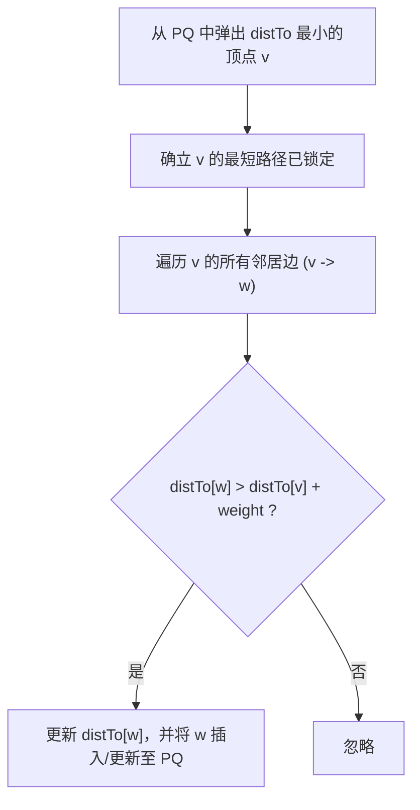

> **课程体系**：UC Berkeley CS61B: Data Structures (Spring 2024)  
> **所属模块**：Module 5: 优先队列与图算法 (Priority Queues & Graph Algorithms)  
> **主讲教师**：Prof. Justin Yokota & Prof. Peyrin Kao (UC Berkeley)  
> **视频时长**：51:37 ｜ **官方原版**：Lecture 24 - Shortest Paths  
> **视频直达**：[📺 在 B 站观看本讲原视频 (P24)](https://www.bilibili.com/video/BV1hJ4m1M7ZA/?p=24) ｜ [📑 官方课件 Slides (Google Presentation)](https://docs.google.com/presentation/d/1mT-F0fxm-sVZj9EQS_E_QMv5SVfeCGptI9vsKpyp57Y) ｜ [📖 官方教材章节](https://cs61b-2.gitbook.io/cs61b-textbook/24.-shortest-paths)  
> **快速导航**：[← 上一讲 (P23 图遍历实战：DFS、BFS 与拓扑排序)](/notes/cs61b/lecture-23) ｜ [📚 返回全书目录](/notes/topics/CS61B) ｜ [下一讲 (P25 最小生成树：割定理与 Prim/Kruskal 算法) →](/notes/cs61b/lecture-25)

---

## 1. 单源最短路径问题（Single-Source Shortest Paths, SSSP）

*(参考时间：00:01:25 · [视频跳转 (P24 00:01:25)](https://www.bilibili.com/video/BV1hJ4m1M7ZA/?p=24&t=85))*

在带权有向图中，每条边 $e = (u \to v)$ 都附带一个非负权重 $w(e)$（代表物理距离或耗油量）。

给定起点 $s$，单源最短路径问题的目标是：**计算从起点 $s$ 出发，到达图中每一个其他顶点的最小总权重路径（Shortest Path Tree, SPT）**。

## 2. 算法通用引擎：边的松弛操作（Edge Relaxation）

*(参考时间：00:09:40 · [视频跳转 (P24 00:09:40)](https://www.bilibili.com/video/BV1hJ4m1M7ZA/?p=24&t=580))*

所有最短路径算法的底层核心原子操作，都是对一条边 $e = (v \to w, \text{weight})$ 执行**松弛（Relaxation）**：

```java
private void relax(DirectedEdge e) {
    int v = e.from(), w = e.to();
    // 核心三角不等式检验
    if (distTo[w] > distTo[v] + e.weight()) {
        distTo[w] = distTo[v] + e.weight(); // 找到更短捷径，更新距离！
        edgeTo[w] = e;                      // 更新到达 w 的最佳前驱边
    }
}
```

松弛的物理含义：如果经由顶点 $v$ 再走边 $e$ 到达 $w$ 的距离，比目前已知的到达 $w$ 的最短距离还要短，那么我们就“放松”了这一条约束，收紧了最短路径上界！

## 3. 戴克斯特拉算法（Dijkstra's Algorithm）全流程推演

*(参考时间：00:19:00 · [视频跳转 (P24 00:19:00)](https://www.bilibili.com/video/BV1hJ4m1M7ZA/?p=24&t=1140))*

图灵奖得主 Edsger Dijkstra 提出了利用优先队列的经典贪心算法：

### 算法执行五步法
1. 初始化：`distTo[s] = 0`，其余所有顶点的 `distTo[v] = \infty`；
2. 将起点插入优先队列 `pq.insert(s, 0)`；
3. **循环出队**：从优先队列中取出当前 `distTo` 最小的未确认顶点 $v$；
4. **贪心确界**：此时 `distTo[v]` 已经绝对确定为全局最优解，不可再被优化！
5. **松弛所有出边**：对顶点 $v$ 出发的所有边进行松弛，并动态更新优先队列中的权重。



### 复杂度：
使用二叉堆优化时，算法总时间为 **$O((V + E) \log V)$**！

## 4. 为什么 Dijkstra 严禁存在负权边？

*(参考时间：00:28:40 · [视频跳转 (P24 00:28:40)](https://www.bilibili.com/video/BV1hJ4m1M7ZA/?p=24&t=1720))*

Dijkstra 算法的正确性建立在贪心假设之上：**沿着一条路径继续往前走，总权重只会单调增加，绝不会减少！**

如果存在负权边（例如某条边的权重是 $-10$）：
- 已经从 PQ 弹出并被标记为“已锁定最短”的顶点，可能会因为后方突然出现一条高额负收益通道而变得更短；
- 贪心策略彻底失效，导致计算结果严重错误！处理负权边必须使用 Bellman-Ford 算法。

## 5. A* 启发式搜索算法（A* Search）：指引航向的罗盘

*(参考时间：00:36:20 · [视频跳转 (P24 00:36:20)](https://www.bilibili.com/video/BV1hJ4m1M7ZA/?p=24&t=2180))*

在电子地图导航中，如果我们想找从旧金山到纽约的最短行车路线，Dijkstra 算法会像水波一样向四周 360 度盲目扩散，甚至会先去搜索西边的太平洋！

Peter Hart 等人提出了 **A* 搜索算法**：
- Dijkstra 优先队列的优先级标准纯粹是已走过的实际距离：$f(v) = g(v) = \text{distTo}[v]$；
- **A* 引入了启发式估计函数 $h(v)$（Heuristic Estimate）**：从顶点 $v$ 到目标终点 $t$ 的预估直线距离！
- 优先队列的排序优先级改为综合评分：
  $$f(v) = g(v) + h(v)$$

通过将探索方向牢牢拉向终点方向，A* 将搜索范围从无序扩散的“大圆盘”急剧收束为精准冲向目标的“细椭圆”，大幅缩短导航计算耗时！

## 6. 本讲小结与课后自测

*(参考时间：00:44:00 · [视频跳转 (P24 00:44:00)](https://www.bilibili.com/video/BV1hJ4m1M7ZA/?p=24&t=2640))*

### 课后综合自测题
A* 算法要保证找到的最短路径绝对正确，启发函数 $h(v)$ 必须满足什么数学条件？  
**答案与解析**：  
启发函数必须满足**可采纳性（Admissibility）**：即 $h(v)$ 预估的距离**绝对不能超过真实的物理最短距离（$h(v) \le h^*(v)$，绝不可高估成本）**！例如在地图导航中，两点间的空间直线距离（欧式距离）永远小于等于真实道路弯曲距离，因此直线距离是绝佳的可采纳启发式。

---

## 附录：UC Berkeley 官方教材深度研读 (Official Textbook In-Depth Chapters)

> **导读说明**：本节内容整合自 UC Berkeley CS61B 官方教材库（GitBook Textbook），针对本讲的核心数据结构与算法提供原汁原味的英文理论推导、形式化代码范例与配套章节习题，与前文视频精讲相互补充印证。

## 24. Shortest Paths

By: Mihir Mirchandani and Teresa Luo

---

## 24.1 Introduction

### Shortest Paths 

#### Recalls 

So far, we have methods to do the following

* find a path from a given vertex, `s`, to every reachable vertex in the graph.

* find a **shortest** path from a given vertex, `s`, to every reachable vertex in the graph. (...or do we?)

Before we answer the mysterious question posed below, let's further recall the two types of searches we could use to do the above two things: BFS or DFS.

Are both going to always be correct? Yes. Does one give better results? BFS finds you the **shortest** paths whereas DFS does not. Is one more efficient than the other, runtime-wise? No. Is one more efficient than the other, space-wise?

* DFS is worse for spindly graphs. Imagine a graph with 10000 nodes all spindly. We'll end up making 10000 recursive calls, which is bad for space.

* BFS is worse for "bushy" graphs, because our queue gets used a lot.

#### Answering the mysterious question 

Did we develop an algorithm to find the **shortest** path from a given vertex to every other reachable vertex? Well, kind of. We developed an algorithm that works well on graphs with no edge labels. Here's what we did: we developed an algorithm that finds us the shortest (**where shortest means the fewest number of edges**) paths from a given source vertex.

But that's not always the correct definition of shortest. Sometimes, our graph edges might have 'weights', and A-B is considered farther than A-C if the A-B edge has weight, say, 5 and the A-C edge only has weight, say, 3.

That is why we need a different algorithm for finding the shortest path when we have the edge weights in the graph.

---

## 24.2 Dijkstra's Algorithm

Professor Hug's Lecture on Shortest Paths


In [Chapter 23.1](https://cs61b-2.gitbook.io/cs61b-textbook/23.-graph-traversals-and-implementations/23.1-bfs-and-dfs) we have implemented BFS & DFS. We discussed the idea of using BFS for finding the shortest path trees however when the graph edges have weight, BFS will upset us. 

Consider the following example. You are on campus and playing a game with your friends around Hearst Memorial Mining Building. You start at the location `s` and you want to go to the location `t`. 

<figure><figcaption></figcaption></figure>

BFS will yield a route of length 330 m instead of therefore we need an algorithm that takes into account edge distances, also known as “edge weights”.

<div><figure><figcaption><p>Correct Result</p></figcaption></figure> <figure><figcaption><p>BFS result</p></figcaption></figure></div>

#### Observations 

Note that the shortest path (for a graph whose edges have weights) can have many, many edges. What we care to minimize is the sum of the weights of the edges on the selected path.

Secondly, note the fact that the shortest paths tree from a source `s` can be created in the following way:

* For every vertex `v` (which is not `s`) in the graph, find the shortest path from `s` to `v`.

* "Combine"/"Union" all the edges that you found above. Tada!

Thirdly, note that the "Shortest Path Tree" will **always be a tree**. Why? Well, let's think about our original solution, where we maintained an edgeToedgeTo array. For every node, there was exactly one "parent" in the edgeToedgeTo array. (Why does this imply that the "Shortest Path Tree" will be a tree? Hint: A tree has `V-1` edges, where `V` is the number of nodes in the tree.)

#### Dijkstra's Algorithm \[\[/ˈdaɪkstrə/]] 

Dijkstra's algorithm takes in an input vertex �s, and outputs the shortest path tree from �s. How does it work?

1. Create a priority queue.

2. Add `s` to the priority queue with priority 00. Add all other vertices to the priority queue with priority ∞∞.

3. While the priority queue is not empty: pop a vertex out of the priority queue, and **relax** all of the edges going out from the vertex.

#### What does it mean to **relax**? 

Suppose the vertex we just popped from the priority queue was `v`. We'll look at all of `v`'s edges. Say, we're looking at edge (`v`,`w`) (the edge that goes from `v` to `w`). We're going to try and relax this edge.

What that means is: Look at your current best distance to `w` from the source, call it **curBestDistToW**. Now, look at your **curBestDistToV**+weight(`v`,`w`) (let's call it **potentialDistToWUsing**).

Is **potentialDistToWUsing** **better, i.e., smaller** than **curBestDistToW**? In that case, set **curBestDistToW=potentialDistToWUsingV**, and update the **edgeTo\[`w`]** to be `v`.

**Important note: we never relax edges that point to already visited vertices.**

This whole process of calculating the potential distance, checking if it's better, and potentially updating is called relaxing.

#### Pseudocode 

```

def dijkstras(source):

    PQ.add(source, 0)

    For all other vertices, v, PQ.add(v, infinity)

    while PQ is not empty:

        p = PQ.removeSmallest()

        relax(all edges from p)

```

```

def relax(edge p,q):

   if q is visited (i.e., q is not in PQ):

       return

   if distTo[p] + weight(edge) < distTo[q]:

       distTo[q] = distTo[p] + w

       edgeTo[q] = p

       PQ.changePriority(q, distTo[q])

```

Guarantees

As long as the edges are all non-negative, Dijkstra's is guaranteed to be optimal.

#### Proofs and Intuitions 

Assume all edges are non-negative.

* At start, distTo\[source] = 0. This is optimal.

* After relaxing all edges from source, let vertex $$v\_1$$ be the vertex with the minimum weight (i.e., the one that's closest to the source.) **Claim: distTo\[**$$v\_1$$**​​] is optimal, i.e., whatever the value of distTo\[**$$v\_1$$**​​] is at this point is the shortest distance from** $$s$$ **to** $$v\_1$$**​​**. Why?

  * Let's try to see why this **MUST** be the case.

  * Suppose that it isn't the case. Then that means that there is some other path from $$s$$ to $$v\_1$$

    which is shorter than the direct path ($$s$$,​​ $$v\_1$$). Ok, so let's consider this hypothetical cool shorter path... it would have to look like ($$s$$, $$v\_a$$​​, $$v\_b$$​​,…, $$v\_1$$​​). But... ($$s$$, $$v\_a$$) is **already** bigger than ($$s$$, $$v\_1$$). (Note that this is true because $$v\_1$$ is the vertex that is closest to $$s$$ from above.) So how can such a path exist which is actually shorter? It can't!

* Now, the next vertex to be popped will be $$v\_1$$​​. (Why? Note that it currently has the lowest priority in the PQ!)

* So now, we can make this same argument for $$v\_1$$​​ and all the relaxation it does. (This is called "proof by induction". It's kind of like recursion for proofs.) And that's it; we're done.

#### Negative Edges? 

Things can go pretty badly when negative edges come into the picture. Consider the following image.

<figure><figcaption></figcaption></figure>

Suppose you're at that vertex labeled 34. Now you're going to try to relax all your edges. You have only one outgoing edge from yourself to 33 with weight −67. Ah, but note: vertex 33 is already visited (it's marked with white.) So... we don't relax it. (Recall the pseudocode for the relax method.)

Now we go home thinking that the shortest distance to 33 is 82 (marked in pink.) But really, we should have taken the path **through** 34 because that would have given us a distance of 101−67=34. Oops.

<figure><figcaption></figcaption></figure>

**Dijkstra's algorithm is not guaranteed to be correct for negative edges. It might work... but it isn't guaranteed to work.**

Try this out: suppose that your graph has negative edges, but all the negative edges only go out of the source vertex `s` that you were passed in. Does Dijkstra's work? Why / Why not?

#### A noteworthy invariant 

Observe that once a vertex is popped off the priority queue, it is never re-added. Its distance is never re-updated. So, in other words, once a vertex is popped from the priority queue, we **know** the true shortest distance to that vertex from the source.

One nice consequence of this fact is "short-circuiting". Suppose... that I didn't care about the shortest-paths tree, but just wanted to find the shortest path from some source to some other target. Suppose that you wanted to take, like, the cities of the world on a graph, and find the shortest path from Berkeley to Oakland. Running `dijkstra(Berkeley)` will mean that you can't actually stop this powerful beast of an algorithm... you have to let it run... till it finds the shortest path to LA, and Houston, and New York City, and everywhere possible!

Well. Once `Oakland` is popped off the priority queue in the algorithm, we can just stop. We can just return the distance and the path we have at that point, and it will be correct. So **sometimes** `dijkstra` takes in not only a source, but also a target. This is for the purposes of short-circuiting.

#### [Demo](https://docs.google.com/presentation/d/1_bw2z1ggUkquPdhl7gwdVBoTaoJmaZdpkV6MoAgxlJc/pub?start=false\&loop=false\&delayms=3000\&slide=id.g771336078_0_180)

\ <br>

---

## 24.3 A\* Algorithm

Professor Hug's Lecture on Shortest Paths


### A\* 

We ended the section on Dijkstra's by discussing a possible way to make Dijkstra's short-circuit and just stop once it hits a given target. Is this good enough?

To answer the above question, we need to sit down and think about how dijkstra's really works. Pictorially, Dijkstra's starts at the source node (imagine the source node being the center of a circle.) And Dijkstra's algorithm now makes concentric circles around this point, in increasing radii, and 'sweeps' these circles, capturing points.

So... the first node Dijkstra's visits is the city closest to the source, then the city next-closest, then the city next-closest, and so on. This sounds like a good idea. What Dijkstra's is doing is first visiting all the cities that are 1-unit distance away, then 2 unit-distance away, and so on. In concentric circles.

Now imagine the following: on a map of the US, start somewhere in the center, say, Denver. Now I want you to find me a path to New York using Dijkstra's. You'll end up traversing nodes in 'closest concentric circle' order.

*原教材中的此处配图链接已失效，可参阅[Dijkstra 搜索范围与 A* 示意说明](https://cs61b-2.gitbook.io/cs61b-textbook/24.-shortest-paths/24.3-a-algorithm)。*

You'll make a small circle first, just around Denver, visiting all the cities in that circle. Eventually, your circles will get bigger, and you'll make a circle that passes through Las Vegas (and would have visited, by now, all the other cities that fall within the circle.) Then, your circle will be big enough to engulf Los Angeles and Dallas... but you're nowhere close to New York yet. All this effort, all these circles, but still... so far from the target. Short-circuiting helps, but only if you actually hit the target node fast.

If only there existed a way to use your prior knowledge: the fact that new-york was eastwards, so you could "hint" your algorithm to prefer nodes that are on the east instead of those that are on the west.

<figure><figcaption><p>A*</p></figcaption></figure>

#### Introducing: A Star 

No, not the sun. It's an algorithm called A\*.

Observe the following: Dijkstra's is a "true" (i.e., not an estimate) measure of the distance **to** a node from the source. So, say, you visit a city in Illinois and your source was Denver, then by that time, you have a true measure of the distance **to** Denver. What we're missing is: some janky, rough estimate of the distance from a node **to** the target node, New York. That would complete the picture. Because then, if you sum these two things up (the measure from the source to the node + the estimate from the node to the target), you get (an estimate from the source to the target.) Of course, the better your original estimate from the node to the target, the better your estimate from the source to the target, the better your A\* algorithm runs.

So, let's modify our Dijkstra's algorithm slightly. In Dijkstra's, we used **bestKnownDistToV** as the priority in our algorithm. This time, we'll use **bestKnownDistToV+estimateFromVToGoal** as our heuristic.

Here is a [demo](https://docs.google.com/presentation/d/177bRUTdCa60fjExdr9eO04NHm0MRfPtCzvEup1iMccM/edit#slide=id.g771336078_0_180)!

#### Chicken And Egg 

We have a problem. How do we know what the estimate is? I mean, the estimate itself is a **distance**, and we're using A\* to **find** the distance from some node to some other node.

It seems like we're in an instance of the classic chicken and egg problem. "What came first? The chicken or the egg?" Aside, FYI, one reddit user had an [idea](https://www.reddit.com/r/dadjokes/comments/97768x/i_ordered_a_chicken_and_an_egg_from_amazon_ill/) about this.

Well, it's called an estimate because it's exactly that. We use A\* to get the **true** shortest path from a source to a target, but the estimate is something we approximate. Coming up with good estimates is hard sometimes.

But to give you an example in our Denver - New York case. What we might do is just look up the GPS Coordinates of these cities, and calculate the straight line distance between those somehow. Of course, this wouldn't be correct because there's probably no straight line that one could take from Denver to NYC, but it's a fairly good estimate!

#### Bad Heuristics 

Suppose that the shortest path from Denver to New York goes through some city $$C$$. Suppose that my GPS is broken, and so I think that this city $$C$$ is infinity far away from everything, and I set the estimated distance to $$C$$ from every other node in the graph to ∞.

What will happen? Well A\* will basically never want to visit this city. (Remember what our priorities are in the priority queue; for this city, the priority will always be ∞∞, even if I visit the immediate neighbors of this city. The estimated distances from the immediate neighbors of this city to this city were set to ∞∞ after all.)

So... now what? We lose. A\* breaks. We get the wrong answer back. Oops.

The takeaway here is that heuristics need to be good. There are two definitions required for goodness.

1. Admissibility. heuristic(v, target) ≤≤ trueDistance(v, target). (Think about the problem above. The true distance from the neighbor of $$C$$ to $$C$$ wasn't infinity, it was much, much smaller. But our heuristic said it was ∞∞, so we broke this rule.)

2. Consistency. For each neighbor $$v$$ of $$w$$:

   * heuristic(v, target) ≤≤ dist(v, w) + heuristic(w, target)

   * where dist(v, w) is the weight of the edge from v to w.

---

## 24.4 Summary

**Dijktra’s Algorithm and Single-Source Shortest Paths.** Suppose we want to record the shortest paths from some source to every single other vertex (so that we can rapidly found a route from s to X, from s to Y, and so forth). We already know how to do this if we’re only counting the number of edges, we just use BFS.

But if edges have weights (representing, for example road lengths), we have to do something else. It turns out that even considering edge weights, we can preprocess the shortest route from the source to every vertex very efficiently. We store the answer as a “shortest paths tree”. Typically, a shortest paths tree is stored as an array of edgeTo\[] values (and optionally distTo\[] values if we want a constant time distTo() operation).

To find the SPT, we can use Dijkstra’s algorithm, which is quite simple once you understand it. Essentially, we visit each vertex in order of its distance from the source, where each visit consists of relaxing every edge. Informally, relaxing an edge means using it if its better than the best known distance to the target vertex, otherwise ignoring it. Or in pseudocode:

```

Dijkstra(G, s):

    while not every vertex has been visited:

        visit(unmarked vertex v for which distTo(v) is minimized)

```

Where visit is given by the following pseudocode:

```

visit(v):

    mark(v)

    for each edge e of s:

        relax(e)

```

And finally, relax is given by:

```

relax(e):

    v = e.source

    w = e.target        

    currentBestKnownWeight = distTo(w)

    possiblyBetterWeight = distTo(v) + e.weight

    if possiblyBetterWeight < currentBestKnownWeight

        Use e instead of whatever we were using before

```

Runtime is $$O(V \cdot  logV + V \cdot  log V + E \cdot  logV)$$, and since $$E > V$$ for any graph we’d run Dijkstra’s algorithm on, this can be written as more simply O(E log V). See slides for runtime description.

**A\* Single-Target Shortest Paths.** If we need only the path to a single target, then Dijkstra’s is inefficient as it explores many many edges that we don’t care about (e.g. when routing from Denver to NYC, we’d explore everything within more than a thousand miles in all directions before reaching NYC).

To fix this, we make a very minor change to Dijkstra’s, where instead of visiting vertices in order of distance from the source, we visit them in order of distance from the source + h(v), where h(v) is some heuristic.

Or in pseudocode:

```

A*(G, s):

    while not every vertex has been visited:

        visit(unmarked vertex v for which distTo(v) + h(v) is minimized)

```

It turns out (but we did not prove), that as long as h(v) is less than the true distance from s to v, then the result of A\* will always be correct.

Note: In the version in class, we did not use an explicit ‘mark’. Instead, we tossed everything in the PQ, and we effectively considered a vertex marked if it had been removed from the PQ.

---

## 24.5 Exercises

### Procedural

Questions 1 and 2, suppose we run Dijkstra's from A. Break ties alphabetically. Breaking ties alphabetically means that if we insert B into the fringe, and C is in the fringe with the same priority, we have a tie! To break this tie, we will do so alphabetically, putting B before C.

1. What is the order that vertices are visited? Please separate vertices with spaces, e.g. A B C ....

2. Select all the edges in the shortest paths tree. \*

<figure><figcaption></figcaption></figure>

<details>

<summary>Problem 1</summary>

A B E C F D G

For this, and all questions on this check in, refer to this walkthrough video for an explanation: [https://youtu.be/5MFOu8bNvd8](https://www.google.com/url?q=https://youtu.be/5MFOu8bNvd8\&sa=D\&source=editors\&ust=1679291837950894\&usg=AOvVaw3zdQsT2ly7PQQGYjid7E6m)

</details>

<details>

<summary>Problem 2</summary>

AE

AB

CE

DF

EG

EF

</details>

For questions 3-5, suppose we run A\* from A to D. Break ties alphabetically

3. What is the order that vertices are visited? Note that not all vertices need be visited. Please separate vertices with spaces, e.g. A B C ....

4. Select all the edges in the shortest path from A -> D, as determined by A\*. Note that this may not be the correct shortest path. Also note that we are NOT finding the shortest path tree, but just the edges on the shortest path!

5. In the previous question, you probably noticed that the actual shortest path from A -> D was not found! The reason for this is because the value of one heuristic is too high. Determine which heuristic this is, and what is the maximum its value can be so that A\* returns the correct shortest path.

<figure><figcaption></figcaption></figure>

<details>

<summary>Problem 3</summary>

A E C B D

</details>

<details>

<summary>Problem 4</summary>

AE

CD

CE

</details>

<details>

<summary>Problem 5</summary>

F:2

</details>


---

## 课程导航与跳转

| 上一讲 | 目录 | 下一讲 | 原视频 |
| :--- | :---: | :--- | :--- |
| [← 上一讲：图遍历实战：DFS、BFS 与拓扑排序](/notes/cs61b/lecture-23) | [📚 返回 CS61B 全书目录](/notes/topics/CS61B) | [下一讲：最小生成树：割定理与 Prim/Kruskal 算法 →](/notes/cs61b/lecture-25) | [🎬 在 B 站观看本讲 (P24)](https://www.bilibili.com/video/BV1hJ4m1M7ZA/?p=24) |
