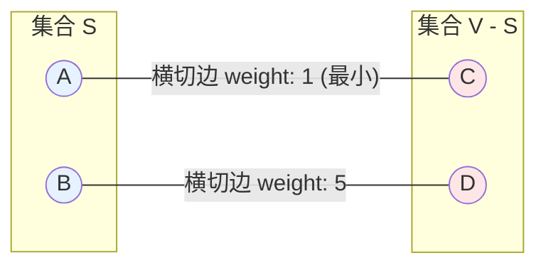
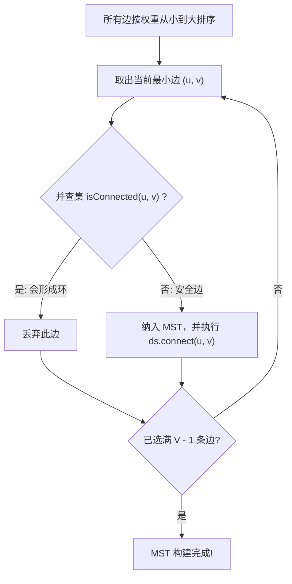

> **课程体系**：UC Berkeley CS61B: Data Structures (Spring 2024)  
> **所属模块**：Module 5: 优先队列与图算法 (Priority Queues & Graph Algorithms)  
> **主讲教师**：Prof. Justin Yokota & Prof. Peyrin Kao (UC Berkeley)  
> **视频时长**：52:03 ｜ **官方原版**：Lecture 25 - Minimum Spanning Trees  
> **视频直达**：[📺 在 B 站观看本讲原视频 (P25)](https://www.bilibili.com/video/BV1hJ4m1M7ZA/?p=25) ｜ [📑 官方课件 Slides (Google Presentation)](https://docs.google.com/presentation/d/13pPWHDLRUX2TAUUUK5ucEQ6dF3vUjzkj_C_iXDGaTPU) ｜ [📖 官方教材章节](https://cs61b-2.gitbook.io/cs61b-textbook/25.-minimum-spanning-trees)  
> **快速导航**：[← 上一讲 (P24 最短路径算法：Dijkstra 与 A* 启发式搜索)](/notes/cs61b/lecture-24) ｜ [📚 返回全书目录](/notes/topics/CS61B) ｜ [下一讲 (P26 图论总结与 DAG 最短路径) →](/notes/cs61b/lecture-26)

---

## 1. 最小生成树（Minimum Spanning Tree, MST）形式化定义

*(参考时间：00:01:20 · [视频跳转 (P25 00:01:20)](https://www.bilibili.com/video/BV1hJ4m1M7ZA/?p=25&t=80))*

假设我们需要为加州所有主要城市铺设光纤互联网骨干网。每两个城市之间铺设光纤都有不同的施工成本。

我们希望设计一个网络方案，满足：
1. **全连通（Connected）**：任意两个城市之间都能够通过光纤通信；
2. **无环（Acyclic）**：没有多余浪费的施工回路（即构成一棵树）；
3. **总成本最低（Minimal Weight）**：所有选定的光纤铺设成本总和达到全局最小。

这就是图论中的**最小生成树（MST）**问题。

## 2. 割定理（The Cut Property）：寻找安全边的基石公理

*(参考时间：00:09:40 · [视频跳转 (P25 00:09:40)](https://www.bilibili.com/video/BV1hJ4m1M7ZA/?p=25&t=580))*

如何判断某条特定的边是否必然属于全局最小生成树？全靠图论中最伟大的公理——**割定理（The Cut Property）**。

### 概念定义：
- **割（Cut）**：将图中的所有顶点随意划分为两个互不相交的非空集合 $S$ 与 $V - S$；
- **横切边（Crossing Edge）**：一端连接集合 $S$，另一端连接集合 $V - S$ 的任意边。

> **割定理公理**：  
> **对于图的任意一种划分割，在所有连接这两个集合的横切边中，权重绝对最小的那一条横切边（Minimal Crossing Edge），必然属于图的某棵最小生成树！**

## 3. Prim 算法：从单点出发的生长式贪心策略

*(参考时间：00:19:15 · [视频跳转 (P25 00:19:15)](https://www.bilibili.com/video/BV1hJ4m1M7ZA/?p=25&t=1155))*

Prim 算法是割定理的极简直接应用：
1. 从任意起始顶点 $s$ 开始，将 $s$ 放入已访问树集合 $S$ 中；
2. 考查所有一端在集合 $S$ 内、另一端在集合 $S$ 外的横切边；
3. 根据割定理，**贪心地挑出其中权重最小的那条横切边**，将其纳入 MST，并把对端的新顶点吸纳进集合 $S$；
4. 重复上述步骤，直到所有 $V$ 个顶点全部被吸纳进树中。

使用索引优先队列优化时，Prim 算法的时间复杂度为 **$O(E \log V)$**。

## 4. Kruskal 算法：基于边的全局排序与并查集防环检测

*(参考时间：00:28:30 · [视频跳转 (P25 00:28:30)](https://www.bilibili.com/video/BV1hJ4m1M7ZA/?p=25&t=1710))*

与 Prim 的单点生长不同，Kruskal 算法采取**全局宏观贪心策略**：

1. 将整张图中的所有 $E$ 条边，**按照权重从小到大进行全局升序排序**；
2. 准备一个空的森林（每个顶点自成一个集合，使用**并查集 Disjoint Sets** 维护）；
3. 从最小边开始依次考查每一条边 $e = (u, v)$：
   - 使用并查集查询 `ds.isConnected(u, v)`；
   - **若已连通**：说明加入该边会产生回路环，果断丢弃！
   - **若未连通**：将边 $e$ 纳入 MST，并执行 `ds.connect(u, v)`！
4. 当成功选出 $V - 1$ 条边时，算法提前终止，MST 构建完毕！

### 复杂度：
排序耗费 $O(E \log E)$，并查集操作耗费 $O(E \alpha(V))$，总时间严格为 **$O(E \log E) = O(E \log V)$**！

## 5. 本讲小结与课后自测

*(参考时间：00:37:00 · [视频跳转 (P25 00:37:00)](https://www.bilibili.com/video/BV1hJ4m1M7ZA/?p=25&t=2220))*

### 课后综合自测题
MST（最小生成树）与 SPT（最短路径树）是一回事吗？  
**答案与解析**：  
**完全不同！**  
- MST 关注的是**所有边的总权重和最小**，属于全网建造成本最低；  
- SPT 关注的是**从特定起点到某个具体顶点的单条路径距离最短**。一棵 MST 并不保证两点间的路径是最短的，一棵 SPT 的所有边权重和往往大于 MST。

---

## 附录：UC Berkeley 官方教材深度研读 (Official Textbook In-Depth Chapters)

> **导读说明**：本节内容整合自 UC Berkeley CS61B 官方教材库（GitBook Textbook），针对本讲的核心数据结构与算法提供原汁原味的英文理论推导、形式化代码范例与配套章节习题，与前文视频精讲相互补充印证。

## 25. Minimum Spanning Trees

By Teresa Luo and Mihir Mirchandani

---

## 25.1 MSTs and Cut Property

Before we dive into the chapter, let's hear a couple words from Professor Hug on MSTs

Let's do a quick warmup!

Spanning Tree Definition

Spanning Tree Usefulness

MSTs vs SPTs

### Minimum Spanning Trees 

\

A minimum spanning tree (MST) is the lightest set of edges in a graph possible such that all the vertices are connected. Because it is a tree, it must be connected and acyclic. And it is called "spanning" since all vertices are included.

In this chapter, we will look at two algorithms that will help us find a MST from a graph.

Before we do that, let's introduce ourselves to the Cut Property, which is a tool that is useful for finding MSTs.

#### Cut Property 

\

We can define a **cut** as an assignment of a graph’s nodes to two non-empty sets (i.e. we assign every node to either set number one or set number two).

We can define a **crossing edge** as an edge which connects a node from one set to a node from the other set.

With these two definitions, we can understand the **Cut Property**; given any cut, the minimum weight crossing edge is in the MST.

*原教材中的此处配图链接已失效，可参阅[最小生成树与割性质说明](https://cs61b-2.gitbook.io/cs61b-textbook/25.-minimum-spanning-trees)。*

The proof for the cut property is as follows: Suppose (for the sake of contradiction) that the minimum crossing edge *e* were not in the MST. Since it is not a part of the MST, if we add that edge, a cycle will be created. Because there is a cycle, this implies that some other edge f must also be a crossing edge (for a cycle, if *e* crosses from one set to another, there must be another edge that crosses back over to the first set). Thus, we can remove *f* and keep *e*, and this will give us a lower weight spanning tree. But this is a contradiction because we supposedly started with a MST, but now we have a collection of edges which is a spanning tree but that weighs less, thus the original MST was not actually minimal. As a result, the cut property must hold.

---

## 25.2 Prim's Algorithm

Finding MST.

One way to find the MST of a graph is the Prim's Algorithm. In this section, we will discuss both the conceptual and concrete implementation of this algorithm, as well as its runtime analysis. 

### Conceptual Visualization

Prim's Algorithm is one way to find a MST from a graph. It is as follows:

1. Start from some arbitrary node.

2. Repeatedly add the shortest edge that has **one node inside the MST in construction.**

3. Repeat until there are V - 1 edges.

#### Why does it work?

Prim's algorithm works because at all stages of the algorithm, we can reason as follows: 

* Consider dividing all the nodes in the graph into two sets:

  * Set 1: nodes that are part of the existing MST that's under construction

  * Set 2: all other nodes

* According to the algorithm, we always add the **lightest, or minimally weighted, edge** that crosses this cut.

* By **the Cut Property**, the added edge is necessarily part of the final MST.

### Implementation

Essentially, this algorithm runs via the same mechanism as [Dijkstra's algorithm](https://cs61b-2.gitbook.io/cs61b-textbook/24.-shortest-paths/24.2-dijkstras-algorithm). 

The only difference is that while Dijkstra's considers candidate nodes by their distance from the source node, Prim's looks at each candidate node's **distance from the MST under construction.**

### Runtime Analysis 

Because this algorithm runs through the same mechanism as Dijkstra's algorithm, its runtime is also identical to Dijkstra's:

$$
O((|V| + |E| )log(|V|))
$$

Remember, this is because we need to add to a priority queue fringe once for every edge we have, and we need to dequeue from it once for every vertex we have.

---

## 25.3 Kruskal's Algorithm

Finding MST.

Another algorithm that finds the MST of a graph is Kruskal's Algorithm. Instead of constructing the MST by traversing through the **nodes** like Prim's Algorithm, Kruskal's Algorithm finds the MST by traversing through the **edges**. 

### Conceptual Visualization and Implementation

The algorithm is as follows:

1. Sort all the edges from lightest to heaviest.

2. Taking one edge at a time (in sorted order), add it to the MST under construction if doing so **does not introduce a cycle.**

3. Repeat until there are V - 1 edges.

#### Why does it work?

Kruskal's algorithm works because of the following reasons:

* Recall the two "sets" introduced in last section. Any edge we add to the MST will be connecting one node from "set one" (nodes that are in the MST under construction), and another node from "set two" (all other nodes).

* The added edge is not part of cycle because we are only adding an edge if it does not introduce a cycle.

* By looking at edge candidates in order from lightest to heaviest, the added edge must be the lightest edge across this cut. (if there was a lighter edge that would be across this cut, it would have been added before this, and adding this one would cause a cycle to appear). 

Hence, this algorithm works also by **the Cut Property.**

### Kruskal's vs Prim's

It's important to note that the MST returned by Kruskal's might not be the same one returned by Prim's, but both algorithms will always return a MST.  

Since both are minimal (optimal), they will both give valid optimal answers (they are tied as equally minimal / same total weight, and this is as low as it can be).

### Runtime Analysis

#### Runtime with Unsorted Edges

Since the underlying data structures of implementing Kruskal's Algorithm are a Priority Queue (to sort the edges), and a Disjoined Set (to connect the edges), the runtime of Kruskal's Algorithm is in tandem with the runtime analysis of [Heaps](https://cs61b-2.gitbook.io/cs61b-textbook/21.-heaps-and-priority-queues) and [WQU](https://cs61b-2.gitbook.io/cs61b-textbook/14.-disjoint-sets/14.4-weighted-quick-union-wqu). 

Specifically, we are using  [Weighted Quick Union with Path Compression](https://cs61b-2.gitbook.io/cs61b-textbook/14.-disjoint-sets/14.5-weighted-quick-union-with-path-compression) to check whether or not an added edge will introduce a cycle. 

The operations that this algorithm utilizes and their corresponding runtime are:

* Insert: $$O(|E| log|E|)$$

* Delete minimum: $$O(|E| log|E|)$$

* Union: $$O(|V| log\cdot  |V|)$$

* isConnected: $$O(|E|log\cdot |V|)$$

The bottleneck of the algorithm is sorting all of the edges to start (insert and delete minimum. Hence, the runtime of Kruskal's Algorithm is:

$$
O(|E| log |E|)
$$

#### Runtime with Sorted Edges

Since there are no need to sort the edges, the "Insert" and "Delete minimum" operations of a heap are not called, where only WQU operations are called.

Therefore, if we are given pre-sorted edges and don't have to pay for that, then the runtime is:

$$
O(|E| log\cdot  |V|)
$$

Where $$log\cdot $$is the Ackermann function.

---

## 25.4 Chapter Summary

In this chapter, we learned about Minimum Spanning Trees and the Cut Property:

* **MST:** the lightest set of edges in a graph possible such that all the vertices are connected and acyclic. 

* **The Cut Property**: given any cut, the minimum weight crossing edge is in the MST.

  * *Cut*:  an assignment of a graph’s nodes to two non-empty sets 

  * *Crossing Edge:* an edge which connects a node from one set to a node from the other set.

We also learned about how to find MSTs of a graph with two algorithms: 

* **Prim's Algorithm**: Construct MST through a mechanism similar to Dijkstra's Algorithm, with the only difference of inserting vertices into the fringe not based on distance to goal vertex but distance to the MST under construction. 

  * *Runtime*: $$O((|V| + |E| )log(|V|))$$

* **Kruskal's Algorithm**: Construct MST by first sorting edges from lightest to heaviest, then add edges sequentially if no cycles are formed until there are V - 1 edges.

  * Runtime: 

    * $$O(|E| log |E|)$$ (unsorted edges)

    * $$O(|E| log\cdot  |V|)$$ (sorted edges) 

---

## 25.5 MST Exercises

### Factual

1. Select all valid MSTs in the diagram below.

<figure><figcaption></figcaption></figure>

2. **True/False**: It is possible that the only Shortest Path Tree is the only Minimum Spanning Tree.

Problem 1

Only B. C and D have cycles; A does not span all vertices.

Problem 2

True. In a tree, there is only one SPT and MST.

### Procedural

1. Run Prim's from `A` in the graph below. In what order are vertices visited? Break ties alphabetically.

2. Run Kruskal's in the graph below. In what order are edges added to the tree? Break ties alphabetically.

<figure><figcaption></figcaption></figure>

3. Design an algorithm to find the min-product spanning tree; ie the spanning tree with the minimum product of its edges. You may assume all edge weights are > 1.

Problem 1

Order: `A B D C F G E`. Prim's repeatedly picks the lightest edge between the current tree and any node not in the tree.

Problem 2

`AB, BD, CF, FG, AC, EG`. Kruskal's keeps adding the next lightest edge as long as it doesn't form a cycle.

Problem 3

Simply take the logarithm of each edge weight, then run any MST algorithm on it. This is guaranteed to work since $$\log a + \log b = \log ab$$, and minimizing the logarithm of the product is the same as minimizing the product for positive weight edges.

### Metacognitive

1. If we add 1 to the weight of each edge in an arbitrary graph, will the MST created by Kruskal’s change?

2. **True/False**: Prim’s Algorithm and Kruskal’s algorithm will always return the same result. If this is true, explain why. If this is false, provide a counterexample, breaking ties alphabetically.

3. Prove the following, known as the cycle property: Given any cycle in an edge weighted graph (all edge weights distinct), the edge of maximum weight in the cycle does not belong to the MST of the graph.

Problem 1

Adding 1 to each number will not change the order of the edges when we sort them, therefore we will get the same MST.

Problem 2

False. A counterexample is the following graph:

Prim’s starting from A will select AD, BD, and CD, whereas Kruskals will select AD, BC, and BD.

Problem 3

Suppose, for contradiction, the maximum-weight edge `f` in a cycle is present in the MST. 

Removing `f` disconnects our MST `T`. Form a cut with the two sides of the MST after `f` is removed.

Since `f` is part of a cycle, there must be also some edge `e` crossing that same cut. However, if we replace `f` with `e`, we now have a spanning tree that has less weight than our MST `T`.

This is a contradiction, so the maximum weight edge in a cycle cannot be part of the MST.

---

## 课程导航与跳转

| 上一讲 | 目录 | 下一讲 | 原视频 |
| :--- | :---: | :--- | :--- |
| [← 上一讲：最短路径算法：Dijkstra 与 A* 启发式搜索](/notes/cs61b/lecture-24) | [📚 返回 CS61B 全书目录](/notes/topics/CS61B) | [下一讲：图论总结与 DAG 最短路径 →](/notes/cs61b/lecture-26) | [🎬 在 B 站观看本讲 (P25)](https://www.bilibili.com/video/BV1hJ4m1M7ZA/?p=25) |
