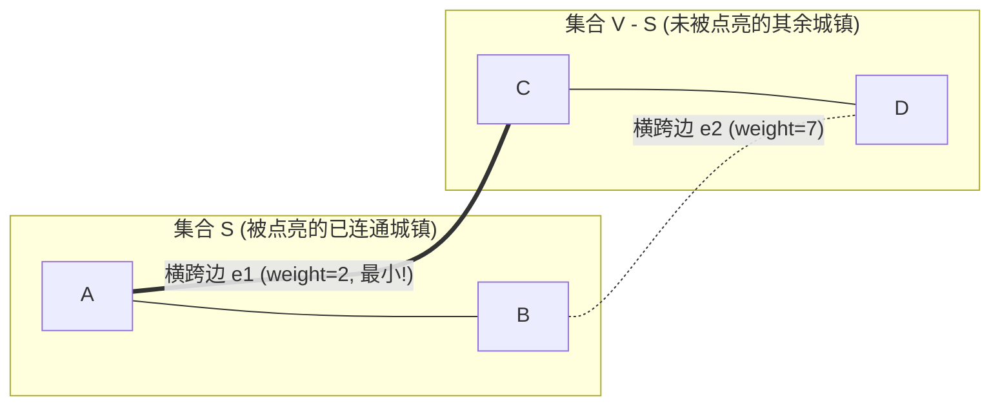

> **课程体系**：UC Berkeley CS61B: Data Structures (Spring 2024)  
> **所属模块**：Module 5: 优先队列与图算法 (Priority Queues & Graph Algorithms)  
> **主讲教师**：Prof. Justin Yokota & Prof. Peyrin Kao (UC Berkeley)  
> **视频时长**：52:03 ｜ **官方原版**：Lecture 25 - Minimum Spanning Trees  
> **视频直达**：[📺 在 B 站观看本讲原视频 (P25)](https://www.bilibili.com/video/BV1hJ4m1M7ZA/?p=25) ｜ [📑 官方课件 Slides (Google Presentation)](https://docs.google.com/presentation/d/13pPWHDLRUX2TAUUUK5ucEQ6dF3vUjzkj_C_iXDGaTPU) ｜ [📖 官方教材章节](https://cs61b-2.gitbook.io/cs61b-textbook/25.-minimum-spanning-trees)  
> **快速导航**：[← 上一讲 (P24 单源最短路径：Dijkstra 算法与边松弛)](/notes/cs61b/lecture-24) ｜ [📚 返回全书目录](/notes/topics/CS61B) ｜ [下一讲 (P26 生成树与有向无环图：Kruskal 与拓扑排序) →](/notes/cs61b/lecture-26)

---

## 1. 最小生成树（Minimum Spanning Tree, MST）的定义

*(参考时间：00:02:15 · [视频跳转 (P25 00:02:15)](https://www.bilibili.com/video/BV1hJ4m1M7ZA/?p=25&t=135))*

考虑为一组分散的城镇铺设计算机网络光缆或自来水管网：
- 我们必须保证任意两个城镇之间都是彼此连通可达的；
- 铺设光缆的成本极其昂贵，我们希望**网络中所有管道的总造价（总边权）最小化**；
- 显然，网络中**绝不能包含任何多余的回路/环（Cycles）**，否则删掉环上任意一条边依然连通且总成本更低！

满足上述条件的子图就是**最小生成树（MST）**：
> 对于包含 $V$ 个顶点的无向加权连通图，其最小生成树是一棵包含全部 $V$ 个顶点的无环连通子图，边数恰好为 $V - 1$，且边的权重之和达到全局最小！

## 2. 灵魂定理：割性质（The Cut Property）

*(参考时间：00:13:50 · [视频跳转 (P25 00:13:50)](https://www.bilibili.com/video/BV1hJ4m1M7ZA/?p=25&t=830))*

所有经典最小生成树算法的数学基石是不可动摇的**割性质（Cut Property）**。

### 什么是割（Cut）？
将图的全部顶点集合 $V$ 随意切分为两个互不相交且非空的子集 $S$ 与 $V - S$。这一人为划分称为一个**割（Cut）**。

### 什么是横跨边（Crossing Edge）？
一个端点落在集合 $S$ 中，另一个端点落在集合 $V - S$ 中的边，称为**横跨割的边（Crossing Edge）**。



> **割性质定理（Cut Property）**：  
> 对于图的任意一个割，**横跨该割的所有边中，权重最小的那条横跨边（Min-weight Crossing Edge），必定属于该图的某棵最小生成树！**

**反证法直觉证明**：  
假设最小生成树没有选这条最小横跨边 $e$，而是选了另一条较重的横跨边 $e'$。若将 $e$ 强行塞入生成树，必然形成一个环；此时将较重的 $e'$ 删去，图依然保持连通，但总权重变得更小！与原生成树“权重最小”的假设矛盾！

## 3. Prim 算法：从单个顶点不断贪心吞并

*(参考时间：00:26:10 · [视频跳转 (P25 00:26:10)](https://www.bilibili.com/video/BV1hJ4m1M7ZA/?p=25&t=1570))*

Prim 算法是割性质最自然、最纯粹的应用体现：

1. 从任意起点顶点 $s$ 开始，将其加入已连通集合 $S$；
2. 考察由当前集合 $S$ 与外部集合 $V - S$ 构成的割；
3. **根据割性质，贪心地挑出连接 $S$ 与外部的最短横跨边，将边另一端的顶点吞并进 $S$**；
4. 重复上述吞并过程 $V-1$ 次，直至所有顶点都被收入麾下！

```java
public class LazyPrimMST {
    private boolean[] marked; // 记录已被吞并进 S 的顶点
    private Queue<Edge> mst;  // 存放生成树的边
    private MinPQ<Edge> pq;   // 横跨割的候选边优先队列

    public LazyPrimMST(EdgeWeightedGraph G) {
        marked = new boolean[G.V()];
        mst = new ArrayDeque<>();
        pq = new MinPQ<>();

        visit(G, 0); // 从顶点 0 开始吞并
        while (!pq.isEmpty() && mst.size() < G.V() - 1) {
            Edge e = pq.delMin(); // 挑出当前最小横跨边
            int v = e.either(), w = e.other(v);
            if (marked[v] && marked[w]) continue; // 两个端点都在 S 内，失效边跳过
            mst.add(e);
            if (!marked[v]) visit(G, v);
            if (!marked[w]) visit(G, w);
        }
    }

    private void visit(EdgeWeightedGraph G, int v) {
        marked[v] = true;
        for (Edge e : G.adj(v)) {
            if (!marked[e.other(v)]) pq.insert(e);
        }
    }
}
```

## 4. Prim 算法 vs Dijkstra 算法深度对比

*(参考时间：00:38:20 · [视频跳转 (P25 00:38:20)](https://www.bilibili.com/video/BV1hJ4m1M7ZA/?p=25&t=2300))*

很多初学者发现 Prim 和 Dijkstra 的代码结构极其相似，甚至到了双胞胎的程度。必须深刻理解两者的本质差异：

| 维度 | Dijkstra 算法 | Prim 算法 |
| :--- | :--- | :--- |
| **解决的目标问题** | 单源最短路径（SSSP） | 最小生成树（MST） |
| **优先队列比较标尺** | **从源点出发的累积总路径长** `distTo[v] + weight` | **连接到已建树集合的单边净权重** `e.weight` |
| **图的方向性要求** | 通常在有向或无向加权图上运行 | 在**无向连通加权图**上运行 |
| **终极形态** | 最短路径树（关注到每个点的个别最优） | 最小生成树（关注全局总代价最小） |

## 5. 本讲小结与复杂度

*(参考时间：00:47:15 · [视频跳转 (P25 00:47:15)](https://www.bilibili.com/video/BV1hJ4m1M7ZA/?p=25&t=2835))*

- 采用索引优先队列的优化版 Prim 算法（Eager Prim），空间复杂度为 $O(V)$，时间复杂度被锁定在优雅的 **$O(E \log V)$**；
- 下一讲我们将介绍另一大著名的全局贪心算法——**Kruskal 算法**，看它如何与我们前面实现的并查集天衣无缝地联袂登场！

---

## 课程导航与跳转

| 上一讲 | 目录 | 下一讲 | 原视频 |
| :--- | :---: | :--- | :--- |
| [← 上一讲：单源最短路径：Dijkstra 算法与边松弛](/notes/cs61b/lecture-24) | [📚 返回 CS61B 全书目录](/notes/topics/CS61B) | [下一讲：生成树与有向无环图：Kruskal 与拓扑排序 →](/notes/cs61b/lecture-26) | [🎬 在 B 站观看本讲 (P25)](https://www.bilibili.com/video/BV1hJ4m1M7ZA/?p=25) |
