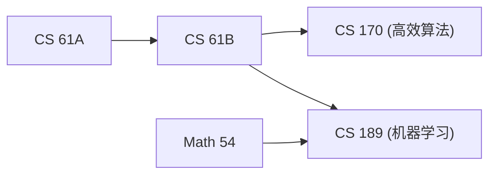

> **课程体系**：UC Berkeley CS61B: Data Structures (Spring 2024)  
> **所属模块**：Module 5: 优先队列与图算法 (Priority Queues & Graph Algorithms)  
> **主讲教师**：Prof. Justin Yokota & Prof. Peyrin Kao (UC Berkeley)  
> **视频时长**：49:51 ｜ **官方原版**：Lecture 26 - MSTs (continued)  Directed Acyclic Graphs  
> **视频直达**：[📺 在 B 站观看本讲原视频 (P26)](https://www.bilibili.com/video/BV1hJ4m1M7ZA/?p=26) ｜ [📑 官方课件 Slides (Google Presentation)](https://docs.google.com/presentation/d/1UHVEYtQhV7EQ74ETn5MvCsnRzsCzmp3MvXL84hXbw-g) ｜ [📖 官方教材章节](https://cs61b-2.gitbook.io/cs61b-textbook/28.-reductions-and-decomposition)  
> **快速导航**：[← 上一讲 (P25 最小生成树：割性质与 Prim 算法)](/notes/cs61b/lecture-25) ｜ [📚 返回全书目录](/notes/topics/CS61B) ｜ [下一讲 (P27 软件工程 I：复杂系统解耦与抽象屏障) →](/notes/cs61b/lecture-27)

---

## 1. 全局贪心之美：Kruskal 算法思想

*(参考时间：00:02:15 · [视频跳转 (P26 00:02:15)](https://www.bilibili.com/video/BV1hJ4m1M7ZA/?p=26&t=135))*

与 Prim 从单点逐步扩散吞并不同，Joseph Kruskal 提出了一种更加大开大合的全局贪心策略：

> **算法流程**：  
> 1. 将全图所有的 $E$ 条边，**按权重从小到大进行全局升序排序**；  
> 2. 依次取出当前权重最小的边；  
> 3. **若加入这条边不会与已选边构成环（Cycle），则毫不犹豫地将它收纳进最小生成树！**  
> 4. 若加入后会产生环，则直接果断丢弃；  
> 5. 重复直至收集齐 $V-1$ 条边为止！

## 2. 环检测神兵利器：并查集（Disjoint Sets）的高光时刻

*(参考时间：00:13:30 · [视频跳转 (P26 00:13:30)](https://www.bilibili.com/video/BV1hJ4m1M7ZA/?p=26&t=810))*

Kruskal 算法在工业界落地的最大技术瓶颈是：**如何以近乎常数的时间判定加入一条边 $(u, v)$ 是否会形成环？**

如果每次加边都用 DFS 遍历全图查环，耗时高达 $O(V)$，总时间将飙升至 $O(E \cdot V)$！  
**回忆我们在 Module 3 精心打造的终极并查集（WQU with Path Compression）！**

判定规则极其优雅：
- 考察边 $(u, v)$：调用 `uf.isConnected(u, v)`；
- **若两点已经连通**：说明它们之间早已存在一条替代路径，加边必定引发成环！直接跳过！
- **若两点不连通**：绝对安全！执行 `uf.connect(u, v)` 并将边加入生成树！

```java
public class KruskalMST {
    private Queue<Edge> mst = new ArrayDeque<>();

    public KruskalMST(EdgeWeightedGraph G) {
        MinPQ<Edge> pq = new MinPQ<>();
        for (Edge e : G.edges()) pq.insert(e); // 全边按权重入堆

        WeightedQuickUnionUF uf = new WeightedQuickUnionUF(G.V());

        while (!pq.isEmpty() && mst.size() < G.V() - 1) {
            Edge e = pq.delMin();
            int v = e.either(), w = e.other(v);
            if (!uf.isConnected(v, w)) { // 极速判定成环
                uf.connect(v, w);       // 瞬间合并集合
                mst.add(e);
            }
        }
    }
}
```

**运行时间分析**：  
对全边排序耗时 $O(E \log E)$，后续每条边执行近乎常数时间的并查集操作 $O(E \cdot \alpha(V))$。**总运行时间牢牢锁定在 $O(E \log E)$！**

## 3. 有向无环图（DAG）与拓扑排序（Topological Sort）

*(参考时间：00:25:40 · [视频跳转 (P26 00:25:40)](https://www.bilibili.com/video/BV1hJ4m1M7ZA/?p=26&t=1540))*

离开无向图，我们进入一类具有特殊数学魅力的有向图：**有向无环图（Directed Acyclic Graph, 简称 DAG）**。

在高校课程选课先修图、工业制造装配流水线、软件工程编译器依赖解析中，都存在严格的先后依赖约束。如果图中存在环，先修逻辑就会陷入死锁。

**拓扑排序（Topological Sort）**：  
将 DAG 的所有顶点排成一条线性序列，使得图中的每一条有向边 $u \to v$，$u$ 在序列中都严格排在 $v$ 的前面！



## 4. 拓扑排序算法实现：DFS 逆后序（Reverse Post-Order）

*(参考时间：00:36:50 · [视频跳转 (P26 00:36:50)](https://www.bilibili.com/video/BV1hJ4m1M7ZA/?p=26&t=2210))*

求解拓扑排序有一条神奇的定理：
> **对 DAG 执行深度优先搜索，并在递归返回退出该节点时将其推入栈中（后序遍历）；最终将栈中的顶点依次弹出，得到的序列就是完美的拓扑序列！**

```java
public class DepthFirstOrder {
    private boolean[] marked;
    private Stack<Integer> reversePost; // 逆后序栈

    public DepthFirstOrder(Digraph G) {
        reversePost = new Stack<>();
        marked = new boolean[G.V()];
        for (int v = 0; v < G.V(); v++) {
            if (!marked[v]) dfs(G, v);
        }
    }

    private void dfs(Digraph G, int v) {
        marked[v] = true;
        for (int w : G.adj(v)) {
            if (!marked[w]) dfs(G, w);
        }
        reversePost.push(v); // 关键：后序入栈
    }

    public Iterable<Integer> order() { return reversePost; }
}
```

## 5. DAG 上的线性最短路与最长路奇迹

*(参考时间：00:46:15 · [视频跳转 (P26 00:46:15)](https://www.bilibili.com/video/BV1hJ4m1M7ZA/?p=26&t=2775))*

在普通加权图中，Dijkstra 必须借助优先队列且不能处理负权边。  
但对于 DAG，只要**严格按照拓扑排序的顺序依次松弛所有顶点的出边**：
- **运行时间降维打击**：完全无需优先队列，时间仅需纯粹的 **$\Theta(V + E)$ 线性时间**！
- **负权边免疫**：完美兼容负权重边，绝无任何 Bug；
- **最长路径（Longest Paths）与关键路径分析（Critical Path Method）**：只需将所有边权取相反数即可快速求解工程项目的最短完工工期瓶颈！

---

## 课程导航与跳转

| 上一讲 | 目录 | 下一讲 | 原视频 |
| :--- | :---: | :--- | :--- |
| [← 上一讲：最小生成树：割性质与 Prim 算法](/notes/cs61b/lecture-25) | [📚 返回 CS61B 全书目录](/notes/topics/CS61B) | [下一讲：软件工程 I：复杂系统解耦与抽象屏障 →](/notes/cs61b/lecture-27) | [🎬 在 B 站观看本讲 (P26)](https://www.bilibili.com/video/BV1hJ4m1M7ZA/?p=26) |
