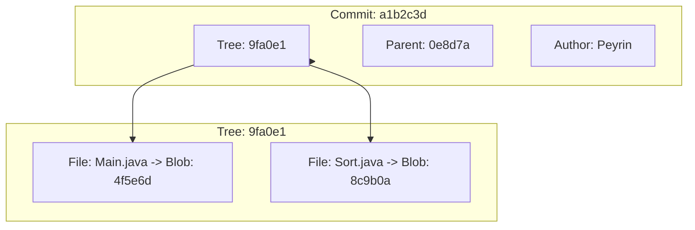
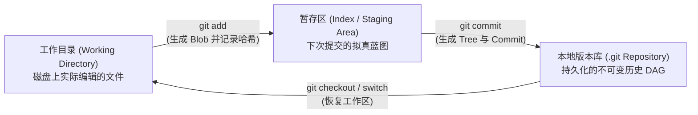

> **课程体系**：UC Berkeley CS61B: Data Structures (Spring 2024)  
> **所属模块**：Module 6: 高级数据结构与经典排序 (Tries & Sorting Algorithms)  
> **主讲教师**：Prof. Justin Yokota & Prof. Peyrin Kao (UC Berkeley)  
> **视频时长**：50:43 ｜ **官方原版**：Lecture 27 - Software Engineering I  
> **视频直达**：[📺 在 B 站观看本讲原视频 (P27)](https://www.bilibili.com/video/BV1hJ4m1M7ZA/?p=27) ｜ [📑 官方课件 Slides (Google Presentation)](https://docs.google.com/presentation/d/15afX6n25MybwUmm58M2xn8KqjQbMYHTQcTJ7u3h_I2M) ｜ [📖 官方教材章节](https://cs61b-2.gitbook.io/cs61b-textbook/27.-software-engineering-i)  
> **快速导航**：[← 上一讲 (P26 图论总结与 DAG 最短路径)](/notes/cs61b/lecture-26) ｜ [📚 返回全书目录](/notes/topics/CS61B) ｜ [下一讲 (P28 字典树：Tries 与前缀检索) →](/notes/cs61b/lecture-28)

---

## 1. 软件工程的终极护城河：版本控制系统（VCS）的演化

*(参考时间：00:01:25 · [视频跳转 (P27 00:01:25)](https://www.bilibili.com/video/BV1hJ4m1M7ZA/?p=27&t=85))*

在个人开发玩具项目时，很多人曾用复制文件夹的方式管理版本：`proj_v1`, `proj_v1_final`, `proj_v1_final_really_final`。

当工程演进为百人团队协作、上百万行代码时，这种原始方式会瞬间崩溃：
- 无法追溯每一行代码是谁、在什么时间、出于什么目的编写的（`git blame`）；
- 无法安全尝试新功能而不破坏稳定分支；
- 发生线上紧急故障时，无法在几秒钟内无损回滚到上一个稳定版本。

### Git 的诞生奇迹
Linus Torvalds 在两周内手工打造的 **Git**，彻底颠覆了以往集中式版本控制（如 SVN）的架构，开创了**去中心化、基于内容寻址的有向无环图（Content-Addressed DAG）体系**。

## 2. 内容寻址存储（Content-Addressable Storage）与 SHA-1 哈希

*(参考时间：00:10:40 · [视频跳转 (P27 00:10:40)](https://www.bilibili.com/video/BV1hJ4m1M7ZA/?p=27&t=640))*

在传统文件系统中，文件通过文件路径（如 `/home/user/file.txt`）寻址。而在 Git 的世界里：
> **核心法则**：**一切数据皆对象（Objects），一切对象均通过其内容的加密散列哈希值（SHA-1 Hash）寻址！**

### 40 位十六进制的绝对唯一性
SHA-1 算法将任意大小的文件内容映射为一个 160 位的散列值（以 40 个十六进制字符呈现，如 `3b18e512...`）：
- **内容决定名字**：只要文件内容发生哪怕一个比特的变动，计算出的哈希值就会彻底天翻地覆；
- **防篡改（Cryptographic Integrity）**：无法伪造或暗中篡改历史提交，因为下游所有提交的哈希都与上游内容紧密纠缠。

## 3. Git 底层三大对象模型：Blob、Tree 与 Commit

*(参考时间：00:19:15 · [视频跳转 (P27 00:19:15)](https://www.bilibili.com/video/BV1hJ4m1M7ZA/?p=27&t=1155))*

Git 的底层物理存储由三类对象拼装而成：

1. **Blob（Binary Large Object）**：纯粹存放文件的原始字节数据，完全不保存文件名或权限信息；
2. **Tree（目录树）**：相当于文件系统的目录，内部包含一系列条目，每个条目记录文件名、文件权限以及对应 Blob 或子 Tree 的 SHA-1 哈希值；
3. **Commit（提交对象）**：记录一次快照的元数据：
   - 指向顶层根 Tree 的哈希引用（代表该时刻全项目的完整快照）；
   - 指向一个或多个**父提交（Parent Commits）**的哈希引用；
   - 提交作者、时间戳与提交日志信息。



## 4. 提交历史的本质：不可变的有向无环图（Commit DAG）

*(参考时间：00:28:30 · [视频跳转 (P27 00:28:30)](https://www.bilibili.com/video/BV1hJ4m1M7ZA/?p=27&t=1710))*

每个提交都保存了其父提交的哈希指针。因此，整个版本库的历史在拓扑结构上是**一棵向后指引的有向无环图（Commit DAG）**：
- **分支（Branch）**：仅仅是一个**可移动的轻量级指针（40 字节的文件）**，保存着某个 Commit 的哈希值！创建分支的成本是瞬间的 $O(1)$！
- **HEAD 指针**：记录当前工作区正处于哪一个分支或哪一个具体的提交上。

## 5. 本讲小结与课后自测

*(参考时间：00:36:00 · [视频跳转 (P27 00:36:00)](https://www.bilibili.com/video/BV1hJ4m1M7ZA/?p=27&t=2160))*

### 课后综合自测题
在 Git 中执行 `git branch feature` 创建新分支时，会在底层完整复制一份项目的所有文件吗？  
**答案与解析**：  
**绝对不会！** Git 创建新分支仅仅是在 `.git/refs/heads/` 目录下创建一个名为 `feature` 的普通小文本文件，里面写入当前 HEAD 指向的那个 40 字符的 Commit 哈希值。空间开销仅为 40 字节，耗时不到 1 毫秒！

## 6. 暂存区（Staging Area / Index）与工作区的三方博弈

*(参考时间：00:41:00 · [视频跳转 (P27 00:41:00)](https://www.bilibili.com/video/BV1hJ4m1M7ZA/?p=27&t=2460))*

Git 的架构之所以比 SVN 等早期版本控制系统灵活得多，核心在于引入了**暂存区（Staging Area / Index）**这一中间缓冲层。

### 三大工作区域的状态流转


1. **工作目录（Working Directory）**：用户直接用 IDE 编辑的代码文件；
2. **暂存区（Index）**：准备随下一次提交永久封存的文件快照清单。它解耦了“磁盘修改”与“提交划分”，允许工程师精细化打包原子提交（Atomic Commits）；
3. **版本库（Repository）**：`.git` 目录中由所有不可变对象（Blobs, Trees, Commits）和引用指针构成的世界。

## 7. Gitlet 工程内核实战：用 Java 从零实现 init, add 与 commit

*(参考时间：00:48:00 · [视频跳转 (P27 00:48:00)](https://www.bilibili.com/video/BV1hJ4m1M7ZA/?p=27&t=2880))*

在 CS 61B 的标志性期末大作业 **Gitlet** 中，学生需要从零手写一个迷你的 Git 实现。

### 核心命令的底层实现伪代码：
```java
public class Repository {
    public static final File CWD = new File(System.getProperty("user.dir"));
    public static final File GITLET_DIR = new File(CWD, ".gitlet");
    public static final File OBJECTS_DIR = new File(GITLET_DIR, "objects");
    public static final File INDEX_FILE = new File(GITLET_DIR, "index");
    public static final File HEAD_FILE = new File(GITLET_DIR, "HEAD");

    /** 初始化全新版本库 */
    public static void init() {
        if (GITLET_DIR.exists()) {
            System.out.println("A Gitlet version-control system already exists in the current directory.");
            return;
        }
        GITLET_DIR.mkdirs();
        OBJECTS_DIR.mkdirs();
        // 创建初始根提交（空提交）
        Commit initial = new Commit("initial commit", null, new Date(0));
        String commitHash = saveObject(initial);
        // 初始化 master 分支与 HEAD
        writeContents(new File(GITLET_DIR, "refs/heads/master"), commitHash);
        writeContents(HEAD_FILE, "ref: refs/heads/master");
    }

    /** 暂存文件 */
    public static void add(String fileName) {
        File file = new File(CWD, fileName);
        if (!file.exists()) return;
        byte[] content = readContents(file);
        String blobHash = sha1(content);
        // 将内容存入 .gitlet/objects/
        saveBlob(blobHash, content);
        // 更新 Index 映射：fileName -> blobHash
        updateIndex(fileName, blobHash);
    }
}
```
通过面向对象设计与 Java 序列化技术，复杂的版本控制被分解为清晰的文件读写与 SHA-1 哈希映射。

## 8. 默克尔树（Merkle Tree）与分布式系统的密码学完整性

*(参考时间：00:54:00 · [视频跳转 (P27 00:54:00)](https://www.bilibili.com/video/BV1hJ4m1M7ZA/?p=27&t=3240))*

Git 的底层 Tree 与 Commit 结构，在密码学与分布式系统中被称为**默克尔树（Merkle Tree）**。

### 核心安全特性：
- 树的每一个父节点的哈希值，都由其所有子节点的哈希值串联后再次哈希而成；
- **防雪崩篡改**：如果黑客在历史提交中偷偷修改了 5 年前某份文件里的一个字符：
  - 该文件的 Blob 哈希变化；
  - 导致包含它的目录 Tree 哈希变化；
  - 导致当时的 Commit 哈希变化；
  - 导致之后的所有下游 Commit 哈希全部雪崩断裂！
- 这一机制使得 Git 成为不可篡改的分布式账本，奠定了现代区块链（Bitcoin / Ethereum）与分布式文件系统（IPFS）的核心思想基石。

---

## 附录：UC Berkeley 官方教材深度研读 (Official Textbook In-Depth Chapters)

> **导读说明**：本节内容整合自 UC Berkeley CS61B 官方教材库（GitBook Textbook），针对本讲的核心数据结构与算法提供原汁原味的英文理论推导、形式化代码范例与配套章节习题，与前文视频精讲相互补充印证。

## 27. Software Engineering I

By Aniruth Narayanan

Prior to the Fall 2023 semester, Professor Hug had a lecture about software code complexity.

For the Fall 2023 semester, this lecture was adjusted to have a similar form of content with different examples and real-world experiences that I (Aniruth) have been through on my gap year from Berkeley.

The content in this GitBook has been adjusted to the newest information. Both video recordings are linked below.

Full Lecture on Software Engineering I by Aniruth Narayanan, Fall 2023


Lecture Slides for Software Engineering I, Fall 2023


Full Lecture on Software Engineering I by Professor Hug, Fall 2022


---

## 27.1 Introduction to Software Engineering

#### Scale

CS 61A is an introductory course that focuses on the correctness of a program. CS 61B, however, focuses on *engineering* software projects. These projects are larger but now require decisions between valid options by considering tradeoffs. The choice between using a LinkedList and an ArrayList, for example, is a tradeoff of runtime and implementation decisions.

Working on smaller scale projects isn't the same as larger scale projects that place more emphasis on design. These tasks are often ambiguous. In the real world, there are no specs, no hints to guide you through your project; there's also no end date where you can submit your code and be done with it.

This lecture features some light theory and then some real-world examples to illustrate these concepts. Project 3 (Build Your Own World) will allow you to embrace the challenge of large scale projects yourself.

#### Further Reading

Please read **A Philosophy of Software Design Paperback by John Ousterhout** if you are very interested in this topic.

---

## 27.2 Complexity

#### Restrictions of Engineering

In other engineering disciplines, we are subject to the laws of nature. Objects have limits on how fast they can move, on how dense they can be, on how much of it there is.

* Chemical engineers worry about temperature

* Material scientists worry about how brittle material is

* Civil engineers worry about the strength of concrete

However, in computer science, we've solved most of these constraints already - the sum power of Apollo missions to get us to the moon is less than the computing power of your phone.

#### The Power of Software

Computers have evolved over time from being large calculators to fine-tuned machines to being multi-purpose and powerful. Video games, for example, used to be customized for the limitations of operating systems but now can be built in frameworks and abstractions.

From this, the limitation is no longer the limit of computing power; it is from the ways that we plan and design what we build. Further:

* An individual programmer is no longer able to effectively manage the entire software system for a large project

  * Spotify, for example, [has over a billion lines of code and 60 million used in production](https://engineering.atspotify.com/2023/04/spotifys-shift-to-a-fleet-first-mindset-part-1/)

* Any one programmer should only need to understand a fraction of the codebase

#### A Definition of Complexity

“*Anything related to the structure of a software system that makes it hard to understand and modify it*” - John Ousterhout, “A Philosophy of Software Design”

As programs have more features and functionality, their complexity increases exponentially. Consider Spotify adding a queue feature; it has to work, but it also needs to work with everything already implemented such as play/pause, search, skip, etc. 

Complex systems are not a goal; our goal is to keep software simple. Complex systems:

* Take longer to understand how code works

* Are more difficult to fix bugs with confidence

* Harder to find what needs to change

  * Unknown unknowns: unclear what needs to be known to make modifications

  * Very common in large codebases

#### Managing Complexity

There are two kinds of complexity:

* Unavoidable (Essential) Complexity

  * To implement certain features, that feature carries some level of inherent complexity with it

* Avoidable Complexity

  * Complexity that we can address with our choices

In response to avoidable complexity, we can:

* Make code simpler and more obvious

  * Using sentinel nodes in Project 1 made life significantly easier to avoid dealing with edge cases

* Modules as a means of abstraction: the ability to use a piece without understanding how it works based on some specification

  * Interfaces are an example - HashMap, BSTMap from lab are both Maps and can be used with `get` and `put` for some key-value pairs without understanding the underlying implementation

---

## 27.3 Strategic vs Tactical Programming

#### Tactical Programming

The goal is to get something working quickly, often using workarounds. Consider code that has many if statements to handle many separate cases to pass autograder tests that is challenging to update and explain.

Prototypes, proof-of-concepts often leverage tactical programming, to show that something could theoretically work.

However:

* There’s no time spent on overall design

* Code is complicated

* Refactoring takes time and potentially means restarting

  * If you didn't plan for Project 2 runtime requirements, you would have to redo the constructor and the entire project

* Proof of concepts are sometimes deployed in the real world due to lack of time

#### Strategic Programming

The goal is to write code that works elegantly - at the cost of planning time, to reduce coding time. This emphasizes long term strategy.

Code should be:

* Maintainable to fix bugs

* Simple to understand

* Future-proof to add new functionality

  * 61B projects have deadlines; afterwards, you can throw it away

If the strategy is insufficient, go back to the drawing board before continuing work.

Helper method strategy is key to leverage throughout projects, especially when we have written comprehensive tests to ensure that these methods are correct.

---

## 27.4 Real World Examples

For this section, it's *highly* recommended to watch the lecture video sections. What follows are summaries of the content; following the visuals are more insightful.

#### Retool

Building a system to implement many different kinds of things in a repeatable manner lends itself to designing general specifications for information, and then generating pages as needed.

This concept extends towards testing - particularly important as the real world has no autograder and no definition of correctness beyond tests that you write.

#### Commit History Traversal

Using what you already know in 61B - representing graphs, doing a BFS - you can solve real-world industry problems! This was an example of finding what deployments contain a certain change, by adjusting how we might represent a graph and then doing a BFS while choosing specific data structures for runtime and ease of use.

---

## 27.5 Summary, Exercises

#### Summary

Good code is more than just working code.

Code (and complexity) scales with functionality.

Practice good design principles in your classes!

The real world is ambiguous; you must define the problem and select the solution given tradeoffs of options.

#### Exercises

Note that since this chapter is more about design principles than actual content, the exercises merely check factual understanding of lecture material. We encourage you to reflect on the software engineering principles discussed as you work on your own projects.

1. What are two ways to manage complexity?

2. What is the difference between strategic and tactical programming? Which is better for managing complexity?

<details>

<summary>Problem 1</summary>

**Make code simpler and more obvious**. Eliminate special cases and avoid repetition. Make code as general and parsimonious as possible.

**Encapsulate code into modules.** Every module should have a specific purpose. Programmers and users can subsequently use other modules in their design, without having to understand how these modules work.

</details>

<details>

<summary>Problem 2</summary>

Tactical programming focuses on getting something to work, instead of focusing on overall design. 

In contrast, strategic programming involves planning ahead and selecting from multiple possible implmentations for the cleanest possible solution. Strategic programming requires thinking about possible future changes and emphasizing code quality.

For managing complexity, strategic programming is more effective. Tactical programming introduces complexity with small fixes and patches over time, whereas strategic programming aims to eliminate these complexities by changing the underlying design.

</details>


---

## 课程导航与跳转

| 上一讲 | 目录 | 下一讲 | 原视频 |
| :--- | :---: | :--- | :--- |
| [← 上一讲：图论总结与 DAG 最短路径](/notes/cs61b/lecture-26) | [📚 返回 CS61B 全书目录](/notes/topics/CS61B) | [下一讲：字典树：Tries 与前缀检索 →](/notes/cs61b/lecture-28) | [🎬 在 B 站观看本讲 (P27)](https://www.bilibili.com/video/BV1hJ4m1M7ZA/?p=27) |
