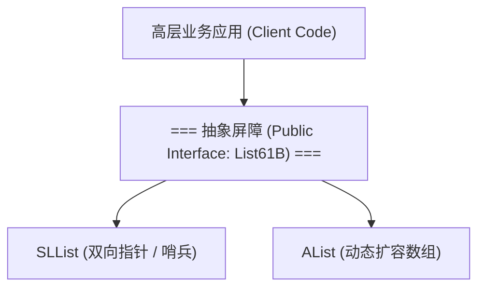

> **课程体系**：UC Berkeley CS61B: Data Structures (Spring 2024)  
> **所属模块**：Module 6: 高级数据结构与经典排序 (Tries & Sorting Algorithms)  
> **主讲教师**：Prof. Justin Yokota & Prof. Peyrin Kao (UC Berkeley)  
> **视频时长**：50:43 ｜ **官方原版**：Lecture 27 - Software Engineering I  
> **视频直达**：[📺 在 B 站观看本讲原视频 (P27)](https://www.bilibili.com/video/BV1hJ4m1M7ZA/?p=27) ｜ [📑 官方课件 Slides (Google Presentation)](https://docs.google.com/presentation/d/15afX6n25MybwUmm58M2xn8KqjQbMYHTQcTJ7u3h_I2M) ｜ [📖 官方教材章节](https://cs61b-2.gitbook.io/cs61b-textbook/27.-software-engineering-i)  
> **快速导航**：[← 上一讲 (P26 生成树与有向无环图：Kruskal 与拓扑排序)](/notes/cs61b/lecture-26) ｜ [📚 返回全书目录](/notes/topics/CS61B) ｜ [下一讲 (P28 前缀树：Trie 结构与字符串极速检索) →](/notes/cs61b/lecture-28)

---

## 1. 软件工程的终极敌人：不可控的复杂性

*(参考时间：00:02:10 · [视频跳转 (P27 00:02:10)](https://www.bilibili.com/video/BV1hJ4m1M7ZA/?p=27&t=130))*

在编写只有几十行的小程序时，任何设计风格都能运行。但当系统规模攀升至数千、数万行乃至数百万行代码时，**复杂性（Complexity）会呈超指数级爆发**。

未经深思熟虑的代码库最终都会退化成所谓的**“大泥球架构（Big Ball of Mud）”**：模块之间千丝万缕相互依赖，修改 A 处的变量，会导致千里之外八竿子打不着的模块 Z 莫名崩溃。软件工程的全部科学与艺术，本质上就是一套**对抗与驾驭复杂性的工程防御体系**。

## 2. 抽象屏障（Abstraction Barriers）的坚壁清野

*(参考时间：00:13:30 · [视频跳转 (P27 00:13:30)](https://www.bilibili.com/video/BV1hJ4m1M7ZA/?p=27&t=810))*

我们在 Module 1 中设计 `SLList` 时就贯彻了抽象屏障思想：
- **使用者（User）**：只允许与 `addFirst`, `getFirst`, `size` 这组高层语义方法打交道；
- **开发者（Implementer）**：在屏障后方自由使用 `IntNode`、指针调整或哨兵优化；
- **物理隔离**：通过 `private` 关键字将实现细节死死封锁在屏障之内！



当我们需要将链表重构为跳表或循环数组时，**只要公开接口不变，上游数十万行业务调用代码无需修改任何一个字**！

## 3. 单一职责原则（Single Responsibility Principle, SRP）

*(参考时间：00:26:15 · [视频跳转 (P27 00:26:15)](https://www.bilibili.com/video/BV1hJ4m1M7ZA/?p=27&t=1575))*

**定义**：一个类或一个方法，**应当仅有且只有一个引起它变化的原因**。

- **反例（上帝类 God Class）**：一个类既负责从网络下载 JSON，又负责解析业务数据，还负责将内容绘制到 UI 界面，甚至处理本地数据库存储；
- **重构之道**：
  1. `NetworkClient`：只专注处理 HTTP 连接与重试；
  2. `JsonParser`：只专注将原始文本反序列化为领域实体；
  3. `DatabaseStorage`：只专注持久化事务；
  4. `ViewRenderer`：只专注界面组件布局。

## 4. 实用重构手法：自解释命名与消除坏味道

*(参考时间：00:37:40 · [视频跳转 (P27 00:37:40)](https://www.bilibili.com/video/BV1hJ4m1M7ZA/?p=27&t=2260))*

讲师强调了几条立竿见影的代码清晰度军规：
1. **好的代码是自解释的（Self-documenting Code）**：
   ```java
   // 坏味道：无意义魔法缩写
   if (d.w > 30 && d.a < 5 && s) { ... }

   // 良好重构：自解释布尔变量
   boolean isHighEnergyWorkingDog = (dog.weight > 30) && (dog.age < 5) && dog.isServiceDog;
   if (isHighEnergyWorkingDog) { ... }
   ```
2. **拒绝硬编码魔法数字（No Magic Numbers）**：将 `86400` 提取为 `public static final int SECONDS_PER_DAY = 86400;`；
3. **扁平化提前返回（Guard Clauses）**：通过提前检查失败条件退出，消灭高达五六层的深渊嵌套 `if-else`。

## 5. 本讲小结与架构金句

*(参考时间：00:47:00 · [视频跳转 (P27 00:47:00)](https://www.bilibili.com/video/BV1hJ4m1M7ZA/?p=27&t=2820))*

- “任何傻瓜都能写出计算机可以理解的代码；优秀的程序员才能写出人类可以理解的代码。” —— Martin Fowler
- 良好的工程设计并不是在一开始就过度设计出庞大繁琐的抽象，而是随着需求演进，敏锐识别代码坏味道并保持持续微小重构。

---

## 课程导航与跳转

| 上一讲 | 目录 | 下一讲 | 原视频 |
| :--- | :---: | :--- | :--- |
| [← 上一讲：生成树与有向无环图：Kruskal 与拓扑排序](/notes/cs61b/lecture-26) | [📚 返回 CS61B 全书目录](/notes/topics/CS61B) | [下一讲：前缀树：Trie 结构与字符串极速检索 →](/notes/cs61b/lecture-28) | [🎬 在 B 站观看本讲 (P27)](https://www.bilibili.com/video/BV1hJ4m1M7ZA/?p=27) |
