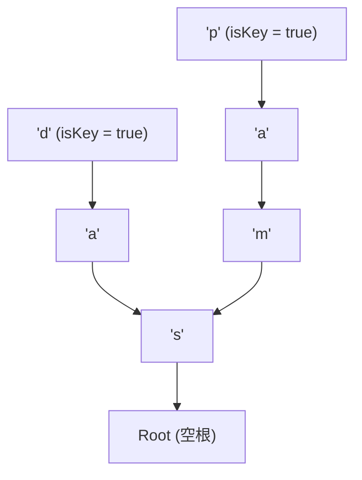

> **课程体系**：UC Berkeley CS61B: Data Structures (Spring 2024)  
> **所属模块**：Module 6: 高级数据结构与经典排序 (Tries & Sorting Algorithms)  
> **主讲教师**：Prof. Justin Yokota & Prof. Peyrin Kao (UC Berkeley)  
> **视频时长**：51:40 ｜ **官方原版**：Lecture 28 - Prefix Operations and Tries  
> **视频直达**：[📺 在 B 站观看本讲原视频 (P28)](https://www.bilibili.com/video/BV1hJ4m1M7ZA/?p=28) ｜ [📑 官方课件 Slides (Google Presentation)](https://docs.google.com/presentation/d/1tcKJNY-ultPxwaHtYn-kd-DV7aXcuBQm6resYvpoCkw) ｜ [📖 官方教材章节](https://cs61b-2.gitbook.io/cs61b-textbook/26.-prefix-operations-and-tries)  
> **快速导航**：[← 上一讲 (P27 软件工程 I：复杂系统解耦与抽象屏障)](/notes/cs61b/lecture-27) ｜ [📚 返回全书目录](/notes/topics/CS61B) ｜ [下一讲 (P29 排序 I：选择排序与就地堆排序) →](/notes/cs61b/lecture-29)

---

## 1. 字符集检索瓶颈：为什么普通 BST 和 Hash 不够快

*(参考时间：00:02:15 · [视频跳转 (P28 00:02:15)](https://www.bilibili.com/video/BV1hJ4m1M7ZA/?p=28&t=135))*

之前我们学习的 BST 和散列表在处理字符串时存在暗藏的隐蔽开销：
- **平衡树查找**：虽然比较次数是 $O(\log N)$，但**每次比较两个长度为 $L$ 的长字符串本身就需要耗费 $O(L)$ 的字符扫描时间**，总耗时为 $O(L \log N)$；
- **散列表查找**：计算长字符串的 `hashCode()` 同样必须遍历全部 $L$ 个字符，且散列表完全无法支持“查找所有以 `pre` 开头的单词”这种前缀操作！

针对字符串数据的特殊结构，计算机科学家发明了专门的检索神兵：**前缀树（Trie，源自 Retrieval）**。

## 2. 多叉前缀树（R-way Trie）结构设计

*(参考时间：00:13:20 · [视频跳转 (P28 00:13:20)](https://www.bilibili.com/video/BV1hJ4m1M7ZA/?p=28&t=800))*

在 Trie 树中，**节点内部通常不显式存储字符本身！字符由通往子节点的边（链接）来隐式表示**。

- 设字符集大小为 $R$（例如英文字符集 $R=26$，ASCII 码表 $R=128$）；
- 每个节点包含一个长度为 $R$ 的子节点指针数组 `Node[] next`；
- 每个节点包含一个布尔标记 `boolean isKey`（或关联的值 `Value val`），标示从根节点走到当前节点的路径是否构成一个完整的合法单词。



在上图中，树中存储了单词 `"sad"` 与 `"sam"`，它们完全共享了前缀路径 `'s'`！

## 3. 核心操作：查找（contains）与插入（add）

*(参考时间：00:25:40 · [视频跳转 (P28 00:25:40)](https://www.bilibili.com/video/BV1hJ4m1M7ZA/?p=28&t=1540))*

```java
public class TrieSet {
    private static final int R = 128; // ASCII 字符集基数

    private static class Node {
        private boolean isKey;
        private Node[] next = new Node[R];
    }

    private Node root = new Node();

    public boolean contains(String key) {
        Node curr = root;
        for (int i = 0; i < key.length(); i++) {
            char c = key.charAt(i);
            if (curr.next[c] == null) return false;
            curr = curr.next[c];
        }
        return curr.isKey;
    }

    public void add(String key) {
        root = add(root, key, 0);
    }

    private Node add(Node x, String key, int d) {
        if (x == null) x = new Node();
        if (d == key.length()) {
            x.isKey = true;
            return x;
        }
        char c = key.charAt(d);
        x.next[c] = add(x.next[c], key, d + 1);
        return x;
    }
}
```

**震撼的复杂度结论**：  
查找和插入一个字符串所需的时间**只取决于该字符串的长度 $L$，与 Trie 树中存储了一千个还是一百亿个单词（$N$）毫无关系！复杂度为严格的 $\Theta(L)$！**

## 4. 独门绝技：前缀匹配与智能输入补全（Autocomplete）

*(参考时间：00:36:50 · [视频跳转 (P28 00:36:50)](https://www.bilibili.com/video/BV1hJ4m1M7ZA/?p=28&t=2210))*

搜索引擎输入框的下拉联想提示（如输入 `"ca"` 自动列出 `"cat"`, `"car"`, `"cable"`）是 Trie 树最闪耀的应用：

```java
public List<String> keysWithPrefix(String prefix) {
    List<String> results = new ArrayList<>();
    Node x = get(root, prefix, 0); // 1. 先一路走完 prefix 的字符路径
    collect(x, new StringBuilder(prefix), results); // 2. 递归收集该子树下的所有 key
    return results;
}

private void collect(Node x, StringBuilder prefix, List<String> results) {
    if (x == null) return;
    if (x.isKey) results.add(prefix.toString());
    for (char c = 0; c < R; c++) {
        prefix.append(c);
        collect(x.next[c], prefix, results);
        prefix.deleteCharAt(prefix.length() - 1); // 回溯
    }
}
```

## 5. 本讲小结与空间权衡

*(参考时间：00:46:40 · [视频跳转 (P28 00:46:40)](https://www.bilibili.com/video/BV1hJ4m1M7ZA/?p=28&t=2800))*

- **空间开销警告**：如果字符集 $R$ 极大（如 Unicode 涵盖数万汉字），每个节点开辟 `Node[R]` 数组会产生巨量空指针浪费；
- **优化演进**：工业界通过引入哈希表映射子节点，或使用**三向单词查找树（Ternary Search Tree, TST）**，在兼顾 $O(L)$ 检索速度的同时实现紧凑的内存占用。

---

## 课程导航与跳转

| 上一讲 | 目录 | 下一讲 | 原视频 |
| :--- | :---: | :--- | :--- |
| [← 上一讲：软件工程 I：复杂系统解耦与抽象屏障](/notes/cs61b/lecture-27) | [📚 返回 CS61B 全书目录](/notes/topics/CS61B) | [下一讲：排序 I：选择排序与就地堆排序 →](/notes/cs61b/lecture-29) | [🎬 在 B 站观看本讲 (P28)](https://www.bilibili.com/video/BV1hJ4m1M7ZA/?p=28) |
