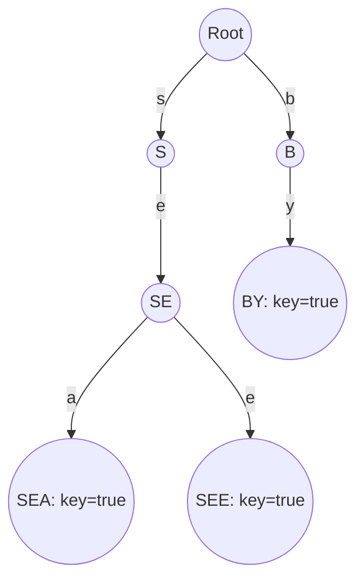

> **课程体系**：UC Berkeley CS61B: Data Structures (Spring 2024)  
> **所属模块**：Module 6: 高级数据结构与经典排序 (Tries & Sorting Algorithms)  
> **主讲教师**：Prof. Justin Yokota & Prof. Peyrin Kao (UC Berkeley)  
> **视频时长**：51:40 ｜ **官方原版**：Lecture 28 - Prefix Operations and Tries  
> **视频直达**：[📺 在 B 站观看本讲原视频 (P28)](https://www.bilibili.com/video/BV1hJ4m1M7ZA/?p=28) ｜ [📑 官方课件 Slides (Google Presentation)](https://docs.google.com/presentation/d/1tcKJNY-ultPxwaHtYn-kd-DV7aXcuBQm6resYvpoCkw) ｜ [📖 官方教材章节](https://cs61b-2.gitbook.io/cs61b-textbook/26.-prefix-operations-and-tries)  
> **快速导航**：[← 上一讲 (P27 软件工程 I：版本控制与 Gitlet 架构设计)](/notes/cs61b/lecture-27) ｜ [📚 返回全书目录](/notes/topics/CS61B) ｜ [下一讲 (P29 排序 I：选择排序与原地堆排序) →](/notes/cs61b/lecture-29)

---

## 1. 字符串键的特殊性：为什么哈希表无法优雅支持前缀匹配？

*(参考时间：00:01:25 · [视频跳转 (P28 00:01:25)](https://www.bilibili.com/video/BV1hJ4m1M7ZA/?p=28&t=85))*

假设我们需要为手机输入法设计**搜索框自动补全（Autocomplete）**或构建字典：
- 给出前缀 `"app"`，系统必须在毫秒内返回所有以 `"app"` 开头的单词（`"apple"`, `"application"`, `"apply"`）。

### 哈希表与平衡树的局限
- **哈希表**：哈希函数将字符串打散成完全随机的散列码，前缀相关的词被扔到了完全不同的哈希桶中，无法高效检索前缀；
- **平衡二叉搜索树（BST）**：虽然有序，但字符串比较需要逐字符对比，单次比对耗时与字符串长度 $L$ 成正比，总耗时为 $O(L \log N)$。

我们需要一种专为字符串量身定制的特殊树结构——**字典树（Trie，源自 reTRIEval）**！

## 2. 字典树（Trie）的核心拓扑：边承载字符，节点承载状态

*(参考时间：00:10:40 · [视频跳转 (P28 00:10:40)](https://www.bilibili.com/video/BV1hJ4m1M7ZA/?p=28&t=640))*

在 Trie 中，**节点内部通常不存储具体的字符**，字符是作为**指向子节点的链接分支（Edges）**存在的：
- 根节点表示空前缀；
- 每一个节点包含一个布尔标记 `isKey`，表示“从根节点沿着路径走到当前节点所拼出的字符串，是否构成一个合法的完整单词”；
- 拥有相同前缀的单词，在树中**100% 共享相同的前缀路径**！



## 3. R-way Trie 的 Java 实现与极速检索

*(参考时间：00:20:00 · [视频跳转 (P28 00:20:00)](https://www.bilibili.com/video/BV1hJ4m1M7ZA/?p=28&t=1200))*

假设字符集是 26 个小写英文字母（基数 $R = 26$）或 ASCII 码表（$R = 128$）：

```java
public class TrieSet {
    private static final int R = 128; // ASCII 字符集大小

    private static class Node {
        private boolean isKey;
        private Node[] next = new Node[R]; // 数组槽位直接充当字符指针
    }

    private Node root = new Node();

    public void add(String key) {
        root = add(root, key, 0);
    }

    private Node add(Node x, String key, int d) {
        if (x == null) x = new Node();
        if (d == key.length()) {
            x.isKey = true;
            return x;
        }
        char c = key.charAt(d);
        x.next[c] = add(x.next[c], key, d + 1);
        return x;
    }

    public boolean contains(String key) {
        Node x = find(root, key, 0);
        return x != null && x.isKey;
    }

    private Node find(Node x, String key, int d) {
        if (x == null) return null;
        if (d == key.length()) return x;
        char c = key.charAt(d);
        return find(x.next[c], key, d + 1);
    }
}
```

### 令人窒息的检索速度：
查找一个长度为 $L$ 的单词，只需要顺着数组指针走 $L$ 步！  
**时间复杂度严格为 $O(L)$！完全独立于字典中保存了多少万个单词（与 $N$ 彻底脱钩）！**

## 4. 自动补全（Autocomplete）与最长前缀匹配实现

*(参考时间：00:29:15 · [视频跳转 (P28 00:29:15)](https://www.bilibili.com/video/BV1hJ4m1M7ZA/?p=28&t=1755))*

实现前缀匹配 `keysWithPrefix(prefix)`：
1. 顺着 `prefix` 的字符一直走到对应的子树根节点；
2. 如果节点存在，对该子树执行 DFS 遍历；
3. 将沿途遇到的所有 `isKey == true` 的单词全部收集输出！

这正是 Google 搜索框与各类手机输入法底层极速联想补全的基石算法。

## 5. 本讲小结与课后自测

*(参考时间：00:37:00 · [视频跳转 (P28 00:37:00)](https://www.bilibili.com/video/BV1hJ4m1M7ZA/?p=28&t=2220))*

### 课后综合自测题
R-way Trie 最大的缺点是什么？工业界如何解决？  
**答案与解析**：  
最大的缺点是**内存稀疏浪费（Memory Waste）**！每个节点都要开辟长度为 $R$ 的指针数组，在短单词分散时大量指针为 `null`。工业界通过**三向单词查找树（TST, Ternary Search Tries）**或基数树（Radix Tree / Patricia Tree）合并单分支链条，将内存利用率提升数倍。

---

## 附录：UC Berkeley 官方教材深度研读 (Official Textbook In-Depth Chapters)

> **导读说明**：本节内容整合自 UC Berkeley CS61B 官方教材库（GitBook Textbook），针对本讲的核心数据结构与算法提供原汁原味的英文理论推导、形式化代码范例与配套章节习题，与前文视频精讲相互补充印证。

## 26. Prefix Operations and Tries

By: Thomas Lee

#### The Search Problem

To motivate this next section, let us consider the **search problem**. In this problem, we are given a stream of data, and our goal is to retrieve the information of interest. For example, a website which allows users to post content to their personal page could want to serve that content only to friends. Another example is if a new station receives logs from thousands of weather stations, and it wants to display a weather map for a specified date and time. 

Both of these are examples of the search problem, just in different flavors! The data structures we have built so far have been to solve the search problems for various domains of interest.

Let us review the data structures we have seen so far:

<table><thead><tr><th width="101">Name</th><th width="222">Storage Operations</th><th width="241">Primary Retrieval Operation</th><th>Retrieve By</th></tr></thead><tbody><tr><td>List</td><td><code>add(key)</code>, <code>insert(key, index)</code></td><td><code>get(index)</code></td><td>index</td></tr><tr><td>Map</td><td><code>put(key, value)</code></td><td><code>get(key)</code></td><td>key identity</td></tr><tr><td>Set</td><td><code>add(key)</code></td><td><code>containsKey(key)</code></td><td>key identity</td></tr><tr><td>Priority Queue</td><td><code>add(key)</code></td><td><code>getSmallest()</code></td><td>key order (smallest to largest)</td></tr><tr><td>Disjoint Sets</td><td><code>connect(int_a, int_b</code></td><td><code>isConnected(int_a, int_b)</code></td><td>two integer values</td></tr></tbody></table>

All of these data structures are used to solve different instances of the search problem. They all have their own applications depending on how the data of interest needs to be retrieved. \

One important thing to note is that these are **abstract** data types (ADTs), which means that we define the behavior of the data structure, not the implementation. There are multiple possible implementations for each of the data structures, and we can even use one data structure in the implementation of another! We often use these ADTs to create even more complex data structures. 

#### Abstraction

Abstraction is the idea of only being concerned with the behavior of something and not the underlying implementation. This concept is not as foreign as you might think! We apply principles of abstraction in our day to day lives without even realizing it. For example, using a keyboard can be considered an abstraction of writing text onto a computer. There can be multiple implementations of a keyboard's circuitry depending on what company produced it, but we do not worry about what is going on under the hood, we just care that it can allow us to type text onto a computer. 

Abstraction is often applied in *layers* when creating data structures. 

When implementing a Priority Queue, we could choose to use a Heap Ordered Tree to store the elements of the priority queue. We do not worry about the implementation of the Heap Ordered Tree--we just care about the methods that a Heap Ordered Tree provides. 

In the same vein, the Heap Ordered Tree does not care about the implementation of the Tree data structure that it uses in it's underlying implementation. 

Finally, whoever ends up using the Priority Queue we create is also unconcerned with how we made the Priority Queue. They would only care that our Priority Queue is able to support adding elements and returning the smallest element efficiently. 

In summary, we can often think of an ADT by the use of another ADT. ADTs have layers of abstraction, each defining behavior that is more specific than the idea that came before 

---

## 26.1 Introduction to Tries

Do or do not. There is no Trie.

Let us first consider a potential improvement for our current HashMap implementation. 

HashMaps are already incredibly fast. For our Resizing Separate Chaining Hash Table, `contains(x)` method has $$\Theta (1)$$ runtime (assuming even spread), and our `add(x)` method also has $$\Theta(1)$$ runtime (assuming even spread and amortized). This is generally the best that we can do, but if we have some additional insight on the data we are storing, we could get even faster. 

##### Special Case 1: Character Keyed Map

If we know that our keys are *only* ASCII characters, we can do away with our general-purpose HashMap and instead use an array where each index in the array corresponds to a specific ASCII character:

```java

public class DataIndexedCharMap<V> {

    private V[] items;

    public DataIndexedCharMap(int R) {

        items = (V[]) new Object[R];

    }

    public void put(char c, V val) {

        items[c] = val;

    }

    public V get(char c) {

        return items[c];

    }

}

```

The above is a possible implementation for a map that takes in character keys. The value R represents the number of possible characters (e.g. 128 for ASCII). We no longer have to store any buckets which could hurt our runtime (at the cost of additional memory). We know that our data will be evenly spread. 

##### Special Case 2: String Keyed Map

Suppose we know that our keys are always strings. We can use a special data structure called a Trie. This data structure stores each letter of a string as a node in a tree. It has great performance for getting words, adding words, and some special string operations. 

#### Trie Demo

Suppose we wanted to store the words "sam", "sad", "sap", "same", "a", and "awls". We want to create a data structure that will allow us to add these words in and make it clear that our set contains those words and not any suffixes or prefixes of those words. 

There are a few key ideas for Tries:

* Every node stores only one letter.

* Nodes can be shared by multiple keys.

Consider a Trie with the words "sam" and "sad" already in it:

<figure><figcaption></figcaption></figure>

When we add the word "sap", we can make use of the fact that we already have the prefix "sa" in the Trie:

<figure><figcaption></figcaption></figure>

Adding "same" follows a similar procedure. We have the prefix "sam" in the Trie, so we can use it to our advantage:

<figure><figcaption></figcaption></figure>

When adding "a", our first instinct may be to add an edge between the root and the existing "a" in our Trie:

<figure><figcaption></figcaption></figure>

However, this way would be a bit misleading because we do not know if the "a" is the start of the word "ame". Instead, we create an entirely new node:

<figure><figcaption></figcaption></figure>

Now when adding "awls", we can just use our similar procedure of using the prefix "a":

<figure><figcaption></figcaption></figure>

This is looking great already! We can see the words that we added very clearly in the Trie. However, there is an issue. We are supposed to have *just* the words "sam", "sad", "sap", "same", "a", and "awls" in the Trie. With our current structure, we cannot say for sure which prefixes should be considered to be in the Trie and which should not be. For example, we want the prefix "sam" to be in the Trie, but we do not want "awl" or "aw" to be considered to be in the Trie. 

To address this issue, we will *color* the last character of each string to be blue to indicate that there is a word that ends with that character:

<figure><figcaption></figcaption></figure>

Now we are finished! To search, we will traverse our Trie from the root and compare with each character of the string we are searching for as we go down. Thus, there are only two cases when we wouldn't be able to find a string; either the final node is white or we fall off the tree.

Examples:

* `contains("sam")`: true, blue node

* `contains("sa")`: false, white node

* `contains("a")`: true, blue node

* `contains("saq")`: false, fell off tree

#### Tries as Maps

Tries can also be maps if we also store data in the nodes. For example, we can have each blue node also hold a number, which could represent the multiplicity of that word. 

#### Summary

See an animated demo of creation of a Trie map [here](http://www.cs.princeton.edu/courses/archive/spring15/cos226/demo/52DemoTrie.mov).

---

## 26.2 Trie Implementation

Giving it the old college Trie.

Now, we will walk through an implementation of a Trie. We'll take a first approach with the idea that each node stores a letter, its children, and a color. Since we know each node key is a character, we can use our `DataIndexedCharMap` class we defined earlier to map to all of a nodes' children. Remember that each node can have at most the number of possible characters as its number of children.

```java

public class TrieSet {

   private static final int R = 128; // ASCII

   private Node root;    // root of trie

   private static class Node {

      private char ch;  

      private boolean isKey;   

      private DataIndexedCharMap next;

      private Node(char c, boolean blue, int R) {

         ch = c; 

         isKey = blue;

         next = new DataIndexedCharMap<Node>(R);

      }

   }

}

```

Note that for any given node, the DataIndexedCharMap object for that node will have mostly null values if nodes in our tree have relatively few children. For a node with only one child, we will have 128 links with 127 equal to null and 1 being used. This means that we are wasting a lot of excess space! We will explore alternative representations further on.

From this, we can make another important observation: each link corresponds to a character if and only if that character **exists**. Therefore, we can remove the Node's character variable and instead base the value of the character from its position in the parent `DataIndexedCharMap`.

```java

public class TrieSet {

   private static final int R = 128; // ASCII

   private Node root;    // root of trie

   private static class Node {

      // no more 'ch' instance variable

      private boolean isKey;   

      private DataIndexedCharMap next;

      private Node(boolean blue, int R) {

         isKey = blue;

         next = new DataIndexedCharMap<Node>(R);

      }

   }

}

```

#### Performance

Given a Trie with N keys the runtime for our Map/Set operations are as follows:

* `add`: $$\Theta (1)$$ 

* `contains`: $$\Theta (1)$$

Why is this the case? It doesn't matter how many items we have in our Trie, the runtime will always be *independent* of the number of keys. We only traverse the length of one key in the worst case ever, which is unrelated to the number of keys in the Trie. Therefore, let's analyze the runtime with a more appropriate measurement: L, the length of the key we are searching for:

* `add`: $$\Theta (L)$$

* `contains`: $$\Theta (L)$$

We have achieved constant runtime without having to worry about amortized resizing times or having an even spreading of keys! Our only issue is that as we mentioned above, our current design is extremely wasteful memory-wise since each node contains an array for every single character even if that character doesn't exist.

#### Improvement: Child Tracking

To address the issue of wasted space, let us explore two possible solutions:

* *Alternate Idea #1*: Hash-Table based Trie. This won't create an array of 128 spots but instead initialize the default value and resize the array only when necessary with the load factor.

* *Alternate Idea #2*: BST based Trie. Again this will only create children pointers when necessary, and we will store the children in the BST. We will have to worry about the runtime for searching in this BST, but this is not a bad approach.

When we implement a Trie, we have to pick a map to our children. A Map is an ADT, so we must also choose the underlying implementation for the map. What does this reiterate to us? There is an **abstraction** barrier between the implementations and the ADT that we are trying to create. This abstraction barrier allows us to take advantage of what each implementation has to offer when we try to meet the ADT behavior. Let's consider each advantage:

* DataIndexedCharMap

  * Space: 128 links per node

  * Runtime: $$\Theta (1)$$

* BST

  * Space: $$C$$ links per node, where $$C$$ is the number of children

  * Runtime: O(log$$R$$), where $$R$$ is the size of the alphabet

* Hash Table

  * Space: $$C$$ links per node, where $$C$$ is the number of children

  * Runtime: O($$R$$), where $$R$$ is the size of the alphabet

Note: Cost per link is higher in BST and Hash Tables; R is a fixed number (this means we can think of the runtimes as constant)

We can takeaway a couple of things. There is a slight memory and efficiency trade off (with BST/Hash Tables vs. DataIndexedCharMap). The runtimes for Trie operations are still constant without any caveats. Tries will especially thrive with some special operations.

---

## 26.3 Trie String Operations

Trie, Trie again.

Tries give us the ability to have constant time lookup and insertion, but they do not always perform better than BSTs and Hash Tables. For any string, we have to traverse through every character, whereas in BSTs and Hash Tables we have access to the entire string immediately. However, Tries are *much* more useful in the specific application of String Operations.

 The main appeal of tries is the ability to efficiently support specific string operations like *prefix matching*. You can imagine why tries make this extremely efficient! Say we were trying to find the longestPrefixOf. Just take the word you're looking for, compare each character with characters in your trie until you can go no longer. Similarly, if we wanted keyWithPrefix, we can traverse to the end of the prefix and return all remaining keys in the Trie.

Let's attempt to define a method `collect` which returns all of the keys in a Trie. The pseudocode will be as follows:

```

collect():

    Create an empty list of results x

    For character c in root.next.keys():

        Call colHelp(c, x, root.next.get(c))

    Return x

colHelp(String s, List<String> x, Node n):

    if n.isKey:

        x.add(s)

    For character c in n.next.keys():

        Call colHelp(s + c, x, n.next.get(c))

```

We first initialize our values inside of the parent function, and then create a recursive helper function to hold more parameters throughout the recursive calls. We only add the current string if it is a key, otherwise we concatenate the character to the string/path we are currently traversing and call the helper on the next child.

Now we can try writing the method `keysWithPrefix` which returns all keys that contain the prefix passed in as an argument. We will borrow heavily from the collect method above.

```

keysWithPrefix(String s):

    Find the end of the prefix, alpha

    Create an empty list x

    For character in alpha.next.keys():

        Call colHelp("sa" + c, x, alpha.next.get(c))

    Return x

```

#### Autocomplete

When you type into any search browser, for example Google, there are always suggestions of what you are about to type. This is extremely helpful and convenient. Say we were searching "How are you doing", if we just type in "how are" into google, we will see that it suggests this exact query.

One way to achieve this is using a Trie! We will build a map from strings to values.

* Values will represent how important Google thinks that string is (Probably frequency)

* Store billions of strings efficiently since they share nodes, less wasteful duplicates

* When a user types a query, we can call the method `keysWithPrefix(x)` and return the 10 strings with the highest value

One major flaw with this system is if the user types in short length strings. You can imagine that the number of keys with the prefix of the input is in the millions when in reality we only want 10. A possible solution to this issue is to store the best value of a substring in each node. We can then consider children in the order of the best value.

Another optimization is to merge nodes that are redundant. This would give us a "radix trie", which holds characters as well as strings in each node. We won't discuss this in depth.

#### Summary

Knowing the types of data that you are storing can give you great power in creating efficient data structures. Specifically for implementing Maps and Sets, if we know that all keys will be Strings, we can use a Trie:

* Tries theoretically have better performances for searching and insertion than hash tables or balanced search trees

* There are more implementations for how to store the children of every node of the trie, specifically three. These three are all fine, but hash table is the most natural

  * *DataIndexedCharMap* (Con: excessive use of space, Pro: speed efficient)

  * *Bushy BST* (Con: slower child search, Pro: space efficient)

  * *Hash Table* (Con: higher cost per link, Pro: space efficient)

* Tries may not actually be faster in practice, but they support special string operations that other implementations don't

  * `longestPrefixOf` and `keysWithPrefix` are easily implemented since the trie is stored character by character

  * `keysWithPrefix` allows for algorithms like autocomplete to exist, which can be optimized through use of a priority queue.

<table><thead><tr><th>Name</th><th width="142.33333333333331">key type</th><th>get(x)</th><th></th></tr></thead><tbody><tr><td>Balanced BST</td><td>comparable</td><td><span class="math">\Theta (log N)</span></td><td><span class="math">\Theta (log N)</span></td></tr><tr><td>RSC Hash Table</td><td>hashable</td><td><span class="math">\Theta (1)^{\dag}</span></td><td><span class="math">\Theta (1)^{*\dag}</span></td></tr><tr><td>Data Indexed Array</td><td>chars</td><td><span class="math">\Theta (1)</span></td><td><span class="math">\Theta (1)</span></td></tr><tr><td>Tries (BST, HT, DICM)</td><td>strings</td><td><span class="math">\Theta (1)</span></td><td><span class="math">\Theta (1)</span></td></tr></tbody></table>

\*: on average, $$\dag$$: items are evenly spread

---

## 26.4 Summary

The *search problem* is to store a collection of objects such that they can be rapidly retrieved (i.e. how do we implement a Map or Set). In particular, we are interested in searching by letter or digit.

### Terminology

* Length of string key usually represented by L.

* Alphabet size usually represented by R.

### Tries

Know how to insert and search for an item in a Trie. Know that Trie nodes typically do not contain letters, and that instead letters are stored implicitly on edge links. Know that there are many ways of storing these links, and that the fastest but most memory hungry way is with an array of size R. We call such tries R-way tries.

**Advantages of Tries.** Tries have very fast lookup times, as we only ever look at as many characters as they are in the data we’re trying to retrieve. However, their chief advantage is the ability to efficiently support various operations not supported by other map/set implementations including:

* longestPrefixOf

* prefixMatches

* spell checking

---

## 26.5 Exercises

### Factual

1. Suppose we use the following trie to represent a map. What would `get("sea")` return? What about `get("sell")`?

<figure><figcaption></figcaption></figure>

2. Consider the Trie-based set below. What does `keysWithPrefix("sp")` return? What nodes does it visit during this call?


3. What is the worst-case runtime when searching for a single word in a trie? Let $$R$$ be the size of the alphabet, and $$N$$ be the number of items in the trie, and $$L$$ be the length of the word being operated on.

<details>

<summary>Problem 1</summary>

`sea` terminates at the node with value 6. `sell` does not exist in the trie (since it does not terminate at the node with `l`, so the `get` operation returns null.

</details>

<details>

<summary>Problem 2</summary>

`keysWithPrefix` follows the prefix to the final letter of the prefix, then performs DFS from that node to get all children. 

During this procedure, it traverses the nodes `s, p, i, t, e, y`. The final return value is `spit, spite, spy`.

</details>

<details>

<summary>Problem 3</summary>

$$\Theta(L)$$. In the worst case, the word is a prefix of some other word in the trie, but is not present in the trie itself. In this case, we go through all the letters of the word.

</details>

### Metacognitive

1. Compare the worst-case number of character comparisons required to insert a word into an LLRB, hash table, and R-way trie. Let $$R$$ be the size of the alphabet, and $$N$$ be the number of items in the trie, and $$L$$ be the maximum length of any word.

<details>

<summary>Problem 1</summary>

**LLRB**: We always insert at the bottom of the LLRB, so there are $$\Theta(\log N)$$comparisons to figure out where the new node goes. Each word comparison takes up to $$L$$ character comparisons. Thus, there are $$\Theta(L \log N)$$ comparisons.

**Hash table**: In the worst case, all items hash to the same bucket. On an insertion, we must compare a word to all other words in the bucket for equality. Assuming this bucket has $$N$$ items, this takes $$\Theta(LN)$$ comparisons.

**R-way trie**: In the worst case, we follow or create $$L$$ nodes to the end of the word. Thus, there are at most $$\Theta(L)$$ comparisons.

</details>


---

## 课程导航与跳转

| 上一讲 | 目录 | 下一讲 | 原视频 |
| :--- | :---: | :--- | :--- |
| [← 上一讲：软件工程 I：版本控制与 Gitlet 架构设计](/notes/cs61b/lecture-27) | [📚 返回 CS61B 全书目录](/notes/topics/CS61B) | [下一讲：排序 I：选择排序与原地堆排序 →](/notes/cs61b/lecture-29) | [🎬 在 B 站观看本讲 (P28)](https://www.bilibili.com/video/BV1hJ4m1M7ZA/?p=28) |
