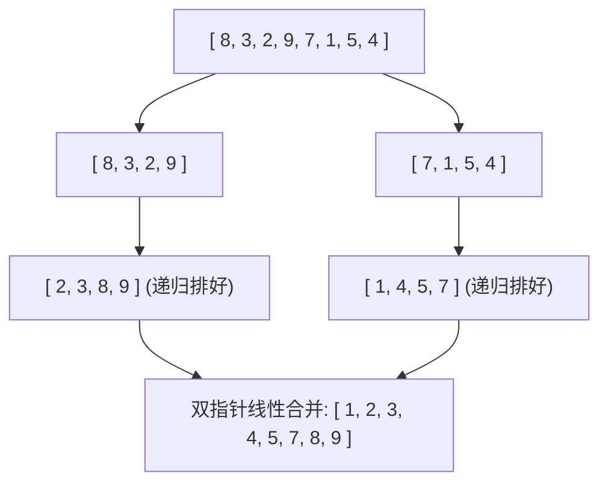

> **课程体系**：UC Berkeley CS61B: Data Structures (Spring 2024)  
> **所属模块**：Module 6: 高级数据结构与经典排序 (Tries & Sorting Algorithms)  
> **主讲教师**：Prof. Justin Yokota & Prof. Peyrin Kao (UC Berkeley)  
> **视频时长**：49:48 ｜ **官方原版**：Lecture 30 - Sorting II Mergesort Insertion Sort  
> **视频直达**：[📺 在 B 站观看本讲原视频 (P30)](https://www.bilibili.com/video/BV1hJ4m1M7ZA/?p=30) ｜ [📑 官方课件 Slides (Google Presentation)](https://docs.google.com/presentation/d/1MqmOxfh1c6gS4hk9hvuRR_hWXWTnCIXMqLGXwRX4Pvk) ｜ [📖 官方教材章节](https://cs61b-2.gitbook.io/cs61b-textbook/30.-quicksort)  
> **快速导航**：[← 上一讲 (P29 排序 I：选择排序与原地堆排序)](/notes/cs61b/lecture-29) ｜ [📚 返回全书目录](/notes/topics/CS61B) ｜ [下一讲 (P31 软件工程 II：架构设计模式与工程解耦) →](/notes/cs61b/lecture-31)

---

## 1. 逆序对（Inversions）与插入排序（Insertion Sort）的自适应性

*(参考时间：00:01:25 · [视频跳转 (P30 00:01:25)](https://www.bilibili.com/video/BV1hJ4m1M7ZA/?p=30&t=85))*

插入排序的核心直觉如同整理手中的扑克牌：从未排序区间依次取出一张牌，将其插入到左侧已经排好序的手牌中的合适位置。

### 逆序对与运行时间定理
数组中的一个**逆序对（Inversion）**指一对满足下标 $i < j$ 但数值 $A[i] > A[j]$ 的元素对。
> **插入排序核心定理**：  
> **插入排序所执行的数据交换次数，精确等于数组中逆序对的总数量！**

- **最好情况**：数组已经有序（逆序对数量为 0）。算法仅需扫描一遍，单次比较即可，运行时间为惊人的 **$\Theta(N)$ 线性时间**！
- **最坏情况**：数组完全逆序（逆序对数量为 $\frac{N(N-1)}{2}$），耗时 $\Theta(N^2)$。
- **工业级价值**：对于“几乎已经有序（Nearly Sorted）”的微小数据集，插入排序通常是全宇宙最快的算法，超越一切复杂的 $O(N \log N)$ 算法！

## 2. 分治法巅峰：归并排序（Mergesort）算法设计

*(参考时间：00:11:30 · [视频跳转 (P30 00:11:30)](https://www.bilibili.com/video/BV1hJ4m1M7ZA/?p=30&t=690))*

归并排序（Mergesort）由现代计算机之父冯·诺依曼于 1945 年发明，是**分治法（Divide and Conquer）**的终极经典：

1. **分解（Divide）**：将当前无序数组从正中间切成左右两半；
2. **解决（Conquer）**：递归地对左半部分和右半部分分别进行归并排序；
3. **合并（Combine）**：将两个已经有序的子数组，合并为一个更大的单调有序数组。

## 3. 归并排序主定理与严格 $\Theta(N \log N)$ 证明

*(参考时间：00:21:40 · [视频跳转 (P30 00:21:40)](https://www.bilibili.com/video/BV1hJ4m1M7ZA/?p=30&t=1300))*

分析归并树的递归层级：
- 数组从大小 $N$ 每次除以 2，递归树的高度严格为 $\log_2 N$；
- 在每一层中，所有子数组的双指针合并操作总耗时恒为 $\Theta(N)$；
- 递归树共有 $\log_2 N$ 层，每层耗费 $\Theta(N)$；
- **总时间复杂度**：
  $$\text{Total Time} = \Theta(N) \times \log_2 N = \Theta(N \log N)$$
无论输入数据是完全正序、完全倒序还是完全随机，归并排序的耗时绝对恒定为 **$\Theta(N \log N)$**！

## 4. 排序算法的黄金属性：稳定性（Stability）

*(参考时间：00:31:00 · [视频跳转 (P30 00:31:00)](https://www.bilibili.com/video/BV1hJ4m1M7ZA/?p=30&t=1860))*

### 为什么稳定性至关重要？
假设我们在电商网站搜索商品，先按“用户评分”排好了序；接着我们点击“按价格排序”。  
如果排序算法是**稳定（Stable）**的：在价格相同的情况下，评分较高的商品依然会排在前面（保留了上一轮排序的相对秩序）！  
如果是不稳定的，之前的排序成果将被彻底打乱。

- **归并排序是稳定的**（双指针比对时，相等元素优先取左侧子数组）；
- **插入排序是稳定的**；
- **堆排序与快速排序是不稳定的**。

## 5. 本讲小结与课后自测

*(参考时间：00:39:00 · [视频跳转 (P30 00:39:00)](https://www.bilibili.com/video/BV1hJ4m1M7ZA/?p=30&t=2340))*

### 课后综合自测题
归并排序最大的缺点是什么？  
**答案与解析**：  
**空间开销较大（Not In-Place）！** 在执行双指针合并时，必须开辟一个长度为 $N$ 的辅助临时数组用于暂存数据，空间复杂度为 $O(N)$。Java 在对原始基本类型排序时倾向于使用无额外空间开销的快速排序。

---

## 附录：UC Berkeley 官方教材深度研读 (Official Textbook In-Depth Chapters)

> **导读说明**：本节内容整合自 UC Berkeley CS61B 官方教材库（GitBook Textbook），针对本讲的核心数据结构与算法提供原汁原味的英文理论推导、形式化代码范例与配套章节习题，与前文视频精讲相互补充印证。

## 30. Quicksort

- [30.1 Partitioning](https://cs61b-2.gitbook.io/cs61b-textbook/30.-quicksort/30.1-partitioning.md)

- [30.2 Quicksort Algorithm](https://cs61b-2.gitbook.io/cs61b-textbook/30.-quicksort/30.2-quicksort-algorithm.md)

- [30.3 Quicksort Performance Caveats](https://cs61b-2.gitbook.io/cs61b-textbook/30.-quicksort/30.3-quicksort-performance-caveats.md)

- [30.4 Summary](https://cs61b-2.gitbook.io/cs61b-textbook/30.-quicksort/30.4-summary.md)

- [30.5 Exercises](https://cs61b-2.gitbook.io/cs61b-textbook/30.-quicksort/30.5-exercises.md)

---

## 30.1 Partitioning

Previously, we’ve covered **selection sort, heap sort, merge sort, and insertion sort**.

These sorts each have a basic idea powering them: 

* Selection sort: find the smallest item, put it at the front

* Heap sort: use MaxPQ to find the maximum element, put it at the front

* Merge sort: merge two sorted halves into one sorted whole 

* Insertion sort: determine where to insert the current item

The core idea behind Quicksort involves **partitioning.** 

Specifically, to partition an array a\[], first pick an element x = a\[i] as the pivot. 

<figure><a href="https://cs61b-2.gitbook.io/cs61b-textbook/15.-asymptotics-ii/15.4-mergesort">原教材配图已失效，查看归并排序章节说明。</a><figcaption>
In this array, x = 10 and is the pivot element. This array has not be partitioned on x = 10 yet. 
</figcaption></figure>

Partitioning on that pivot element (x) involves rearrange a\[] such that: 

1. x moves to some position j (can be the original position of i)

2. All array elements to the left of x are less than or equal to x (<= x) 

3. All array elements to the right of x are greater than or equal to x (>= x)

In the following arrays, A, B, and C represent arrays that are valid partitions (with the pivot being x = 10), while D represents an invalid partition.

<figure><a href="https://cs61b-2.gitbook.io/cs61b-textbook/15.-asymptotics-ii/15.4-mergesort">原教材配图已失效，查看归并排序章节说明。</a><figcaption>
D is an invalid partition because 4 is less than 10, but is to the right of the pivot after the partition. 
</figcaption></figure>

 

---

## 30.2 Quicksort Algorithm

The figure below shows a partition performed on the pivot of 5. Notice how 5 in its “proper place” (in other words, it’s exactly where it should be if the entire array was sorted).

This suggests that the partition procedure can be used recursively on the two halves to the left and to the right of the pivot element. 

<figure><a href="https://cs61b-2.gitbook.io/cs61b-textbook/15.-asymptotics-ii/15.4-mergesort">原教材配图已失效，查看归并排序章节说明。</a><figcaption>
After partitioning on the pivot element of 5, 5 is in the “proper place” and there are two halves left to be sorted. The left half are the four elements of [3, 2, 1, 4], and the right half consists of the three elements of [7, 8, 6]. 
</figcaption></figure>

The properties that partitioning provides inspires Tony Hoare’s Quicksort algorithm. 

**Quicksort Algorithm** 

To quicksort N items: 

1. Partition on the leftmost item as the pivot. 

2. Recursively quicksort the left half. 

3. Recursively quicksort the right half. 

<figure><a href="https://cs61b-2.gitbook.io/cs61b-textbook/15.-asymptotics-ii/15.4-mergesort">原教材配图已失效，查看归并排序章节说明。</a><figcaption>
<a href="https://docs.google.com/presentation/d/1QjAs-zx1i0_XWlLqsKtexb-iueao9jNLkN-gW9QxAD0/edit?usp=sharing">Demo of quicksort is linked here</a>
</figcaption></figure>

 

---

## 30.3 Quicksort Performance Caveats

"Quicksort" was chosen by Tony Hoare as the name for this particular partition sort algorithm. Coincidentally, quicksort is empirically the fastest sort for most common situations. 

How fast is Quicksort exactly? To answer this question, we need to count the number and calculate the difficulty of the partition operations employed in Quicksort. 

In the theoretical runtime analysis, partitioning costs $$\Theta(K)$$ time, where $$\Theta(K)$$ is the number of elements being partitioned.

However, what complicates runtime analysis for Quicksort is that the the overall runtime will depend on where the pivot ends up. 

##### Best Case

For instance, the best case runtime is when the pivot chosen always lands in the middle (in other words, the partition always picks the median element of the array). 

<figure><a href="https://cs61b-2.gitbook.io/cs61b-textbook/15.-asymptotics-ii/15.4-mergesort">原教材配图已失效，查看归并排序章节说明。</a><figcaption>
Best Case
</figcaption></figure>

In the best case, the total work done at each level is approximately O(N). To see this, the first partition pivots on one element and requires checking all N elements to determine whether they go on the right or the left of the pivot element. The second layer repeats this, but for N/2 elements on two separate pivots (since we are recursively partitioning on the two halves). Thus, each level is O(N) work. 

The overall runtime becomes $$\Theta(NH)$$, where H = # of layers = $$\Theta(log N)$$. Thus, the total runtime for Quicksort in the best case is $$\Theta(N log N)$$.

##### Worst Case

The worst case for runtime occurs when the pivot chosen at each partition lands at the beginning of the array. In this scenario, each layer still has to do O(N) work, but now there are H = # of layers = N layers, since every single element has to be pivoted on. Thus, the worst case runtime is $$\Theta(N^2)$$.

<figure><a href="https://cs61b-2.gitbook.io/cs61b-textbook/15.-asymptotics-ii/15.4-mergesort">原教材配图已失效，查看归并排序章节说明。</a><figcaption>
Worst Case: \Theta(N^2)
</figcaption></figure>

##### Quicksort vs Mergesort Performance

| Theoretical Analysis | Quicksort           | Mergesort           |

| -------------------- | ------------------- | ------------------- |

| Best Case            | $$\Theta(N log N)$$ | $$\Theta(N log N)$$ |

| Worst Case           | $$\Theta(N^2)$$     | $$\Theta(N log N)$$ |

In comparison, Mergesort seems to be a lot better, since Quicksort suffers from a theoretical worst case runtime of $$\Theta(N^2)$$. So how can Quicksort be the fastest sort empirically? Quicksort's advantage empirically comes from the fact that on average, Quicksort is $$\Theta(NlogN)$$.

##### Quicksort's Performance Argument #1: 10% Case

One argument for why Quicksort is the fastest sort empirically supposes that the pivot always ends up at least 10% from either edge. 

<figure><figcaption>
Pivot is ~10% from the left edge.
</figcaption></figure>

If this is the case, then the runtime is still O(NH), where O(N) is the work at each level and H is the # of levels. Since the pivot always lands at least 10% from either edge, H is approximately $$\log\_{10/9} N$$= O(log N). Thus, overall runtime is O(N log N).

<figure><figcaption>
10% case partition work at each level.
</figcaption></figure>

In other words, even if you are not lucky enough to have a pivot that is near the middle, if you can at least have a pivot that is always 10% from the edge, the runtime will be O(N log N). 

##### Quicksort's Performance Argument #2: Quicksort is BST Sort

From another lens, Quicksort can be seen as a form of BST sort. This is because the compareTo calls that Quicksort employs between each element and the pivot element in each partition is the same as the compareTo calls performed in BST insert. 

<figure><figcaption>
BST insert
</figcaption></figure>

<figure><figcaption>
Quicksort partitions on the "same" BST elements as above.
</figcaption></figure>

Since random insertion into a BST takes O(N log N) time, Quicksort can be argued to have similar performance. 

##### Empirical Quicksort Runtime

Empirically, for N items, Quicksort uses an average of \~2N ln N compares to complete (across 10,000 trials with N = 1000). For more information, [check out this link](http://www.informit.com/articles/article.aspx?p=2017754\&seqNum=7).

##### Avoiding the Worst Case of Quicksort

As you can see from above, the performance of Quicksort (both in terms of order of growth and in constant factors) depends critically upon **how you select the pivot, how you partition around the pivot, and other optimizations that you can add to speed things up.** 

Given certain conditions, Quicksort can result in $$\Theta(N^2)$$, which is much worse than $$\Theta(N log N)$$. Some of these conditions include **bad ordering,** where the array is already in sorted order (or almost sorted order), and **bad elements,** where the array has all duplicates. 

---

## 30.4 Summary

**Insertion Sort Sweet Spots.** We concluded our discussion of insertion sort by observing that insertion sort is very fast for arrays that are almost sorted, i.e. that have Θ(N) inversions. It is also fastest for small N (roughly N≤15).

**Partitioning.** Partioning an array on a pivot means to rearrange the array such that all items to the left of the pivot are ≤ the pivot, and all items to the right are ≥ the pivot. Naturally, the pivot can move during this process.

**Partitioning Strategies.** There are many particular strategies for partitioning. You are not expected to know any particular startegy.

**Quicksort.** Partition on some pivot. Quicksort to the left of the pivot. Quicksort to the right.

**Quicksort Runtime.** Understand how to show that in the best case, Quicksort has runtime Θ(Nlog⁡N), and in the worse case has runtime $$Θ(N^2)$$.

**Pivot Selection.** Choice of partitioning strategy and pivot have profound impacts on runtime. Two pivot selection strategies that we discussed: Use leftmost item and pick a random pivot. Understand how using leftmost item can lead to bad performance on real data.

**Randomization.** Accept (without proof) that Quicksort has on average Θ(Nlog⁡N) runtime. Picking a random pivot or shuffling an array before sorting (using an appropriate partitioning strategy) ensures that we’re in the average case.

**Quicksort properties.** For most real world situations, quicksort is the fastest sort.

---

## 30.5 Exercises

### Factual

1. Suppose we have a sorted array in Java. What is the best approach for finding a particular item in the array: binary search or linear iteration?

2. Repeat the above exercise for a sorted array stored on physical tape.

3. Given the array `[90, 50, 20, 30, 40, 10, 60, 50, 30]`, what would be the best pivot?

Problem 1

Binary search. Binary search would take $$\log N$$ time, where $$N$$ is the length of the array.

Problem 2

On a physical tape, the runtime of the algorithm will be dominated by the time to accelerate the physical piece of tape. In the worst case, binary search would involve scanning to the middle of the tape, then a quarter of the way back, then an 1/8th of the way forward, and so forth. In the worst case, we have to cover N/2 + N/4 + N/8 + ... + 1 or O(N) spaces on the tape. However, all that acceleration back and forth will result in an algorithm that is almost certainly slower in the worst case than just scanning forwards.

Problem 3

40; it is the median which will evenly partition the array.

### Procedural

1. If we have 10 items to sort, how many compares will it take to selection sort all of the items?

2. What is the depth of the quicksort recursive tree in the best and worst case? Give an exact answer, not a theta bound.

Problem 1

45 total; first we do 9 compares to find the smallest item, then 8, then 7, etc. 1 + 2 + 3 + ... 9 = 45.

Problem 2

In the worst case, we make $$N$$ recursive calls if we always choose the smallest or largest item as our pivot. Thus, the recursive tree has depth $$N$$.

In the best case, we always choose the median as our pivot. This halves the size of the array at each level, resulting in $$\log\_2 N$$ levels.

### Metacognitive

1. Assume that we always pick the leftmost item as our pivot for quicksort. Identify the three types of arrays that will cause a worst-case runtime. For partitioning, assume that we partition into two arrays: items less than or equal to the pivot, and items greater than the pivot.

Problem 1

The two types of arrays are:

1. Arrays already in sorted order. There will always be nothing to the left of the pivot, since the pivot will always be the smallest item.

2. Arrays in reverse-sorted order. This has the same problem as (1), except that the pivot will always be the largest item. 

3. Arrays where all items are equal. Everything will be partitioned into the left (less than or equal to array), and nothing in the greater-than array.

---

## 课程导航与跳转

| 上一讲 | 目录 | 下一讲 | 原视频 |
| :--- | :---: | :--- | :--- |
| [← 上一讲：排序 I：选择排序与原地堆排序](/notes/cs61b/lecture-29) | [📚 返回 CS61B 全书目录](/notes/topics/CS61B) | [下一讲：软件工程 II：架构设计模式与工程解耦 →](/notes/cs61b/lecture-31) | [🎬 在 B 站观看本讲 (P30)](https://www.bilibili.com/video/BV1hJ4m1M7ZA/?p=30) |
