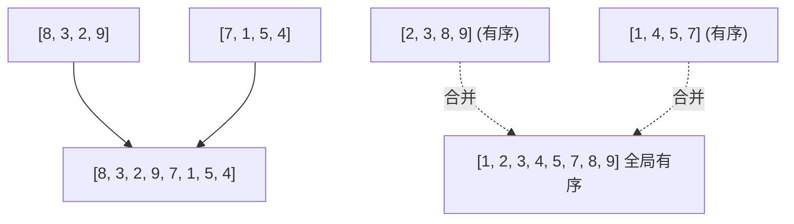

> **课程体系**：UC Berkeley CS61B: Data Structures (Spring 2024)  
> **所属模块**：Module 6: 高级数据结构与经典排序 (Tries & Sorting Algorithms)  
> **主讲教师**：Prof. Justin Yokota & Prof. Peyrin Kao (UC Berkeley)  
> **视频时长**：49:48 ｜ **官方原版**：Lecture 30 - Sorting II Mergesort Insertion Sort  
> **视频直达**：[📺 在 B 站观看本讲原视频 (P30)](https://www.bilibili.com/video/BV1hJ4m1M7ZA/?p=30) ｜ [📑 官方课件 Slides (Google Presentation)](https://docs.google.com/presentation/d/1MqmOxfh1c6gS4hk9hvuRR_hWXWTnCIXMqLGXwRX4Pvk) ｜ [📖 官方教材章节](https://cs61b-2.gitbook.io/cs61b-textbook/30.-quicksort)  
> **快速导航**：[← 上一讲 (P29 排序 I：选择排序与就地堆排序)](/notes/cs61b/lecture-29) ｜ [📚 返回全书目录](/notes/topics/CS61B) ｜ [下一讲 (P31 软件工程 II：API 设计与防御性编程) →](/notes/cs61b/lecture-31)

---

## 1. 插入排序（Insertion Sort）：打扑克牌的直觉

*(参考时间：00:02:15 · [视频跳转 (P30 00:02:15)](https://www.bilibili.com/video/BV1hJ4m1M7ZA/?p=30&t=135))*

插入排序的运作过程就像我们在打扑克牌时整理手牌：
- 将数组划分为“前部已排序区”和“后部未排序区”；
- 每次从未排序区抓取下一张牌，**自右向左与已排序区的牌逐一比较并交换，直至落入合法的有序槽位**。

```java
public static void insertionSort(int[] a) {
    for (int i = 1; i < a.length; i++) {
        for (int j = i; j > 0 && a[j] < a[j - 1]; j--) {
            swap(a, j, j - 1);
        }
    }
}
```

## 2. 插入排序的秘密武器：逆序对（Inversions）理论

*(参考时间：00:12:30 · [视频跳转 (P30 00:12:30)](https://www.bilibili.com/video/BV1hJ4m1M7ZA/?p=30&t=750))*

对于完全乱序的数组，插入排序的最坏时间是糟糕的 $\Theta(N^2)$。但它在工业界却拥有不可替代的尊崇地位，原因在于**它对“部分有序数据”拥有近乎无敌的高速表现**！

### 逆序对定义
对于数组中的一对索引 $i < j$，若满足 $a[i] > a[j]$，则称 $(i, j)$ 是一个**逆序对（Inversion）**。

> **核心定理**：  
> 插入排序内部执行的**元素交换次数，在数学上严格等于原数组中包含的逆序对总数**！

- **最好情况（数组本来就有序）**：逆序对为 0，内层循环一次都不执行，运行时间为极其暴力的 **$\Theta(N)$**！
- **应用场景**：在工程实践中，若已知数据大部分有序（如实时传感器增量数据），插入排序速度甚至超越快速排序与归并排序！同时它是绝对**稳定（Stable）且原地（In-place）**的。

## 3. 归并排序（Merge Sort）：分治思想的巅峰

*(参考时间：00:24:50 · [视频跳转 (P30 00:24:50)](https://www.bilibili.com/video/BV1hJ4m1M7ZA/?p=30&t=1490))*

约翰·冯·诺依曼于 1945 年发明的**归并排序（Merge Sort）**是分治算法（Divide and Conquer）的经典典范：

1. **分（Divide）**：将当前无序数组从中间一分为二，递归对左右两半分别进行归并排序；
2. **治（Conquer）**：递归的 Base Case 为子数组长度 $\le 1$（天然有序）；
3. **合（Combine）**：使用双指针技术，将两个已经有序的子数组合并为一个全局有序的完整大数组！



## 4. 归并排序递归树与复杂度推导

*(参考时间：00:36:10 · [视频跳转 (P30 00:36:10)](https://www.bilibili.com/video/BV1hJ4m1M7ZA/?p=30&t=2170))*

利用递归树分析归并排序的运行开销：
- **树的深度**：每次二分，整棵递归树的高度为 $\log_2 N$；
- **每层的总开销**：在递归树的任意一层上，所有子数组合并的长度总和恰好等于原始数组长度 $N$，即**每一层的合并工作量恒为 $\Theta(N)$**！

$$\text{总时间} = \text{树高} \times \text{每层代价} = \log_2 N \times \Theta(N) = \Theta(N \log N)$$

无论输入数据是完全随机、完全升序还是完全降序，**归并排序在最好、最坏与平均情况下，时间表现恒定为绝对稳健的 $\Theta(N \log N)$**！

## 5. 归并排序的稳定性与空间代价权衡

*(参考时间：00:46:20 · [视频跳转 (P30 00:46:20)](https://www.bilibili.com/video/BV1hJ4m1M7ZA/?p=30&t=2780))*

- **绝对稳定（Stable）**：合并双指针比对时，若遇到相等元素 `a[i] == a[j]`，优先拷贝左半部分的元素，即可百分之百锁定原有相对位置不变；
- **唯一的阿喀琉斯之踵：非原地（Not In-place）**：合并操作无法在原数组内部原地完成，必须开辟长度为 $N$ 的辅助内存数组（空间复杂度为 $\Theta(N)$）。这也是工业界通用快速排序更受欢迎的核心原因。

---

## 课程导航与跳转

| 上一讲 | 目录 | 下一讲 | 原视频 |
| :--- | :---: | :--- | :--- |
| [← 上一讲：排序 I：选择排序与就地堆排序](/notes/cs61b/lecture-29) | [📚 返回 CS61B 全书目录](/notes/topics/CS61B) | [下一讲：软件工程 II：API 设计与防御性编程 →](/notes/cs61b/lecture-31) | [🎬 在 B 站观看本讲 (P30)](https://www.bilibili.com/video/BV1hJ4m1M7ZA/?p=30) |
