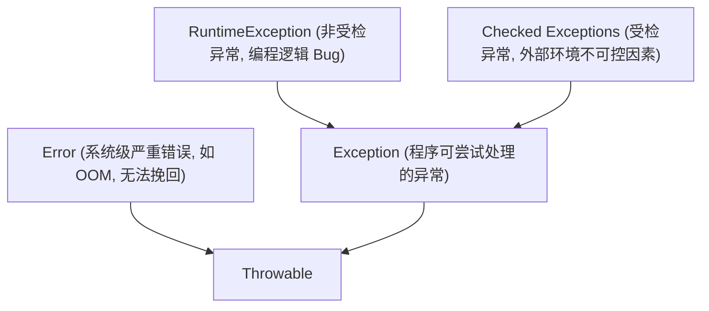

> **课程体系**：UC Berkeley CS61B: Data Structures (Spring 2024)  
> **所属模块**：Module 6: 高级数据结构与经典排序 (Tries & Sorting Algorithms)  
> **主讲教师**：Prof. Justin Yokota & Prof. Peyrin Kao (UC Berkeley)  
> **视频时长**：54:00 ｜ **官方原版**：Lecture 31 - Software Engineering II  
> **视频直达**：[📺 在 B 站观看本讲原视频 (P31)](https://www.bilibili.com/video/BV1hJ4m1M7ZA/?p=31) ｜ [📑 官方课件 Slides (Google Presentation)](https://docs.google.com/presentation/d/1P1Uc8phy1GW1M4A8PA7mJJMWqb2QgOfewwwB1wMnFlU/edit#slide=id.g2c95eb66b0d_0_7) ｜ [📖 官方教材章节](https://cs61b-2.gitbook.io/cs61b-textbook/31.-software-engineering-ii)  
> **快速导航**：[← 上一讲 (P30 排序 II：归并排序与插入排序)](/notes/cs61b/lecture-30) ｜ [📚 返回全书目录](/notes/topics/CS61B) ｜ [下一讲 (P32 排序 III：快速排序与分区机制) →](/notes/cs61b/lecture-32)

---

## 1. 好 API 的黄金准则：易于正确使用，难以误用

*(参考时间：00:02:15 · [视频跳转 (P31 00:02:15)](https://www.bilibili.com/video/BV1hJ4m1M7ZA/?p=31&t=135))*

API（应用程序编程接口）是开发者之间沟通的桥梁。Java 架构大师 Joshua Bloch 提出了 API 设计的至高哲学：
> **“API 应当易于正确使用，并且难以误用（Easy to use correctly, hard to use incorrectly）。”**

如果一个函数的参数顺序极其反直觉（如连续接收 5 个 `int` 分别代表年月日时分），调用方极易传错参数诱发线上灾难。优秀的 API 应该通过类型系统、强约束命名和建造者模式（Builder Pattern）从编译期扼杀误用的可能。

## 2. 不可变对象（Immutability）与防御性拷贝

*(参考时间：00:13:40 · [视频跳转 (P31 00:13:40)](https://www.bilibili.com/video/BV1hJ4m1M7ZA/?p=31&t=820))*

可变状态（Mutable State）是多线程并发 Bug 和指针逃逸破坏的核心温床。一个对象一旦创建其内部状态就永远无法更改，该对象就是**不可变对象（Immutable）**。

### 防御性拷贝（Defensive Copying）的必要性
即便把字段声明为 `private final`，如果字段本身是一个可变对象引用（如 `Date` 或数组），外部调用者依然可以通过获取到的引用篡改对象内部状态！

```java
public final class ImmutableSchedule {
    private final Date appointmentDate;

    public ImmutableSchedule(Date date) {
        // 关键：构造时执行深拷贝，切断与外部传入对象的关联！
        this.appointmentDate = new Date(date.getTime());
    }

    public Date getAppointmentDate() {
        // 关键：返回时同样执行深拷贝，防止外部拿到引用后执行 setTime() 篡改！
        return new Date(this.appointmentDate.getTime());
    }
}
```

## 3. 契约式设计：前置条件与断言校验

*(参考时间：00:25:30 · [视频跳转 (P31 00:25:30)](https://www.bilibili.com/video/BV1hJ4m1M7ZA/?p=31&t=1530))*

方法应当在刚进入入口的第一时间，对所有入参进行严格的有效性验证：

```java
public static double calculateSquareRoot(double x) {
    if (x < 0) {
        throw new IllegalArgumentException("开方参数不能为负数, actual: " + x);
    }
    // 执行高精度计算...
}
```
通过尽早抛出具象异常（Fail-Fast 原则），能够让 Bug 在发生的源头瞬间暴露并记录堆栈上下文，而不是带着脏数据进入深层业务逻辑后发生诡异的连环崩溃。

## 4. Java 异常体系大权衡：受检 vs 非受检

*(参考时间：00:36:50 · [视频跳转 (P31 00:36:50)](https://www.bilibili.com/video/BV1hJ4m1M7ZA/?p=31&t=2210))*



- **非受检异常（Unchecked RuntimeException）**：如 `NullPointerException`, `IndexOutOfBoundsException`。这类异常代表**程序员写出了有缺陷的代码**，应当通过修复逻辑根除，而不是到处盲目 `try-catch`；
- **受检异常（Checked Exception）**：如 `IOException`, `SQLException`。代表**不可抗力的外部系统故障**（如网络断开、磁盘损坏），编译器强迫调用方必须显式处理或向上声明。

## 5. 本讲小结与工程心法

*(参考时间：00:46:15 · [视频跳转 (P31 00:46:15)](https://www.bilibili.com/video/BV1hJ4m1M7ZA/?p=31&t=2775))*

- 绝不要写空的 `catch (Exception e) {}` 块，这等同于把起火警报器的电池抠掉掩耳盗铃；
- 优先设计不可变类，不可变对象天然具备完全线程安全性，可以自由跨线程共享而无需加锁；
- 保持异常信息的具象性，携带引起故障的上下文参数值。

---

## 课程导航与跳转

| 上一讲 | 目录 | 下一讲 | 原视频 |
| :--- | :---: | :--- | :--- |
| [← 上一讲：排序 II：归并排序与插入排序](/notes/cs61b/lecture-30) | [📚 返回 CS61B 全书目录](/notes/topics/CS61B) | [下一讲：排序 III：快速排序与分区机制 →](/notes/cs61b/lecture-32) | [🎬 在 B 站观看本讲 (P31)](https://www.bilibili.com/video/BV1hJ4m1M7ZA/?p=31) |
