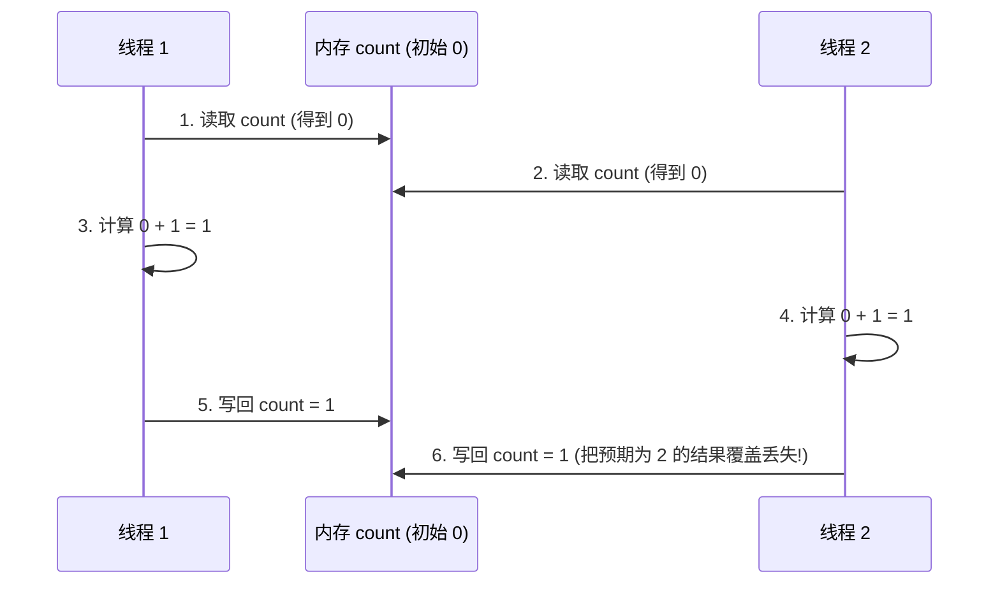

> **课程体系**：UC Berkeley CS61B: Data Structures (Spring 2024)  
> **所属模块**：Module 7: 软件工程、高级算法与计算理论 (Software Engineering & Complexity)  
> **主讲教师**：Prof. Justin Yokota & Prof. Peyrin Kao (UC Berkeley)  
> **视频时长**：54:00 ｜ **官方原版**：Lecture 37 - Software Engineering IV  
> **视频直达**：[📺 在 B 站观看本讲原视频 (P37)](https://www.bilibili.com/video/BV1hJ4m1M7ZA/?p=37) ｜ [📑 官方课件 Slides (Google Presentation)](https://docs.google.com/presentation/d/13TE3w603C6zt1q5vWRL9WmbwxkG0VjFluIIHSbV0qNU/edit) ｜ [📖 官方教材章节](https://cs61b-2.gitbook.io/cs61b-textbook/37-software-engineering-iv)  
> **快速导航**：[← 上一讲 (P36 排序 VI：基数排序进阶与排序大决战)](/notes/cs61b/lecture-36) ｜ [📚 返回全书目录](/notes/topics/CS61B) ｜ [下一讲 (P38 数据压缩：前缀码与哈夫曼编码) →](/notes/cs61b/lecture-38)

---

## 1. 并发的诱惑与深渊：多核心时代的编程范式

*(参考时间：00:02:15 · [视频跳转 (P37 00:02:15)](https://www.bilibili.com/video/BV1hJ4m1M7ZA/?p=37&t=135))*

由于现代 CPU 物理晶体管功耗墙的限制，单核时钟频率无法无限制攀升，芯片厂商转向在单个芯片上集成数十乃至上百个 CPU 物理核心。

为了压榨硬件算力，我们引入**多线程并发编程（Concurrency / Multithreading）**。然而，并发编程极度反直觉，多个线程同时读写共享内存会诱发极其隐蔽的**非确定性（Nondeterminism）Bug**。

## 2. 竞争条件（Race Condition）与原子性破坏

*(参考时间：00:13:40 · [视频跳转 (P37 00:13:40)](https://www.bilibili.com/video/BV1hJ4m1M7ZA/?p=37&t=820))*

考虑一个简单的计数累加操作：
```java
count++;
```
看似极简的一行代码，在底层的机器指令中被拆解为三个独立的微操作：
1. **读取**：从主内存将 `count` 的值加载到 CPU 寄存器；
2. **修改**：寄存器数值执行加 1 操作；
3. **写回**：将寄存器数值写回主内存。

如果两个线程同时执行 `count++`，可能发生可怕的交错覆盖：


## 3. 临界区与 Java 同步原语：synchronized 锁

*(参考时间：00:25:20 · [视频跳转 (P37 00:25:20)](https://www.bilibili.com/video/BV1hJ4m1M7ZA/?p=37&t=1520))*

为了保证对共享可变状态的操作具有**原子性（Atomicity）与互斥性（Mutual Exclusion）**，Java 提供了内置的监视器锁机制：

```java
public class SynchronizedCounter {
    private int count = 0;

    // 每次仅允许一个线程进入该方法执行
    public synchronized void increment() {
        count++;
    }

    public synchronized int getCount() {
        return count;
    }
}
```

任何时刻只有一个线程能持有该对象实例的内置锁。其他线程必须在临界区外排队阻塞等待，彻底杜绝数据竞争！

## 4. 死锁（Deadlock）的产生四要素与防范

*(参考时间：00:36:30 · [视频跳转 (P37 00:36:30)](https://www.bilibili.com/video/BV1hJ4m1M7ZA/?p=37&t=2190))*

加锁并非万灵药。粗暴加锁极易引发**死锁（Deadlock）**：
- 线程 1 拿着锁 A，等待获取锁 B；
- 线程 2 拿着锁 B，等待获取锁 A；
- 两者彼此死等，系统永久僵死冻结！

### 防范死锁的黄金军规：全局锁排序（Lock Ordering）
强制系统中的所有线程**严格按照相同的全局固定顺序获取锁**（例如永远先锁 A 再锁 B）。破坏死锁产生的“环路等待”条件，从根源上消灭死锁。

## 5. 本讲小结与现代并发哲学

*(参考时间：00:46:15 · [视频跳转 (P37 00:46:15)](https://www.bilibili.com/video/BV1hJ4m1M7ZA/?p=37&t=2775))*

- 优先采用不可变对象（Immutable），没有可变状态就永远没有竞态条件；
- 优先使用 Java 标准并发包 `java.util.concurrent`（如 `ConcurrentHashMap`, `BlockingQueue`, `AtomicInteger`），避免手工编写脆弱的底层同步块。

---

## 课程导航与跳转

| 上一讲 | 目录 | 下一讲 | 原视频 |
| :--- | :---: | :--- | :--- |
| [← 上一讲：排序 VI：基数排序进阶与排序大决战](/notes/cs61b/lecture-36) | [📚 返回 CS61B 全书目录](/notes/topics/CS61B) | [下一讲：数据压缩：前缀码与哈夫曼编码 →](/notes/cs61b/lecture-38) | [🎬 在 B 站观看本讲 (P37)](https://www.bilibili.com/video/BV1hJ4m1M7ZA/?p=37) |
