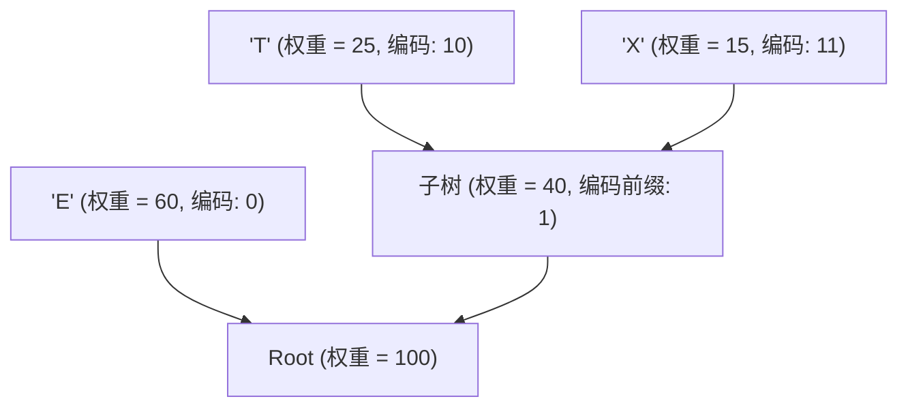

> **课程体系**：UC Berkeley CS61B: Data Structures (Spring 2024)  
> **所属模块**：Module 7: 软件工程、高级算法与计算理论 (Software Engineering & Complexity)  
> **主讲教师**：Prof. Justin Yokota & Prof. Peyrin Kao (UC Berkeley)  
> **视频时长**：42:46 ｜ **官方原版**：Lecture 38 - Compression  
> **视频直达**：[📺 在 B 站观看本讲原视频 (P38)](https://www.bilibili.com/video/BV1hJ4m1M7ZA/?p=38) ｜ [📑 官方课件 Slides (Google Presentation)](https://docs.google.com/presentation/d/1k4tgpf7xaW-uhlHYlp3izZRYtBGMYPVRlHCmmpN6QXQ) ｜ [📖 官方教材章节](https://cs61b-2.gitbook.io/cs61b-textbook/38.-compression-and-complexity)  
> **快速导航**：[← 上一讲 (P37 软件工程 IV：并发控制与线程安全)](/notes/cs61b/lecture-37) ｜ [📚 返回全书目录](/notes/topics/CS61B) ｜ [下一讲 (P39 计算理论与不可解性：P、NP 与 P=NP 世纪难题) →](/notes/cs61b/lecture-39)

---

## 1. 为什么数据可以被压缩：冗余度与信息论

*(参考时间：00:02:15 · [视频跳转 (P38 00:02:15)](https://www.bilibili.com/video/BV1hJ4m1M7ZA/?p=38&t=135))*

在日常计算机使用中，文本、图像、音视频都能通过 `.zip` 或流式协议进行大幅压缩。

压缩的本质在于利用数据内部普遍存在的**统计冗余（Statistical Redundancy）**：
在英文文本中，字母 `'e'`, `'t'`, `'a'` 出现的频率极高，而 `'z'`, `'q'`, `'x'` 极其罕见。如果所有字符都机械地占用 8 位（1 字节）ASCII 码，是对存储空间的巨大浪费。  
信息论之父克劳德·香农（Claude Shannon）指明了方向：**高频出现的常见符号分配较短的比特串，低频罕见的符号分配较长的比特串，整体期望编码长度即可大幅缩减！**

## 2. 变长编码的歧义危机与前缀码（Prefix-Free Codes）

*(参考时间：00:13:40 · [视频跳转 (P38 00:13:40)](https://www.bilibili.com/video/BV1hJ4m1M7ZA/?p=38&t=820))*

如果直接使用变长编码，可能会引发致命的解码歧义：
- 假设 `'A'` 编码为 `0`，`'B'` 编码为 `1`，`'C'` 编码为 `01`；
- 当解码器收到比特流 `01` 时，它无法判定这代表单个字符 `'C'`，还是代表 `'AB'`！

**前缀码（Prefix-Free Code）法则**：
> **没有任何字符的编码，是另一个字符编码的前缀！**

前缀码可以直接映射为一棵优雅的**二叉判定树**：
- 根节点出发，向左走代表比特 `0`，向右走代表比特 `1`；
- **所有合法的字符符号必须严格存放在树的叶子节点上（Leaf Level）！**  
- 因为叶子节点没有子孙，任何一个字符的路径都不可能是另一个字符路径的前缀，解码时遇到叶子节点即可瞬间毫无歧义地确认字符！

## 3. 哈夫曼编码（Huffman Coding）贪心算法

*(参考时间：00:25:30 · [视频跳转 (P38 00:25:30)](https://www.bilibili.com/video/BV1hJ4m1M7ZA/?p=38&t=1530))*

大卫·哈夫曼（David Huffman）于 1952 年提出了构建最优二叉前缀树的贪心算法：

1. **频次统计**：扫描一遍文本，统计每个字符出现的出现次数（权重）；
2. **单节点建堆**：为每个字符创建单节点二叉树，放入一个**最小优先队列（MinPQ）**中；
3. **合并两小（Merge Two Smallest）**：
   - 从优先队列中弹出当前频次最小的两个节点 $T_1$ 和 $T_2$；
   - 创建一个全新的父节点，其权重为 $Weight(T_1) + Weight(T_2)$，左右孩子分别指向 $T_1$ 和 $T_2$；
   - 将新合成的大树重新丢回优先队列！
4. **重复直至队列中只剩一棵包含全部字符的终极前缀树！**

## 4. 哈夫曼编解码完整工业级链路

*(参考时间：00:36:50 · [视频跳转 (P38 00:36:50)](https://www.bilibili.com/video/BV1hJ4m1M7ZA/?p=38&t=2210))*

一个自包含的压缩文件必须保证解压端能够准确还原原始数据：

### 压缩链路（Compress）
1. 统计字符频次；
2. 构建哈夫曼树；
3. 递归遍历哈夫曼树，构建字符到比特串的快速查找表 `String[] lookupTable`；
4. **写入哈夫曼树骨架**（前序遍历序列化到压缩文件头，供解压端还原树形）；
5. 写入原始字符总数；
6. 遍历文本，查表并将对应比特流紧凑写入输出文件。

### 解压链路（Expand）
1. 从文件头重建哈夫曼前缀树；
2. 读取字符总数；
3. 沿着比特流从根节点左右穿梭，每次走到叶子节点便输出对应字符，并重置回根节点继续解码。

## 5. 本讲小结与最优性证明

*(参考时间：00:46:15 · [视频跳转 (P38 00:46:15)](https://www.bilibili.com/video/BV1hJ4m1M7ZA/?p=38&t=2775))*

- **数学证明（最优性）**：哈夫曼算法生成的树在所有基于字符频次的前缀码树中，加权外部路径长度（Weighted External Path Length）严格达到全局理论绝对最小值！
- 现实世界的 `.zip`, `.gzip`, `JPEG`, `MP3` 文件，其最底层的熵编码步骤全部广泛采纳了哈夫曼编码。

---

## 课程导航与跳转

| 上一讲 | 目录 | 下一讲 | 原视频 |
| :--- | :---: | :--- | :--- |
| [← 上一讲：软件工程 IV：并发控制与线程安全](/notes/cs61b/lecture-37) | [📚 返回 CS61B 全书目录](/notes/topics/CS61B) | [下一讲：计算理论与不可解性：P、NP 与 P=NP 世纪难题 →](/notes/cs61b/lecture-39) | [🎬 在 B 站观看本讲 (P38)](https://www.bilibili.com/video/BV1hJ4m1M7ZA/?p=38) |
