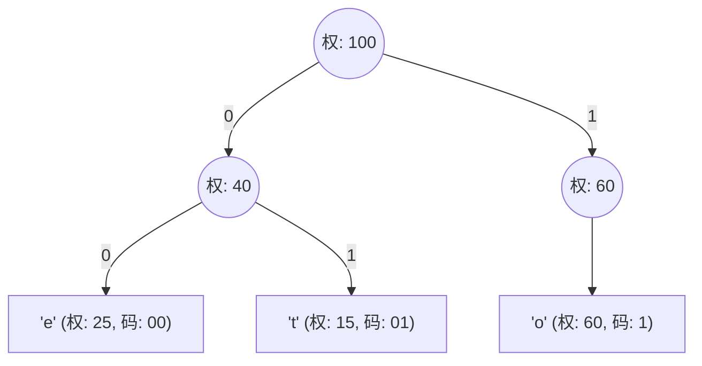

> **课程体系**：UC Berkeley CS61B: Data Structures (Spring 2024)  
> **所属模块**：Module 7: 软件工程、高级算法与计算理论 (Software Engineering & Complexity)  
> **主讲教师**：Prof. Justin Yokota & Prof. Peyrin Kao (UC Berkeley)  
> **视频时长**：42:46 ｜ **官方原版**：Lecture 38 - Compression  
> **视频直达**：[📺 在 B 站观看本讲原视频 (P38)](https://www.bilibili.com/video/BV1hJ4m1M7ZA/?p=38) ｜ [📑 官方课件 Slides (Google Presentation)](https://docs.google.com/presentation/d/1k4tgpf7xaW-uhlHYlp3izZRYtBGMYPVRlHCmmpN6QXQ) ｜ [📖 官方教材章节](https://cs61b-2.gitbook.io/cs61b-textbook/38.-compression-and-complexity)  
> **快速导航**：[← 上一讲 (P37 软件工程 IV：大规模系统演进与技术债务)](/notes/cs61b/lecture-37) ｜ [📚 返回全书目录](/notes/topics/CS61B) ｜ [下一讲 (P39 计算复杂性理论：规约与 P 与 NP 问题) →](/notes/cs61b/lecture-39)

---

## 1. 压缩的数学本质：冗余消除与香农信息熵（Information Entropy）

*(参考时间：00:01:25 · [视频跳转 (P38 00:01:25)](https://www.bilibili.com/video/BV1hJ4m1M7ZA/?p=38&t=85))*

数据为什么能够被压缩？  
因为人类语言、图像、代码中充斥着大量的**统计冗余（Statistical Redundancy）**！

在标准的 ASCII 编码中，每一个字符都被平等地赋予 8 个比特（1 字节）。但在英文文本中：
- 字母 `'e'` 的出现频率高达 12.7%；
- 而字母 `'z'` 的出现频率仅为 0.07%！
- 让高频出现的 `'e'` 和罕见出现的 `'z'` 消耗同样多的 8 个比特，是极其巨大的信息浪费！

香农信息论指出：**高频符号应当赋予极短的比特编码，而低频符号赋予较长的比特编码**，从而最小化全局加权平均比特长度！

## 2. 前缀无关码（Prefix-Free Codes）与歧义消除

*(参考时间：00:10:40 · [视频跳转 (P38 00:10:40)](https://www.bilibili.com/video/BV1hJ4m1M7ZA/?p=38&t=640))*

如果我们采用变长编码（Variable-Length Codes）：
- 假设 `'A'` 编码为 `0`，`'B'` 编码为 `1`，`'C'` 编码为 `01`；
- 当接收端收到比特流 `01` 时，它到底代表 `"AB"` 还是代表 `"C"`？产生了致命歧义！

### 前缀无关码公理
> **前缀无关码定理**：  
> **在编码系统中，任何一个字符的比特编码，都绝对不能是另一个字符编码的前缀！**

只要满足前缀无关性，解码器在逐个读取比特流时，一旦匹配到某个合法字符，就能**毫无歧义地立即完成断句切分**！

## 3. 哈夫曼编码（Huffman Coding）：贪心树构建算法

*(参考时间：00:20:15 · [视频跳转 (P38 00:20:15)](https://www.bilibili.com/video/BV1hJ4m1M7ZA/?p=38&t=1215))*

大卫·哈夫曼在 1952 年提出了构建最优前缀无关码的经典贪心算法：

### 算法执行四步法：
1. **统计频次**：统计文本中每个字符出现的频率；
2. **构建叶子森林**：为每个字符创建一个单节点树，其权重等于字符频次，全部放入**最小优先队列（Min-PQ）**中；
3. **循环合并最小两树**：
   - 从优先队列中弹出当前权重最小的两棵树 $T_1$ 和 $T_2$；
   - 创建一个新的父节点，作为它们共同的根，其权重为 $W = \text{weight}(T_1) + \text{weight}(T_2)$；
   - 规定向左走为比特 `0`，向右走为比特 `1`；
   - 将这棵合并后的新树重新插入优先队列；
4. 重复上述合并，直到优先队列中只剩下一棵完整的**哈夫曼大树**！


高频出现的字符在树中靠近根部，编码极短；低频字符深埋底层，编码虽长但鲜少使用，全局压缩率达到信息论最优极限！

## 4. 本讲小结与课后自测

*(参考时间：00:30:00 · [视频跳转 (P38 00:30:00)](https://www.bilibili.com/video/BV1hJ4m1M7ZA/?p=38&t=1800))*

### 课后综合自测题
在解压缩文件时，解压程序如何知道原始的哈夫曼树长什么样？  
**答案与解析**：  
压缩文件必须在头部包含**序列化的哈夫曼树（Trie Header）**！解压程序启动时，首先读取文件开头的树拓扑，在内存中还原出哈夫曼树，随后才能根据该树对后续的比特流进行精准逐位解码。

---

## 附录：UC Berkeley 官方教材深度研读 (Official Textbook In-Depth Chapters)

> **导读说明**：本节内容整合自 UC Berkeley CS61B 官方教材库（GitBook Textbook），针对本讲的核心数据结构与算法提供原汁原味的英文理论推导、形式化代码范例与配套章节习题，与前文视频精讲相互补充印证。

## 38. Compression and Complexity

By Dhruti Pandya and Stella Kaval

---

## 38.1 Introduction to Compression

As an introduction to compression, consider the processes of creating and unzipping a zip file.

<pre class="language-bash"><code class="lang-bash">$ zip mobydick.zip mobydick.txt 

adding: mobydick.txt (deflated 59%)

$ ls -l

<strong>-rw-rw-r-- 1 jug jug 643207 Apr 24 10:55 mobydick.txt

</strong>-rw-rw-r-- 1 jug jug 261375 Apr 24 10:55 mobydick.zip

</code></pre>

Note that before and after unzipping, the file size changes!

### Compression Model 1: Algorithms on Bits

In our first model of compression, we consider compression as applying a *compression algorithm* on a sequence of bits. To reverse the compression, we apply the inverse *decompression algorithm.*

<figure><figcaption><p>Compression and decompression.</p></figcaption></figure>

Say you had a text file called `example.txt`. If you were to zip that text file, you'd get `example.zip`, a zip file with a size much lesser than the original `example.txt` file. This is the main idea behind compression--a technique used to reduce file size.

Then, if you were to unzip `example.zip` into a file called `unzippedexample.txt`, you would notice no difference between `example.txt` and `unzippedexample.txt.` This is an indicator of **lossless** compression, where no information is lost.

---

## 38.2 Prefix-free Codes

Consider the representation of English text in Java. We represent text as a sequence of characters, each taking 8 bits of memory.

One easy way to compress, then, is to simply use less than 8 bits per character. To do this, we have to decide which **codewords** (bit sequences) go with each **symbol** (character).

### Mapping Alphanumeric Symbols

#### Morse Code

As an introductory example, consider the Morse code alphabet. Looking at the alphabet below, what does the sequence – – • – – • represent? It’s ambiguous! The same sequence of symbols can represent either MEME, or GG, depending on what you choose – – • to represent

<figure><figcaption><p>Ambiguity in morse code</p></figcaption></figure>

In real usage, operators must pause between codewords to indicate a break. The pause acts as an implicit third symbol, but we can't encode this real-time information into our code.

#### Prefix-free Codes

An alternate strategy to avoid the need for real-time is to use **prefix-free codes**. In a prefix-free code, no codeword is a prefix of any other. In the Morse Code example, there would be no confusion whether the – – in the pattern – – • – – • is supposed to represent M, or the start of G.

Let's represent Morse code as a tree of codewords leading to symbols. As we can see from the tree, several symbols have representations that are prefixes of other symbols.

<figure><figcaption><p>Morse code is not prefix-free.</p></figcaption></figure>

As an example of an (arbitrary) prefix-free code, consider the following encoding:

<figure><figcaption><p>One prefix-free code.</p></figcaption></figure>

The following code is also prefix-free:

<figure><figcaption><p>Another prefix-free code.</p></figcaption></figure>

Note that some codes are more efficient for certain strings than others: in the first representation, `I ATE` uses less bits than the second code. However, this is highly dependent on what string we're trying to encode.

---

## 38.3 Shannon-Fano Codes

Shannon-Fano codes are an approach to create prefix-free codes based on a set of symbols/characters and their probabilities. The main idea is that we want shorter prefix-free codes for more popular characters, and longer codes for lesser used characters.

The algorithm is: 

* Count relative frequencies of all characters in a text.

* Split into ‘left’ and ‘right halves’ of roughly equal frequency.

  * Left half gets a leading zero. Right half gets a leading one.

  * Repeat.

At the end, you will get a tree as shown below, with shorter paths for characters with a higher frequency, and longer paths for characters with a lower frequency.

<figure><figcaption></figcaption></figure>

However, Shannon-Fano coding is NOT optimal, so it is not used very often.

---

## 38.4 Huffman Coding Conceptuals

### Core Idea

Huffman coding takes a bottom-up approach to prefix-free codes, as opposed to the top-down approach taken by Shannon-Fano codes. The algorithm is as follows:

* Calculate relative frequencies.

  * Assign each symbol to a node with weight = relative frequency.

  * Take the two smallest nodes and merge them into a super node with weight equal to sum of weights.

  * Repeat until everything is part of a tree.

<figure><figcaption><p>Huffman Coding: step by step example (Part 1)</p></figcaption></figure>

<figure><figcaption><p>Huffman Coding: step by step example (Part 2)</p></figcaption></figure>

### Data Structures

Let's now think about the data structures we would use for the encoding and decoding processes of the Huffman Coding process. Recall that encoding will translate symbols to code words and decoding will do the opposite. An example is as follows:

* Encoding translates `I ATE` into `0000011000100101.`

* Decoding translates `0000011000100101` into `I ATE`.

<details>

<summary>For encoding (bitstream to compressed bitstream), what data structure would we use? </summary>

There are two options!

1. **HashMap/TreeMap**: create a map from character to bit sequence, calling the `get()` method to look up each character

2. **Array**: Each index of the array would represent the character, with the bit sequence in that slot of the array. Recall that each character is just an integer. For example, the letter `A` is `65`). 

What's the difference? Arrays are faster than maps but might use more memory if indices are unused.

</details>

<details>

<summary>For decoding (compressed bitstream back to bitstream), what data structure would we use?</summary>

There is really only one good data structure that can help us find longest prefixes of bit streams.

**Trie**: Here, we can use a Binary Trie with numbers 0 and 1. When we get the bitstream, the trie allows easy lookup to the longest prefix. Below is an image that demonstrates how the trie could look.


</details>

### In Practice

Now that we have talked about what Huffman Coding is, let's talk about some practical issues that arise when we want to use it. There are two main philosophies we can use.

#### Corpus

* For each input type (English text, Chinese text, images), assemble huge numbers of sample inputs for each category. Use corpus to create a standard code for English, Chinese, etc. 

* A corpus is a collection of pieces of language to be used as a sample of the language. Below is an example where we specify that we want to use the `ENGLISH` corpus to compress `mobydick.txt`

```

$ java HuffmanEncodePh1 ENGLISH mobydick.txt

```

**Problem:** Suboptimal encoding, which means our corpus does not exactly match our input. What this means in the context of this example is that `mobydick.txt` might not match up well with the general frequencies of `ENGLISH` texts and instead might have some other quirks or specifications from the author.

#### Unique Code

* For every possible input file, create a unique code just for that file. Then, when someone receives that file, they will know how to decode it using the code we send along the compressed file. 

* As seen in the example below, we do not specify a corpus and we send along another file to help the decoding process for that specific file.

```

$ java HuffmanEncodePh2 mobydick.txt

```

**Problem**: This approach requires us to use extra space for the codeword table in the compressed bitstream. However, this generally works better than the corpus philosophy so is used commonly in the real world.

---

## 38.5 Compression Theory

### Compression Ratios

* The goal of data compression is to reduce the size of a sequence of data while retaining as much information as possible. For example, the letter `e` appears more frequently in the English dictionary than `z`, so we would want to represent `e` with smaller bits.

* **Compression ratio** is a measure of how much the size of the compressed data differs from the original data. 

  * **Huffman Coding** is a compression technique that represents common symbols with smaller numbers of bits, resulting in a more efficient encoding. 

  * **Run-length encoding** is another compression technique that replaces repeated characters with the character itself and the number of times it occurs. 

  * **LZW** is a compression technique that searches for common repeated patterns in the input and replaces them with a shorter code. 

* The general idea behind most compression techniques is to exploit any existing redundancy or order within the sequence to reduce the size of the data. However, if a sequence has no existing redundancy or order, compression may not be possible.

### Self-Extracting Bits

* Self-extracting bits is a compression technique that wraps the compressed bits and the decompression algorithm into a **single sequence of bits**.

* The goal is to simplify the compression and decompression process by combining the two steps into one. Self-extracting bits can be used to create executable files that can be run on any system with an interpreter (e.g. Java interpreter).

<figure><figcaption></figcaption></figure>

### HugPlant Example

* To compress an image file like `hugplant.bmp`, we can break it into 8-bit chunks and Huffman encode each chunk.

* We package the compressed data plus decoder into a single self-extracting `.java` file, represented as a `byte[]` array.

* When the `byte[]` array is passed to an interpreter, the interpreter executes the Huffman decoding algorithm and produces the original `hugplant.bmp` image file.

* The size of the compressed bitstream and the Huffman decoding algorithm combined is **smaller** than the original image file, making it more efficient to store and transmit.

* However, the receiver of the compressed file must have access to the appropriate interpreter to decode and reconstruct the original image.

---

## 38.6 LZW Compression

### Key Idea

The LWZ approach is based on the idea of exploiting redundancy and patterns in the input data to achieve compression. Basically, each codeword can represent multiple symbols.

For example, imagine a sequence of symbols `ABCABCA`. In traditional compression, each symbol would be mapped to a fixed-length codeword, resulting in a compressed sequence like `010001001000100100`. With the LWZ approach, the codewords can be based on patterns in the input data. In this case, the algorithm might start with a codeword table. (A --> 0, B --> 1, C --> 2). This could result in a compressed sequence looking something like `01201201`. By allowing for codewords that can represent multiple symbols, the LWZ approach can achieve more efficient compression than traditional approaches.

### Algorithm

* The algorithm starts with a simple codeword table where each codeword corresponds to a single symbol.

* Whenever a codeword is used, a new codeword is created by concatenating the previous codeword with the next symbol.

* The algorithm does not specify what happens when the codeword table becomes full, but there are many variants of the algorithm that handle this differently.

* A neat fact about the LWZ approach is that it is possible to reconstruct the codeword table from the compressed bitstream alone, without needing to send the table along with the compressed data.

* LWZ decompression [demo](https://docs.google.com/presentation/d/1U8XO6CWfcU4QgrFOZmGjAgmaKxLc8HXk6qB1JQVlqrg/edit#slide=id.g53705ba95_0259).

### Fun Facts

* The algorithm is named after its inventors, Lempel, Ziv, and Welch.

* The LWZ algorithm is used as a component in many compression tools, including .gif files, .zip files, and more.

* The LWZ algorithm was once controversial due to attempts to enforce licensing fees, but the patent expired in 2003.

---

## 38.7 Summary

**Compression Model #1: Algorithms Operating on Bits.** Given a sequence of bits B, we put them through a compression algorithm C to form a new bitstream C(B). We can run C(B) through a corresponding decompression algorithm to recover B. Ideally, C(B) is less than B.

**Variable Length Codewords.** Basic idea: Use variable length codewords to represent symbols, with shorter keywords going with more common symbols. For example, instead of representing every English character by a 8 bit ASCII value, we can represent more common values with shorter sequences. Morse code is an example of a system of variable length codewords.

**Prefix Free Codes.** If some codewords are prefixes of others, then we have ambiguity, as seen in Morse Code. A prefix free code is a code where no codeword is a prefix of any other. Prefix free codes can be uniquely decoded.

**Shannon-Fano Coding.** Shannon-Fano coding is an intuitive procedure for generating a prefix free code. First, one counts the occurrence of all symbols. Then you recursively split characters into halves over and over based on frequencies, with each half either having a 1 or a 0 appended to the end of the codeword.

**Huffman Coding.** Huffman coding generates a provably optimal prefix free code, unlike Shannon-Fano, which can be suboptimal. First, one counts the occurrence of all symbols, and create a “node” for each symbol. We then merge the two lowest occurrence nodes into a tree with a new supernode as root, with each half either having a 1 or a 0 appended to the beginning of the codeword. We repeat this until all symbols are part of the tree. Resulting code is optimal.

**Huffman Implementation.** To compress a sequence of symbols, we count frequencies, build an encoding array and a decoding trie, write the trie to the output, and then look up each symbol in the encoding array and write out the appropriate bit sequence to the output. To decompress, we read in the trie, then repeatedly use longest prefix matching to recover the original symbol.

**General Principles Behind Compression.** Huffman coding is all about representing common symbols with a small number of bits. There are other ideas, like run length encoding where you replace every character by itself followed by its number of occurrences, and LZW which searches for common repeated patterns in the input. More generally, the goal is to exploit redundancy and existing order in the input.

**Universal Compression is Impossible.** It is impossible to create an algorithm that can compress any bitstream by 50%. Otherwise, you could just compress repeatedly until you ended up with just 1 bit, which is clearly absurd. A second argument is that for an input bitstream of say, size 1000, only 1 in 2^499 is capable of being compressed by 50%, due to the pigeonhole principle.

**Compression Model #2: Self Extracting Bits.** Treating the algorithm and the input bitstream separately (like we did in model #1) is a more accurate model, but it seems to leave open strange algorithms like one in which we simply hardcode our desired output into the algorithm itself. For example, we might have a .java decompression algorithm that has a giant `byte[]` array of your favorite TV show, and if the algorithm gets the input `010`, it outputs this `byte[]` array.

In other words, it seems to make more sense to include not just the compressed bits when considering the size of our output, but also the algorithm used to do the decompression.

One conceptual trick to make this more concrete is to imagine that our algorithm and the bits themselves are a single entity, which we can think of a self-extracting bit sequence. When fed to an interpreter, this self-extracting bit sequence generates a particular output sequence.

**Hugplant Example.** If we have an image file of something like the hugplant.bmp from lecture, we can break it into 8 bit chunks and then Huffman encode it. If we give this file to someone else, they probably won’t know how to decompress it, since Huffman coding is not a standard compression algorithm supported by major operating systems. Thus, we also need to provide the Huffman decoding algorithm. We could send this as a separate .java file, but for conceptual convenience and in line with compression model #2, we’ll imagine that we have packaged our compressed bit stream into a `byte[]` array in a .java file. When passed to an interpreter, this bitstream yields the original hugplant.bmp, which is 4 times larger than the compressed bitstream + huffman interpreter.

---

## 38.8 Exercises

### Factual

1. Suppose we build a Shannon Fano or Huffman code for the text of this question including spaces and punctuation characters. Which characters would have the longest code?

2. What two ways could we represent a Huffman code for characters in Java?

<details>

<summary>Problem 1</summary>

`?` and `.`, since both are only used once in the above sentence.

</details>

<details>

<summary>Problem 2</summary>

A `HashMap<Character, BitSequence>` or a `BitSequence[]`. Note that the two are equivalent in Java because a Character is a number.

</details>

### Procedural

1. Suppose we have a string `abcdefg` which repeats 1000 times. How many bits would be in the compressed bitstream?

<details>

<summary>Problem 1</summary>

Since all 8 characters are equal in frequency, we get a balanced binary tree as our Huffman encoding, so all codewords are 3 bits long. 1000 \* 8 \* 3 = 24000 bits.

</details>

### Metacognitive

1. Using the idea of self-extracting bits, come up with an encoding for the sequence `abdefg` repeated 1000 times that uses less than 2000 bits. 

<details>

<summary>Problem 1</summary>

The idea of self-extracting bits includes writing code or an interpreter that can generate the original uncompressed sequence. This can be done with the following code:

```java

public class Sequence {

    public static void main(String[] args) {

        for (int i = 0; i < 1000; i++) {

            for (int j = 0; j < 8; j++) {

                System.out.print(String.format("%c", 'a' + j));

            }

        }

    }

}

```

This code uses exactly 239 characters, or 1912 bits. This demonstrates the power of the self-extracting bits model: compare this to the 24000 bits required for a Huffman code.

</details>


---

## 课程导航与跳转

| 上一讲 | 目录 | 下一讲 | 原视频 |
| :--- | :---: | :--- | :--- |
| [← 上一讲：软件工程 IV：大规模系统演进与技术债务](/notes/cs61b/lecture-37) | [📚 返回 CS61B 全书目录](/notes/topics/CS61B) | [下一讲：计算复杂性理论：规约与 P 与 NP 问题 →](/notes/cs61b/lecture-39) | [🎬 在 B 站观看本讲 (P38)](https://www.bilibili.com/video/BV1hJ4m1M7ZA/?p=38) |
