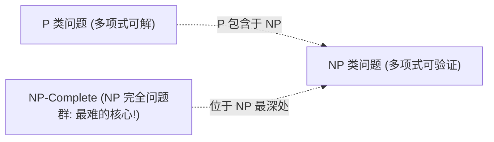

> **课程体系**：UC Berkeley CS61B: Data Structures (Spring 2024)  
> **所属模块**：Module 7: 软件工程、高级算法与计算理论 (Software Engineering & Complexity)  
> **主讲教师**：Prof. Justin Yokota & Prof. Peyrin Kao (UC Berkeley)  
> **视频时长**：47:54 ｜ **官方原版**：Lecture 39 - Computability P=NP  
> **视频直达**：[📺 在 B 站观看本讲原视频 (P39)](https://www.bilibili.com/video/BV1hJ4m1M7ZA/?p=39) ｜ [📑 官方课件 Slides (Google Presentation)](https://docs.google.com/presentation/d/1QFwbmMVE0Wlvg-gnWnemTxRX_t7h6IlhCQU69dcAkaA) ｜ [📖 官方教材章节](https://cs61b-2.gitbook.io/cs61b-textbook/39.-compression-complexity-p-np)  
> **快速导航**：[← 上一讲 (P38 数据压缩：前缀码与哈夫曼编码)](/notes/cs61b/lecture-38) ｜ [📚 返回全书目录](/notes/topics/CS61B) ｜ [下一讲 (P40 全课全景大总结与未来征程) →](/notes/cs61b/lecture-40)

---

## 1. 判定问题（Decision Problems）与计算复杂性分类

*(参考时间：00:02:15 · [视频跳转 (P39 00:02:15)](https://www.bilibili.com/video/BV1hJ4m1M7ZA/?p=39&t=135))*

在课程即将尾声之际，我们从具体的 Java 代码实现跳脱出来，站在理论计算机科学的至高云端俯瞰所有可计算问题的边界。

在理论计算中，科学家通常考察**判定问题（Decision Problems）**：其输出结果只有明确的 `Yes` 或 `No`（例如“图中是否存在总长小于 100 的哈密顿回路？”）。

## 2. P 类与 NP 类问题：求解 vs 验证

*(参考时间：00:13:30 · [视频跳转 (P39 00:13:30)](https://www.bilibili.com/video/BV1hJ4m1M7ZA/?p=39&t=810))*

### 1. P 类问题（Polynomial Time）
> 可以在**多项式时间（Polynomial Time, 即 $O(N^k)$）内被计算机高效求解**的问题集合。
- 比如：排序问题（$O(N \log N)$）、最短路径（$O(E \log V)$）、最小生成树（$O(E \log E)$）。这些是人类目前能够用计算机在工业界大规模有效求解的问题。

### 2. NP 类问题（Nondeterministic Polynomial Time）
> 如果有人给你一个潜在的答案线索（Certificate / Proof），你可以在**多项式时间内验证该答案的真伪**的问题集合。
- 经典例子：**数独（Sudoku）**。解一道超高难度的大规模数独可能需要穷举数百年，但如果别人给你一份已经填满的数字底稿，你可以在几毫秒内轻松校验每一行、每一列和每个九宫格是否合法！

## 3. 归约（Reduction）与 NP 完全性（NP-Complete）

*(参考时间：00:25:20 · [视频跳转 (P39 00:25:20)](https://www.bilibili.com/video/BV1hJ4m1M7ZA/?p=39&t=1520))*

### 归约（Reduction）的力量
若解决问题 A 的代码可以作为一个子程序来解决问题 B，并且中间转化的代价只有多项式级别，则称“问题 A 可以多项式时间归约到问题 B”。  
这意味着：**问题 B 的本质难度绝对不低于问题 A！**

### NP-Complete（NPC）
Stephen Cook 与 Leonid Levin 证明了令人震撼的定理：
> 在 NP 家族中，存在一组**最艰难的终极核心问题（NP-Complete）**。所有其他 NP 问题都可以在多项式时间内归约到它们身上！  
> 只要人类能为哪怕任意一个 NPC 问题（如 3-SAT、旅行商问题 TSP、团问题 Clique）找到多项式时间求解算法，**那么所有属于 NP 的成千上万个难题都将在瞬间被彻底攻破！**

## 4. 千禧年百万美元大奖：P 等于 NP 吗？

*(参考时间：00:36:40 · [视频跳转 (P39 00:36:40)](https://www.bilibili.com/video/BV1hJ4m1M7ZA/?p=39&t=2200))*

**P versus NP** 是当代数学与计算机科学界皇冠上的明珠：
> **“能够被快速验证的问题，是否一定能够被快速求解？”**

- 若 $P = NP$：意味着人类创造性证明定理的能力、发明药分子结构的能力、破解密码的能力，全部能被自动化程序在多项式时间内瞬时解决。现代网络安全的全部基石（基于大数分解困难度的 RSA 加密体系）将直接破产！
- 绝大多数计算机科学家倾向于相信 $P 
e NP$，但至今无人能给出严密的数学证明。

## 5. 不可计算性终章：图灵停机问题（Halting Problem）

*(参考时间：00:46:20 · [视频跳转 (P39 00:46:20)](https://www.bilibili.com/video/BV1hJ4m1M7ZA/?p=39&t=2780))*

是否存在即使耗尽宇宙所有算力、无论花费多少时间都**永远无法用程序解决的问题**？

阿兰·图灵（Alan Turing）于 1936 年用精妙的反证法证明了**停机问题不可判定（Undecidable）**：
> 不存在一个通用程序 $H(P, I)$，能够对任意输入的程序 $P$ 及其输入 $I$，准确判定 $P$ 在输入 $I$ 下最终是否会正常停止运行还是陷入无限死循环！

这向全人类宣告：**计算的能力是有边界的。在代码与算法的世界之外，依然存在着程序永远无法触达的彼岸。**

---

## 课程导航与跳转

| 上一讲 | 目录 | 下一讲 | 原视频 |
| :--- | :---: | :--- | :--- |
| [← 上一讲：数据压缩：前缀码与哈夫曼编码](/notes/cs61b/lecture-38) | [📚 返回 CS61B 全书目录](/notes/topics/CS61B) | [下一讲：全课全景大总结与未来征程 →](/notes/cs61b/lecture-40) | [🎬 在 B 站观看本讲 (P39)](https://www.bilibili.com/video/BV1hJ4m1M7ZA/?p=39) |
