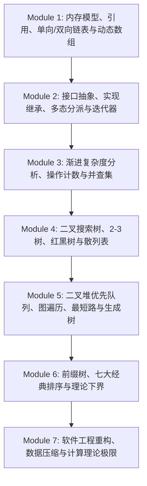

> **课程体系**：UC Berkeley CS61B: Data Structures (Spring 2024)  
> **所属模块**：Module 7: 软件工程、高级算法与计算理论 (Software Engineering & Complexity)  
> **主讲教师**：Prof. Justin Yokota & Prof. Peyrin Kao (UC Berkeley)  
> **视频时长**：55:47 ｜ **官方原版**：Lecture 40 - Summary  
> **视频直达**：[📺 在 B 站观看本讲原视频 (P40)](https://www.bilibili.com/video/BV1hJ4m1M7ZA/?p=40) ｜ [📑 官方课件 Slides (Google Presentation)](https://docs.google.com/presentation/d/1MmnYUoi-4Wyt6_3BcBdt_WkrL1XECZ9ypCyUmhW7e2U)  
> **快速导航**：[← 上一讲 (P39 计算理论与不可解性：P、NP 与 P=NP 世纪难题)](/notes/cs61b/lecture-39) ｜ [📚 返回全书目录](/notes/topics/CS61B) ｜ 下一讲：无（全书完结）

---

## 1. CS 61B 宏大知识图谱全貌回溯

*(参考时间：00:02:15 · [视频跳转 (P40 00:02:15)](https://www.bilibili.com/video/BV1hJ4m1M7ZA/?p=40&t=135))*

回首这 40 讲的壮丽征途，我们从第一讲一个朴素的 `HelloWorld.java` 出发，一步一个脚印，跨越了令人惊叹的思想高峰：

## 2. 贯穿全书的三大核心工程觉悟

*(参考时间：00:15:30 · [视频跳转 (P40 00:15:30)](https://www.bilibili.com/video/BV1hJ4m1M7ZA/?p=40&t=930))*

1. **抽象屏障（Abstraction Barriers）**：  
   永远将接口契约与具体实现物理剥离。让使用者享受简洁直观的高层 API，让开发者保留自由优化底层数据结构的巨大空间；
2. **渐进思维（Asymptotic Thinking）**：  
   摆脱具体的硬件与物理环境，站在数学增长阶的云端审视算法的大局。在指数级膨胀的大数据时代，优秀算法的威力远胜千军万马的超级硬件堆砌；
3. **权衡的艺术（The Art of Trade-offs）**：  
   工程世界没有免费的午餐。用额外的指针换取常数时间的快速插入（链表），用额外的哈希表空间换取 $O(1)$ 的瞬时查找（散列表），用稍微牺牲空间换取绝对的稳定性（归并排序）。**洞察约束，权衡利弊，是顶尖工程师的唯一标志。**

## 3. 伯克利后续高阶计算机科学地图

*(参考时间：00:28:40 · [视频跳转 (P40 00:28:40)](https://www.bilibili.com/video/BV1hJ4m1M7ZA/?p=40&t=1720))*

学完 CS 61B 后，你已经具备了探索计算机科学任意专业领域的扎实基石：

- **深入硬件与底层系统**：
  - **CS 61C**（计算机体系结构 Machine Structures）：C 语言、RISC-V 汇编、CPU 流水线、虚拟内存与缓存硬件；
  - **CS 162**（操作系统 Operating Systems）：进程线程调度、虚拟文件系统、网络协议栈与并发内核；
- **算法与理论的最高殿堂**：
  - **CS 170**（高效算法与不可解问题）：图论高级算法、线性规划、动态规划深水区、近似算法与随机化算法；
- **工业级大规模软件与人工智能**：
  - **CS 186**（数据库系统实现）：B+ 树索引、查询优化器、WAL 事务日志与分布式存储；
  - **CS 188 / 189**（人工智能与机器学习）：概率图模型、深度神经网络与数学推导。

## 4. 教师结语与终身编程心法

*(参考时间：00:41:20 · [视频跳转 (P40 00:41:20)](https://www.bilibili.com/video/BV1hJ4m1M7ZA/?p=40&t=2480))*

主讲教师 Justin Yokota 与 Peyrin Kao 在结课之际留下寄语：
> “不要害怕面对重重 Bug 和错综复杂的庞大代码库。计算机科学最动人的魅力，就在于你可以用最基础的一行行逻辑指令，像搭建乐高积木一样，在纯粹的虚拟世界里凭空创造出惊艳万物的宏伟数字奇迹。”

保持好奇，心怀敬畏，持续重构。祝愿每一位读者在未来的技术征途中扬帆远航，代码长青！

## 5. 本书完结致谢与延伸资源

*(参考时间：00:52:10 · [视频跳转 (P40 00:52:10)](https://www.bilibili.com/video/BV1hJ4m1M7ZA/?p=40&t=3130))*

- **课程官方主页**：[UC Berkeley CS 61B Spring 2024 (sp24.datastructur.es)](https://sp24.datastructur.es/)
- **官方参考讲义**：[CS61B Textbook 2023 / 2024](https://cs61b-2.gitbook.io/cs61b-textbook/)
- **课程原著资料**：Josh Hug 教授原创教学体系与幻灯片设计
- **视频源回链**：[哔哩哔哩原视频播放合集 (BV1hJ4m1M7ZA)](https://www.bilibili.com/video/BV1hJ4m1M7ZA)

---

## 课程导航与跳转

| 上一讲 | 目录 | 下一讲 | 原视频 |
| :--- | :---: | :--- | :--- |
| [← 上一讲：计算理论与不可解性：P、NP 与 P=NP 世纪难题](/notes/cs61b/lecture-39) | [📚 返回 CS61B 全书目录](/notes/topics/CS61B) | 全书完结 | [🎬 在 B 站观看本讲 (P40)](https://www.bilibili.com/video/BV1hJ4m1M7ZA/?p=40) |
