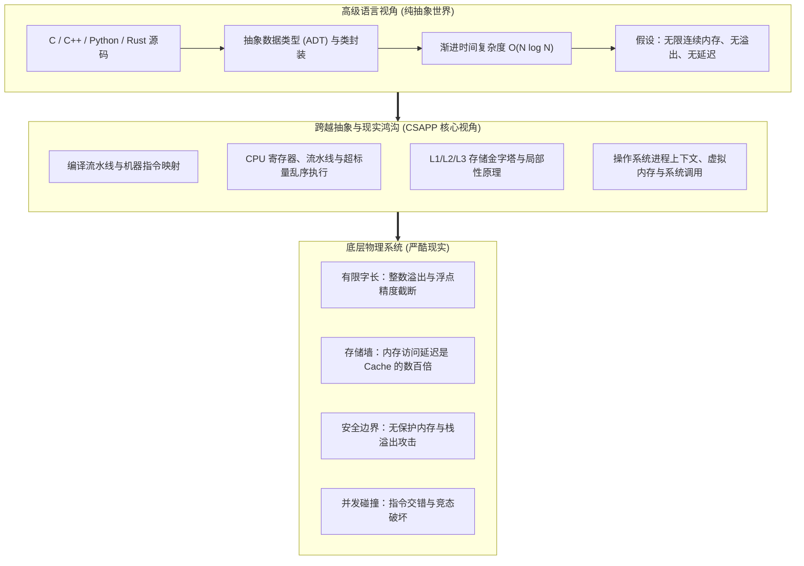

> **讲师**：Randal E. Bryant & David R. O'Hallaron ｜ **原视频**：Bilibili 分 P1 ｜ **时长**：01:15:09  
> **所属模块**：Module 0: 课程导论 (Course Overview)（L01 · 计算机系统核心理念、硬件与程序交互视角）  
> **原视频地址**：[https://www.bilibili.com/video/BV1iW411d7hd/?p=1](https://www.bilibili.com/video/BV1iW411d7hd/?p=1)  
> **课程官方归属**：Carnegie Mellon University (CMU) 15-213 / 18-213 / 15-513: Introduction to Computer Systems (CSAPP Fall 2015)  
> **对应教材**：*Computer Systems: A Programmer's Perspective (3rd Edition)* by R. Bryant & D. O'Hallaron  
> **字幕与讲义出处**：字幕由 EugeneLiu/translationCSAPP 团队翻译校订（CC BY-NC 4.0 开源协议），幻灯片版权归 CMU 课程组所有。  

---

## 1. 从抽象世界走向物理现实：计算机系统核心理念 (Theme: Systems Knowledge is Power)

*(参考时间：00:01:15 · [视频跳转 (P1 00:01:15)](https://www.bilibili.com/video/BV1iW411d7hd/?p=1&t=75))*


在绝大多数先修的计算机课程中（如编程入门、面向对象设计、离散数学、数据结构与算法），教学重点无一例外都是**抽象（Abstraction）**。
* 在高级语言的抽象世界里：
  * 整数拥有任意精度，数学运算法则处处成立；
  * 浮点数等同于实数，满足结合律与分配律；
  * 内存是一个无限连续、随取随用的扁平数组；
  * 程序的性能由渐进时间复杂度（大 $O$ 记号，如 $O(N \log N)$ vs $O(N^2)$）唯一决定；
  * 执行过程是单调且瞬间完成的纯逻辑推演。

然而，计算机终究是由硅芯片、晶体管阵列、微纳金属导线、高速缓存和外部物理总线构成的**物理实体**。
CMU 15-213 / CSAPP 的核心宗旨，就是帮助程序员**撕开纯理论抽象的保护滤镜**，建立起对底层物理现实的敬畏与透彻理解：
1. **你不需要成为芯片硬件架构师**：你不需要亲自去用 Verilog 绘制加法电路，也不用手工在布线层排布晶体管；
2. **你也不需要整天手写纯汇编**：现代编译器的优化能力已远超一般人类的耐心与局部权衡水平；
3. **但你必须站在“程序员的视角（Programmer's Perspective）”深刻理解系统的物理法则**：
   * 为什么同样是 $O(N^2)$ 的双重循环，按行遍历比按列遍历能快整整几十倍？
   * 为什么两个看似相同的浮点数累加次序调换一下，计算结果就会出现巨大误差甚至引发航天系统灾难？
   * 为什么一行看似平常的字符串拷贝，能够被黑客利用并一举取得远程服务器的 Root 控制权？

**系统知识就是力量（Systems Knowledge is Power!）**：只有深刻理解底层，你才能写出性能更高、极度健壮、在面对高并发与边界异常时坚如磐石的工业级程序。



## 2. 系统现实之一：整数不是数学整数，运算不满足无限范围 (Ints are not Integers)

*(参考时间：00:09:30 · [视频跳转 (P1 00:09:30)](https://www.bilibili.com/video/BV1iW411d7hd/?p=1&t=570))*


在数学集合论中，整数集合 $\mathbb{Z}$ 是无限且封闭的，对于任何实数 $x$，恒有平方非负：
$$x^2 \ge 0 \quad (\forall x \in \mathbb{R})$$
此外，对加法恒有单调性：$x + 1 > x$。

然而在计算机内部，所有的整型变量都必须装在**固定位宽**（如 8 位、16 位、32 位或 64 位）的物理寄存器和内存单元中。现代计算机普遍采用**二进制补码（Two's Complement）**编码：
* 32 位有符号整数 `int` 的表示范围严格受限在 $[-2^{31}, 2^{31}-1]$，即 $[-2147483648, 2147483647]$；
* 一旦计算结果超出了这一物理边界，最高位（符号位）就会发生**溢出翻转（Overflow）**！

课堂上 Bryant 教授给出了震撼的实验证据：
```c
int x = 50000;
printf("x * x = %d\n", x * x);
```
在符合数学直觉的计算中，$50000 \times 50000 = 2,500,000,000$。
但在 32 位机器中，运行上述代码的输出竟然是：
```text
x * x = -1794967296
```
这是因为 $2.5 \times 10^9$ 的二进制表示是 `0x9502F900`，最高位是 `1`。计算机硬件严格将其解释为负数！此时，**$x^2 \ge 0$ 的数学公理在计算机中轰然倒塌**。

另一个经典陷阱是加法单调性：
```c
int max_val = 2147483647;
printf("max_val + 1 = %d\n", max_val + 1); // 输出 -2147483648 (TMin)!
```
> **编者深度解析**：
> 计算机的整数算术虽然不具备无限性，但它**绝不是随机胡乱生成的**！补码算术在代数上严格构成了一个**模运算阿贝尔环（Abelian Ring modulo $2^w$）**。它满足结合律与交换律，所有算术溢出的行为完全具备确定性和可预测性。理解这一数学本质是攻克后续 Data Lab 的先决条件。

## 3. 系统现实之一 (续)：浮点数不是实数，不满足结合律与分配律 (Floats are not Reals)

*(参考时间：00:15:40 · [视频跳转 (P1 00:15:40)](https://www.bilibili.com/video/BV1iW411d7hd/?p=1&t=940))*


许多初学者误以为浮点数（`float`, `double`）既然能带小数，就能完美模拟数学实数。事实恰恰相反，浮点数是**以有限的二进制比特对实数轴进行离散非均匀抽样**：
* 浮点数使用 IEEE 754 标准：数值表示为 $(-1)^s \times M \times 2^E$；
* 32 位单精度浮点数只有 23 位尾数有效数字（精度约 7 位十进制），64 位双精度浮点数只有 52 位尾数（精度约 15-17 位十进制）。

正因尾数位宽有限，浮点数运算在底层必须进行**对齐阶码与精度舍入（Rounding）**。这直接摧毁了实数最基本的结合律：
$$(1e20 + -1e20) + 3.14 = 0.0 + 3.14 = 3.14$$
$$1e20 + (-1e20 + 3.14) = 1e20 + -1e20 = 0.0$$

在计算 `-1e20 + 3.14` 时，由于两个加数的指数差异高达数十个数量级，小数字 $3.14$ 的有效位为了对齐大阶码，在硬件向右移位过程中**被全部移出有效位寄存器并强行截断舍入丢失**！
* 结果：原本应当存在的 $3.14$ 就如同未曾发生过一样彻底蒸发。
* **灾难案例**：1991 年海湾战争中，美军“爱国者”防空导弹系统因系统时钟内部浮点计数累积了约 0.34 秒的舍入误差，导致雷达跟踪窗口偏离超过 500 米，最终拦截飞毛腿导弹失败造成重大人员伤亡。

## 4. 系统现实之二：必须理解汇编语言 (You've Got to Know Assembly)

*(参考时间：00:22:15 · [视频跳转 (P1 00:22:15)](https://www.bilibili.com/video/BV1iW411d7hd/?p=1&t=1335))*


现代高级语言（C、C++、Rust、Go）拥有极度精巧的语法抽象，但为什么顶尖工程师必须学会直接阅读 x86-64 机器汇编？
Bryant 教授指出了三大无可替代的现实需求：

1. **理解编译器的行为边界与优化极限**：
   编译器并不是全知全能的先知。面对看似简单的两行代码，编译器常常因为难以排除指针别名（Pointer Aliasing）或者函数副作用（Side Effects）而被迫放弃激进优化。懂得阅读汇编，你就能一眼看出编译器是否生成了你期望的 SIMD 向量化指令或内联展开，并精准指导代码重构。

2. **面对现场崩溃（Crash）与死锁时的唯一真相**：
   在真实的线上生产环境中，当核心服务发生 Segmentation Fault 崩溃并生成 Core Dump 核心转储文件时，代码早已脱去了高级语言的华丽外衣，调用栈中只有冰冷的寄存器状态（`%rsp`, `%rbp`, `%rip`）和反汇编指令流。只有精通汇编，你才能单步倒推事故现场的寄存器覆写过程。

3. **网络安全与攻防对抗的底层根基**：
   几乎所有严峻的底层系统安全漏洞（如栈溢出、ROP 面向返回编程、格式化字符串漏洞、UAF 释放后引用），都是在汇编指令和寄存器传参级别发动的。不读懂汇编，就永远只能在应用层隔靴搔痒。

## 5. 系统现实之三：内存至关重要与越界踩踏幽灵 Bug (Memory Matters)

*(参考时间：00:30:20 · [视频跳转 (P1 00:30:20)](https://www.bilibili.com/video/BV1iW411d7hd/?p=1&t=1820))*


高级语言程序员习惯于将内存想象为一个安全舒适的保姆式沙盒：数组越界有异常抛出，对象失效有垃圾回收。
然而在 C/C++ 这种系统级语言中，**硬件与运行时根本不提供任何自动边界检查**！指针本质上就是一个无拘无束的内存物理绝对地址。

课堂上展示了 CSAPP 历史上最经典的“内存踩踏（Memory Referencing Bug）”实验：
```c
typedef struct {
    int a[2];
    double d;
} struct_t;

double fun(int i) {
    volatile struct_t s;
    s.d = 3.14;
    s.a[i] = 1073741824; /* 故意越界写入！ */
    return s.d;
}
```
结构体中明确声明数组 `a` 只有两个元素（索引仅为 0 和 1）。当程序员恶作剧般地传入 `i = 0, 1, 2, 3, 4` 时，观察 `fun(i)` 返回的 `s.d`：

| 索引 `i` | 访问位置分析 | 返回的 `s.d` 值 | 现象与本质原因 |
|:---:|:---|:---:|:---|
| `i = 0` | 正常写入 `s.a[0]` | `3.140000` | 正常运行，未波及 `d` |
| `i = 1` | 正常写入 `s.a[1]` | `3.140000` | 正常运行，未波及 `d` |
| `i = 2` | **越界写入 `s.a[2]`** | **`3.1399998664856`** | `s.d` 的数值被离奇篡改！ |
| `i = 3` | **越界写入 `s.a[3]`** | **`2.00000061035156`** | `s.d` 发生严重畸变！ |
| `i = 4` | **越界写入 `s.a[4]`** | `3.140000` (或崩溃) | 越界踩到了相邻的保存寄存器或栈返回地址！ |

> **内存布局真相拆解**：
> 在 64 位体系结构下，编译器出于硬件对齐要求，将 8 字节的 `double d` 紧随 8 字节的数组 `a[2]` 之后连续排布在栈帧中。
> * `s.a[0]` 占据低 4 字节，`s.a[1]` 占据接下来的 4 字节；
> * 当访问 `s.a[2]` 时，指针偏移量恰好跨入了 `double d` 的**低 32 位二进制区间**！
> * 写入整数 `1073741824`（即十六进制 `0x40000000`），无声无息地覆写了 IEEE 754 浮点数的尾数低位，导致 `s.d` 发生微小漂移；
> * 当访问 `s.a[3]` 时，直接覆写了 `double d` 的**高 32 位**（包含符号位与高阶指数），导致其数值发生翻天覆地的剧变！

## 6. 系统现实之四：硬件架构对性能的决定性统治力 (Memory Hierarchy Dominates)

*(参考时间：00:41:45 · [视频跳转 (P1 00:41:45)](https://www.bilibili.com/video/BV1iW411d7hd/?p=1&t=2505))*


传统算法理论告诉你：只要两个算法的大 $O$ 复杂度相同，它们就是同阶渐进等价的。
但系统工程师必须知道：**大 $O$ 隐藏的常数因子，不仅可能相差巨大，而且会受到底层存储体系金字塔的严厉制约**！

考虑下面两个极其平凡的二维矩阵求和函数：
```c
void copyji(int src[2048][2048], int dst[2048][2048]) {
    int i, j;
    for (j = 0; j < 2048; j++)
        for (i = 0; i < 2048; i++)
            dst[i][j] = src[i][j]; /* 列优先遍历 (Column-major) */
}

void copyij(int src[2048][2048], int dst[2048][2048]) {
    int i, j;
    for (i = 0; i < 2048; i++)
        for (j = 0; j < 2048; j++)
            dst[i][j] = src[i][j]; /* 行优先遍历 (Row-major) */
}
```
在数学逻辑上，两个函数执行的赋值操作次数完全相同（均为 $2048 \times 2048 = 4,194,304$ 次）。
但在真实硬件上的实测耗时：
* `copyij`（行优先）：耗时约 **4.3 毫秒**
* `copyji`（列优先）：耗时高达 **81.8 毫秒**！
**两者性能相差近 20 倍！**

为什么？因为 C 语言二维数组在内存中是**行优先连续存放**的。
* 在 `copyij` 中，内层循环访问相邻地址，每次 CPU 从主存载入一个 64 字节的缓存块（Cache Line），随后的 15 次整型访存**全部无延迟命中 L1 高速缓存**（空间局部性极佳）；
* 在 `copyji` 中，内层循环每次步长跳跃 2048 个整数（8KB），不仅彻底摧毁了 L1/L2 Cache，更是次次发生缓存缺失，逼迫 CPU 反复停摆等待漫长的主存总线读取！

## 7. 系统现实之五：计算机绝不止执行程序，更是网络与并发的核心媒介

*(参考时间：00:54:10 · [视频跳转 (P1 00:54:10)](https://www.bilibili.com/video/BV1iW411d7hd/?p=1&t=3250))*


早期的计算机或许只是一台高速数值批处理机，输入纸带打孔卡，输出计算表格。
而在当今时代，单机单进程时代早已终结：
1. **数据跨越网络流转**：计算机通过网卡收发网络报文，网络数据包的到达本质上是异步外部硬件中断；通过抽象的套接字（Sockets）API，本地进程能与相隔数千公里的远端服务器无缝通信。
2. **操作系统调度多个并发逻辑流**：为了同时服务成千上万的用户请求，操作系统通过分时轮转、进程多路复用与内核级线程，在单个物理硬件上构筑出宏大的并发世界。
3. **并发同步的万丈深渊**：当多个线程在共享内存中并发读写同一块数据时，指令微步的非确定性交错会引发离奇诡异的“幽灵竞态（Race Conditions）”和“死锁（Deadlock）”。

## 8. 全课程 7 大经典实验 (Labs) 深度全景解析

*(参考时间：01:05:00 · [视频跳转 (P1 01:05:00)](https://www.bilibili.com/video/BV1iW411d7hd/?p=1&t=3900))*


15-213 之所以能够被全球数十所顶尖大学计算机系奉为圭臬，其灵魂全在于 7 大硬核动手实验。这些实验层层递进，贯通全书理论：


1. **L1: Data Lab (位级魔法)**：
   * 严苛规则：禁用任何控制流（`if`, `while`）、禁用乘除法、禁用大于 255 的大常数，只能使用有限数量的位操作符（`~`, `&`, `^`, `|`, `+`, `<<`, `>>`）。
   * 目标：亲手用位级比特变换实现补码绝对值、符号判断、两数比大小以及 IEEE 754 浮点转换，将位级直觉刻入骨髓。

2. **L2: Bomb Lab (二进制拆弹专家)**：
   * 形式：你收到一个没有任何源码、仅有 x86-64 机器二进制的可执行文件（程序炸弹）。
   * 目标：使用 GDB 调试器打断点、单步跟踪反汇编代码、检查寄存器与运行时栈内存状态，逆向推导拆除 6 个阶段的逻辑密码。一旦输入错误，炸弹爆炸并扣分！

3. **L3: Attack Lab (黑客攻防实战)**：
   * 目标：利用目标程序中未检查输入长度的 `gets()` 漏洞，手工构造十六进制 Payload 覆写栈帧返回地址。
   * 进阶挑战：在开启了 NX/DEP（栈不可执行）保护的高级阶段，通过搜索合法的 `gadget` 指令序列拼装 ROP 链，完成对控制流的绝妙劫持。

4. **L4: Cache Lab (缓存调优大师)**：
   * Part A：手写一个精确模拟 LRU 替换策略的软件高速缓存模拟器；
   * Part B：对 $32 \times 32$, $64 \times 64$, $61 \times 67$ 矩阵转置算法进行多层分块（Blocking/Tiling）与寄存器暂存优化，将 Cache Miss 次数压制到理论下限。

5. **L5: Shell Lab (微型 Unix 外壳开发)**：
   * 目标：从零实现一个支持前台/后台作业调度（Job Control）、管道与 I/O 重定向、正确捕获处理 `SIGINT` (`Ctrl+C`)、`SIGTSTP` (`Ctrl+Z`) 和 `SIGCHLD` 的全功能 Linux Shell。

6. **L6: Malloc Lab (工业级内存分配器)**：
   * 目标：编写自己的 `mm_malloc`, `mm_free`, `mm_realloc` 动态内存管理器。
   * 挑战：在保证吞吐率每秒数十万次分配的同时，通过空闲链表、边界标记合并、分离适配等高阶数据结构，达到 85% 以上的空间利用率。

7. **L7: Proxy Lab (高并发多线程代理网关)**：
   * 目标：综合网络编程、Sockets API、HTTP 协议解析、POSIX 多线程并发与 readers-writers 读写锁缓存同步，构建一个工业级代理服务器。


---

### 本讲小结与核心思考 (Takeaways)

1. **系统视角的本质转变**：本讲从底层机制剖析了「Course Overview：深入理解计算机系统的核心世界观与五大现实」的核心实现原理。
2. **软硬件协同设计**：理解底层规则不仅能消除潜在的难以调试的隐蔽 Bug，更是编写极致性能工业级代码的前提。
3. **动手实践验证**：推荐配合 CSAPP 对应章节课后习题与官方实验（Lab），在 Linux 终端环境下使用 GDB 与性能分析工具亲自印证理论。
