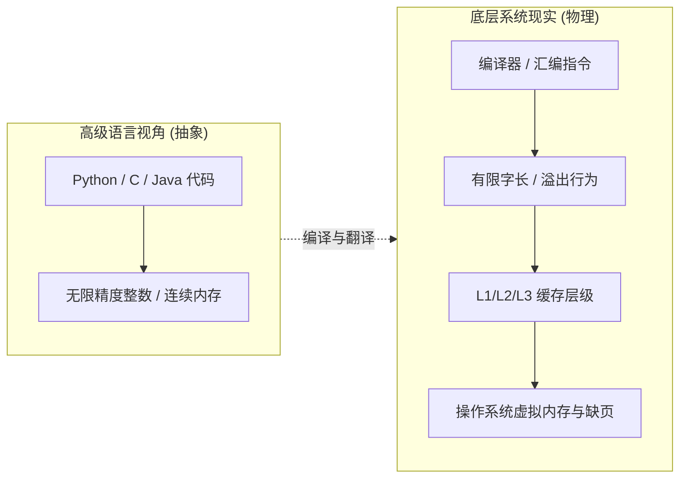

> **讲师**：Randal E. Bryant & David R. O'Hallaron ｜ **原视频**：Bilibili 分 P1 ｜ **时长**：01:15:09  
> **所属模块**：Module 0: 课程导论 (Course Overview)（L01 · 计算机系统核心理念、硬件与程序交互视角）  
> **原视频地址**：[https://www.bilibili.com/video/BV1iW411d7hd/?p=1](https://www.bilibili.com/video/BV1iW411d7hd/?p=1)  
> **课程官方归属**：Carnegie Mellon University (CMU) 15-213 / 18-213 / 15-513: Introduction to Computer Systems (CSAPP Fall 2015)  
> **对应教材**：*Computer Systems: A Programmer's Perspective (3rd Edition)* by R. Bryant & D. O'Hallaron  
> **字幕与讲义出处**：字幕由 EugeneLiu/translationCSAPP 团队翻译校订（CC BY-NC 4.0 开源协议），幻灯片版权归 CMU 课程组所有。  

---

## 1. 课程核心主题：系统知识就是力量 (Systems Knowledge is Power)

*(参考时间：00:01:15 · [视频跳转 (P1 00:01:15)](https://www.bilibili.com/video/BV1iW411d7hd/?p=1&t=75))*


计算机科学的大多数先修课程（如数据结构、算法与面向对象设计）都高度强调**抽象（Abstraction）**：将复杂底层封装为抽象数据类型（ADT），通过渐进时间复杂度（大 O 记号）分析性能。在抽象的世界里，整数具有任意精度，内存是无限连续的数组，计算操作都是瞬间完成的。

但在真实物理世界中，计算机是由硅芯片、晶体管、金属导线和外部总线构成的物理硬件。**“从程序员的视角理解计算机系统（CSAPP）”**的宗旨正在于打破过于纯粹的抽象滤镜：
* 绝大多数现代应用程序员不需要亲自去设计芯片，也不需要整天手写汇编代码；
* 但是，当你深刻理解了高级语言代码如何一步步映射到汇编指令、寄存器、缓存层级与操作系统系统调用时，你才能写出性能更高、更安全、在关键时刻不会发生灾难性崩溃的代码。



## 2. 计算机系统的第一大现实：整数不是数学整数，浮点数不是实数

*(参考时间：00:10:45 · [视频跳转 (P1 00:10:45)](https://www.bilibili.com/video/BV1iW411d7hd/?p=1&t=645))*


在数学中，整数集合 $\mathbb{Z}$ 是无限且封闭的，对任意整数 $x$ 都有 $x^2 \ge 0$。但在计算机中，整数使用固定位宽（例如 32 位或 64 位补码）存储：

```c
int x = 50000;
printf("%d\n", x * x); // 在 32 位系统下输出 -1794967296！
```
当计算 $50000 \times 50000 = 2500000000$ 时，该数值超出了 32 位有符号整数的最大正数上限 $2^{31}-1 = 2147483647$，发生有符号溢出，最高位成为符号位，结果变成了负数！这说明在计算机中，**$x^2 \ge 0$ 并不恒成立**。

浮点数同样不遵守数学实数的结合律：
$$(1e20 + -1e20) + 3.14 = 3.14$$
$$1e20 + (-1e20 + 3.14) = 0.0$$
在计算机底层，由于浮点数的有效位数有限（单精度 float 仅 23 位有效尾数，双精度 double 52 位），$1e20$ 加上 $3.14$ 时，$3.14$ 因为指数对齐过大而在移位截断中彻底丢失（有效位下溢）。理解浮点数的 IEEE 754 编码对于数值计算、物理仿真以及高精度金融计算至关重要。

## 3. 计算机系统的第二大现实：必须理解汇编语言

*(参考时间：00:19:30 · [视频跳转 (P1 00:19:30)](https://www.bilibili.com/video/BV1iW411d7hd/?p=1&t=1170))*


程序员在日常工作中很少从零手写汇编，因为现代编译器（GCC、Clang）的优化能力比绝大多数人类更耐心、更严密。但为什么我们必须学会阅读汇编？
1. **理解编译器的优化边界**：为什么有时候把循环稍微调换一下次序，或者消除一个指针别名，编译器就能生成性能快十倍的向量化指令？
2. **调试崩溃与逆向工程**：当程序在生产环境中因段错误（Segmentation Fault）崩溃、没有源码仅有 Core Dump 时，调用栈中充斥着寄存器和机器指令，不懂汇编寸步难行。
3. **识别并防范底层安全漏洞**：臭名昭著的缓冲区溢出攻击（Buffer Overflow）和栈溢出攻击正是直接利用了函数调用的栈帧内存布局，覆盖返回地址。

## 4. 计算机系统的第三大现实：内存至关重要 (Memory Matters)

*(参考时间：00:27:15 · [视频跳转 (P1 00:27:15)](https://www.bilibili.com/video/BV1iW411d7hd/?p=1&t=1635))*


C 语言赋予了程序员直接操作内存指针的强大能力，但**C/C++ 不提供任何自动数组边界检查**。课堂上 Bryant 教授给出了一个极为震撼的内存引用错误示例：

```c
typedef struct {
    int a[2];
    double d;
} struct_t;

double fun(int i) {
    volatile struct_t s;
    s.d = 3.14;
    s.a[i] = 1073741824; /* 越界写入测试 */
    return s.d;
}
```
当传入不同的 `i` 时：
* `fun(0)` 返回 `3.14`
* `fun(1)` 返回 `3.14`
* `fun(2)` 返回 `3.1399998664856`
* `fun(3)` 返回 `2.00000061035156`
* `fun(4)` 甚至可能导致程序崩溃！

为什么访问 `s.a[2]` 和 `s.a[3]` 会篡改相邻的浮点数 `s.d`？因为在编译器内存对齐规则下，数组 `a` 紧邻 `d` 存放。越界赋值 `s.a[2]` 实际上覆写了 `double d` 对应低 32 位二进制比特！这种无声无息破坏其他变量的“幽灵 Bug”，只有深刻理解内存布局才能精确定位。

## 5. 计算机系统的第四与第五现实：性能不仅是算法复杂度，计算机不止执行程序

*(参考时间：00:39:20 · [视频跳转 (P1 00:39:20)](https://www.bilibili.com/video/BV1iW411d7hd/?p=1&t=2360))*


* **第四现实：硬件体系对程序运行时间具有数量级影响**。遍历一个二维矩阵，按行优先（Row-Major）访问比按列优先（Column-Major）访问的速度能够相差数十倍甚至上百倍！两个算法在渐进时间复杂度上都是 $O(N^2)$，但行遍历完美命中 CPU 的 L1/L2 高速缓存与硬件预取器，而列遍历导致每一次访存都发生 Cache Miss，频繁从漫长延迟的主存读取。
* **第五现实：计算机不仅执行程序，更要通过网络和 I/O 与物理世界交互**。从网络套接字（Sockets）接收数据包、响应用户键盘输入、通过系统调用向磁盘持久化文件、管理多进程并发——计算机系统的生命力在于网络与并发。

## 6. 课程核心实验全景 (Labs Overview)

*(参考时间：00:52:10 · [视频跳转 (P1 00:52:10)](https://www.bilibili.com/video/BV1iW411d7hd/?p=1&t=3130))*


15-213 之所以被誉为 CMU 乃至全球计算机专业的“神课”，核心就在于其精心设计的 7 大动手实验（Labs）：
* **L1 (Data Lab)**：只用受限的位操作符实现整数与浮点数算法，彻底参透补码与 IEEE 754 底层细节。
* **L2 (Bomb Lab)**：逆向工程实战！面对一个仅有二进制机器码的可执行文件，使用 GDB 单步反汇编、分析寄存器与控制流，拆除 6 个逻辑炸弹。
* **L3 (Attack Lab)**：安全实战，通过缓冲区溢出篡改栈帧，实施代码注入（Code Injection）与 ROP（Return-Oriented Programming）攻击。
* **L4 (Cache Lab)**：自己用 C 语言手写一个软件高速缓存模拟器，并对矩阵转置算法进行多层分块优化，榨干 Cache 性能。
* **L5 (Shell Lab)**：实现一个支持前后台作业控制、管道重定向和安全信号处理的微型 Unix Shell。
* **L6 (Malloc Lab)**：自己实现 `malloc`、`free` 和 `realloc`！设计隐式/显式空闲链表、边界标记合并与内存对齐，平衡吞吐率与空间利用率。
* **L7 (Proxy Lab)**：编写多线程高并发 Web 代理服务器，深入掌握网络套接字编程与读写锁缓存同步。


---

### 本讲小结与核心思考 (Takeaways)

1. **系统视角的本质转变**：本讲从底层机制剖析了「Course Overview：深入理解计算机系统的核心世界观」的核心实现原理。
2. **软硬件协同设计**：理解底层规则不仅能消除潜在的难以调试的隐蔽 Bug，更是编写极致性能工业级代码的前提。
3. **动手实践验证**：推荐配合 CSAPP 对应章节课后习题与官方实验（Lab），在 Linux 终端环境下使用 GDB 与性能分析工具亲自印证理论。
