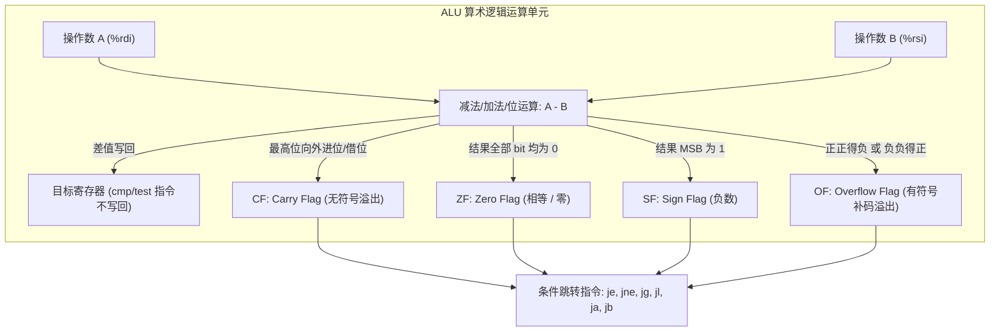

> **讲师**：Randal E. Bryant & David R. O'Hallaron ｜ **原视频**：Bilibili 分 P6 ｜ **时长**：01:13:50  
> **所属模块**：Module 2: 机器级程序表示 (Machine-Level Representation of Programs)（L05 - L09 · x86-64 汇编、控制流、过程调用与数据结构）  
> **原视频地址**：[https://www.bilibili.com/video/BV1iW411d7hd/?p=6](https://www.bilibili.com/video/BV1iW411d7hd/?p=6)  
> **课程官方归属**：Carnegie Mellon University (CMU) 15-213 / 18-213 / 15-513: Introduction to Computer Systems (CSAPP Fall 2015)  
> **对应教材**：*Computer Systems: A Programmer's Perspective (3rd Edition)* by R. Bryant & D. O'Hallaron  
> **字幕与讲义出处**：字幕由 EugeneLiu/translationCSAPP 团队翻译校订（CC BY-NC 4.0 开源协议），幻灯片版权归 CMU 课程组所有。  

---

## 1. 控制流的核心基石：CPU 条件码寄存器 (Condition Codes)

*(参考时间：00:02:12 · [视频跳转 (P6 00:02:12)](https://www.bilibili.com/video/BV1iW411d7hd/?p=6&t=132))*


在高级编程语言（如 C、Java、Python）中，程序的控制流是由 `if-else`、`while`、`for` 和 `switch` 等高级结构驱动的。
然而，CPU 硬件在最底层本质上是按顺序一条条从内存取指令执行的流水线（Program Counter 指向下一条指令）。
为了在硬件上实现“根据计算结果选择不同执行路径”，x86-64 CPU 引入了一组由硬件维护的单比特状态寄存器，统称为**条件码寄存器（Condition Code Registers）**。

### 四大核心条件码寄存器

| 条件码 | 全称 | 置位条件 (何时为 1) | 典型应用场景 |
| :--- | :--- | :--- | :--- |
| **CF** | Carry Flag (进位标志) | 最近的操作导致最高位产生了向外进位或借位（无符号数溢出） | 检测无符号整数加减法溢出、多精度大整数相加 |
| **ZF** | Zero Flag (零标志) | 最近的操作计算结果恰好等于 0 | 检测两数是否相等 (`a == b`)、循环计数器减至 0 |
| **SF** | Sign Flag (符号标志) | 最近的操作结果为负数（最高有效位 MSB 为 1） | 有符号数正负号检测 (`t < 0`) |
| **OF** | Overflow Flag (溢出标志) | 最近的操作导致了有符号数二进制补码溢出（正正得负或负负得正） | 检测有符号整数算术溢出 (`t < Min` 或 `t > Max`) |

### 条件码的隐式设置与显式设置
1. **算术与逻辑指令的隐式副作用**：
   大部分整数算术指令（如 `addq`, `subq`, `imulq`, `andq`, `orq`, `xorq`, `shlq`, `sarq`）在完成计算并将结果写入目标寄存器的同时，都会**隐式修改**条件码。
   * 特例：`leaq`（加载有效地址指令）专为地址计算设计，**绝不改变任何条件码**！这使得编译器可以用 `leaq` 巧妙地在不破坏条件状态的前提下执行乘加运算。
   * 移位操作中，进位标志 CF 会被设置为最后一个移出位的数值，而溢出标志 OF 在单步移位时根据符号变化设置。
   * 逻辑操作（`andq`, `orq`, `xorq`）会将 CF 和 OF 强制清零，仅根据结果设置 ZF 和 SF。

2. **显式比较与测试指令（只设条件码，不改寄存器）**：
   为了专门用于条件判断而不破坏原有操作数，x86-64 提供了两组特殊的无写回指令：
   * `cmpq Src2, Src1`：计算 `Src1 - Src2`，并根据差值设置条件码，但**不保存计算结果**。
     * 若 `Src1 == Src2`，则差值为 0，**ZF = 1**。
     * 若计算 `Src1 - Src2` 产生有符号负数，则 **SF = 1**。
     * 需特别注意 AT&T 语法的操作数顺序：比较的逻辑是“源操作数 1”减去“源操作数 2”，即 `cmpq %rax, %rdx` 实际在计算 `%rdx - %rax`。
   * `testq Src2, Src1`：计算 `Src1 & Src2`（按位与），根据与的结果设置 ZF 和 SF，**CF 和 OF 强制置 0**。
     * 典型惯用法：`testq %rax, %rax`。当 `%rax` 自身为 0 时置 ZF=1；当 `%rax` 为负数时置 SF=1。常用于检查指针是否为 NULL 或数字正负。



## 2. 条件码的读取与判断逻辑：setX 指令家族与符号比较推导

*(参考时间：00:15:30 · [视频跳转 (P6 00:15:30)](https://www.bilibili.com/video/BV1iW411d7hd/?p=6&t=930))*


条件码通常不直接作为数据读取，而是通过以下三种机制间接使用：
1. 通过 `setX` 指令将单个字节寄存器根据条件置为 0 或 1；
2. 通过条件跳转指令 `jX` 改变程序计数器 `%rip`；
3. 通过条件传送指令 `cmovX` 选择性移动数据。

### `setX` 指令的工作原理
`setX Dest` 指令根据条件码的特定布尔组合，将单字节目标（如 `%al`, `%bl`, `%cl` 等低 8 位寄存器）设为 `0x01` 或 `0x00`。随后编译器通常配合 `movzbl` 指令将其高位清零扩展为 32/64 位整数。

### 有符号比较的数学推导（为什么是 $SF \oplus OF$？）
很多同学在接触汇编时都会困惑：为什么判断 `a < b`（`jl` 指令）的条件不是简单的 `SF = 1`，而是 `SF ^ OF`（异或）？
让我们通过数学严谨推导：
执行 `cmpq %rsi, %rdi` 即计算 $t = a - b$。
* **情况 1：无溢出发生 ($OF = 0$)**
  * 若计算没有溢出，则真正的数学差值与其补码表示符号完全一致。
  * 若 $a < b$，则 $t < 0$，最高位必为 1，故 $SF = 1$。
  * 此时 $SF \oplus OF = 1 \oplus 0 = 1$。
* **情况 2：发生正溢出 ($OF = 1, t < 0$ 且实际 $a - b > 0$)**
  * 当 $a > 0$ 且 $b < 0$ 时，差值过大导致正数溢出变为负数，故 $SF = 1$。
  * 但实际数学上 $a > b$，故不满足 $a < b$。
  * 此时 $SF \oplus OF = 1 \oplus 1 = 0$（正确判定为假！）。
* **情况 3：发生负溢出 ($OF = 1, t \ge 0$ 且实际 $a - b < 0$)**
  * 当 $a < 0$ 且 $b > 0$ 时，差值过小导致负数下溢变为正数，故 $SF = 0$。
  * 但实际数学上 $a < b$ 确实成立！
  * 此时 $SF \oplus OF = 0 \oplus 1 = 1$（正确判定为真！）。

综上所述，无论溢出与否，**$SF \oplus OF$ 永远能够准确判定有符号数 $a < b$**！

| 指令 | 助记符含义 | 判定条件 (布尔代数表达式) | 适用场景 |
| :--- | :--- | :--- | :--- |
| `sete` / `setz` | Equal / Zero | $ZF$ | 相等 ($a == b$) |
| `setne` / `setnz` | Not Equal / Not Zero | $\sim ZF$ | 不相等 ($a \ne b$) |
| `sets` | Negative | $SF$ | 负数 ($t < 0$) |
| `setns` | Non-negative | $\sim SF$ | 非负 ($t \ge 0$) |
| `setg` / `setnle` | Greater (Signed) | $\sim (SF \oplus OF) \,\&\, \sim ZF$ | 有符号大于 ($a > b$) |
| `setge` / `setnl` | Greater or Equal (Signed) | $\sim (SF \oplus OF)$ | 有符号大于等于 ($a \ge b$) |
| `setl` / `setnge` | Less (Signed) | $SF \oplus OF$ | 有符号小于 ($a < b$) |
| `setle` / `setng` | Less or Equal (Signed) | $(SF \oplus OF) \mid ZF$ | 有符号小于等于 ($a \le b$) |
| `seta` / `setnbe` | Above (Unsigned) | $\sim CF \,\&\, \sim ZF$ | 无符号大于 ($a >_u b$) |
| `setb` / `setnae` | Below (Unsigned) | $CF$ | 无符号小于 ($a <_u b$) |

## 3. 条件分支与跳转指令：PC 相对寻址机制

*(参考时间：00:26:40 · [视频跳转 (P6 00:26:40)](https://www.bilibili.com/video/BV1iW411d7hd/?p=6&t=1600))*


汇编语言中的跳转分为**无条件跳转（`jmp`）**和**条件跳转（`jX`）**。
* `jmp Label`：直接跳转到目标标号处；
* `jmp *Operand`：**间接跳转**，跳转目标地址存储在寄存器或内存中（例如 `jmp *%rax` 或 `jmp *(%rax, %rdx, 8)`），这是实现函数指针与 `switch` 跳转表的核心。
* `jX Label`：条件跳转，当且仅当特定条件成立时跳转，否则执行下一条紧接着的指令。

### PC 相对寻址（PC-Relative Addressing）深度解析
在机器代码中，目标地址是如何编码的？
现代操作系统绝大多数代码都是**位置无关（Position-Independent Code, PIC）**的。为了实现这一点，x86-64 中的跳转指令通常采用 **PC 相对寻址**：
* 指令中编码的不是目标代码的绝对内存物理/虚拟地址，而是**目标地址相对于紧随跳转指令之后的下一条指令地址的偏移量（Displacement）**！
* 偏移量通常以 1 个字节（-128 到 +127）、2 个字节或 4 个字节补码形式存储。

```assembly
# 汇编反汇编实例 (objdump 提取)
4004d0:   48 83 f8 05             cmp    $0x5,%rax
4004d4:   7e 08                   jle    4004de <loop+0xe>
4004d6:   48 83 c0 01             add    $0x1,%rax
4004da:   eb f4                   jmp    4004d0 <loop>
4004de:   f3 c3                   repz retq
```
* 分析 `4004d4: 7e 08`：
  * `7e` 是 `jle` 指令的操作码；
  * `08` 是 1 字节相对偏移量；
  * 下一条指令的地址是 `4004d6`；
  * 计算目标地址：`0x4004d6 + 0x08 = 0x4004de`！正好对应 `repz retq`。
* 分析 `4004da: eb f4`：
  * `eb` 是 `jmp` 的 1 字节相对寻址操作码；
  * `f4` 是十六进制单字节补码，$-12$；
  * 下一条指令地址是 `4004dc`；
  * 计算目标地址：`0x4004dc - 0x0c = 0x4004d0`！完美跳回循环开头。

**PC 相对寻址的巨大工程优势**：代码无论被加载到内存的哪个虚拟地址段，指令字节码保持完全恒定，无需链接器在加载时逐行打补丁！

## 4. 条件传送指令 (Conditional Move)：用数据传送替代分支跳转

*(参考时间：00:36:10 · [视频跳转 (P6 00:36:10)](https://www.bilibili.com/video/BV1iW411d7hd/?p=6&t=2170))*


传统条件跳转指令（`jX`）存在现代超标量处理器中最致命的性能隐患：**分支预测失败惩罚（Branch Misprediction Penalty）**！

### 现代 CPU 流水线与分支预测危机
现代 CPU 普遍具有 14 到 20 级流水线深度。为了保持流水线源源不断满负荷运转，CPU 在遇到条件跳转指令时，**无法等待算术结果算出再决定去向**，而是必须借助硬件分支预测器（Branch Predictor）猜测最可能的跳转方向，并投机执行后续指令。
* **预测成功**：流水线零停顿，吞吐率拉满；
* **预测失败**：CPU 必须将已经投机执行的整条流水线指令全部冲刷作废（Pipeline Flush），重新从正确路径取指，这通常会带来 **15 到 30 个时钟周期的巨大性能损失**！

### 条件传送指令 `cmovX` 的救赎
针对这个瓶颈，现代指令集引入了**条件传送指令（Conditional Move, 如 `cmovle`, `cmovne`, `cmovge`）**：
* 思想：**同时计算出条件的两个可能分支结果，最后利用一条硬件条件传送指令根据条件码选择将哪一个存入目标寄存器**！
* 此时程序执行路径是**完全线性的**，没有任何跳转指令，分支预测器永远不会受挫，流水线恒定无停顿！

```c
/* 经典绝对值差值函数 */
long absdiff(long x, long y) {
    long result;
    if (x < y)
        result = y - x;
    else
        result = x - y;
    return result;
}
```

```assembly
# 优化编译生成的条件传送汇编 (gcc -O2)
# %rdi = x, %rsi = y
absdiff:
    movq    %rsi, %rax
    subq    %rdi, %rax          # rval = y - x
    movq    %rdi, %rdx
    subq    %rsi, %rdx          # eval = x - y
    cmpq    %rsi, %rdi          # 比较 x : y
    cmovge  %rdx, %rax          # 如果 x >= y，将 %rdx 传送给 %rax
    ret                         # 返回 %rax
```

> [!CAUTION] 条件传送并非万灵药：三大禁用危险场景！
> 尽管条件传送消除了分支开销，但在以下三种情形下**绝对不能使用条件传送**，编译器会退回传统跳转：
> 1. **空指针解引用等非法内存访问**：
>    ```c
>    long val = (p != NULL) ? *p : 0;
>    ```
>    若用 `cmov`，即使 `p == NULL`，CPU 也会提前无条件执行 `*p` 的内存加载，导致立即触发 **Segmentation Fault (段错误)**！
> 2. **具有副作用的表达式（Side Effects）**：
>    ```c
>    long val = test ? count++ : error_handler();
>    ```
>    两个分支都会被计算，导致计数器被错误自增两次，或错误触发异常处理函数。
> 3. **计算开销极其悬殊的表达式**：
>    如果其中一个分支需要调用开销极大的复杂函数或浮点矩阵乘法，盲目计算两个分支的耗时远超流水线惩罚。

## 5. 循环语句的底层汇编结构：Do-While、Jump-to-Middle 与 Guarded-Do

*(参考时间：00:48:20 · [视频跳转 (P6 00:48:20)](https://www.bilibili.com/video/BV1iW411d7hd/?p=6&t=2900))*


C 语言提供了三种基本循环结构：`do-while`、`while` 和 `for`。但在 x86-64 机器指令集中，**没有专门的循环指令**！所有循环一律由条件码、测试比较指令和跳转指令组合构造。

### 1. `do-while` 循环：最直接的底层形态
`do-while` 先执行循环体，再在末尾判断循环条件，若为真则跳回循环开头。这与汇编的单条条件跳转语义天然契合。

```c
long pcount_do(unsigned long x) {
    long result = 0;
    do {
        result += x & 0x1;
        x >>= 1;
    } while (x);
    return result;
}
```

```assembly
# pcount_do 汇编翻译
# %rdi = x
    movl    $0, %eax            # result = 0
.L2:
    movq    %rdi, %rdx
    andl    $1, %edx            # %rdx = x & 1
    addq    %rdx, %rax          # result += %rdx
    shrq    $1, %rdi            # x >>= 1
    jne     .L2                 # if (x != 0) goto .L2
    rep; ret
```

### 2. `while` 循环翻译模式一：Jump-to-Middle（中间跳转）
`while` 循环在进入循环体前必须先检查条件。未优化代码（`-O0` 或 `-O1`）常用 **Jump-to-Middle** 策略：在函数入口处直接无条件跳转到末尾的测试代码处。

```assembly
# while (Test) { Body } -> Jump-to-Middle
    jmp     .L_TEST
.L_LOOP:
    # 循环体 (Loop Body)
.L_TEST:
    cmpq    ...
    jle     .L_LOOP
```

### 3. `while` 循环翻译模式二：Guarded-Do（带守卫的 Do-While）
现代高性能优化编译器（`-O2` 及以上）普遍偏好 **Guarded-Do** 模式：
在进入循环前先用一个守卫条件判断：如果初始条件就不满足，直接跳过整个循环；如果满足，则直接跌入一个**高效的 do-while 核心循环体**！

```c
/* Guarded-Do 模式的 C 等价变换 */
if (!Test)
    goto done;
do {
    Body;
} while (Test);
done:
```
* **性能优势**：在许多常见场景中（如处理非空字符串或非空数组），守卫分支预测成功率极高，且循环体内部的每一次迭代只有一次末尾的条件跳转，去除了入口跳转的开销。

## 6. Switch 语句与跳转表 (Jump Tables)：O(1) 多路分支的极致艺术

*(参考时间：01:02:15 · [视频跳转 (P6 01:02:15)](https://www.bilibili.com/video/BV1iW411d7hd/?p=6&t=3735))*


当程序员需要处理多达十几个甚至几十个分支选项时（如词法分析器、指令模拟器、状态机转换），如果使用一连串的 `if-else if-else`，时间复杂度将退化为 $O(N)$，即依次做 $N$ 次比较和条件分支。
而 C 语言的 `switch` 语句在特定条件下会被编译器翻译为**跳转表（Jump Table）**，实现耗时恒定为 **$O(1)$** 的多路跳转！

### 跳转表的核心构造原理
跳转表在本质上是一个**存储代码地址的连续数组**（位于只读数据段 `.rodata` 中）。数组的每一个表项都是一个指向特定代码标号的 8 字节虚拟地址指针。

```c
/* 典型 switch 源码 */
void switch_eg(long x, long n, long *dest) {
    long val = x;
    switch (n) {
        case 100: val *= 13; break;
        case 102: val += 10; /* 穿透 Fall-through */
        case 103: val += 11; break;
        case 104:
        case 106: val *= val; break;
        default:  val = 0;
    }
    *dest = val;
}
```

```assembly
# switch_eg 汇编核心解析
# %rdi = x, %rsi = n, %rdx = dest
switch_eg:
    subq    $100, %rsi          # index = n - 100 (归一化偏移至从 0 开始)
    cmpq    $6, %rsi            # 比较 index : 6 (检测是否在合法范围内 [0, 6])
    ja      .L_DEFAULT          # 若为无符号大于（处理负数和超出上限），直接跳 default

    jmp     *.L_JUMP_TABLE(,%rsi,8)  # 间接跳转！读取 Table[index] 并跳转！

.section .rodata
    .align 8
.L_JUMP_TABLE:
    .quad   .L_CASE_100         # index 0 (n=100)
    .quad   .L_DEFAULT          # index 1 (n=101 缺失，填 default)
    .quad   .L_CASE_102         # index 2 (n=102)
    .quad   .L_CASE_103         # index 3 (n=103)
    .quad   .L_CASE_104_106     # index 4 (n=104)
    .quad   .L_DEFAULT          # index 5 (n=105 缺失，填 default)
    .quad   .L_CASE_104_106     # index 6 (n=106)
```

### 跳转表的系统级精妙设计
1. **负数与越界的单次判断技巧**：
   编译器先执行 `subq $100, %rsi` 将取值区间平移到 $[0, 6]$，然后使用 **无符号比较指令 `ja`（Jump if Above）**！
   如果原始 $n < 100$，减法结果为负数；当视作无符号数时，最高位为 1 变成了一个极其巨大的正整数，必定 $> 6$，一条 `ja` 指令同时搞定了“太小”和“太大”两种边界情况！
2. **缺失 Case 与 Fall-through 的优雅处理**：
   * 对于缺失的 `case 101` 和 `case 105`，跳转表相应索引处直接填充 `.L_DEFAULT` 的地址；
   * 对于 `case 102` 没有 `break` 产生的穿透（Fall-through），汇编代码中 `.L_CASE_102` 之后不放 `jmp` 指令，任由执行流直接跌入 `.L_CASE_103`！
3. **稀疏 Case 的权衡**：
   若 Case 标签极为分散（例如 `case 1:`, `case 1000000:`），生成跳转表会造成巨大的内存浪费。此时编译器会自动降级为二分查找决策树（Binary Search Tree）或级联 `if-else`。

> [!TIP] Bomb Lab 调试秘籍
> 在 CSAPP 的经典实验 **Bomb Lab Phase 3** 中，核心就是一段包含 `switch` 跳转表的反汇编代码！
> 掌握 `jmp *Offset(,%reg,8)` 的语法，在 GDB 中使用 `x/8gx 0x...` 打印跳转表地址数组，就能在数秒内逆向还原出炸弹所有的合法输入选项！


---

### 本讲小结与核心思考 (Takeaways)

1. **系统视角的本质转变**：本讲从底层机制剖析了「Machine-Level Programming II: Control（条件码、分支跳转、循环翻译与条件传送）」的核心实现原理。
2. **软硬件协同设计**：理解底层规则不仅能消除潜在的难以调试的隐蔽 Bug，更是编写极致性能工业级代码的前提。
3. **动手实践验证**：推荐配合 CSAPP 对应章节课后习题与官方实验（Lab），在 Linux 终端环境下使用 GDB 与性能分析工具亲自印证理论。
