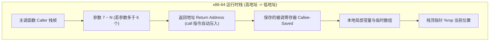

> **讲师**：David R. O'Hallaron ｜ **原视频**：Bilibili 分 P7 ｜ **时长**：01:06:45  
> **所属模块**：Module 2: 机器级程序表示 (Machine-Level Representation of Programs)（L05 - L09 · x86-64 汇编、控制流、过程调用与数据结构）  
> **原视频地址**：[https://www.bilibili.com/video/BV1iW411d7hd/?p=7](https://www.bilibili.com/video/BV1iW411d7hd/?p=7)  
> **课程官方归属**：Carnegie Mellon University (CMU) 15-213 / 18-213 / 15-513: Introduction to Computer Systems (CSAPP Fall 2015)  
> **对应教材**：*Computer Systems: A Programmer's Perspective (3rd Edition)* by R. Bryant & D. O'Hallaron  
> **字幕与讲义出处**：字幕由 EugeneLiu/translationCSAPP 团队翻译校订（CC BY-NC 4.0 开源协议），幻灯片版权归 CMU 课程组所有。  

---

## 1. 过程调用的三大基石机制

*(参考时间：00:02:50 · [视频跳转 (P7 00:02:50)](https://www.bilibili.com/video/BV1iW411d7hd/?p=7&t=170))*

函数（过程）是软件模块化抽象的基石。在机器底层，执行过程调用必须协同解决三大问题：
1. **传递控制（Passing Control）**：进入被调用函数并能正确返回到调用点之后的位置。
2. **传递数据（Passing Data）**：主调函数向被调函数传入若干参数，并接收返回值。
3. **内存管理（Memory Management）**：在调用开始时为局部变量分配空间，返回时自动释放。

## 2. 运行时栈（Runtime Stack）与 call/ret 指令

*(参考时间：00:15:30 · [视频跳转 (P7 00:15:30)](https://www.bilibili.com/video/BV1iW411d7hd/?p=7&t=930))*

x86-64 程序通过向下生长的栈（Stack）管理过程调用（栈底在高地址，栈顶在低地址，由 `%rsp` 指向）：
* **`call Target`**：自动将下一条指令的地址（**返回地址 Return Address**）压入栈顶（`%rsp` 减 8 并存入地址），随后跳转到目标函数入口。
* **`ret`**：从当前栈顶弹出一个 8 字节地址存入指令指针寄存器 `%rip`（`%rsp` 加 8），CPU 自然回到主调函数接着向下运行。

栈帧（Stack Frame）随函数调用层层嵌套展开，形成了先进后出的自然结构，完美支撑了函数的递归调用。

## 3. 寄存器使用约定：Caller-saved vs Callee-saved

*(参考时间：00:33:10 · [视频跳转 (P7 00:33:10)](https://www.bilibili.com/video/BV1iW411d7hd/?p=7&t=1990))*

当函数 `P` 调用函数 `Q` 时，如果两者都想用 `%rbx`，会不会发生冲突覆写？ABI 规范为此制定了铁律：
* **被调用者保存寄存器（Callee-saved: `%rbx, %rbp, %r12 - %r15`）**：`Q` 必须保证在返回时这些寄存器的值与 `P` 调用它之前一模一样！若 `Q` 要用它们，必须在函数入口先 `pushq` 备份到栈上，函数返回前再 `popq` 恢复。
* **调用者保存寄存器（Caller-saved: 其余所有寄存器）**：任何函数都可以随意改写它们。若主调函数 `P` 之后还要用，`P` 必须在调用前自己把它们保存起来。

## 4. 递归调用的自然实现与局部数据隔离

*(参考时间：00:48:20 · [视频跳转 (P7 00:48:20)](https://www.bilibili.com/video/BV1iW411d7hd/?p=7&t=2900))*

递归函数（如阶乘 `rfact(n)`）在汇编层面没有任何特殊硬件机制，因为每一次进入函数，`call` 指令都会分配一个独立的返回地址，配合各自栈帧中私有的寄存器保存与局部变量。不同调用层级拥有各自专属的栈内存空间，当递归触底反弹时，逐层 `pop` 恢复环境并计算返回值，展现了栈抽象与硬件设计的极致优雅。

---

### 本讲小结与核心思考 (Takeaways)

1. **系统视角的本质转变**：本讲从底层机制剖析了「Machine Level Programming III: Procedures：过程调用与栈帧管理」的核心实现原理。
2. **软硬件协同设计**：理解底层规则不仅能消除潜在的难以调试的隐蔽 Bug，更是编写极致性能工业级代码的前提。
3. **动手实践验证**：推荐配合 CSAPP 对应章节课后习题与官方实验（Lab），在 Linux 终端环境下使用 GDB 与性能分析工具亲自印证理论。
