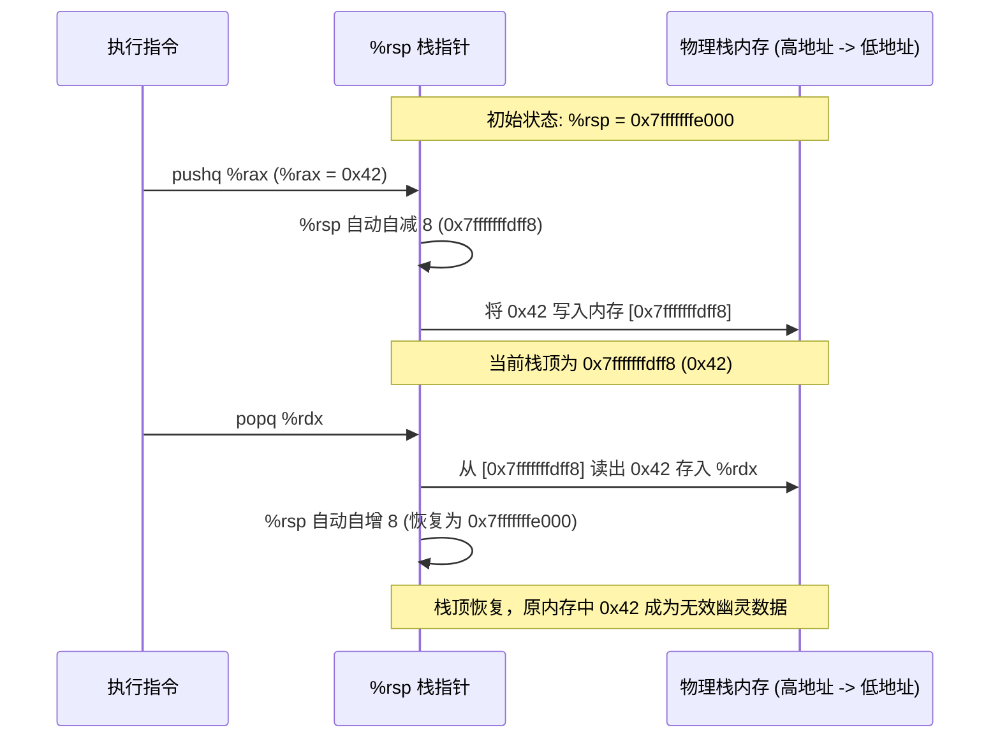

> **讲师**：Randal E. Bryant & David R. O'Hallaron ｜ **原视频**：Bilibili 分 P7 ｜ **时长**：01:06:45  
> **所属模块**：Module 2: 机器级程序表示 (Machine-Level Representation of Programs)（L05 - L09 · x86-64 汇编、控制流、过程调用与数据结构）  
> **原视频地址**：[https://www.bilibili.com/video/BV1iW411d7hd/?p=7](https://www.bilibili.com/video/BV1iW411d7hd/?p=7)  
> **课程官方归属**：Carnegie Mellon University (CMU) 15-213 / 18-213 / 15-513: Introduction to Computer Systems (CSAPP Fall 2015)  
> **对应教材**：*Computer Systems: A Programmer's Perspective (3rd Edition)* by R. Bryant & D. O'Hallaron  
> **字幕与讲义出处**：字幕由 EugeneLiu/translationCSAPP 团队翻译校订（CC BY-NC 4.0 开源协议），幻灯片版权归 CMU 课程组所有。  

---

## 1. 过程调用的机器级三大机制：控制、数据与内存管理

*(参考时间：00:01:10 · [视频跳转 (P7 00:01:10)](https://www.bilibili.com/video/BV1iW411d7hd/?p=7&t=70))*


在软件工程中，过程（Procedures，在 C 语言中称为函数 Functions，在面向对象语言中称为方法 Methods）是实现代码模块化、抽象和复用的核心机制。
当函数 $P$ 调用函数 $Q$ 时，底层硬件和操作系统必须协同完成三大基础机制：
1. **传递控制（Passing Control）**：
   * 在进入函数 $Q$ 时，程序计数器 `%rip` 必须设置到 $Q$ 的代码起始地址；
   * 在函数 $Q$ 执行完毕返回时，`%rip` 必须精确恢复到函数 $P$ 中紧跟在调用指令之后的下一条指令地址。
2. **传递数据（Passing Data）**：
   * 过程 $P$ 必须能够向过程 $Q$ 提供一个或多个参数；
   * 过程 $Q$ 必须能够向过程 $P$ 返回一个执行结果。
3. **分配与释放内存（Allocating & Deallocating Memory）**：
   * 函数 $Q$ 在开始执行前，可能需要为自身的局部变量分配空间；
   * 在返回之前，这些局部存储必须被全部回收；
   * 当函数出现嵌套调用甚至自递归调用时，必须支持多次调用的局部数据互不干扰独立共存。

所有这三大机制，在 x86-64 体系下都是围绕**程序栈（Program Stack）**高度优化实现的。

## 2. 程序栈的物理结构与指令级原子操作：pushq 与 popq

*(参考时间：00:08:45 · [视频跳转 (P7 00:08:45)](https://www.bilibili.com/video/BV1iW411d7hd/?p=7&t=525))*


### 栈的向低地址生长特性
在 x86-64 架构及绝大部分类 Unix 操作系统中，栈的组织遵循以下绝对物理规则：
* **栈自高地址向低地址向下生长（Grows Downward）**；
* 寄存器 `%rsp`（Stack Pointer，栈指针）永远存储**当前栈顶元素的内存物理/虚拟地址**！
* 栈底位于高地址端，栈顶位于低地址端。

### `pushq` 与 `popq` 的微架构分解
向栈中压入和弹出数据具有硬件级原子指令支持：
1. **压栈指令 `pushq Src`**：
   * 步骤 1：将栈指针 `%rsp` 减去 8 个字节（向下移动，开辟空间）；
   * 步骤 2：将源操作数 `Src` 的 8 字节数值写入 `%rsp` 指向的新内存地址。
   * 等价微操作：
     ```assembly
     subq    $8, %rsp
     movq    Src, (%rsp)
     ```
2. **出栈指令 `popq Dest`**：
   * 步骤 1：从当前 `%rsp` 指向的内存地址读取 8 字节数据并存入目标操作数 `Dest`；
   * 步骤 2：将栈指针 `%rsp` 加上 8 个字节（向上移动，释放空间）。
   * 等价微操作：
     ```assembly
     movq    (%rsp), Dest
     addq    $8, %rsp
     ```

注意：出栈操作并没有在物理上清空内存数据！原有的数据仍然残留在旧内存中，只是由于 `%rsp` 指针的移动，它们被逻辑标记为“无效”。这一机制也是诸如未初始化局部变量残留“垃圾值”的物理根源。



## 3. 控制转移机制：call 与 ret 的硬件底层细节

*(参考时间：00:19:15 · [视频跳转 (P7 00:19:15)](https://www.bilibili.com/video/BV1iW411d7hd/?p=7&t=1155))*


控制转移的核心是指令 `call` 与 `ret` 的精确配对：
1. **`call Target` 指令**：
   * 将紧随在 `call` 指令后面的那条指令的地址（即**返回地址 Return Address**）压入当前栈中；
   * 将程序计数器 `%rip` 的值修改为目标函数 `Target` 的入口地址。
2. **`ret` 指令**：
   * 从当前栈顶（`%rsp` 所指位置）弹出一个 8 字节地址值；
   * 将这个弹出的地址强行赋值给程序计数器 `%rip`，恢复执行原调用者函数。

```assembly
# 调用函数的一瞬间栈的精确变化
400540 <multstore>:
400540: 53                      push   %rbx
...
400560 <main>:
...
400563: e8 d8 ff ff ff          callq  400540 <multstore>
400568: 48 8b 54 24 08          mov    0x8(%rsp),%rdx  <-- 返回地址！
```
当 CPU 执行到 `400563` 的 `callq` 时：
* CPU 发现下一条指令地址是 `0x400568`；
* 硬件自动将 `0x400568` 压栈，`%rsp` 自减 8；
* `%rip` 跃迁为 `0x400540`；
* 当 `multstore` 内部执行完毕遇到 `ret` 指令时，CPU 弹出栈顶的 `0x400568` 存入 `%rip`，指令流严丝合缝地在 `400568` 处继续推进！

## 4. x86-64 数据传递约定：寄存器传参矩阵与溢出栈参数

*(参考时间：00:28:40 · [视频跳转 (P7 00:28:40)](https://www.bilibili.com/video/BV1iW411d7hd/?p=7&t=1720))*


在早期的 32 位 x86 体系（IA-32）中，所有函数参数无论多少一律通过栈内存传递，导致每次函数调用都伴随着昂贵的内存读写。
而在 64 位 x86-64 ABI（System V AMD64 ABI，Linux/macOS 默认标准）中，**前 6 个整数或指针类型参数一律使用寄存器传递**，速度得到质的飞跃！

### 前 6 个参数寄存器映射表（必须烂熟于胸）

| 参数序号 | 64 位寄存器 | 32 位寄存器 | 16 位寄存器 | 8 位寄存器 |
| :--- | :--- | :--- | :--- | :--- |
| **第 1 个参数** | `%rdi` | `%edi` | `%di` | `%dil` |
| **第 2 个参数** | `%rsi` | `%esi` | `%si` | `%sil` |
| **第 3 个参数** | `%rdx` | `%edx` | `%dx` | `%dl` |
| **第 4 个参数** | `%rcx` | `%ecx` | `%cx` | `%cl` |
| **第 5 个参数** | `%r8` | `%r8d` | `%r8w` | `%r8b` |
| **第 6 个参数** | `%r9` | `%r9d` | `%r9w` | `%r9b` |
| **返回值 (Return Val)** | `%rax` | `%eax` | `%ax` | `%al` |

*记忆口诀*：**D-S-D-C-8-9**（`rDi`, `rSi`, `rDx`, `rCx`, `r8`, `r9`）。

### 超出 6 个参数的处理规则
如果函数参数超过 6 个（例如定义了 8 个参数）：
* 前 6 个参数依然按顺序分别放入上述 6 个寄存器；
* 第 7 个至第 $N$ 个参数必须**通过调用者的栈帧进行传递**！
* 传递顺序：参数必须按**逆序压栈**，第 7 个参数位于栈顶（即地址紧靠调用返回地址处），第 8 个参数位于其上方更高地址处。
* 所有通过栈传递的参数，其在栈上的存储空间必须按 8 字节（64 位）对齐。

## 5. 寄存器保护约定：调用者保存 (Caller-Saved) vs 被调用者保存 (Callee-Saved)

*(参考时间：00:41:30 · [视频跳转 (P7 00:41:30)](https://www.bilibili.com/video/BV1iW411d7hd/?p=7&t=2490))*


寄存器是所有函数共享的全局唯一的稀缺计算资源。如果函数 $P$ 正在使用某个寄存器保存关键临时变量，接着调用了子函数 $Q$，$Q$ 是否可以随意覆写这个寄存器？
为了防止程序数据被互相踩踏破坏，x86-64 严格确立了两类寄存器保护惯例：

### 1. 被调用者保存寄存器 (Callee-Saved Registers)
包括：**`%rbx`, `%rbp`, `%r12`, `%r13`, `%r14`, `%r15`**。
* **规则**：当过程 $P$ 调用过程 $Q$ 时，$Q$ 必须保证在返回前，这些寄存器的值与其被调用时**完全一致**！
* **实现方式**：如果函数 $Q$ 想要使用 `%rbx`，它必须在函数入口处先把 `%rbx` 原有值 `pushq %rbx` 到栈上保存；在函数执行完毕返回前，必须通过 `popq %rbx` 恢复原值。
* **对于调用者 $P$ 的含义**：$P$ 可以安全地把需要跨越多个函数调用仍然存活的变量存放在 Callee-Saved 寄存器中，调用任何子函数回来后这些值绝对不会丢失！

### 2. 调用者保存寄存器 (Caller-Saved Registers)
包括：**`%rax`（返回值）、参数寄存器（`%rdi`, `%rsi`, `%rdx`, `%rcx`, `%r8`, `%r9`）以及 `%r10`, `%r11`**。
* **规则**：任何函数都可以无条件任意修改这些寄存器的内容，无需在退出前恢复！
* **对于调用者 $P$ 的含义**：如果 $P$ 在调用子函数之前在 `%r10` 中存了重要数据，在执行 `call` 之后，`%r10` 的内容可能已被子函数完全篡改破坏。因此 $P$ 必须在调用前自行负责将其压栈保存！

## 6. 现代栈帧全景模型与递归的天然支持

*(参考时间：00:54:10 · [视频跳转 (P7 00:54:10)](https://www.bilibili.com/video/BV1iW411d7hd/?p=7&t=3250))*


### 现代 x86-64 栈帧结构全景
在 x86-64 编译体系中，并不是每个函数都会建立复杂的栈帧：
* **叶子函数（Leaf Functions）**：不调用任何其他子函数的简短函数，往往仅需寄存器传参和计算，甚至完全不需要在栈上分配任何空间！
* **复杂函数栈帧**：当寄存器不足、需要对局部变量取地址（`&` 运算符）、分配局部结构体/数组、或调用参数超过 6 个的函数时，栈帧自高向低通常包含：
  1. 传入参数（调用者分配的参数 7 至 $N$）；
  2. 返回地址（`call` 自动压入）；
  3. 被保存的被调用者寄存器（Callee-saved registers）；
  4. 局部变量分配区；
  5. 构造传给子函数的参数区（Argument build area）；
  6. **16 字节对齐填充（Padding）**：x86-64 ABI 强制要求，在执行 `call` 指令前，栈指针 `%rsp` 必须满足 16 字节边界对齐（有利于 SIMD 向量指令高速访问）。

### 递归调用的机器级自然实现
许多初学者好奇：硬件是如何支持自递归函数（如阶乘、斐波那契数列、深度优先搜索）的？
**答案就是栈帧的私有性**！
每一次递归调用，都会触发一条全新的 `call` 指令，在内存中向下推进 `%rsp` 并开辟一个崭新的、独立的栈帧。
每个递归层级拥有属于自己专属的局部变量、保存的寄存器和返回地址。当递归到达基准条件（Base Case）层层返回时，每一层的 `ret` 会自动弹出属于那一层的状态，数据天然绝缘，无需任何专门的“递归硬件”！


---

### 本讲小结与核心思考 (Takeaways)

1. **系统视角的本质转变**：本讲从底层机制剖析了「Machine-Level Programming III: Procedures（过程调用、栈帧模型与寄存器保护约定）」的核心实现原理。
2. **软硬件协同设计**：理解底层规则不仅能消除潜在的难以调试的隐蔽 Bug，更是编写极致性能工业级代码的前提。
3. **动手实践验证**：推荐配合 CSAPP 对应章节课后习题与官方实验（Lab），在 Linux 终端环境下使用 GDB 与性能分析工具亲自印证理论。
