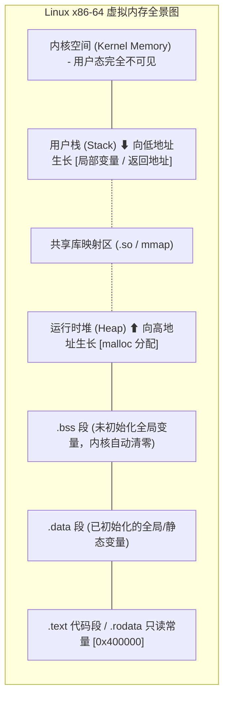

> **讲师**：Randal E. Bryant & David R. O'Hallaron ｜ **原视频**：Bilibili 分 P9 ｜ **时长**：01:18:49  
> **所属模块**：Module 2: 机器级程序表示 (Machine-Level Representation of Programs)（L05 - L09 · x86-64 汇编、控制流、过程调用与数据结构）  
> **原视频地址**：[https://www.bilibili.com/video/BV1iW411d7hd/?p=9](https://www.bilibili.com/video/BV1iW411d7hd/?p=9)  
> **课程官方归属**：Carnegie Mellon University (CMU) 15-213 / 18-213 / 15-513: Introduction to Computer Systems (CSAPP Fall 2015)  
> **对应教材**：*Computer Systems: A Programmer's Perspective (3rd Edition)* by R. Bryant & D. O'Hallaron  
> **字幕与讲义出处**：字幕由 EugeneLiu/translationCSAPP 团队翻译校订（CC BY-NC 4.0 开源协议），幻灯片版权归 CMU 课程组所有。  

---

## 1. Linux 64 位进程内存全景布局 (Memory Layout)

*(参考时间：00:02:15 · [视频跳转 (P9 00:02:15)](https://www.bilibili.com/video/BV1iW411d7hd/?p=9&t=135))*


在 64 位 Linux 操作系统中，尽管指针宽度为 64 位（理论寻址能力高达 16 EB），现代 x86-64 CPU 和 Linux 内核目前只启用低 47 位（约 128 TB）作为用户态虚拟地址空间。
一个正在运行的 Linux 进程，其内存空间自低地址向高地址划分为明确的层次：

1. **程序代码与常量段 (.text / .rodata)**：
   * 从地址 `0x00400000` 附近开始向上排布；
   * 包含编译后的机器指令，属性为**只读、可执行（r-x）**，防止程序意外自我修改。
2. **已初始化与未初始化全局数据段 (.data / .bss)**：
   * `.data`：存放已经显式赋初始值的全局变量和静态变量（可读写 rw-）；
   * `.bss`：存放未初始化或初始化为 0 的全局变量。在可执行文件中不占磁盘物理空间，由操作系统在加载时统一清零。
3. **运行时堆 (Heap)**：
   * 紧接在数据段之后，通过 `malloc()` / `free()` / `brk()` / `sbrk()` 动态分配；
   * **向高地址方向向上生长**。
4. **共享库映射区 (Shared Libraries)**：
   * 位于地址空间中部偏上，用于动态加载 `libc.so`、动态链接器以及通过 `mmap()` 映射的文件。
5. **用户栈 (User Stack)**：
   * 从用户空间最高可用地址（约 `0x7fffffffffff`）开始，**向低地址方向向下生长**；
   * 用于存放函数调用帧、返回地址、局部变量和 Callee-saved 寄存器。
6. **内核虚拟内存 (Kernel Space)**：
   * 占用最高端地址空间，用户态代码不可读写，仅在发生中断或系统调用陷入内核时使用。



## 2. 缓冲区溢出漏洞 (Buffer Overflow)：黑客是如何劫持程序控制流的？

*(参考时间：00:15:40 · [视频跳转 (P9 00:15:40)](https://www.bilibili.com/video/BV1iW411d7hd/?p=9&t=940))*


C 语言是一门不带“数组边界检查（Array Bounds Checking）”的强性能语言。当程序员在栈上分配了一个固定大小的字符数组，却使用了不限制输入长度的不安全库函数（如 `gets()`, `strcpy()`, `sprintf()`, `scanf("%s")`）时，灾难便降临了。

### 栈溢出攻击经典解剖
假设有如下极度危险的代码：
```c
void echo() {
    char buf[24]; // 在栈上分配 24 字节
    gets(buf);    // 恶名昭彰：从标准输入无限制读取字符直至遇到换行符！
    puts(buf);
}
```

```
栈帧物理空间示意 (从低地址到高地址):
  %rsp -> [ buf[0] ... buf[23] ]   (24 字节局部缓冲区)
          [ 保存的 %rbx 等寄存器 ]   (8 字节)
          [ 保存的返回地址 %rip ]   (8 字节！原指向 main 函数)
```
* **正常执行**：用户输入 10 个字符，存入 `buf`，函数执行完毕遇到 `ret`，CPU 从栈顶弹出正确的返回地址，程序继续正常执行。
* **恶意攻击（Exploit）**：
  * 攻击者精心构造一段长度为 40 字节的恶意二进制输入；
  * 前 24 字节填满 `buf`；
  * 接下来的 8 字节覆盖旧的被保存寄存器；
  * **最后 8 字节精准覆盖“保存的返回地址（Return Address）”**！
  * 当 `echo` 函数执行到 `ret` 时，CPU 弹出的是攻击者伪造的恶意地址，程序计数器 `%rip` 瞬间跳转到攻击者指定的恶意代码执行！

**历史教训**：1988 年著名的莫里斯蠕虫（Morris Worm）瘫痪了全球十分之一的互联网主机，其核心杀伤力正是利用了 Unix `fingerd` 守护进程中的 `gets()` 栈溢出漏洞！

## 3. 系统防御第一道防线：金丝雀栈保护机制 (Stack Canaries)

*(参考时间：00:32:10 · [视频跳转 (P9 00:32:10)](https://www.bilibili.com/video/BV1iW411d7hd/?p=9&t=1930))*


为了从根本上抵御破坏返回地址的栈溢出攻击，现代编译器（GCC）默认启用了**金丝雀保护机制（Stack Canaries / Stack Protector）**。

### 煤矿里的金丝雀：名字的由来
19 世纪的煤矿工人下井时会带一只金丝雀。金丝雀对有毒瓦斯极其敏感，如果金丝雀中毒死亡，矿工便知道瓦斯泄漏必须立即撤退。
在程序栈中，**金丝雀（Canary）**是一个在函数入口处由编译器插入在**局部缓冲区与返回地址之间**的一个随机 8 字节特殊守卫值！

### 汇编级的金丝雀植入与校验
```assembly
# 开启 -fstack-protector 后的函数汇编
echo:
    subq    $40, %rsp
    movq    %fs:40, %rax        # 从线程段寄存器 %fs 获取随机 Guard 守卫值
    movq    %rax, 24(%rsp)      # 将金丝雀紧贴在返回地址之前写入栈中！
    xorl    %eax, %eax          # 清空 %rax，抹去金丝雀在寄存器中的痕迹

    leaq    (%rsp), %rdi
    callq   gets                # 执行危险的 gets

    # 校验流程
    movq    24(%rsp), %rax      # 从栈中重新读取金丝雀值
    xorq    %fs:40, %rax        # 与内核原始守卫值做异或比对
    jne     .L_STACK_CHK_FAIL   # 如果不为 0，说明金丝雀被篡改！立即跳转
    addq    $40, %rsp
    ret

.L_STACK_CHK_FAIL:
    callq   __stack_chk_fail    # 强行 abort 进程，输出 "*** stack smashing detected ***"
```
* **防御逻辑**：由于栈是向低地址生长的，攻击者如果想要溢出 `buf` 从而覆盖更高地址的返回地址，**就必须横跨并覆写位于中间的金丝雀**！
* 守卫值由操作系统内核在进程启动时随机生成，其最低字节通常包含 `0x00`（阻止 `strcpy` 等字符串函数向后复制）。攻击者无法猜测金丝雀内容，篡改后一旦异或校验失败，程序直接自毁，漏洞攻击被化解。

## 4. 现代系统立体防御体系：NX/DEP 保护与 ASLR 地址空间随机化

*(参考时间：00:46:30 · [视频跳转 (P9 00:46:30)](https://www.bilibili.com/video/BV1iW411d7hd/?p=9&t=2790))*


除了金丝雀，现代操作系统和硬件架构还构建了两大坚不可摧的立体防护屏障：

### 1. 栈与数据段不可执行保护 (NX Bit / DEP)
* **原理**：在早期的冯·诺依曼计算机中，内存中的数据和代码没有严格物理区分。攻击者常把一段恶意机器指令（Shellcode，如调用 `execve("/bin/sh")`）直接写入栈缓冲区，再把返回地址指向栈中这段 Shellcode 执行。
* **NX 标志位（No-Execute / Data Execution Prevention）**：现代 CPU 的页表项中引入了专用的硬件 **NX 比特位**。操作系统将栈和堆内存的权限严格标记为**可读写、但绝对不可执行（rw-，满足 $W \oplus X$ 原则）**！
* **效果**：即使攻击者成功把恶意 Shellcode 注入到栈缓冲区并跳转过去，CPU 硬件在尝试从栈地址取指令的一瞬间就会触发硬件保护故障，抛出 `SIGSEGV` 强行终止程序。

### 2. 地址空间布局随机化 (ASLR: Address Space Layout Randomization)
* **原理**：攻击者要想劫持控制流，必须提前知道注入代码或 libc 库函数在内存中的确切虚拟地址。
* **ASLR 机制**：Linux 内核在每次启动运行一个程序时，都会在栈基地址、堆起始地址以及共享动态库加载地址中引入随机大小的偏移量！
* **效果**：程序每次运行，栈变量和库函数的物理虚拟地址全都在剧烈漂移。攻击者在本地计算机算出的地址，在远程目标机器上百分之百落空，大大增加了攻击门槛。

## 5. 高级渗透攻防：面向返回编程 (ROP - Return-Oriented Programming)

*(参考时间：01:03:15 · [视频跳转 (P9 01:03:15)](https://www.bilibili.com/video/BV1iW411d7hd/?p=9&t=3795))*


当现代系统同时启用了 NX（栈不可执行）和金丝雀时，黑客是否就束手无策了？
**面向返回编程（Return-Oriented Programming, ROP）**应运而生，成为了现代软件安全攻防中最耀眼的黑客艺术。

### ROP 的核心哲学：不注入代码，借刀杀人
ROP 的核心思想是：既然自己注入的 Shellcode 无法在不可执行的栈上运行，那么就**直接借用目标程序自身 `.text` 代码段或 `libc.so` 中本来就合法的可执行代码片段**！

### 什么是 ROP 小部件 (Gadget)？
* **Gadget** 是指在现有代码段中找到的、以 `ret`（机器码 `0xc3`）指令结尾的极短指令序列（通常 2 到 3 条指令）。
* 典型 Gadget 示例：
  ```assembly
  popq %rdi; ret
  ```
  这个小部件的作用是：从当前栈顶弹出一个值存入 `%rdi`（正好是传递第 1 个参数的寄存器！），然后执行 `ret`！

### ROP 攻击链（ROP Chain）拼接艺术
攻击者在栈上不再存放指令代码，而是**存放一长串精心策划的代码地址与数据交叉排列的调用链**：
1. 攻击者覆盖返回地址，指向 Gadget 1 (`popq %rdi; ret`)；
2. 栈的下一个单元存放参数（如指向 `"/bin/sh"` 字符串的地址）；
3. 栈的再下一个单元存放 Gadget 2 或 `system()` 函数的入口地址；
4. 当函数返回时，CPU 执行 Gadget 1：将 `"/bin/sh"` 弹出并载入 `%rdi`；
5. Gadget 1 末尾的 `ret` 自动从栈顶弹出下一个地址，无缝跳入 `system()` 执行！
6. 一个拥有 root 权限的系统 Shell 被黑客成功激活！

> [!NOTE] CSAPP 实验关联：Attack Lab
> 在 CSAPP 的第三个重磅实验 **Attack Lab** 中：
> * 前几关（Phase 1-3）在禁用保护的环境下体验经典的栈溢出与代码注入；
> * 后几关（Phase 4-5）开启了 NX 不可执行保护，同学们必须在反汇编的机器码库中寻觅各种以 `c3` 结尾的字节，手搓属于你自己的 ROP Gadget 攻击链！


---

### 本讲小结与核心思考 (Takeaways)

1. **系统视角的本质转变**：本讲从底层机制剖析了「Machine-Level Programming V: Advanced Topics（缓冲区溢出、栈保护机制、ASLR 与 ROP 攻击）」的核心实现原理。
2. **软硬件协同设计**：理解底层规则不仅能消除潜在的难以调试的隐蔽 Bug，更是编写极致性能工业级代码的前提。
3. **动手实践验证**：推荐配合 CSAPP 对应章节课后习题与官方实验（Lab），在 Linux 终端环境下使用 GDB 与性能分析工具亲自印证理论。
