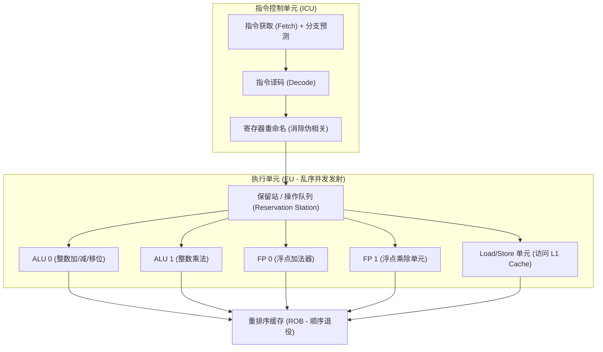

> **讲师**：David R. O'Hallaron ｜ **原视频**：Bilibili 分 P10 ｜ **时长**：01:13:38  
> **所属模块**：Module 3: 程序性能优化 (Optimizing Program Performance)（L10 · 编译器能力与局限、循环优化、指令级并行）  
> **原视频地址**：[https://www.bilibili.com/video/BV1iW411d7hd/?p=10](https://www.bilibili.com/video/BV1iW411d7hd/?p=10)  
> **课程官方归属**：Carnegie Mellon University (CMU) 15-213 / 18-213 / 15-513: Introduction to Computer Systems (CSAPP Fall 2015)  
> **对应教材**：*Computer Systems: A Programmer's Perspective (3rd Edition)* by R. Bryant & D. O'Hallaron  
> **字幕与讲义出处**：字幕由 EugeneLiu/translationCSAPP 团队翻译校订（CC BY-NC 4.0 开源协议），幻灯片版权归 CMU 课程组所有。  

---

## 1. 优化的哲学与编译器的保守边界

*(参考时间：00:02:50 · [视频跳转 (P10 00:02:50)](https://www.bilibili.com/video/BV1iW411d7hd/?p=10&t=170))*


现代优化编译器（如开启 `gcc -O2` 或 `-O3`）是一项惊人的工程奇迹。它们能够自动重排指令、展开小循环、寄存器分配、消除死代码和将乘法转化为移位。
然而，在日常开发中，许多代码在编译器优化后依然运行极其缓慢。为什么编译器不能帮我们搞定一切？

### 编译器的黄金戒律：安全第一（Safety First）
编译器的首要职责是**正确性**。优化后的机器代码必须与原始源代码的行为在**所有可能极端情况下严格保持一致（Behavioral Equivalence）**。
只要存在任何一种罕见情况可能导致优化改变程序的可观测行为，编译器就必须**放弃优化，选择保守生成代码**！

### 阻碍编译器优化的两大核心障碍
1. **内存别名使用 (Memory Aliasing)**：
   ```c
   void twiddle1(long *xp, long *yp) {
       *xp += *yp;
       *xp += *yp;
   }
   void twiddle2(long *xp, long *yp) {
       *xp += 2 * *yp;
   }
   ```
   直觉上 `twiddle1` 访问了 4 次内存（2 次读 2 次写），而 `twiddle2` 只需要 2 次读 1 次写。编译器为什么不敢把 `twiddle1` 优化成 `twiddle2`？
   * 思考极端情况：如果调用者传入的是相同的指针 `xp == yp`！
   * `twiddle1`：第一次 `*xp += *xp` 使数值翻倍，第二次 `*xp += *xp` 再次翻倍，最终结果是原始值的 **4 倍**！
   * `twiddle2`：`*xp += 2 * *xp` 计算出的结果是原始值的 **3 倍**！
   * 结果完全不同！因为编译器无法在编译期证明 `xp` 与 `yp` 是否指向同一内存，为了安全只能忠实保留 4 次内存访问。

2. **函数调用的副作用 (Side Effects)**：
   ```c
   long counter = 0;
   long f() { return counter++; }
   long func1() { return f() + f() + f() + f(); }
   long func2() { return 4 * f(); }
   ```
   `func1` 使得 `counter` 增加了 4，而 `func2` 只调用了一次 `f()` 导致 `counter` 仅增加 1。因此，当循环条件中包含函数调用时，编译器不敢轻易把函数挪出循环！

## 2. 消除渐进级低效：代码移动与循环条件中 strlen 的灾难

*(参考时间：00:15:30 · [视频跳转 (P10 00:15:30)](https://www.bilibili.com/video/BV1iW411d7hd/?p=10&t=930))*


### 代码移动 (Code Motion)
代码移动是指识别出那些在循环体中被反复计算、但每次迭代计算结果其实完全相同的表达式，将其从循环体中提取到循环外部只计算一次。

### 经典反面教材：大 O 复杂度坍塌为 $O(N^2)$ 的惨剧
很多资深程序员在不经意间也写出过如下看似优雅的代码：
```c
/* 将字符串全部字符转为小写 */
void lower(char *s) {
    long i;
    for (i = 0; i < strlen(s); i++) {
        if (s[i] >= 'A' && s[i] <= 'Z')
            s[i] -= ('A' - 'a');
    }
}
```
* **灾难分析**：
  * C 语言中的 `strlen(s)` 不是像 Java 或 Go 那样直接读取一个字段，而是必须从指针头一直扫描到 `\0` 终止符，耗时是严格的 **$O(N)$**！
  * 循环执行 $N$ 次，每次循环在判断退出条件时都重新调用一次 `strlen(s)`；
  * 整段代码的实际运行时间变成了巨大的 **$O(N^2)$**！
  * 当字符串只有几十个字节时毫无知觉；当处理数兆字节的大文本时，程序会瞬间陷入假死状态！
* **编译器为何不出手相救？**
  * 因为 `lower` 内部修改了 `s[i]` 的内存！编译器不知道修改字符会不会碰巧写出一个 `\0` 从而改变字符串长度，因此它无法安全地外提 `strlen`！
* **程序员的手动救赎**：
  ```c
  void lower_opt(char *s) {
      long i;
      long len = strlen(s); // 手动代码移动！仅计算一次
      for (i = 0; i < len; i++) {
          if (s[i] >= 'A' && s[i] <= 'Z')
              s[i] -= ('A' - 'a');
      }
  }
  ```
  耗时瞬间由 $O(N^2)$ 降低至标准的 $O(N)$，对于 100 万字符的字符串，性能提升达 **100,000 倍**！

## 3. 系统级性能基准：每元素时钟周期数 (CPE - Cycles Per Element)

*(参考时间：00:26:15 · [视频跳转 (P10 00:26:15)](https://www.bilibili.com/video/BV1iW411d7hd/?p=10&t=1575))*


在系统级性能优化中，传统的“秒（Seconds）”并不是一个理想的度量衡，因为它严重受 CPU 主频、操作系统后台负载和时钟抖动的影响。
CSAPP 引入了黄金性能指标：**每元素周期数（CPE: Cycles Per Element）**。

### 线性时间模型
绝大多数处理长度为 $n$ 的数组或集合的循环，其总运行 CPU 时钟周期数 $T$ 可以由线性方程建模：
$$T(n) = CPE \times n + Overhead$$
* **Overhead（启动开销）**：包含函数调用、栈帧建立、变量初始化等一次性固定开销；
* **CPE（斜率）**：处理每一个元素所需要的边际周期数。CPE 越低，说明算法在流水线上的吞吐效率越高！
* 通过运行不同规模 $n$ 的测试用例并进行最小二乘线性拟合，斜率即为精准的 CPE。

## 4. 现代超标量处理器微架构深度拆解：乱序执行与关键路径

*(参考时间：00:36:40 · [视频跳转 (P10 00:36:40)](https://www.bilibili.com/video/BV1iW411d7hd/?p=10&t=2200))*


要突破编译器的优化天花板，程序员必须在脑海中建立起现代 CPU 微架构的真实物理图像：
现代处理器早已不是传统的“取一条、执行一条、写回一条”的串行机器，而是**超标量（Superscalar）、高度流水线化（Pipelined）且无序执行（Out-of-Order Execution）**的并行巨兽！

### 核心物理单元划分
1. **指令控制单元 (ICU - Instruction Control Unit)**：
   * 负责从 L1 指令 Cache 中取指；
   * **分支预测与投机取指**：在条件分支尚未得出结果前提前向后取指；
   * **指令译码器**：将复杂的 x86 宏指令分解为一系列更加简单底层、类似 RISC 的**微操作（$\mu$-ops）**；
   * **退役单元（Retirement Unit）与寄存器重命名**：维护几十个物理寄存器别名，消除伪数据相关（WAR / WAW 冲突），确保指令尽管无序执行，但对外表现出的状态改变完全符合顺序退出。
2. **执行单元 (EU - Execution Unit)**：
   * 拥有多个并发的功能执行单元：例如 2 个整数加减单元、2 个浮点乘除单元、多个内存加载与存储单元；
   * **数据就绪即发射（Data-Driven Execution）**：一条微操作只要它依赖的输入操作数已经准备好，并且对应功能单元空闲，就可以立即被发射执行，完全不用管程序代码中排在它前面的指令是否卡住！

### 关键路径 (Critical Path) 与数据流图
一段循环代码的实际执行速度，由其操作之间形成的**数据流依赖图中的最长依赖链条——关键路径（Critical Path）**唯一决定。
如果后一条指令的计算必须等待前一条指令的输出结果，它们之间就形成了硬性的**数据冒险（Data Hazard）**，无论你有多少个空闲的 ALU 硬件，它们都只能串行等待！



## 5. 打破关键路径：循环展开与多路并行累加器

*(参考时间：00:48:30 · [视频跳转 (P10 00:48:30)](https://www.bilibili.com/video/BV1iW411d7hd/?p=10&t=2910))*


以一个数组累积求和/求积的核心循环为例：
```c
/* 基准实现 combine4 */
void combine4(vec_ptr v, data_t *dest) {
    long i;
    long length = vec_length(v);
    data_t *d = get_vec_start(v);
    data_t acc = IDENT;
    for (i = 0; i < length; i++) {
        acc = acc OP d[i]; // 致命瓶颈：数据依赖链！
    }
    *dest = acc;
}
```

### 1. 单纯的 $k \times 1$ 循环展开：为什么遇到性能撞墙？
我们可以将循环展开（Loop Unrolling），比如 $2 \times 1$ 展开：每次迭代计算 2 个元素。
```c
for (i = 0; i < limit; i += 2) {
    acc = (acc OP d[i]) OP d[i+1];
}
```
* **效果**：减少了循环变量 `i` 的自增次数和分支跳转次数，性能略微提升；
* **瓶颈**：但是，计算 `(acc OP d[i]) OP d[i+1]` 时，所有计算依然串行排在一根独木桥 `acc` 上！后一次加法必须严格等待前一次加法输出，**关键路径长度完全没有缩短**！其 CPE 直接被浮点加法器的延迟（Latency Bound，约 3.0 周期）死死卡住。

### 2. 突破物理极限：$k \times k$ 多路独立累加器
为了打破数据依赖，我们可以引入**多个独立的累加器变量**（例如 `acc0` 累加偶数项，`acc1` 累加奇数项）：
```c
/* 2 x 2 多路累加器循环展开 */
void combine6(vec_ptr v, data_t *dest) {
    long i;
    long length = vec_length(v);
    long limit = length - 1;
    data_t *d = get_vec_start(v);
    data_t acc0 = IDENT;
    data_t acc1 = IDENT;

    /* 每次迭代利用两条独立的数据流并发执行 */
    for (i = 0; i < limit; i += 2) {
        acc0 = acc0 OP d[i];
        acc1 = acc1 OP d[i+1];
    }
    /* 处理末尾剩余元素 */
    for (; i < length; i++) {
        acc0 = acc0 OP d[i];
    }
    *dest = acc0 OP acc1;
}
```
* **神级微架构效应**：
  * `acc0` 与 `acc1` 在逻辑上完全互不相关！
  * CPU 的两个浮点计算单元能够**在同一时钟周期内同时发射并执行 `acc0` 和 `acc1` 的累加**！
  * 关键路径被硬生生斩断了一半，吞吐率翻倍，CPE 直接逼近硬件流水线的**吞吐极限（Throughput Bound，约 0.5 周期）**！

> [!WARNING] 浮点运算优化的数学禁区
> 编译器为什么不敢自动将 `combine4` 优化为 `combine6`？
> 因为在实数数学中加法满足结合律 $(a+b)+c = a+(b+c)$，但**在 IEEE 754 浮点数计算中加法是不满足结合律的**！
> 改变浮点累加顺序可能导致舍入误差不同，因此多路累加优化必须由理解底层架构的程序员显式手动进行！

## 6. 编写分支预测友好型代码与性能总结

*(参考时间：01:04:20 · [视频跳转 (P10 01:04:20)](https://www.bilibili.com/video/BV1iW411d7hd/?p=10&t=3860))*


### 现代软件优化的阶梯式总结 (Hierarchy of Optimization)
1. **最高优先级：高级算法与数据结构**：
   将算法复杂度从 $O(N^2)$ 降低到 $O(N \log N)$，没有任何低层微架构技巧能够弥补算法层面的劣势。
2. **第二优先级：编写对编译器友好的基础代码**：
   * 消除循环内部不必要的多余函数调用（外提代码）；
   * 消除内存别名阻碍，使用局部变量承接循环累加结果，最后一次性写回指针；
   * 尽可能让指针引用的内存区域边界明确。
3. **第三优先级：榨干处理器硬件指令级并行 (ILP)**：
   * 针对计算密集型热点循环，采用 $k \times k$ 循环展开配合多路并行累加器；
   * 使用括号重新结合操作顺序（如 `x = x * (a * b)`），拆分关键路径依赖。
4. **第四优先级：规避微架构陷阱**：
   * 尽量保持分支跳转方向可预测（避免高度随机的数据驱动分支）；
   * 善用条件传送指令 `cmov`；
   * 遵守局部性原理（下一模块的核心重点：存储器层次结构与缓存友好访问）。


---

### 本讲小结与核心思考 (Takeaways)

1. **系统视角的本质转变**：本讲从底层机制剖析了「Program Optimization（程序性能优化：编译器边界、CPE 与超标量流水线关键路径）」的核心实现原理。
2. **软硬件协同设计**：理解底层规则不仅能消除潜在的难以调试的隐蔽 Bug，更是编写极致性能工业级代码的前提。
3. **动手实践验证**：推荐配合 CSAPP 对应章节课后习题与官方实验（Lab），在 Linux 终端环境下使用 GDB 与性能分析工具亲自印证理论。
