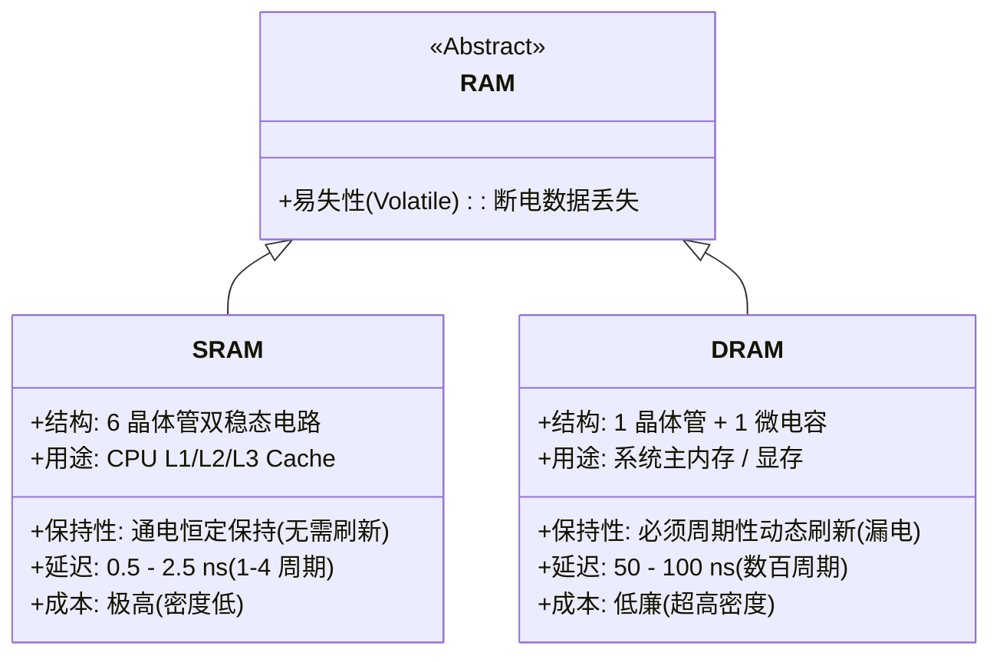

> **讲师**：David R. O'Hallaron ｜ **原视频**：Bilibili 分 P11 ｜ **时长**：01:15:47  
> **所属模块**：Module 4: 存储器层次结构 (The Memory Hierarchy & Cache)（L11 - L12 · 局部性原理、存储金字塔、Cache 组织与缓存友好代码）  
> **原视频地址**：[https://www.bilibili.com/video/BV1iW411d7hd/?p=11](https://www.bilibili.com/video/BV1iW411d7hd/?p=11)  
> **课程官方归属**：Carnegie Mellon University (CMU) 15-213 / 18-213 / 15-513: Introduction to Computer Systems (CSAPP Fall 2015)  
> **对应教材**：*Computer Systems: A Programmer's Perspective (3rd Edition)* by R. Bryant & D. O'Hallaron  
> **字幕与讲义出处**：字幕由 EugeneLiu/translationCSAPP 团队翻译校订（CC BY-NC 4.0 开源协议），幻灯片版权归 CMU 课程组所有。  

---

## 1. 计算机存储技术的两大支柱：SRAM 与 DRAM 物理特性对比

*(参考时间：00:02:15 · [视频跳转 (P11 00:02:15)](https://www.bilibili.com/video/BV1iW411d7hd/?p=11&t=135))*


现代计算机系统中，主存（Main Memory）和高速缓存（Cache）是由两种基于完全不同物理机制的半导体随机存取存储器（RAM）构建的：**SRAM（静态随机存取存储器）** 与 **DRAM（动态随机存取存储器）**。

### 1. SRAM (Static RAM) 核心机制
* **存储单元结构**：每个比特位由一个 **6 晶体管电路（6-Transistor Circuit）** 构成的双稳态（Bistable）锁存器实现。
* **物理特性**：
  * 只要持续通电，SRAM 就会无限期稳定保持其状态（0 或 1），**不需要任何动态刷新操作**；
  * 对外部电压抖动和噪声具有极高的抗干扰韧性；
  * **存取延迟极低**：访问时间仅需 **0.5 到 2.5 纳秒（1 到几个 CPU 时钟周期）**！
* **代价**：每个单元需要 6 个晶体管，集成度低、硅片面积大、制造成本极其昂贵且功耗较高。
* **应用场景**：CPU 芯片内部的 L1、L2、L3 高速缓存。

### 2. DRAM (Dynamic RAM) 核心机制
* **存储单元结构**：每个比特位仅由 **1 个晶体管和 1 个微型微电容（1T-1C）** 构成！
* **物理特性**：
  * 电容存储的微量电荷会随着时间通过硅基底迅速泄漏（Leakage），在室温下通常只能保持 10 到 100 毫秒；
  * **强制动态刷新（Refresh）**：内存控制器必须每隔几十毫秒周期性地对所有行进行读取并重新充电，否则数据将永久丢失；
  * 破坏性读取（Destructive Read）：每次读取电容电荷后必须立即执行回写充电；
  * **存取延迟较高**：访问时间约为 **50 到 100 纳秒（数百个 CPU 时钟周期）**。
* **优势**：极简的 1T-1C 结构使得芯片集成度极高，单位容量成本非常低廉。
* **应用场景**：计算机的主内存（Main Memory）以及图形显卡的显存。



## 2. 非易失性存储与固态硬盘 (SSD) 内部微架构

*(参考时间：00:18:40 · [视频跳转 (P11 00:18:40)](https://www.bilibili.com/video/BV1iW411d7hd/?p=11&t=1120))*


断电后仍能保留数据的半导体存储器统称为**非易失性存储器（Nonvolatile Memory）**：
* **ROM (Read-Only Memory)**：早期用于固化固件；
* **Flash Memory (闪存)**：现代主流技术，分为 NOR Flash（支持芯片内执行 XIP）和 NAND Flash（高密度、大容量）。

### 固态硬盘 (SSD: Solid-State Drive) 架构与磨损平衡
固态硬盘由一个嵌入式控制器（SSD Controller）和一个或多个 NAND Flash 闪存芯片阵列构成。
* **页（Page）与块（Block）的不对称物理法则**：
  * 闪存的基本读取和写入单位是**页（Page，典型大小 4KB 到 8KB）**；
  * 闪存的擦除单位却是**块（Block，典型由 32 到 128 个 Page 组成，大小 512KB 到 4MB）**！
  * **只能写空页，不能原地覆盖（No In-Place Overwrite）**：一个 Page 必须在被完全擦除（全部置 1）后才能写入数据。一旦写满，若要修改某个 Page，必须将其余有效 Page 复制到新 Block 中，然后再将旧 Block 整体擦除！
* **写放大（Write Amplification）**：修改少量数据引发大量底层数据搬运和整块擦除的现象。
* **磨损均衡（Wear Leveling）**：每个闪存块的擦写寿命通常只有 1,000 到 100,000 次。SSD 控制器内部运行着极其复杂的固件算法，将写入操作均匀分摊到所有物理块上，防止局部块提前损毁。

## 3. 机械硬盘 (HDD) 物理几何结构与三维访问延迟计算

*(参考时间：00:32:15 · [视频跳转 (P11 00:32:15)](https://www.bilibili.com/video/BV1iW411d7hd/?p=11&t=1935))*


尽管 SSD 已经普及，但在海量冷数据存储中心，机械硬盘（Hard Disk Drive）依然扮演着不可替代的角色。
机械硬盘是由涂有磁性介质的**旋转盘片（Platters）**构成的精密机电一体化设备。

### 磁盘物理几何构造
* **主轴（Spindle）**：带动盘片以恒定高速旋转（常见 5400 RPM、7200 RPM 或企业级 15000 RPM）；
* **磁道（Tracks）**：盘片表面同心圆环；
* **扇区（Sectors）**：每个磁道被切分为若干个扇区（标准大小为 512 字节或 4096 字节），扇区间由不存数据的间隙（Gaps）分隔；
* **柱面（Cylinder）**：所有盘片上半径相同的一组磁道构成的虚拟圆柱体；
* **磁头臂与读写磁头（Read/Write Heads）**：悬浮在距离盘片表面仅几十纳米的气垫上，沿径向同步摆动。

### 磁盘访问耗时数学推导（三大延迟阶段）
读取一个磁盘扇区的总时间 $T_{\text{access}}$ 由三个关键阶段决定：
$$T_{\text{access}} = T_{\text{seek}} + T_{\text{rotation}} + T_{\text{transfer}}$$

1. **寻道时间 (Seek Time, $T_{\text{seek}}$)**：
   * 磁头臂机械摆动，将磁头精准对准目标柱面（磁道）的时间；
   * 现代磁盘的平均寻道时间约为 **3 到 9 毫秒 (ms)**。
2. **旋转延迟 (Rotational Latency, $T_{\text{rotation}}$)**：
   * 磁头到达目标磁道后，等待盘片旋转将目标扇区转动到磁头正下方的时间；
   * 平均旋转延迟等于盘片旋转半周的时间：
     $$T_{\text{avg rotation}} = \frac{1}{2} \times \left( \frac{60 \text{ 秒}}{\text{RPM}} \right)$$
     * 例如 7200 RPM 硬盘：$T_{\text{avg rotation}} = \frac{1}{2} \times \frac{60}{7200} \approx 4.17 \text{ ms}$。
3. **数据传输时间 (Transfer Time, $T_{\text{transfer}}$)**：
   * 目标扇区扫过磁头正下方、磁信号转化为电信号的时间；
   * 耗时极短，通常在 **0.02 ms** 数量级。

### 震撼对比：存储墙的残酷现实
* **访问 CPU 寄存器**：$\approx 0.3 \text{ ns}$（若折算为人类体感时间 1 秒）；
* **访问 L1 Cache**：$\approx 1 \text{ ns}$（相当于 3 秒）；
* **访问 DRAM 主存**：$\approx 100 \text{ ns}$（相当于 5 分钟）；
* **访问机械磁盘**：$\approx 10 \text{ ms} = 10,000,000 \text{ ns}$（**相当于整整 12 个月！整整一年！**）。
这种横跨 7 个数量级的悬殊物理鸿沟，正是现代计算机体系结构设计必须全盘围绕“缓存”展开的根本原因！

## 4. 计算机系统的灵魂规律：局部性原理 (Principle of Locality)

*(参考时间：00:46:10 · [视频跳转 (P11 00:46:10)](https://www.bilibili.com/video/BV1iW411d7hd/?p=11&t=2770))*


计算机体系结构之所以能够在如此巨大的速度鸿沟下维持高效率运行，完全建立在一个强大的经验物理现象之上——**局部性原理（Principle of Locality）**。
一个编写良好的计算机程序，往往倾向于在任意时刻只访问整个存储器地址空间中的一小块局部区域。

### 局部性的两大表现形态
1. **时间局部性 (Temporal Locality)**：
   * 如果某个内存位置被访问了一次，那么在不久的将来，它极有可能被**反复多次访问**；
   * 典型实例：循环控制变量 `i`、循环体内反复累加的局部变量 `sum`、循环体自身的代码指令。
2. **空间局部性 (Spatial Locality)**：
   * 如果某个内存位置被访问了一次，那么在不久的将来，与其**物理地址邻近的存储单元**极有可能被访问；
   * 典型实例：按顺序连续遍历一维数组元素、按顺序执行的线性汇编指令流。

### 步长分析与多维数组遍历的死穴
访问连续向量的步长（Stride）对空间局部性有着决定性影响：
* **步长为 1 (Stride-1)**：按内存顺序逐个读取元素，空间局部性完美；
* **步长为 $k$ (Stride-$k$)**：每隔 $k$ 个元素读取一次，$k$ 越大，空间局部性越差。

```c
#define M 2048
#define N 2048
int a[M][N];

/* 函数 1：行优先遍历 (Row-Major) -> Stride-1 访问 */
int sum_array_rows() {
    int i, j, sum = 0;
    for (i = 0; i < M; i++)
        for (j = 0; j < N; j++)
            sum += a[i][j]; // 完美的连续地址访问！
    return sum;
}

/* 函数 2：列优先遍历 (Column-Major) -> Stride-N 访问 */
int sum_array_cols() {
    int i, j, sum = 0;
    for (j = 0; j < N; j++)
        for (i = 0; i < M; i++)
            sum += a[i][j]; // 灾难性的跳跃访问！步长为 2048*4 = 8192 字节！
    return sum;
}
```
* **实际测试差距**：对于大矩阵，`sum_array_rows` 的运行速度通常比 `sum_array_cols` **快 10 倍到 25 倍**！尽管两者的渐进复杂度都是 $O(M \times N)$。
* **原因**：CPU 每次从内存向 Cache 装载数据都是以 64 字节块（Cache Line）为单位搬运的。行优先遍历单次载入 16 个 `int`，后续 15 次全部高速命中 Cache；而列优先遍历每次访问都跨越整整一行，把刚刚载入 Cache 的有用数据全部浪费，引发极其惨烈的 Cache Miss！

## 5. 存储器层次结构金字塔 (The Memory Hierarchy)

*(参考时间：01:02:15 · [视频跳转 (P11 01:02:15)](https://www.bilibili.com/video/BV1iW411d7hd/?p=11&t=3735))*


综合上述所有存储器件的速度、成本与容量权衡，现代计算机系统构建了分层分级的**存储器金字塔体系（Memory Hierarchy）**：

```
       [ L0: CPU 寄存器 ]         (几百字节，0.3ns)
          [ L1 Cache ]            (数十 KB，1ns)
            [ L2 Cache ]          (数百 KB - 几 MB，3-10ns)
              [ L3 Cache ]        (几十 MB，10-20ns)
                [ L4: 主存 DRAM ] (数十 GB，50-100ns)
                  [ L5: 本地 SSD / HDD ] (TB 级别，微秒至毫秒级)
                    [ L6: 远程分布式存储 / Web 服务器 ] (EB 级别，数十毫秒以上)
```

### 核心缓存原则：第 $k$ 层作为第 $k+1$ 层的硬件高速缓存
整个金字塔的中心运转逻辑是：**每一层存储设备都作为其紧邻下一级更大、更慢存储设备的高速缓冲存储器（Cache）**！
* 数据始终以固定大小的**块（Block）**为单位在相邻两层之间传递；
* **Cache Hit（缓存命中）**：当程序在第 $k$ 层找到了需要的数据块，直接高速返回；
* **Cache Miss（缓存未命中）**：当所需数据在第 $k$ 层不存在时，必须向下访问第 $k+1$ 层将其取回并放入第 $k$ 层中。

### 三大经典 Cache Miss 类型 (3C 模型)
1. **冷启动 / 强制未命中 (Cold / Compulsory Miss)**：
   * Cache 刚初始化为空时，首次访问任何数据块都必须强制从下一层载入。
2. **冲突未命中 (Conflict Miss)**：
   * 大多数硬件 Cache 采用受限的映射放置策略（多个内存块映射到同一个 Cache 组）；
   * 即使 Cache 整体空间还有大量剩余，若程序频繁交替访问映射到同一组的多个不同数据块，就会互相挤压替换（称为抖动 Thrashing）。
3. **容量未命中 (Capacity Miss)**：
   * 程序的**工作集（Working Set）**总大小超过了 Cache 的物理总容量，数据块被不可避免地频繁换出。


---

### 本讲小结与核心思考 (Takeaways)

1. **系统视角的本质转变**：本讲从底层机制剖析了「The Memory Hierarchy（存储技术、磁盘与 SSD 物理特性、局部性原理与存储金字塔）」的核心实现原理。
2. **软硬件协同设计**：理解底层规则不仅能消除潜在的难以调试的隐蔽 Bug，更是编写极致性能工业级代码的前提。
3. **动手实践验证**：推荐配合 CSAPP 对应章节课后习题与官方实验（Lab），在 Linux 终端环境下使用 GDB 与性能分析工具亲自印证理论。
