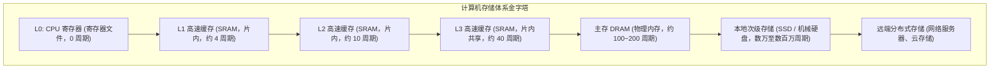

> **讲师**：David R. O'Hallaron ｜ **原视频**：Bilibili 分 P11 ｜ **时长**：01:15:47  
> **所属模块**：Module 4: 存储器层次结构 (The Memory Hierarchy & Cache)（L11 - L12 · 局部性原理、存储金字塔、Cache 组织与缓存友好代码）  
> **原视频地址**：[https://www.bilibili.com/video/BV1iW411d7hd/?p=11](https://www.bilibili.com/video/BV1iW411d7hd/?p=11)  
> **课程官方归属**：Carnegie Mellon University (CMU) 15-213 / 18-213 / 15-513: Introduction to Computer Systems (CSAPP Fall 2015)  
> **对应教材**：*Computer Systems: A Programmer's Perspective (3rd Edition)* by R. Bryant & D. O'Hallaron  
> **字幕与讲义出处**：字幕由 EugeneLiu/translationCSAPP 团队翻译校订（CC BY-NC 4.0 开源协议），幻灯片版权归 CMU 课程组所有。  

---

## 1. 存储器技术谱系：SRAM、DRAM 与非易失存储

*(参考时间：00:03:10 · [视频跳转 (P11 00:03:10)](https://www.bilibili.com/video/BV1iW411d7hd/?p=11&t=190))*

计算机的存储系统基于不同的物理效应与工艺折衷构建：
* **静态 RAM（SRAM）**：每个位采用 6 个晶体管双稳态门电路构成。只要通电就永久稳定，访问极快（约 1-4 个时钟周期），用于 CPU 片上 L1/L2/L3 高速缓存；缺点是价格昂贵、集成密度低、功耗大。
* **动态 RAM（DRAM）**：每个位利用电容上存储的微小电荷表示。电荷会在毫秒内泄露，必须周期性刷新（Refresh）。集成度极高、成本低，用作计算机的物理主存（Main Memory）；访问延迟约为几十纳秒（相当于上百个 CPU 时钟周期）。
* **闪存与固态硬盘（SSD）**：基于浮栅晶体管技术，断电不丢失数据。按“页（Page）”读写，按“块（Block）”擦除，具备磨损均衡（Wear Leveling）算法。

## 2. 磁盘存储结构与漫长的机械寻道开销

*(参考时间：00:19:40 · [视频跳转 (P11 00:19:40)](https://www.bilibili.com/video/BV1iW411d7hd/?p=11&t=1180))*

机械硬盘（HDD）由盘片（Platter）、磁道（Track）、扇区（Sector）和机械臂读写磁头构成。磁盘访问延迟包含三部分：
1. **寻道时间（Seek Time）**：机械臂移动到目标磁道（约 3-9 ms）；
2. **旋转延迟（Rotational Latency）**：盘片旋转使目标扇区转到磁头下方（7200 RPM 硬盘平均约 4 ms）；
3. **数据传输时间（Transfer Time）**。

机械寻道总耗时高达约 10 毫秒！相比之下，SRAM 访问只需约 1 纳秒。两者速度差距相当于**闪电一瞬与长达数月之差**！若没有多级缓存系统，CPU 将有 99.999% 的时间都在饥饿等待漫长的磁盘或内存。

## 3. 计算机系统的核心基石：局部性原理 (Principle of Locality)

*(参考时间：00:35:10 · [视频跳转 (P11 00:35:10)](https://www.bilibili.com/video/BV1iW411d7hd/?p=11&t=2110))*

为什么多级缓存能够产生神奇的加速效果？因为良好编写的程序展现出了强烈的**局部性原理**：
* **时间局部性（Temporal Locality）**：被引用过一次的内存位置，在不久的将来极大概率会被反复多次访问（如循环变量、累加器）。
* **空间局部性（Spatial Locality）**：若某个内存位置被访问，其物理上相邻相近的位置在不久的将来极大概率也会被访问（如数组顺序扫描、连续执行的指令流）。

## 4. 存储体系金字塔与通用高速缓存机制

*(参考时间：00:51:30 · [视频跳转 (P11 00:51:30)](https://www.bilibili.com/video/BV1iW411d7hd/?p=11&t=3090))*

整个现代计算机体系构建在优雅的**金字塔型存储层级（Memory Hierarchy）**之上：
每一层 $k$ 都作为其下一较慢层 $k+1$ 的数据缓存器！
* **缓存命中（Cache Hit）**：第 $k$ 层已拥有所需数据，即刻极速返回。
* **缓存缺失（Cache Miss）**：
  * **冷缺失（Cold/Compulsory Miss）**：缓存尚为空时的首次访问。
  * **容量缺失（Capacity Miss）**：工作集规模超过了缓存物理容量上限。
  * **冲突缺失（Conflict Miss）**：多个不同内存块被硬件散列映射到了同一个缓存组槽位，引发互相淘汰踢出。

---

### 本讲小结与核心思考 (Takeaways)

1. **系统视角的本质转变**：本讲从底层机制剖析了「The Memory Hierarchy：存储器层次结构与局部性原理」的核心实现原理。
2. **软硬件协同设计**：理解底层规则不仅能消除潜在的难以调试的隐蔽 Bug，更是编写极致性能工业级代码的前提。
3. **动手实践验证**：推荐配合 CSAPP 对应章节课后习题与官方实验（Lab），在 Linux 终端环境下使用 GDB 与性能分析工具亲自印证理论。
