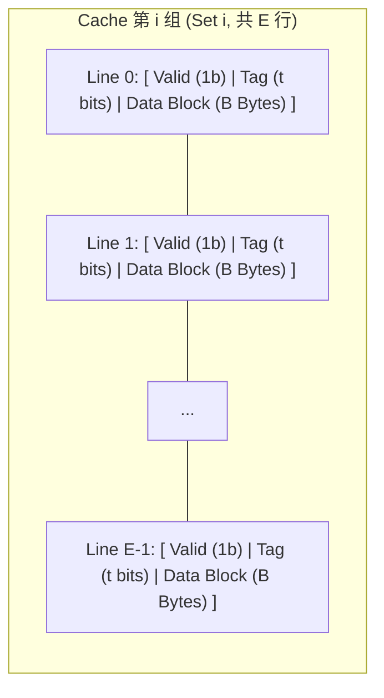

> **讲师**：David R. O'Hallaron ｜ **原视频**：Bilibili 分 P12 ｜ **时长**：01:18:43  
> **所属模块**：Module 4: 存储器层次结构 (The Memory Hierarchy & Cache)（L11 - L12 · 局部性原理、存储金字塔、Cache 组织与缓存友好代码）  
> **原视频地址**：[https://www.bilibili.com/video/BV1iW411d7hd/?p=12](https://www.bilibili.com/video/BV1iW411d7hd/?p=12)  
> **课程官方归属**：Carnegie Mellon University (CMU) 15-213 / 18-213 / 15-513: Introduction to Computer Systems (CSAPP Fall 2015)  
> **对应教材**：*Computer Systems: A Programmer's Perspective (3rd Edition)* by R. Bryant & D. O'Hallaron  
> **字幕与讲义出处**：字幕由 EugeneLiu/translationCSAPP 团队翻译校订（CC BY-NC 4.0 开源协议），幻灯片版权归 CMU 课程组所有。  

---

## 1. 通用高速缓存物理参数四元组 (S, E, B, m)

*(参考时间：00:02:30 · [视频跳转 (P12 00:02:30)](https://www.bilibili.com/video/BV1iW411d7hd/?p=12&t=150))*


高速缓存（Cache）是整个现代处理器体系结构中硬件复杂度最高、对性能影响最直接的组件。
为了统一分析所有各级 Cache，计算机科学家将其结构形式化定义为四元组 **$(S, E, B, m)$**：

* $m$：系统的**物理地址比特数**（64 位系统中通常 $m=48$ 或 $m=64$）；
* $S = 2^s$：Cache 中包含的**组（Sets）**的数量；
* $E$：每个组中包含的**缓存行（Cache Lines）**的数量（即相联度 Associativity）；
* $B = 2^b$：每个缓存行中存储的有效数据**块大小（Block Size，以字节为单位）**，在现代 Intel/AMD CPU 中普遍恒定为 **$B = 64$ 字节**；
* **Cache 总数据容量 $C$**（不包含标记位与有效位元开销）：
  $$C = S \times E \times B$$

### 单个 Cache Line 的精密内部物理构造
每个缓存行在芯片电路上包含三个紧密相连的字段：
1. **有效位 (Valid Bit)**：1 比特，标记该行存储的数据当前是否有效（上电初始化为 0）；
2. **标记位 (Tag Bits)**：$t = m - (s + b)$ 比特，用于与地址中的 Tag 进行比对，确认当前行是否是所需的目标块；
3. **数据块 (Data Block)**：$B = 2^b$ 字节的物理存储介质，存放真正的程序数据。



## 2. CPU 物理地址的三段式解构：Tag、Set Index 与 Block Offset

*(参考时间：00:15:20 · [视频跳转 (P12 00:15:20)](https://www.bilibili.com/video/BV1iW411d7hd/?p=12&t=920))*


当 CPU 执行一条加载指令（如 `movq (%rax), %rdx`）生成一个 $m$ 位的物理内存地址时，Cache 硬件会自动将这 $m$ 个比特从高到低精巧地切割为三个功能截然不同的字段：

```
       [   Tag 标记位 (t 位)   |   Set Index 组索引 (s 位)   |   Block Offset 块偏移 (b 位)   ]
MSB                                                                                     LSB
```

### 为什么硬件采用“中位做组索引（Middle Bits for Set Index）”？
这是一个在系统设计中极其绝妙的经典考点！为什么不用地址的最高有效位作为组索引，而必须使用中间位？
* **如果使用高位做索引**：
  * 内存中连续排布的一串数据（具有优秀空间局部性），其高位地址几乎是完全相同的！
  * 这会导致这一整块连续数据被**全部映射到同一个 Cache 组中**，造成该组极度拥堵并频繁发生冲突未命中，而其他组全部闲置！
* **使用中间位做索引**：
  * 连续的内存块由于中间地址位的迅速递增，会被**均匀轮流分散映射到 Cache 的各个不同组中**！
  * 极大限度地利用了整个 Cache 的所有硬件行，空间利用率拉满。

### Cache 命中判定的三步走流水线
1. **组选择 (Set Selection)**：利用中间的 $s$ 位无符号整数，作为索引直接在硬件多路选择器上定位到目标组；
2. **行匹配 (Line Matching)**：遍历该组内的所有 $E$ 个行，检查是否有某一行的 `Valid == 1` 并且其存储的 `Tag` 与地址中的高 $t$ 位完全一致！
   * 若找到匹配行，则触发 **Cache Hit**；
   * 若找不到或有效位为 0，则触发 **Cache Miss**。
3. **字抽取 (Word Extraction)**：命中后，利用地址最低的 $b$ 位作为块偏移量，从 $B$ 字节的数据块中截取出所需的 1、2、4 或 8 字节目标数据送入 CPU 寄存器。

## 3. Cache 架构分类学：直接映射、组相联与全相联 Cache

*(参考时间：00:29:40 · [视频跳转 (P12 00:29:40)](https://www.bilibili.com/video/BV1iW411d7hd/?p=12&t=1780))*


根据每个组包含的行数 $E$（相联度），Cache 在工业界被划分为三种经典架构：

### 1. 直接映射高速缓存 (Direct-Mapped Cache: $E = 1$)
* 每个组仅包含唯一的一行；
* **优点**：硬件结构极其简单，查找速度极快（无需并行的 Tag 比较器电路）；
* **致命弱点：颠簸现象 (Thrashing)**：
  如果程序频繁访问交替映射到同一个组的两个数组（例如两个大小为 4096 字节的向量相加 `c[i] = a[i] + b[i]`），由于每个组只有 1 行，读取 `a[i]` 刚把数据载入该组，紧接着读取 `b[i]` 就会把 `a[i]` 强行踢出！随后下一次迭代读取 `a[i+1]` 又把 `b[i]` 踢出，导致命中率断崖式跌落至接近 0%！

### 2. 组相联高速缓存 (Set-Associative Cache: $1 < E < C/B$)
* 现代 CPU 主流采用（如常见的 8 路组相联 L1 Cache，$E = 8$）；
* 每个组内部有 $E$ 个并行的行。硬件利用 $E$ 个平行的比较器在同一瞬间完成所有 $E$ 个 Tag 的比对；
* 极大地消除了冲突未命中的颠簸风险。当组满发生替换时，采用 **LRU (Least Recently Used，最近最少使用)** 策略将最久未被访问的行逐出。

### 3. 全相联高速缓存 (Fully-Associative Cache: $S = 1$)
* 整个 Cache 只有一个单一的大组，包含所有 $E = C/B$ 行；
* 地址中完全没有 Set Index 字段（$s = 0$），所有地址位除了块偏移外全部是 Tag！
* 任何数据块可以被存放在 Cache 的任意一行中，**冲突未命中率为 0**！
* **代价**：需要极其庞大且昂贵的并行比较器硬件电路，功耗巨大，通常仅用于规模极小的关键部件（如 CPU 的 TLB 页表缓存）。

## 4. 写策略大对决：Write-Through vs Write-Back 与 Write-Allocate

*(参考时间：00:43:50 · [视频跳转 (P12 00:43:50)](https://www.bilibili.com/video/BV1iW411d7hd/?p=12&t=2630))*


读取 Cache 的过程非常直观，但当 CPU 执行写入操作（如 `movq %rax, (%rdx)`）时，内存一致性与写策略的设计变得极其微妙。

### 1. 写命中时的策略 (Write-Hit Policy)
当要写入的内存地址已经在 Cache 中命中时：
* **直写 (Write-Through)**：
  * 立即把数据写入当前 Cache 块，**并且同时立即同步写回下一层主存**！
  * **优缺点**：逻辑简单，主存随时保持最新状态；但每次写操作都会引发缓慢的外部总线写周期，吞吐率惨不忍睹。
* **写回 (Write-Back，现代绝对主流)**：
  * 数据**仅写入当前 Cache 块**，完全不通知下一层主存！
  * 为该缓存行额外引入一个 **脏位 (Dirty Bit)**，并标记 `Dirty = 1`；
  * 只有当该行将来因为发生未命中要被其他块替换驱逐（Evicted）时，硬件才检测脏位，一次性将整块数据刷写回下一级主存。
  * **优势**：极大地过滤掉了高频重复写操作的总线开销，性能极高。

### 2. 写未命中时的策略 (Write-Miss Policy)
当要写入的地址不在当前 Cache 中时：
* **写分配 (Write-Allocate)**：
  * 先把该数据块从下一层主存加载到当前 Cache 中，然后再执行更新写入；
  * 充分利用后续可能存在的空间局部性；
  * **黄金搭档**：现代处理器几乎恒定采用 **写回 + 写分配 (Write-Back + Write-Allocate)** 的组合拳！
* **非写分配 (No-Write-Allocate)**：
  * 直接绕过 Cache，把数据直接写入下一层主存，不载入 Cache。

## 5. 缓存友好的代码设计与矩阵乘法分块 (Blocking / Tiling) 算法

*(参考时间：00:58:30 · [视频跳转 (P12 00:58:30)](https://www.bilibili.com/video/BV1iW411d7hd/?p=12&t=3510))*


编写高性能工业级软件的程序员，必须将代码结构与 Cache 几何尺寸严密调谐。

### 矩阵乘法的三层循环次序与 CPE 评测
计算 $C = A \times B$（矩阵维度为 $N \times N$）：
经典三重循环包含 `i, j, k` 三个变量。不同的遍历嵌套次序会带来完全不同维度的空间局部性：
1. **`ijk` 与 `jik` 循环**：
   * 内层循环固定 `i` 和 `j`，以 `k` 为索引同时扫描 $A[i][k]$ 和 $B[k][j]$；
   * $A$ 是行扫描（Stride-1，命中率极佳）；但 $B$ 是列扫描（Stride-N，每次都 Miss！）；
   * 平均每次乘加发生约 1.25 次 Miss。
2. **`kij` 与 `ikj` 循环（极速次序）**：
   * 内层循环索引为 `j`；
   * 在最内层循环中，累加的是 $A[i][k] \times B[k][j]$ 写入 $C[i][j]$；
   * 此刻 $B$ 和 $C$ 全都在沿行方向连续访问（全部是完美的 Stride-1！），且 $A[i][k]$ 是内层恒定标量！
   * Miss 率骤降至 0.25 次，**运行速度比 `ijk` 快数倍**！

### 突破容量瓶颈：矩阵分块技术 (Blocking / Tiling)
当矩阵规模极其庞大（例如 $N = 2048$），整行数据已经远远超出了 L1 Cache 的总容量，即使按行访问，读到行尾时行首的数据也早就被全部替换出去了。
**分块算法（Blocking）** 的核心思想是将大矩阵切分为 $B \times B$ 大小的微型子矩阵块（Tiles）：

```c
/* 矩阵乘法分块优化核心源码 */
void bijk(array A, array B, array C, int n, int bsize) {
    int i, j, k, kk, jj;
    for (jj = 0; jj < n; jj += bsize) {
        for (kk = 0; kk < n; kk += bsize) {
            for (i = 0; i < n; i++) {
                for (j = jj; j < jj + bsize; j++) {
                    int sum = 0;
                    for (k = kk; k < kk + bsize; k++) {
                        sum += A[i][k] * B[k][j];
                    }
                    C[i][j] += sum;
                }
            }
        }
    }
}
```
* **原理解析**：精心挑选分块大小 $B$，使得一个 $B \times B$ 的数据块能够**完整常驻在高速 L1 Cache 中**！
* 在内层循环计算期间，该子块被反复读取重用，数据在被换出前榨干了所有可能的时间局部性，将主存总线带宽压力削减了数十倍！

> [!TIP] Cache Lab 通关秘诀
> CSAPP 经典实验 **Cache Lab Part B** 要求针对 $32 \times 32$、$64 \times 64$ 和 $61 \times 67$ 矩阵转置设计转置算法，严格限制 Miss 次数。
> 其制胜法宝正是通过对矩阵进行 $8 \times 8$ 或 $4 \times 4$ 分块，并巧妙利用本地寄存器临时承接数据，彻底消除对角线元素访问时引发的自冲突未命中！


---

### 本讲小结与核心思考 (Takeaways)

1. **系统视角的本质转变**：本讲从底层机制剖析了「Cache Memories（高速缓存微架构、地址解构、写策略与矩阵分块优化）」的核心实现原理。
2. **软硬件协同设计**：理解底层规则不仅能消除潜在的难以调试的隐蔽 Bug，更是编写极致性能工业级代码的前提。
3. **动手实践验证**：推荐配合 CSAPP 对应章节课后习题与官方实验（Lab），在 Linux 终端环境下使用 GDB 与性能分析工具亲自印证理论。
