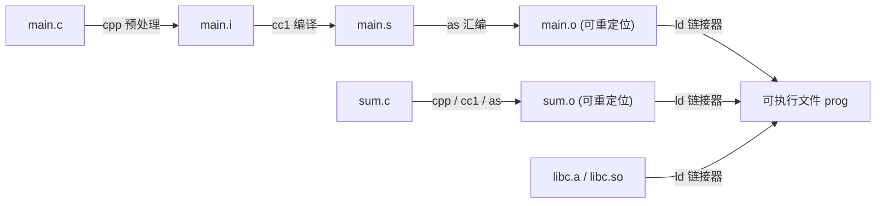

> **讲师**：Randal E. Bryant & David R. O'Hallaron ｜ **原视频**：Bilibili 分 P13 ｜ **时长**：01:21:33  
> **所属模块**：Module 5: 链接 (Linking)（L13 · 静态链接、重定位、符号解析、共享库与动态链接）  
> **原视频地址**：[https://www.bilibili.com/video/BV1iW411d7hd/?p=13](https://www.bilibili.com/video/BV1iW411d7hd/?p=13)  
> **课程官方归属**：Carnegie Mellon University (CMU) 15-213 / 18-213 / 15-513: Introduction to Computer Systems (CSAPP Fall 2015)  
> **对应教材**：*Computer Systems: A Programmer's Perspective (3rd Edition)* by R. Bryant & D. O'Hallaron  
> **字幕与讲义出处**：字幕由 EugeneLiu/translationCSAPP 团队翻译校订（CC BY-NC 4.0 开源协议），幻灯片版权归 CMU 课程组所有。  

---

## 1. 编译流水线全景与链接器的核心使命

*(参考时间：00:02:10 · [视频跳转 (P13 00:02:10)](https://www.bilibili.com/video/BV1iW411d7hd/?p=13&t=130))*


在现代软件开发中，任何大型系统都不是放在单一的巨大源文件中编译的。程序员将系统划分为更小、更好管理的模块，每个模块可以独立修改和编译。
将这些离散的模块无缝拼接成一个统一可执行程序的关键系统工具，就是**链接器（Linker）**。

### GCC 编译系统的完整四阶段演进
当我们执行 `gcc -O2 -v -o prog main.c sum.c` 时，构建系统在底层实际调用了四个独立的专业工具：
1. **预处理器 (C Preprocessor, cpp)**：
   * 处理所有以 `#` 开头的宏指令（`#include`, `#define`, `#ifdef`）；
   * 将头文件展开合并，生成纯 C 文本文件 `main.i`。
2. **编译器 (C Compiler, cc1)**：
   * 进行词法、语法分析、语义分析及优化；
   * 将高级 C 代码翻译为平台特定的汇编语言文本文件 `main.s`。
3. **汇编器 (Assembler, as)**：
   * 将汇编指令逐条编码翻译为对应的二进制机器码指令；
   * 生成**可重定位目标文件（Relocatable Object File）** `main.o`。
4. **链接器 (Linker, ld)**：
   * 收集 `main.o`, `sum.o` 以及标准 C 运行时库文件；
   * 解析所有跨文件的符号引用，完成地址重定位，最终生成单一的二进制**完全可执行文件（Executable Object File）** `prog`！



## 2. 目标文件格式工业标准：ELF (Executable and Linkable Format)

*(参考时间：00:15:45 · [视频跳转 (P13 00:15:45)](https://www.bilibili.com/video/BV1iW411d7hd/?p=13&t=945))*


现代 Linux 系统中，所有的目标文件（无论是 `.o`、`.a`、`.so` 还是最终的无后缀可执行文件）均遵循统一的 **ELF（Executable and Linkable Format）** 标准。

### 一个典型的 ELF 可重定位目标文件内部节区 (Sections)
* **ELF Header**：以 16 字节的魔数（Magic Number: `0x7f 'E' 'L' 'F'`）开头，记录机器字长（64位）、字节序（小端）、文件类型、节区头部表（Section Header Table）的偏移量与大小。
* **`.text` 节**：已编译程序的已完成机器指令代码。
* **`.rodata` 节**：只读数据，如 `printf` 中的格式化字符串、`switch` 语句跳转表。
* **`.data` 节**：**已显式初始化的全局变量和静态 C 变量**。
* **`.bss` 节**：**未初始化或初始化为 0 的全局变量和静态 C 变量**。
  * *关键优化*：`.bss` 在磁盘 ELF 文件中**完全不占用任何实际物理空间**，它仅仅是一个占位元数据，只记录总大小！在程序被操作系统加载运行的一瞬间，内核会自动开辟内存并将整个 `.bss` 全部填零。
* **`.symtab` 节**：**符号表（Symbol Table）**，存放程序中定义和引用的所有函数与全局变量的元数据信息。
* **`.rel.text` 节**：代码段的重定位条目。记录所有在编译阶段因为不知道绝对地址而暂时留空的函数调用指令位置。
* **`.rel.data` 节**：数据段的重定位条目。记录所有被初始化的全局指针变量的位置。

## 3. 符号与符号解析规则：强符号 vs 弱符号与全局污染隐患

*(参考时间：00:29:10 · [视频跳转 (P13 00:29:10)](https://www.bilibili.com/video/BV1iW411d7hd/?p=13&t=1750))*


链接器的第一个核心任务是**符号解析（Symbol Resolution）**：将代码中每一个符号引用（如调用 `sum()` 或读取 `val`）精准绑定到某一个目标模块的符号定义上。

### 模块中的三类符号
1. **全局符号 (Global Symbols)**：本模块定义、且能被其他模块公开引用的符号（非静态 C 函数与非静态全局变量）；
2. **外部符号 (External Symbols)**：本模块引用的、但是在其他模块中定义的全局符号（通过 `extern` 声明）；
3. **局部符号 (Local Symbols)**：带有 `static` 属性的 C 函数和全局变量。它们仅在当前模块内可见，**链接器对局部符号完全视而不见**。
   * 注意：函数内部的局部非静态变量不是局部符号！它们在运行时分配在栈上，符号表中根本没有它们。

### 强符号 (Strong) 与弱符号 (Weak) 的三大裁决铁律
在编译阶段，编译器将全局符号划分为两极：
* **强符号**：函数定义以及**显式赋予了初值的全局变量**；
* **弱符号**：**未初始化的全局变量**。

根据强弱属性，链接器严格执行以下三条裁决规则：
* **规则 1：同名强符号绝对互斥**：
  若在不同模块中定义了多个同名的强符号，链接器立即报错终止：`multiple definition of ...`！
* **规则 2：强符号碾压弱符号**：
  若一个强符号与一个或多个同名弱符号相遇，链接器静默选择**强符号的定义**！
* **规则 3：弱符号群中随机抓取**：
  若有多个同名的弱符号且没有强符号，链接器会**任性地随机挑选其中一个**！

### 惊悚案例：弱符号引发的灵异内存踩踏
```c
/* 文件 p1.c */
#include <stdio.h>
int x = 15213; // 强符号 (4 字节 int)
int y = 15212; // 强符号 (4 字节 int)
void p2(void);

int main() {
    p2();
    printf("x = %d, y = %d\n", x, y);
    return 0;
}
```

```c
/* 文件 p2.c */
double x; // 弱符号！且在 p2 中认为 x 是 8 字节的 double！
void p2() {
    x = 0.0; // 写入 8 个字节的 0.0！
}
```
* **灾难发生**：
  * 链接时没有任何报错，因为 `p1.c` 的强符号 `x` 覆盖了 `p2.c` 的弱符号；
  * 但当 `p2()` 执行 `x = 0.0` 时，它向 `x` 的地址连续写入了 **8 个字节**！
  * 这不仅将 `x` 置 0，还顺道**无情地覆盖了紧随其后的全局变量 `y` 的 4 字节内存**！
  * 运行结果：`x = 0, y = 0`！排查这种 Bug 往往会让团队花费数天时间抓狂。
* **防御手段**：在 GCC 中永远加上编译参数 `-fno-common`（现代 GCC 默认已开启）或 `-Werror`，强行禁止弱符号多重定义。

## 4. 重定位全流程解剖：PC 相对寻址与绝对寻址的修补艺术

*(参考时间：00:44:30 · [视频跳转 (P13 00:44:30)](https://www.bilibili.com/video/BV1iW411d7hd/?p=13&t=2670))*


完成符号解析后，链接器进入第二个核心步骤——**重定位（Relocation）**。
在这个阶段，链接器将所有模块的同类节区合并（例如把所有 `.o` 的 `.text` 合并为一个大的 `.text`），并为每一个符号分配全系统唯一的最终运行时虚拟地址。

### 重定位条目 (Relocation Entries)
在汇编器生成 `.o` 文件时，遇到跨模块函数调用，汇编器无法知道目标函数最终位于哪个内存地址。因此汇编器在指令处填入全 0 作为占位符，并在 `.rel.text` 中生成一个**重定位条目**。

ELF 定义了两种最关键的 x86-64 重定位类型：
1. **`R_X86_64_PC32` (重定位一个使用 32 位 PC 相对地址的引用)**：
   * 汇编指令中使用相对于当前指令的偏移量寻址（如 `callq`）；
   * 链接器的计算公式：
     $$\text{refaddr} = \text{ADDR}(.text) + r.\text{offset}$$
     $$\text{refvalue} = \text{ADDR}(\text{symbol}) - \text{refaddr} - 4$$
   * 将计算出的 4 字节补码直接写回机器指令占位符处。
2. **`R_X86_64_32` (重定位一个 32 位绝对地址的引用)**：
   * 直接将符号的绝对运行时虚拟地址填入目标位置。

## 5. 静态库 (.a) 链接机制与命令行顺序依赖陷阱

*(参考时间：00:56:15 · [视频跳转 (P13 00:56:15)](https://www.bilibili.com/video/BV1iW411d7hd/?p=13&t=3375))*


### 静态库 (Static Libraries) 的打包与按需提取
静态库（以 `.a` 为后缀，如 `libc.a`）在本质上是由 Linux `ar`（Archive）归档工具将大量独立的 `.o` 文件打包压制成的一个集合容器。
* **为什么不把所有标准库函数编成一个巨大的 `libc.o`？**
  如果放在单一 `.o` 中，任何只调用了 `printf` 的小程序都必须全量把海量数学库、图形库等无用代码全部硬链接进来，导致可执行文件体积暴增数十兆。
* **按需解析**：链接器扫描静态库时，**仅仅提取那些能够解决当前未解析符号引用的特定 `.o` 成员文件**，其余未被引用的 `.o` 被完全忽略！

### 命令行静态库的严格顺序依赖法则
许多工程师都经历过这样的报错：明明在编译命令中加了库，链接器却依然报 `undefined reference`！
这是因为 **Linux 链接器是严格按照从左到右的顺序单向扫描命令行参数的**！

链接器在内部维护三个关键集合：
* $E$：最终将被合并进可执行文件的目标文件集合；
* $U$：当前尚未被解析绑定的符号集合（未决符号）；
* $D$：在此前输入文件中已经定义的所有符号集合。

```bash
# 错误示范：链接器瞬间报错退出！
gcc -static -lvector p.o
```
* **分析原因**：
  * 链接器首先看到 `-lvector`：此时集合 $U$ 还是空的（没有任何未决符号！），链接器认为不需要从 `libvector.a` 中提取任何文件，直接跳过；
  * 接着扫描到 `p.o`：发现了对 `addvec` 的未决引用，将其加入 $U$；
  * 命令行结束！$U$ 集合非空，链接器暴怒报错：`undefined reference to 'addvec'`！
* **铁律**：**永远把被依赖的库文件放在命令行的最右端（调用者在左，被调用者在右）**！
  ```bash
  gcc -static p.o -lvector # 正确！
  ```

## 6. 现代动态链接与共享库 (.so)：PIC、GOT 与 PLT 延迟绑定

*(参考时间：01:09:40 · [视频跳转 (P13 01:09:40)](https://www.bilibili.com/video/BV1iW411d7hd/?p=13&t=4180))*


静态库虽然高效，但在现代多任务操作系统中存在不可忽视的弊端：
1. **磁盘与内存的严重浪费**：如果系统中同时运行着 100 个进程，每个进程都在自己内存空间复制一份完全相同的 `printf` 代码，数以百兆的物理内存被白白消耗；
2. **软件热更新极其困难**：如果 `libc.a` 修复了一个严重安全漏洞，全系统成千上万个应用程序必须全部重新编译链接才能生效。

### 动态共享库 (Shared Libraries: `.so` / DLL)
共享库是一个可以在运行时被动态加载到任意内存地址、并被多个运行中进程在物理内存中共享单一份指令代码的目标模块。

### 核心黑科技：位置无关代码 (PIC) 与延迟绑定 (Lazy Binding)
为了让同一段代码可以被加载到不同进程的不同虚拟地址上而无需重定位打补丁，编译器采用了 **PIC（Position-Independent Code）** 技术：
1. **全局偏移表 (GOT - Global Offset Table)**：
   * 无论代码被加载到哪里，数据段与代码段之间的相对距离在链接期是恒定不变的！
   * 编译器在数据段开头开辟一个指针数组（GOT）。代码中访问任何全局变量，一律通过 PC 相对寻址读取 GOT 中的条目，再间接寻址目标数据。
2. **过程链接表 (PLT - Procedure Linkage Table) 与延迟绑定**：
   * 一个大型动态库可能包含上万个函数，但一个程序在某次运行中往往只调用其中的几个。如果在启动时把上万个函数全部进行动态重定位解析，程序启动将极其卡顿！
   * **延迟绑定机制**：将函数地址的解析推迟到**该函数第一次被实际调用的那一瞬间**才去执行！
   * 首次调用触发动态链接器运行，解析出真实地址并填入 GOT；后续的所有调用直接通过 GOT 跳转，开销仅为一次间接内存访问！


---

### 本讲小结与核心思考 (Takeaways)

1. **系统视角的本质转变**：本讲从底层机制剖析了「Linking（编译流水线、ELF 目标文件、符号解析与静态/动态链接）」的核心实现原理。
2. **软硬件协同设计**：理解底层规则不仅能消除潜在的难以调试的隐蔽 Bug，更是编写极致性能工业级代码的前提。
3. **动手实践验证**：推荐配合 CSAPP 对应章节课后习题与官方实验（Lab），在 Linux 终端环境下使用 GDB 与性能分析工具亲自印证理论。
