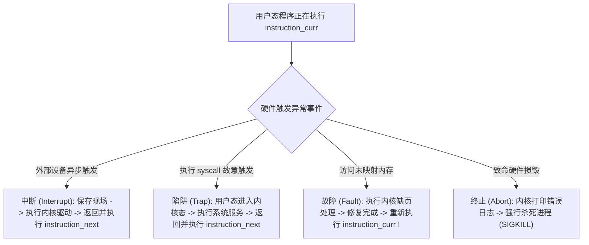

> **讲师**：David R. O'Hallaron ｜ **原视频**：Bilibili 分 P14 ｜ **时长**：01:12:09  
> **所属模块**：Module 6: 异常控制流 (Exceptional Control Flow)（L14 - L15 · 硬件异常、系统调用、进程上下文切换、信号与非局部跳转）  
> **原视频地址**：[https://www.bilibili.com/video/BV1iW411d7hd/?p=14](https://www.bilibili.com/video/BV1iW411d7hd/?p=14)  
> **课程官方归属**：Carnegie Mellon University (CMU) 15-213 / 18-213 / 15-513: Introduction to Computer Systems (CSAPP Fall 2015)  
> **对应教材**：*Computer Systems: A Programmer's Perspective (3rd Edition)* by R. Bryant & D. O'Hallaron  
> **字幕与讲义出处**：字幕由 EugeneLiu/translationCSAPP 团队翻译校订（CC BY-NC 4.0 开源协议），幻灯片版权归 CMU 课程组所有。  

---

## 1. 从平滑控制流到突变：异常控制流 (ECF) 全景

*(参考时间：00:01:25 · [视频跳转 (P14 00:01:25)](https://www.bilibili.com/video/BV1iW411d7hd/?p=14&t=85))*


从最简单的视角看，CPU 的控制流通常是极其平滑且单调的：程序计数器从一条指令自增推进到下一条指令，偶尔被 `jmp`, `call`, `ret` 改变方向。
但这种单纯由程序内部逻辑驱动的控制流，**完全无法应对计算机系统的物理现实**：
* 硬盘扇区数据何时读取完毕？
* 网卡何时收到了外部传入的数据包？
* 键盘何时被用户按下一枚按键？
* 程序执行除法时分母为 0 怎么办？
* 程序访问了尚未分配物理内存的虚拟页面怎么办？

系统必须具备一种能力：**对系统状态的突发变化做出紧急响应，瞬间打断当前的正常执行路径**。
这种在硬件、操作系统内核以及应用程序各层级共同构建的突变机制，统称为**异常控制流（Exceptional Control Flow, ECF）**。

## 2. 硬件异常分类学：中断、陷阱、故障与终止

*(参考时间：00:10:40 · [视频跳转 (P14 00:10:40)](https://www.bilibili.com/video/BV1iW411d7hd/?p=14&t=640))*


异常（Exception）在本质上是**控制权由当前正在执行的用户代码向操作系统内核的突发转移**。
在 CPU 内部，维护着一个由内核初始化的**异常表（Exception Table）**。每种异常分配一个唯一的编号 $k$。当异常发生时，硬件将当前状态压栈，并通过异常表基址寄存器计算跳转到内核的第 $k$ 号异常处理程序（Exception Handler）。

### 四大类异常的严格物理界定

| 类别 | 产生诱因 | 同步/异步 | 返回行为 | 经典实例 |
| :--- | :--- | :--- | :--- | :--- |
| **中断 (Interrupt)** | 来自 CPU 芯片外部 I/O 设备的信号 | **异步 (Asynchronous)** | 总是返回到**下一条指令** | 定时器芯片中断、网卡数据包到达、磁盘完成读写 |
| **陷阱 (Trap)** | 有意的、由软件指令主动触发 | **同步 (Synchronous)** | 总是返回到**下一条指令** | **系统调用 (System Call)**、断点调试陷阱 |
| **故障 (Fault)** | 潜在可恢复的错误或硬件事件 | **同步 (Synchronous)** | **可能重新执行当前指令**，或终止 | **缺页异常 (Page Fault)**、浮点除零异常 |
| **终止 (Abort)** | 不可恢复的致命硬件错误 | **同步 (Synchronous)** | **绝不返回**（直接杀死进程） | 奇偶校验错误、DRAM 硬件掉电或故障 |

### 关键机制对比：陷阱（系统调用）与故障（缺页）
1. **陷阱与系统调用**：用户态程序受到沙箱限制，无法直接操作底层硬件（如读写磁盘或发送网卡数据）。用户程序必须执行 `syscall` 指令，主动陷入内核态（Trap）。内核验证权限并代为执行，完成后返回用户程序下一条指令。
2. **缺页故障（Page Fault）的神奇恢复**：当程序访问一个合法的虚拟地址，但该页面尚未从磁盘加载到物理内存时，硬件 MMU 触发缺页故障。内核拦截该故障，暂停当前程序，从磁盘读取该页面写入物理内存并更新页表，最后**让 CPU 重新执行刚刚那条引发故障的指令**！程序感觉不到任何异样，无缝继续运行。



## 3. 进程抽象核心：逻辑控制流、私有地址空间与上下文切换

*(参考时间：00:24:15 · [视频跳转 (P14 00:24:15)](https://www.bilibili.com/video/BV1iW411d7hd/?p=14&t=1455))*


**进程（Process）** 是现代操作系统中最成功、最伟大的软件抽象。
进程为应用程序提供了两大关键的“终极幻觉”：
1. **独立的逻辑控制流（Logical Control Flow）**：让程序感觉自己独占了整颗 CPU 运算核心；
2. **私有的虚拟地址空间（Private Address Space）**：让程序感觉自己独占了整个连续巨大的内存空间，且不受其他进程的任何干扰。

### 并发与时间片轮转 (Time Slicing)
当多个进程在单核 CPU 上交替执行时，每个进程执行其控制流的一小段（时间片，通常 10 到 100 毫秒），然后 CPU 迅速切换到另一个进程。由于切换频率极高，在宏观人类视角下，多个程序是在同时并发执行的。

### 深入微架构：上下文切换 (Context Switch)
操作系统内核使用一种称为**上下文切换**的高级 ECF 机制来实现多进程并发调度。
* **什么是上下文（Context）**？
  上下文是内核为了重启一个被挂起的进程所必须维护的全部物理状态集合，包括：
  * 通用寄存器、浮点寄存器的值；
  * 程序计数器 `%rip` 与栈指针 `%rsp`；
  * 页表基址寄存器 `CR3`；
  * 打开的文件描述符表与进程状态标志。
* **上下文切换的三步代价**：
  1. 保存当前正在运行进程 $A$ 的上下文到内核数据结构中；
  2. 恢复将要运行进程 $B$ 此前保存的上下文；
  3. 将控制权转移给进程 $B$（切换地址空间与流水线）。
  * *隐性巨大性能损耗*：上下文切换本身只需几微秒，但地址空间的切换会**导致 CPU 内部的 TLB（Translation Lookaside Buffer）和各级 Cache 全部失效（冷启动未命中）**！

## 4. 系统级进程控制：fork 的双生奥秘与进程图拓扑分析

*(参考时间：00:38:50 · [视频跳转 (P14 00:38:50)](https://www.bilibili.com/video/BV1iW411d7hd/?p=14&t=2330))*


在 Unix / Linux 体系中，创建新进程的核心系统调用是 `fork()`。

### `fork()` 的三大经典特征
1. **调用一次，返回两次 (Called Once, Returns Twice)**：
   * 在父进程中，`fork()` 返回新创建的子进程的进程 ID（PID）；
   * 在子进程中，`fork()` 返回 `0`！
   * 程序员正是通过判断返回值是否为 0，让父子进程在同源代码中走向完全不同的执行分支。
2. **完全独立但高度相似的副本**：
   * 子进程获得了父进程用户级虚拟地址空间的一份完全一致（但彼此物理隔离）的副本（包括代码段、数据段、堆、共享库以及调用栈）；
   * 子进程获得了父进程所有打开文件描述符的副本；
   * *现代黑科技 Copy-on-Write (COW)*：物理上内核并不会瞬间盲目拷贝整个几十 GB 的内存，而是让父子进程共享同一份只读物理页，只有当某一方尝试修改某页数据时，才触发缺页故障执行物理拷贝！
3. **并发无序执行**：父进程与子进程是两个独立调度的实体，谁先执行、谁后执行完全取决于内核调度算法，程序员绝不能假设时序。

### 进程图 (Process Graphs) 拓扑推演模型
为了严谨分析包含嵌套 `fork` 代码的执行路径，CSAPP 提出了强大的分析工具——进程图（有向无环图）：
```c
void fork_eg() {
    printf("L0\n");
    fork();
    printf("L1\n");
    fork();
    printf("Bye\n");
}
```
* 初始状态：进程 1 打印 `L0`；
* 第一次 `fork()`：分裂为进程 1 和进程 2，两者均向下执行打印 `L1`（共打印 2 次 `L1`）；
* 第二次 `fork()`：进程 1 和进程 2 各自分裂一次，产生共 4 个活动进程，每个进程均打印 `Bye`（共打印 4 次 `Bye`）！

## 5. 僵尸进程收尸、waitpid 同步与 execve 的涅槃重塑

*(参考时间：00:54:10 · [视频跳转 (P14 00:54:10)](https://www.bilibili.com/video/BV1iW411d7hd/?p=14&t=3250))*


### 进程的死亡与僵尸进程 (Zombies)
当一个进程由于显式调用 `exit()` 或接收到致命信号终止时，它并没有立即从系统中彻底蒸发。
* 内核会将其保持在一种被称为**僵尸（Zombie）**的状态，保留其退出状态码（Exit Status）和少量内核元数据；
* **收尸（Reaping）**：父进程必须显式调用 `wait()` 或 `waitpid()` 系统调用读取子进程的退出状态，随后内核才会将僵尸进程彻底抹去；
* **危害与孤儿进程**：如果父进程一直运行却从不对死去的子进程进行收尸，系统中的 PID 资源将被海量僵尸进程耗尽！如果父进程先于子进程意外死亡，未亡的子进程会成为**孤儿进程（Orphan）**，Linux 会将其过继给系统 1 号祖先进程（`init` 或 `systemd`），由 1 号进程负责为其终生收尸。

### 进程的重塑：`execve()` 系统调用
`fork()` 负责分裂出一个双胞胎，而要运行一个完全崭新的程序，必须借助 `execve()`：
```c
int execve(const char *filename, char *const argv[], char *const envp[]);
```
* **核心哲学：调用一次，永不返回 (Called Once, Never Returns)**！
* `execve()` 会彻底清空当前进程原本的代码段、数据段、堆和栈，加载并运行指定的可执行二进制文件，重新从 `main()` 开始执行；
* 进程的 PID 保持不变，所有打开的文件描述符默认保持保留。只有在发生错误（如文件不存在）时，`execve()` 才会返回 `-1`。


---

### 本讲小结与核心思考 (Takeaways)

1. **系统视角的本质转变**：本讲从底层机制剖析了「Exceptional Control Flow: Exceptions and Processes（异常架构、系统调用、进程抽象与并发控制）」的核心实现原理。
2. **软硬件协同设计**：理解底层规则不仅能消除潜在的难以调试的隐蔽 Bug，更是编写极致性能工业级代码的前提。
3. **动手实践验证**：推荐配合 CSAPP 对应章节课后习题与官方实验（Lab），在 Linux 终端环境下使用 GDB 与性能分析工具亲自印证理论。
