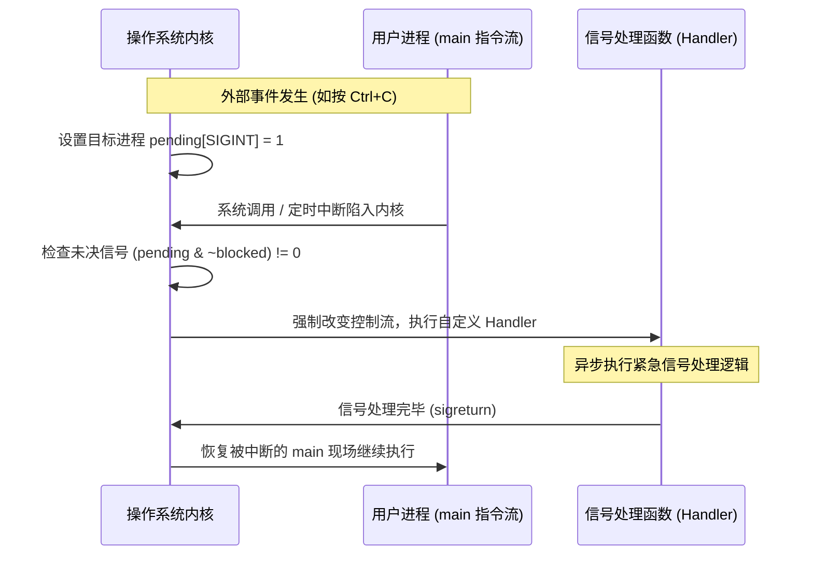

> **讲师**：Randal E. Bryant & David R. O'Hallaron ｜ **原视频**：Bilibili 分 P15 ｜ **时长**：01:19:27  
> **所属模块**：Module 6: 异常控制流 (Exceptional Control Flow)（L14 - L15 · 硬件异常、系统调用、进程上下文切换、信号与非局部跳转）  
> **原视频地址**：[https://www.bilibili.com/video/BV1iW411d7hd/?p=15](https://www.bilibili.com/video/BV1iW411d7hd/?p=15)  
> **课程官方归属**：Carnegie Mellon University (CMU) 15-213 / 18-213 / 15-513: Introduction to Computer Systems (CSAPP Fall 2015)  
> **对应教材**：*Computer Systems: A Programmer's Perspective (3rd Edition)* by R. Bryant & D. O'Hallaron  
> **字幕与讲义出处**：字幕由 EugeneLiu/translationCSAPP 团队翻译校订（CC BY-NC 4.0 开源协议），幻灯片版权归 CMU 课程组所有。  

---

## 1. 软中断的本质：Linux 信号 (Signals) 架构与常见信号类型

*(参考时间：00:02:15 · [视频跳转 (P15 00:02:15)](https://www.bilibili.com/video/BV1iW411d7hd/?p=15&t=135))*


硬件异常使得内核能够接管硬件事件，但操作系统内核如何主动向运行中的用户态应用程序通风报信？
**信号（Signal）** 是一种纯软件形式的高级异常控制流（软中断）。它允许内核或某一个进程强行中断另一个进程的正常执行流程，通知其发生了某类异步事件。

### 经典 Linux 核心信号类型一览表

| 编号 | 信号宏定义 | 默认处理动作 | 触发事件源 |
| :--- | :--- | :--- | :--- |
| **2** | `SIGINT` | 终止进程 | 用户在终端敲击 **Ctrl + C** 组合键 |
| **9** | `SIGKILL` | 终止进程 (无条件) | **特权杀死信号：既不能被捕获，也不能被忽略！** |
| **11** | `SIGSEGV` | 终止进程并 Core Dump | **段错误**：非法内存解引用、越界写只读内存 |
| **14** | `SIGALRM` | 终止进程 | 定时器倒计时归零（由 `alarm()` 设定） |
| **17** | `SIGCHLD` | 默认忽略 (Ignore) | 某个子进程终止或停止时，内核向父进程发送 |
| **19** | `SIGSTOP` | 暂停进程执行 | **挂起信号：既不能被捕获，也不能被忽略！** (Ctrl + Z 触发 `SIGTSTP`) |

## 2. 信号的生命周期三部曲：发送、未决与递送 (Sending, Pending, Receiving)

*(参考时间：00:16:40 · [视频跳转 (P15 00:16:40)](https://www.bilibili.com/video/BV1iW411d7hd/?p=15&t=1000))*


一个信号从诞生到被处理，严格经历三个物理阶段：
1. **发送信号 (Sending a Signal)**：
   * 内核更新目标进程上下文中的内部状态位；
   * 发送原因：内核检测到硬件事件（如除以 0 产生 `SIGFPE`），或者其他进程显式调用了 `kill(pid, sig)` 系统调用。
2. **未决状态 (Pending Signal)**：
   * 信号已经被发送，但目标进程尚未对其做出响应处理的中间状态；
   * **极其关键的硬件特性：非排队性（Signals are Not Queued）**！
     在内核中，每个进程只维护一个 `pending` 位向量（位掩码，Bit-Vector）！
     同一种类型的信号在任意时刻**只能有一个处于 Pending 状态**。如果一个 `SIGCHLD` 正在 Pending，此时又有 10 个子进程同时终止发出 `SIGCHLD`，后面的信号将被内核**直接丢弃**！
3. **接收/递送信号 (Receiving a Signal)**：
   * 当内核完成一次系统调用或中断处理、准备将控制权交还给用户态进程的一瞬间，内核会计算：
     $$\text{pnb} = \text{pending} \,\&\, \sim \text{blocked}$$
   * 如果 $\text{pnb} \ne 0$，内核强制暂停当前指令，转而去执行用户注册的信号处理函数（Signal Handler）；
   * 处理函数执行完毕后，执行 `sigreturn` 陷阱，控制权才恢复给被中断的用户代码。



## 3. 编写信号处理函数的工业级安全准则 (Async-Signal-Safety)

*(参考时间：00:32:20 · [视频跳转 (P15 00:32:20)](https://www.bilibili.com/video/BV1iW411d7hd/?p=15&t=1940))*


编写信号处理程序是整个系统编程中最危险、最容易产生极其隐蔽竞态条件（Race Conditions）的领域。
因为信号处理程序是**完全异步执行的**，它可以在用户代码执行到任何一条汇编指令的间隙被突发插入执行！

### 信号安全四大戒律 (Async-Signal-Safe Guidelines)
* **G0: 极简化原则（Keep it Simple）**：
  处理函数应该尽可能短小精悍。最稳健的设计是仅仅在处理函数中设置一个全局标志位，然后立刻返回，让主程序在主循环中去轮询处理。
* **G1: 仅调用异步信号安全函数（Async-Signal-Safe Functions）**：
  * 操作系统定义了一批可重入（Reentrant）且不会被信号打断破坏状态的系统函数（如 `_exit`, `write`, `waitpid`）；
  * **绝对禁忌：永远不要在信号处理函数中调用 `printf`, `sprintf`, `malloc` 或 `free`**！
    * *为什么？* `printf` 内部持有全局的 I/O 缓冲区锁，`malloc` 内部持有全局堆链表锁。如果主程序正在执行 `malloc` 并持有了堆锁，此时信号突发到来，处理函数内部又调用了 `malloc`，处理函数将永远等待主程序释放锁，引发**死锁（Deadlock）强行卡死**！
* **G2: 保存与恢复 `errno`**：
  许多系统调用在出错时会修改全局的 `errno`。如果处理函数内部调用了可能会改变 `errno` 的系统函数，必须在入口处暂存 `errno`，并在退出前严丝合缝地恢复原值！
* **G3: 声明标志变量为 `volatile sig_atomic_t`**：
  ```c
  volatile sig_atomic_t flag = 0;
  ```
  * `sig_atomic_t`：由硬件保证单次读写是原子性的整数类型（不会发生读出一半数据的撕裂现象）；
  * `volatile`：告诉优化编译器不要把该变量缓存到 CPU 寄存器中，每次读写必须强制穿透到内存，防止主循环由于看不到处理函数的修改而陷入死循环。

## 4. SIGCHLD 的并发陷阱：为什么必须用 while 循环 waitpid？

*(参考时间：00:48:15 · [视频跳转 (P15 00:48:15)](https://www.bilibili.com/video/BV1iW411d7hd/?p=15&t=2895))*


在 CSAPP 著名的 **Shell Lab** 中，90% 的同学都会在处理后台任务退出时栽跟头。
经典的致命错误写法：
```c
/* 致命错误实现：一次信号只收一个子进程 */
void handler_bad(int sig) {
    int olderrno = errno;
    pid_t pid = waitpid(-1, NULL, 0); // 以为一个子进程死掉就触发一次
    errno = olderrno;
}
```

### 为什么上述代码必定导致僵尸进程堆积？
* 假设父进程并发派生了 5 个子进程在后台运行；
* 某个时刻，3 个子进程几乎在同一微秒瞬间同时执行完毕终止；
* 3 个子进程都会向父进程发送 `SIGCHLD`；
* 信号 1 到达，内核将父进程的 `pending[SIGCHLD]` 置为 1；
* 信号 2 和信号 3 紧随其后到达：但由于非排队性，内核发现 `pending[SIGCHLD]` 已经是 1 了，**直接将后续两个信号无情丢弃**！
* 父进程进入处理函数，只调用了一次 `waitpid`，收割了第 1 个子进程后退出；
* 结果：**剩下的 2 个子进程成了永远无人收敛的僵尸进程！系统资源严重泄露！**

### 救赎的唯一真理写法：非阻塞循环收割
```c
/* 完美的工业级 SIGCHLD 处理函数 */
void handler_good(int sig) {
    int olderrno = errno;
    pid_t pid;
    int status;
    /* 使用 WNOHANG：若无子进程退出立即返回 0，绝不挂起当前主进程 */
    while ((pid = waitpid(-1, &status, WNOHANG | WUNTRACED)) > 0) {
        // 在此处妥善处理子进程状态更新
    }
    errno = olderrno;
}
```
通过 `while` 循环配合 `WNOHANG`，即使内核把 100 次信号合并为单次通知，一次循环也会不知疲倦地连续收割完当前所有已经死去的子进程，彻底杜绝僵尸隐患！

## 5. 非本地跳转 (Nonlocal Jumps)：setjmp 与 longjmp 的控制流跃迁

*(参考时间：01:05:40 · [视频跳转 (P15 01:05:40)](https://www.bilibili.com/video/BV1iW411d7hd/?p=15&t=3940))*


在 C 语言中，常规的 `goto` 语句存在一个铁的限制：只能在同一个函数内部进行局部跳转，绝对无法跨越函数边界。
为了应对深层嵌套调用中的严重错误恢复，C 标准库提供了强大的**非本地跳转（Nonlocal Jumps）机制**：`setjmp` 与 `longjmp`。

### 核心函数签名与机制
```c
#include <setjmp.h>
int setjmp(jmp_buf env);
void longjmp(jmp_buf env, int retval);
```
1. **`setjmp(env)`**：
   * 将当前 CPU 的所有寄存器环境、栈指针 `%rsp` 和程序计数器 `%rip` 完整打包快照，保存在 `env` 缓冲区中；
   * 初次直接调用时，返回值恒定为 **`0`**。
2. **`longjmp(env, retval)`**：
   * 可以在调用链的任意深处（甚至是跨越了数十层递归的子函数中）被执行；
   * 从 `env` 中强行恢复所有寄存器状态和栈指针，**直接将控制流闪现瞬移回当初调用 `setjmp` 的位置**！
   * 此时 `setjmp` 仿佛发生奇迹般“第二次返回”，且返回值正是由 `longjmp` 传入的非零数值 `retval`！

### 现代应用与 C++ 异常处理的雏形
`setjmp/longjmp` 绕过了常规的层层 `ret` 函数退栈，是 C 语言实现轻量级用户态协程调度器（Coroutines）以及实现类似 C++ / Java 中 `try-catch-throw` 异常处理体系的底层物理基石。


---

### 本讲小结与核心思考 (Takeaways)

1. **系统视角的本质转变**：本讲从底层机制剖析了「Exceptional Control Flow: Signals and Nonlocal Jumps（信号生命周期、异步安全与非本地跳转）」的核心实现原理。
2. **软硬件协同设计**：理解底层规则不仅能消除潜在的难以调试的隐蔽 Bug，更是编写极致性能工业级代码的前提。
3. **动手实践验证**：推荐配合 CSAPP 对应章节课后习题与官方实验（Lab），在 Linux 终端环境下使用 GDB 与性能分析工具亲自印证理论。
