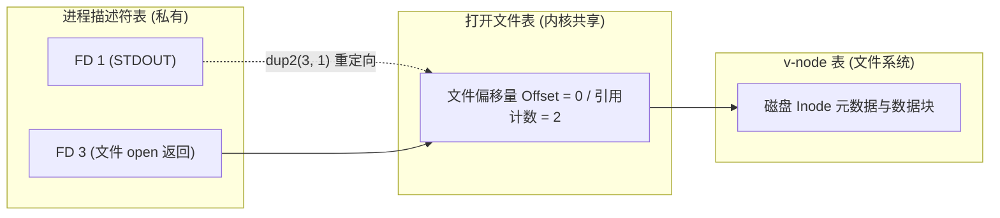

> **讲师**：Randal E. Bryant ｜ **原视频**：Bilibili 分 P16 ｜ **时长**：01:11:01  
> **所属模块**：Module 7: 系统级 I/O 与虚拟内存 (System-Level I/O & Virtual Memory)（L16 - L18 · Unix I/O、虚拟内存地址翻译、页表与多级缓存保护）  
> **原视频地址**：[https://www.bilibili.com/video/BV1iW411d7hd/?p=16](https://www.bilibili.com/video/BV1iW411d7hd/?p=16)  
> **课程官方归属**：Carnegie Mellon University (CMU) 15-213 / 18-213 / 15-513: Introduction to Computer Systems (CSAPP Fall 2015)  
> **对应教材**：*Computer Systems: A Programmer's Perspective (3rd Edition)* by R. Bryant & D. O'Hallaron  
> **字幕与讲义出处**：字幕由 EugeneLiu/translationCSAPP 团队翻译校订（CC BY-NC 4.0 开源协议），幻灯片版权归 CMU 课程组所有。  

---

## 1. Unix 哲学核心：一切皆文件 (Everything is a File)

*(参考时间：00:02:40 · [视频跳转 (P16 00:02:40)](https://www.bilibili.com/video/BV1iW411d7hd/?p=16&t=160))*

在 Linux 和 Unix 系统中，所有的外部 I/O 设备都被抽象建模为文件：
* 磁盘文件是文件，目录是包含文件列表的文件；
* 键盘、终端显示器、鼠标是字符设备文件；
* 甚至远端网络套接字也是文件！

所有的输入和输出都可以统一为四种极度极简的原语系统调用：
1. **打开文件 `open()`**：内核返回一个非负小整数**文件描述符（File Descriptor, FD）**。每个进程启动时默认拥有：`0` (标准输入 STDIN)、`1` (标准输出 STDOUT)、`2` (标准错误 STDERR)。
2. **改变文件位置 `lseek()`**。
3. **读写文件 `read()` 与 `write()`**。
4. **关闭文件 `close()`**。

## 2. 不足值 (Short Counts) 与健壮 I/O 包 (Rio)

*(参考时间：00:17:20 · [视频跳转 (P16 00:17:20)](https://www.bilibili.com/video/BV1iW411d7hd/?p=16&t=1040))*

当调用 `read(fd, buf, n)` 时，返回值可能小于请求的字节数 $n$，这被称为**不足值（Short Count）**。不足值在读取磁盘文件末尾（EOF）或者从慢速网络套接字（Network Sockets）读写数据时极易发生。

为此，CSAPP 提供了经典的 **Rio（Robust I/O）** 封装包：
* **无缓冲 I/O（`rio_readn`, `rio_writen`）**：在循环中不断重试读写，自动处理不足值与被信号中断的系统调用（EINTR），确保请求字节完全读写完毕。
* **带缓冲 I/O（`rio_readlineb`, `rio_readnb`）**：在内存中维护 8KB 内部缓冲区，一次系统调用批量载入，显著减少 `read` 系统调用进入内核的上下文切换开销，高效读取文本行。

## 3. 文件元数据与 stat 函数

*(参考时间：00:32:00 · [视频跳转 (P16 00:32:00)](https://www.bilibili.com/video/BV1iW411d7hd/?p=16&t=1920))*

文件的属性信息通过 `stat` 或 `fstat` 系统调用获取存入 `struct stat`：
* `st_size`：文件的物理大小（字节数）。
* `st_mode`：包含了文件类型（常规文件、目录、套接字、字符设备）以及读写执行权限比特位（通过宏 `S_ISREG()`, `S_ISDIR()` 判定）。
* 修改时间、访问时间与 Inode 节点号。

## 4. 内核数据结构：文件共享与 dup2 重定向

*(参考时间：00:46:15 · [视频跳转 (P16 00:46:15)](https://www.bilibili.com/video/BV1iW411d7hd/?p=16&t=2775))*

内核内部通过三张关键表格协同管理打开的文件：
1. **描述符表（Descriptor Table, 每个进程独有）**：索引为 FD，内容指向打开文件表条目。
2. **打开文件表（Open File Table, 整个系统共享）**：包含当前文件偏移量（File Offset）与引用计数。
3. **v-node 表（v-node Table, 全系统共享）**：记录文件的真实磁盘元数据和 Inode。

* **子进程继承**：`fork()` 时，子进程完整复制父进程的描述符表，指向同一个打开文件表条目，共享文件读写偏移量！
* **I/O 重定向 `dup2(oldfd, newfd)`**：复制文件描述符表项，让 `newfd` 也指向 `oldfd` 的文件。Shell 执行 `ls > output.txt` 时，正是调用 `dup2(fd, 1)` 将标准输出强行重定向到文件。

---

### 本讲小结与核心思考 (Takeaways)

1. **系统视角的本质转变**：本讲从底层机制剖析了「System-Level I/O：Unix I/O 模型、稳健 I/O 库与元数据」的核心实现原理。
2. **软硬件协同设计**：理解底层规则不仅能消除潜在的难以调试的隐蔽 Bug，更是编写极致性能工业级代码的前提。
3. **动手实践验证**：推荐配合 CSAPP 对应章节课后习题与官方实验（Lab），在 Linux 终端环境下使用 GDB 与性能分析工具亲自印证理论。
