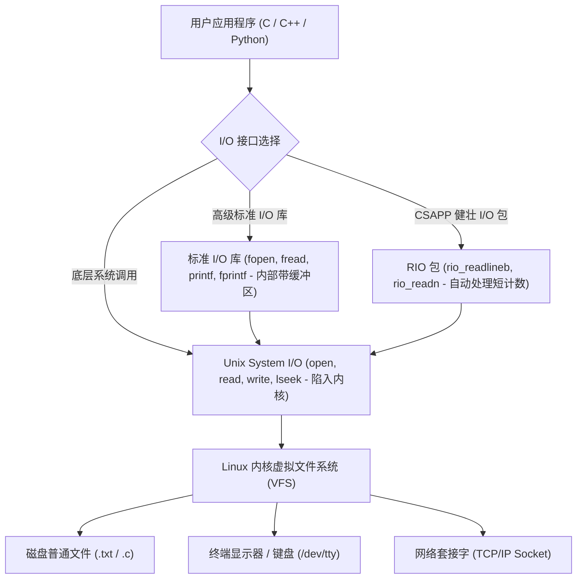
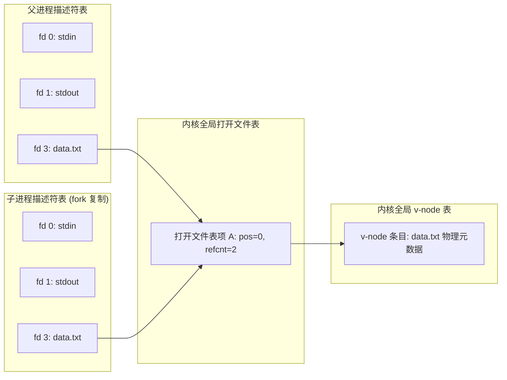

> **讲师**：David R. O'Hallaron ｜ **原视频**：Bilibili 分 P16 ｜ **时长**：01:11:01  
> **所属模块**：Module 7: 系统级 I/O 与虚拟内存 (System-Level I/O & Virtual Memory)（L16 - L18 · Unix I/O、虚拟内存地址翻译、页表与多级缓存保护）  
> **原视频地址**：[https://www.bilibili.com/video/BV1iW411d7hd/?p=16](https://www.bilibili.com/video/BV1iW411d7hd/?p=16)  
> **课程官方归属**：Carnegie Mellon University (CMU) 15-213 / 18-213 / 15-513: Introduction to Computer Systems (CSAPP Fall 2015)  
> **对应教材**：*Computer Systems: A Programmer's Perspective (3rd Edition)* by R. Bryant & D. O'Hallaron  
> **字幕与讲义出处**：字幕由 EugeneLiu/translationCSAPP 团队翻译校订（CC BY-NC 4.0 开源协议），幻灯片版权归 CMU 课程组所有。  

---

## 1. Unix I/O 的终极哲学：一切皆文件 (Everything is a File)

*(参考时间：00:02:10 · [视频跳转 (P16 00:02:10)](https://www.bilibili.com/video/BV1iW411d7hd/?p=16&t=130))*


在 Unix / Linux 操作系统设计哲学中，最优雅、最震撼人心的概念莫过于：**所有的 I/O 设备都被模型化映射为文件（Everything is a File）**！
* 机械磁盘与 SSD 上的常规数据是文件；
* 键盘、显示器终端是文件（`/dev/tty`）；
* 物理内存是文件（`/dev/mem`）；
* 甚至连跨越千山万水的互联网 TCP/IP 网络连接，在操作系统看来也是一个可以进行读写的文件（网络套接字 Socket）！

### Unix I/O 的四大基石系统调用
通过将所有设备抽象为统一的文件流，所有的输入和输出都可以通过一套极其简练的系统接口完成：
1. **打开文件 (`open`)**：向内核宣告准备访问某个文件，内核返回一个极小的非负整数——**文件描述符（File Descriptor, fd）**。
   * 系统默认自动为每个进程打开三个标准流：
     * `0`: 标准输入 (`STDIN_FILENO`)；
     * `1`: 标准输出 (`STDOUT_FILENO`)；
     * `2`: 标准错误 (`STDERR_FILENO`)。
2. **改变当前文件位置 (`lseek`)**：维护一个从文件开头算起的字节偏移量 $k$。
3. **读写文件 (`read` & `write`)**：
   * `read(fd, buf, n)`：从当前位置向内存 `buf` 复制至多 $n$ 个字节；
   * `write(fd, buf, n)`：从内存 `buf` 向当前位置写入 $n$ 个字节。
4. **关闭文件 (`close`)**：通知内核释放该描述符占用的资源。



## 2. 系统级 I/O 的深水区：短计数 (Short Counts) 的必然性与应对之道

*(参考时间：00:15:30 · [视频跳转 (P16 00:15:30)](https://www.bilibili.com/video/BV1iW411d7hd/?p=16&t=930))*


在调用底层系统函数 `read(fd, buf, count)` 时，初学者往往理所当然地认为：既然我要求读取 `count` 个字节，函数就一定会给我返回 `count` 个字节。
**这是系统级编程中最容易引发致命 Bug 的严重误解！**

### 什么是短计数 (Short Count)？
当 `read` 或 `write` 实际传送的字节数**严格小于**程序员请求的字节数时（即返回值大于 0 但小于 `count`），便发生了**短计数**。

### 为什么短计数在物理上不可避免？
1. **在读普通磁盘文件时遇到 EOF（End of File）**：
   假设你请求读取 4096 字节，但文件当前位置距离末尾只剩 30 字节，`read` 将返回 30，下一次再调用则返回 0（表示 EOF）。
2. **从终端设备读写（键盘输入）**：
   每个 `read` 调用遇到换行符 `\n` 就会立即返回，单次只返回一行文本的字节数。
3. **读写网络套接字 (Network Sockets)**：
   * 因特网数据包受到 MTU 分片、网络拥塞、路由延迟等多种因素制约；
   * 即使对方发送了 1MB 数据，网卡和内核 TCP 接收缓冲区此时可能仅收到了 200 字节，`read` 绝不会傻傻死等，而是立即把这 200 字节交付给用户态并返回短计数 200！
4. **进程管道 (Pipes)**：管道内部缓冲区的有限容量导致读写切片。

> [!IMPORTANT] 黄金法则：工业级代码必须处理短计数
> 在进行网络编程（如 Web 服务器、RPC 框架）时，短计数不是例外，而是**绝对的常态**！
> 任何盲目假定 `read` 一次性读完所有数据的网络代码，在真实弱网高并发环境下百分之百会发生协议截断崩溃！

## 3. CSAPP 鲁棒 I/O 包 (RIO Package) 深度实现解析

*(参考时间：00:28:45 · [视频跳转 (P16 00:28:45)](https://www.bilibili.com/video/BV1iW411d7hd/?p=16&t=1725))*


为了彻底解决短计数问题、并提供如同 `fgets` 一样便捷的高效带缓存文本行读取功能，CSAPP 课程组设计了享誉全球的 **RIO（Robust I/O）包**。

### 1. 无缓冲健壮读写函数：`rio_readn` 与 `rio_writen`
通过一个自旋循环不断发起底层系统调用，直到所有请求字节全部传输完毕或遭遇硬错误才返回：

```c
/* 保证读出 n 字节或遇到 EOF 才退出的健壮读函数 */
ssize_t rio_readn(int fd, void *usrbuf, size_t n) {
    size_t nleft = n;
    ssize_t nread;
    char *bufp = usrbuf;

    while (nleft > 0) {
        if ((nread = read(fd, bufp, nleft)) < 0) {
            if (errno == EINTR) /* 被突发信号中断唤醒，不算错误 */
                nread = 0;      /* 重新发起读调用 */
            else
                return -1;      /* 真实硬错误 */
        } else if (nread == 0)
            break;              /* 遭遇真正的 EOF */
        nleft -= nread;
        bufp += nread;
    }
    return (n - nleft);         /* 返回实际读取的总字节数 */
}
```

### 2. 带缓冲的高效文本读取：`rio_readlineb` 内部双缓冲机理
如果逐个字节调用底层 `read(fd, &c, 1)` 去扫描换行符，每读一个字节就要执行一次昂贵的用户态-内核态上下文陷阱（耗费数千时钟周期）！
RIO 设计了一个专门的缓冲区结构体 `rio_t`：
* 每次通过 `read` 一次性从内核吞吐 **8192 字节（`RIO_BUFSIZE`）** 填满应用层缓冲区；
* 后续的 `rio_readlineb` 只需要在内存指针上高速扫描，只有当内部缓冲区耗尽时才再次访问内核。
* 既避免了频繁的系统调用，又完美规避了标准 I/O 库在套接字全双工模式下读写交叉的致命缓存缺陷！

## 4. 内核打开文件内部全景：描述符表、文件表与 v-node 表三级联动

*(参考时间：00:43:10 · [视频跳转 (P16 00:43:10)](https://www.bilibili.com/video/BV1iW411d7hd/?p=16&t=2590))*


操作系统内核究竟是如何跟踪记录所有进程打开的文件的？
在 Linux 内核内部，通过三张精密关联的核心数据结构实现：

1. **进程级描述符表 (Descriptor Table)**：
   * 每个运行中的进程拥有独立的一张表；
   * 表项由文件描述符索引（0, 1, 2, ...）；
   * 每个表项仅存放一个指针，指向全局文件表中的条目。
2. **系统级打开文件表 (Open File Table)**：
   * 全内核唯一、所有进程共享的全局表；
   * 记录该“打开实例”的当前文件位置（File Position / Offset）、**引用计数（Reference Count）** 以及指向对应 v-node 表项的指针。
3. **系统级 v-node 表 (v-node / i-node Table)**：
   * 记录磁盘物理文件的元数据信息（文件大小、访问权限、物理数据块在磁盘上的排布位置）。

### 经典文件共享场景深度推演
* **场景一：两个独立进程打开同一个文件**：
  * 进程 A 的 fd 3 和进程 B 的 fd 4 各自指向**打开文件表中两个不同的独立表项**；
  * 这两个表项各自拥有独立的当前文件位置（读写互不影响！）；
  * 但最终都指向**同一个 v-node 表项**。
* **场景二：`fork()` 派生子进程引发的文件共享**：
  * 子进程精确复制父进程的描述符表；
  * 子进程的 fd 3 与父进程的 fd 3 **指向打开文件表中同一个完全相同的表项**！
  * **震撼后果**：父子进程**共享同一个文件位置指针**！父进程读取了 10 个字节导致偏移推进，子进程紧接着读取将直接从第 11 个字节开始读取！



## 5. I/O 重定向的机器级本质：dup2 魔法

*(参考时间：00:56:40 · [视频跳转 (P16 00:56:40)](https://www.bilibili.com/video/BV1iW411d7hd/?p=16&t=3400))*


在 Linux Shell 中，我们每天都在使用重定向符号（如 `./prog > output.txt`）。Shell 是如何在不修改程序源代码的前提下，把原本打印在终端上的输出强行改道写进磁盘文件的？
这一切的核心正是系统调用 **`dup2`**：
```c
int dup2(int oldfd, int newfd);
```

### `dup2(oldfd, newfd)` 的微观执行步骤
1. 如果 `newfd` 此前已经打开，内核先将其隐式 `close` 释放；
2. 将描述符表中 `oldfd` 表项的内容（即指向打开文件表的指针）**精确复制覆盖到 `newfd` 表项中**！
3. 执行完毕后，`oldfd` 与 `newfd` 同时指向同一个打开文件表项。

```c
/* 实现 ./prog > output.txt 的核心代码 */
int fd = open("output.txt", O_WRONLY | O_CREAT | O_TRUNC, 0644);
dup2(fd, STDOUT_FILENO); // 关键！将标准输出 1 号重定向至 fd
close(fd);               // 关闭多余的原描述符
execve("./prog", argv, envp);
```
当被调用的 `./prog` 内部欢快地执行 `printf("Hello World\n")` 时，它依然是在向标准输出 1 号描述符写数据；但由于描述符表 1 号位置内部的指针已经被 `dup2` 掉包指向了 `output.txt`，数据便无声无息地流入了磁盘文件中！


---

### 本讲小结与核心思考 (Takeaways)

1. **系统视角的本质转变**：本讲从底层机制剖析了「System-Level I/O（Unix I/O 哲学、短计数陷阱、健壮 RIO 包与文件共享）」的核心实现原理。
2. **软硬件协同设计**：理解底层规则不仅能消除潜在的难以调试的隐蔽 Bug，更是编写极致性能工业级代码的前提。
3. **动手实践验证**：推荐配合 CSAPP 对应章节课后习题与官方实验（Lab），在 Linux 终端环境下使用 GDB 与性能分析工具亲自印证理论。
