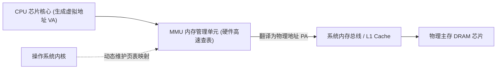

> **讲师**：Randal E. Bryant & David R. O'Hallaron ｜ **原视频**：Bilibili 分 P17 ｜ **时长**：01:11:14  
> **所属模块**：Module 7: 系统级 I/O 与虚拟内存 (System-Level I/O & Virtual Memory)（L16 - L18 · Unix I/O、虚拟内存地址翻译、页表与多级缓存保护）  
> **原视频地址**：[https://www.bilibili.com/video/BV1iW411d7hd/?p=17](https://www.bilibili.com/video/BV1iW411d7hd/?p=17)  
> **课程官方归属**：Carnegie Mellon University (CMU) 15-213 / 18-213 / 15-513: Introduction to Computer Systems (CSAPP Fall 2015)  
> **对应教材**：*Computer Systems: A Programmer's Perspective (3rd Edition)* by R. Bryant & D. O'Hallaron  
> **字幕与讲义出处**：字幕由 EugeneLiu/translationCSAPP 团队翻译校订（CC BY-NC 4.0 开源协议），幻灯片版权归 CMU 课程组所有。  

---

## 1. 物理寻址 vs 虚拟寻址：打破物理内存牢笼

*(参考时间：00:02:15 · [视频跳转 (P17 00:02:15)](https://www.bilibili.com/video/BV1iW411d7hd/?p=17&t=135))*

早期的计算机（以及现代最简单的微控制器单片机）采用**物理寻址（Physical Addressing）**：CPU 执行指令生成的地址就是物理主存芯片引脚上的真实电气信号。
但在现代通用多任务操作系统中，物理寻址存在致命硬伤：
* 进程之间毫无安全隔离，恶意程序可以随意修改操作系统内核或其他程序的内存；
* 程序占用的内存必须是连续物理空间，多个程序并发运行时极易造成严重碎片化；
* 程序员在编写代码时必须时刻提防自己的程序地址会不会与别人冲突。

### 虚拟寻址 (Virtual Addressing) 与 MMU
现代计算机全部采用**虚拟寻址**：
* CPU 芯片内部集成了一个专门的硬件模块——**内存管理单元（MMU - Memory Management Unit）**；
* CPU 核心流水线只生成**虚拟地址（VA - Virtual Address）**；
* MMU 硬件利用操作系统内核在内存中建立的**页表（Page Tables）**，以极高的速度动态将虚拟地址现场翻译为**物理地址（PA - Physical Address）**，然后再送往内存总线！

## 2. 虚拟内存的三重化身：缓存工具、管理工具与保护工具

*(参考时间：00:14:20 · [视频跳转 (P17 00:14:20)](https://www.bilibili.com/video/BV1iW411d7hd/?p=17&t=860))*

虚拟内存（Virtual Memory, VM）是计算机科学史上最伟大的抽象之一，它在系统中同时扮演着三重不可或缺的角色的融合：

### 1. 作为主存的高速缓存工具 (VM as a Tool for Caching)
* 概念上，虚拟内存被组织为一个存放在磁盘上的 $N$ 个连续字节大小的单元数组；
* 内存被切分为固定大小的块，称为**虚拟页（Virtual Pages, VPs）**，通常为 **4 KB（$2^{12}$ 字节）**；
* 物理内存 DRAM 同样被切分为相同大小的块，称为**物理页帧（Physical Pages / Page Frames, PPs）**；
* **DRAM 作为磁盘缓存的物理特性**：
  * 由于访问磁盘的代价是访问 DRAM 的 100,000 倍以上，缺页的代价极其高昂！
  * 因此虚拟页的尺寸很大（4KB 起步，现代系统可支持 2MB/1GB 巨页）；
  * DRAM 缓存采用**完全相联（Fully Associative）**：任意虚拟页可以放置在任意物理页帧中；
  * 必须采用极其高明复杂的页面替换算法（如 LRU 变种、时钟算法 Clock）；
  * 恒定采用**写回（Write-Back）**策略，绝不轻易写磁盘。

### 2. 作为内存管理工具 (VM as a Tool for Memory Management)
* **简化链接**：每个进程都拥有一致的、私有的虚拟内存空间（如代码段永远从 `0x400000` 开始），编译器和链接器完全不用操心代码最终会被装载到哪块物理芯片上；
* **简化加载**：通过 `mmap` 将可执行文件的节区映射到虚拟页，只有在实际访问引发缺页时才按需调页（Demand Paging）；
* **简化共享**：多个进程可以把各自私有的虚拟页映射到同一块只读物理页上（如 `libc.so` 代码），极大节省内存；
* **简化内存分配**：当调用 `malloc` 需要分配连续的 100MB 虚拟内存时，操作系统只需从物理内存中随手抓出分散的物理页帧，通过页表把它们拼成连续的虚拟地址！

### 3. 作为内存保护工具 (VM as a Tool for Memory Protection)
页表项中除了物理地址，还内嵌了精密的**权限控制位**：
* `SUP`：是否必须在内核态（Supervisor Mode）才能访问；
* `READ` / `WRITE`：是否允许读写；
* `EXEC`（NX 位）：是否允许执行代码。
一旦用户态代码试图向只读代码段写入数据，MMU 硬件立即阻断并触发保护故障，抛出 `SIGSEGV` 段错误。

## 3. 页表内部结构与缺页异常 (Page Fault) 的神奇自愈流程

*(参考时间：00:27:50 · [视频跳转 (P17 00:27:50)](https://www.bilibili.com/video/BV1iW411d7hd/?p=17&t=1670))*

### 页表 (Page Table) 的数据结构
页表是一个常驻在物理内存中的**页表项（PTE - Page Table Entry）数组**。
每个虚拟页在页表中拥有一个对应的 PTE：
* **有效位 (Valid Bit)**：
  * 若 `Valid == 1`：表示该虚拟页当前已经被缓存加载到了物理内存中，PTE 存放对应的**物理页帧号（PPN）**；
  * 若 `Valid == 0` 且地址非空：表示该虚拟页尚未载入内存，PTE 存放该页在**磁盘上的物理存储地址**；
  * 若 `Valid == 0` 且地址为空：表示该虚拟页尚未被分配，访问将直接引发段错误。

### 缺页异常 (Page Fault) 全链路推演
当 CPU 试图访问一个 `Valid == 0` 的虚拟页时：
1. MMU 硬件检测到有效位为 0，立即触发**缺页故障硬件异常（Page Fault Exception）**；
2. CPU 控制流挂起当前用户程序，瞬间陷入操作系统内核的缺页异常处理程序；
3. 内核在物理内存 DRAM 中寻找一个空闲物理页；若物理内存已满，则利用替换算法挑选一个**牺牲页（Victim Page）**将其换出到磁盘交换空间（Swap Space）；
4. 内核向磁盘控制器发出 I/O 请求，将目标虚拟页从磁盘按扇区读入选定的物理页帧中；
5. 内核更新页表：将对应 PTE 的有效位置 1，写入物理页号 PPN；
6. 缺页处理程序返回——**让 CPU 重新执行刚刚那条引发缺页的原始加载指令**！
7. 此时 MMU 再次查表，命中物理内存，数据被高速读入 CPU，程序完全不知道曾经发生过一次横跨内核与磁盘的壮举！

## 4. 地址翻译硬件流水线与 TLB (快表) 硬件极速加速

*(参考时间：00:41:30 · [视频跳转 (P17 00:41:30)](https://www.bilibili.com/video/BV1iW411d7hd/?p=17&t=2490))*

### 虚拟地址到物理地址的数学映射
假设虚拟地址为 $n$ 位，物理地址为 $m$ 位，页面大小为 $P = 2^p$ 字节（$p=12$ 时即 4KB）：
* **虚拟地址 (VA)** 划分为：
  * **VPN (Virtual Page Number)**：高 $n - p$ 位，作为索引在页表中查找 PTE；
  * **VPO (Virtual Page Offset)**：低 $p$ 位，页内字节偏移。
* **物理地址 (PA)** 划分为：
  * **PPN (Physical Page Number)**：物理页帧号，来自查表得到的 PTE；
  * **PPO (Physical Page Offset)**：物理页内字节偏移。
* **物理不变法则**：**$\text{VPO} \equiv \text{PPO}$**！因为页面大小相同，页内偏移量在翻译前后完全保持恒定不变！

### 翻译后备缓冲器 (TLB - Translation Lookaside Buffer)
页表本身存放在物理 DRAM 内存中。这意味着：**CPU 每次想要访问一个内存数据，都必须先访问一次内存读取页表，再访问一次内存读取真正的数据**！这会导致系统性能直接暴跌 50%！
为了突破这一瓶颈，MMU 芯片内部集成了一个极小、但极速的硬件缓存——**TLB（快表）**：
* TLB 是专门缓存 PTE 的芯片级 SRAM Cache；
* **TLB Hit**：CPU 生成 VA，MMU 首先在 TLB 中并行比对 VPN。在 99% 的情况下均能直接命中，**地址翻译在零周期内瞬间完成**！
* **TLB Miss**：极少数情况下未命中，MMU 才向多级页表发起内存读取（Page Walk），并将结果载入 TLB。

## 5. 多级页表 (Multi-Level Page Tables)：解决 512GB 页表灾难的数学魔法

*(参考时间：00:55:10 · [视频跳转 (P17 00:55:10)](https://www.bilibili.com/video/BV1iW411d7hd/?p=17&t=3310))*

### 为什么单级扁平页表在 64 位体系下物理上不可能实现？
考虑 64 位系统（目前主流使用 48 位虚拟地址空间）：
* 虚拟空间大小为 $2^{48} = 256 \text{ TB}$；
* 页面大小为 $4 \text{ KB} = 2^{12}$ 字节；
* 整个系统拥有 $2^{48 - 12} = 2^{36}$（约 680 亿）个虚拟页！
* 每个页表项 PTE 占 8 个字节；
* **如果使用单级平铺页表，单个进程光是页表本身就需要消耗**：
  $$2^{36} \times 8 \text{ 字节} = 512 \text{ GB 物理内存}！$$
一个只有 16GB 内存的电脑，连一个进程的页表都装不下！

### 多级页表（层次化树形结构）的降维打击
以 x86-64 采用的 **4 级页表机制** 为例：
48 位虚拟地址被切分为：
`[ PML4 (9位) | PDPT (9位) | PD (9位) | PT (9位) | VPO (12位) ]`
* **内存节约的第一大奥秘**：
  如果一级页表中的某个条目是空的（表示整个 512GB 的虚拟地址范围完全没有被进程使用），**那么对应的二级、三级、四级页表在物理上根本不需要被创建分配**！
* 绝大多数典型用户程序，虽然拥有 256TB 的虚拟视野，但实际使用的数据往往只有几十兆字节；
* 多级页表将原本需要 512GB 的平铺巨阵，压缩成了只有几片叶子节点的稀疏前缀树（Trie），实际消耗内存仅需几十 KB！

---

### 本讲小结与核心思考 (Takeaways)

1. **系统视角的本质转变**：本讲从底层机制剖析了「Virtual Memory: Concepts（虚拟内存概念、分页机制、TLB 硬件加速与多级页表）」的核心实现原理。
2. **软硬件协同设计**：理解底层规则不仅能消除潜在的难以调试的隐蔽 Bug，更是编写极致性能工业级代码的前提。
3. **动手实践验证**：推荐配合 CSAPP 对应章节课后习题与官方实验（Lab），在 Linux 终端环境下使用 GDB 与性能分析工具亲自印证理论。
