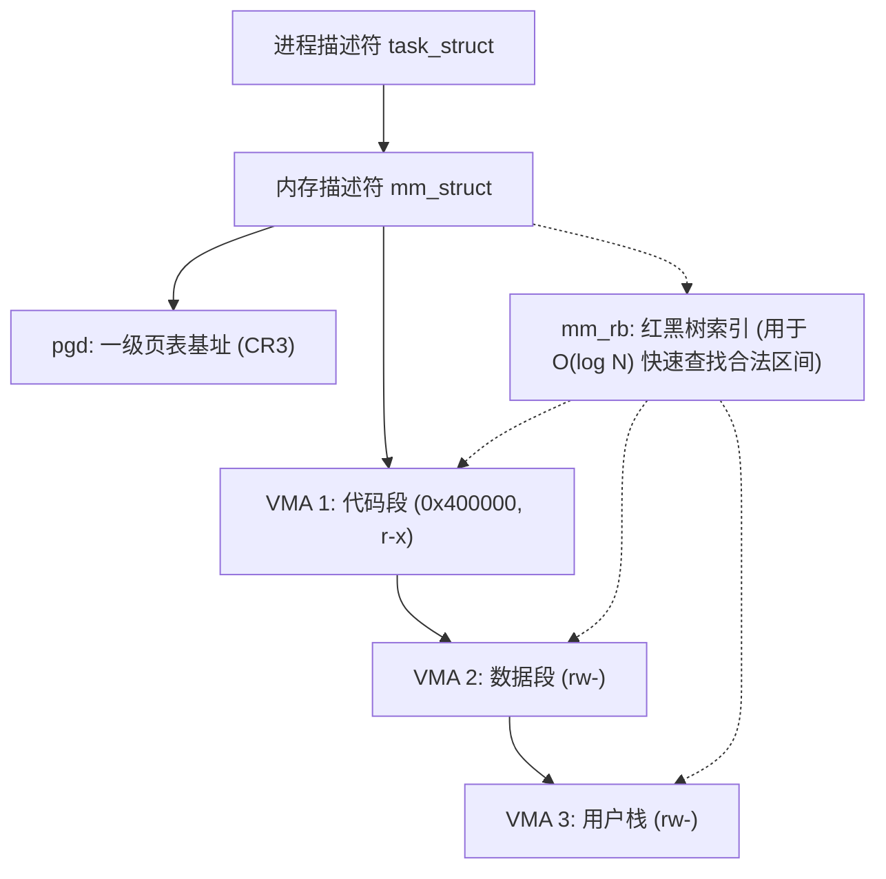

> **讲师**：David R. O'Hallaron ｜ **原视频**：Bilibili 分 P18 ｜ **时长**：01:17:48  
> **所属模块**：Module 7: 系统级 I/O 与虚拟内存 (System-Level I/O & Virtual Memory)（L16 - L18 · Unix I/O、虚拟内存地址翻译、页表与多级缓存保护）  
> **原视频地址**：[https://www.bilibili.com/video/BV1iW411d7hd/?p=18](https://www.bilibili.com/video/BV1iW411d7hd/?p=18)  
> **课程官方归属**：Carnegie Mellon University (CMU) 15-213 / 18-213 / 15-513: Introduction to Computer Systems (CSAPP Fall 2015)  
> **对应教材**：*Computer Systems: A Programmer's Perspective (3rd Edition)* by R. Bryant & D. O'Hallaron  
> **字幕与讲义出处**：字幕由 EugeneLiu/translationCSAPP 团队翻译校订（CC BY-NC 4.0 开源协议），幻灯片版权归 CMU 课程组所有。  

---

## 1. Linux 进程虚拟内存内核数据结构：mm_struct 与 VMA 红黑树

*(参考时间：00:02:15 · [视频跳转 (P18 00:02:15)](https://www.bilibili.com/video/BV1iW411d7hd/?p=18&t=135))*


在 Linux 内核内部，虚拟内存并不是毫无规则的散乱碎片，而是通过一系列精巧的内核对象进行结构化维护的。
内核为系统中的每一个进程维护着一个 `task_struct` 进程描述符，其中包含一个指针 `mm`，指向描述该进程全部内存状态的 **`mm_struct`**：

### `mm_struct` 的核心成员
* **`pgd`**：指向该进程一级页表（PML4）物理基地址的指针。当发生上下文切换时，内核将该指针写入 CPU 专用的 `CR3` 控制寄存器；
* **`mmap`**：指向一个由 **`vm_area_struct`（虚拟内存区域，简称 VMA）** 构成的单向链表头部；
* **`mm_rb`**：一棵管理所有 VMA 的**红黑树（Red-Black Tree）**根节点。

### 什么是虚拟内存区域 (VMA - Virtual Memory Area)？
一个 VMA 描述了一段连续的、具有相同保护权限与属性的虚拟页面集合：
* 代码段是一个 VMA（只读、可执行）；
* 数据段与 BSS 是一个 VMA（可读写）；
* 运行时堆（Heap）是一个向高地址生长的 VMA；
* 共享库映射区是一个或多个 VMA；
* 用户栈（User Stack）是一个向低地址生长的 VMA。
* **为什么同时使用链表与红黑树？**
  * 当内核需要按顺序遍历所有内存区域（如 `fork` 拷贝或输出 `/proc/pid/maps`）时，直接遍历单向链表；
  * 当进程发生缺页、内核需要瞬间判定某个虚拟地址 $A$ 是否落在合法的内存区域内时，红黑树提供了 **$O(\log N)$** 的极速二分查找！



## 2. Linux 缺页异常处理三部曲：合法性、权限与调页

*(参考时间：00:16:30 · [视频跳转 (P18 00:16:30)](https://www.bilibili.com/video/BV1iW411d7hd/?p=18&t=990))*


当 MMU 产生缺页异常陷入内核后，Linux 内核的异常处理函数执行严密的三步审查流程：

1. **第一步：地址合法性审查（Is Virtual Address Legal?）**：
   * 内核在进程的红黑树中搜索发生缺页的虚拟地址 $A$；
   * 如果 $A$ 不落在该进程目前定义的任何一个 VMA 的区间范围内，说明程序正在尝试访问完全非法的野指针内存！
   * **判决**：内核生成 `SIGSEGV` 信号（Segment Fault），立即将程序处死。
2. **第二步：内存保护权限审查（Is Memory Access Valid?）**：
   * 找到了包含地址 $A$ 的合法 VMA；
   * 检查引发异常的操作类型（读、写、执行）是否与该 VMA 规定的读写执行权限匹配；
   * 例如：试图向只读代码段 VMA 执行写入操作！
   * **判决**：内核同样抛出 `SIGSEGV` 保护异常并终止程序。
3. **第三步：合法正常调页（Normal Page Fault Handling）**：
   * 通过了上述两项严酷审查，内核确认这是一次完全合法的按需调页；
   * 内核分配一个物理页帧，从磁盘文件（或交换空间）将目标数据块读入物理页；
   * 更新硬件页表条目 PTE，最后让 CPU 重新执行刚刚那条指令。

## 3. 内存映射技术 (mmap) 与文件 I/O 零拷贝性能奇迹

*(参考时间：00:32:10 · [视频跳转 (P18 00:32:10)](https://www.bilibili.com/video/BV1iW411d7hd/?p=18&t=1930))*


Linux 提供了一个极其强悍的系统调用——**`mmap()`**：
```c
void *mmap(void *start, size_t length, int prot, int flags, int fd, off_t offset);
```
`mmap` 允许应用程序将一个磁盘文件直接映射到进程的虚拟内存空间中，或者分配一段匿名的干净内存。

### 内存映射的两类核心对象
1. **映射普通文件 (Regular Files)**：
   * 将磁盘文件的一个连续区域映射到一个 VMA 中；
   * 采用**按需调页（Demand Paging）**：调用 `mmap` 的瞬间，内核实际上**根本没有从磁盘读取任何一个字节**！内核仅仅是在进程里新建了一个 VMA 结构体；
   * 当程序后续真正通过指针访问这段内存时，由缺页异常驱动硬件自动从磁盘将对应页调入内存。
2. **映射匿名文件 (Anonymous Files / Demand-Zero Pages)**：
   * 映射对象不是磁盘物理文件，而是内核维护的一个全 0 虚拟文件；
   * 专门用于分配大块连续的堆内存（`.bss` 段以及 `malloc` 请求超大内存时在底层自动调用）。

### `mmap` 对比传统 `read`/`write` 的零拷贝（Zero-Copy）优势
传统读写文件流程：
`磁盘 -> 内核页缓存 -> 复制到用户态 buf -> 用户修改 -> 复制回内核 -> 刷盘`（伴随多次昂贵的内存拷贝和上下文切换）。
`mmap` 流程：
直接将文件映射到用户虚拟页！用户通过指针对其进行读写，如同操作内存数组一样简单，完全绕过了用户态中间缓冲区的冗余拷贝，吞吐率呈爆发式增长！

## 4. 写时复制 (COW: Copy-on-Write)：fork 瞬间完成的底层奥秘

*(参考时间：00:46:40 · [视频跳转 (P18 00:46:40)](https://www.bilibili.com/video/BV1iW411d7hd/?p=18&t=2800))*


在前一讲中我们提到：`fork()` 会为子进程创建一份与父进程虚拟内存完全一样的私有副本。
如果父进程当时正在运行一个占用 32 GB 内存的大型内存数据库，难道 `fork` 会在瞬间向物理内存申请另外 32 GB 空间并逐字节全量复制一遍吗？
如果真是这样，`fork` 将会耗费数秒甚至导致物理内存直接被 OOM 撑爆！

### 写时复制（Copy-on-Write, COW）的神级实现
现代操作系统利用虚拟内存与 MMU 保护位实现了一个天衣无缝的障眼法：
1. **创建只读副本**：
   在 `fork()` 调用时，内核为子进程精确复制父进程的 `mm_struct` 和页表，让父子进程的虚拟页**全部指向同一批现有的物理页帧**！
2. **剥夺写权限**：
   内核将父子进程所有原本可读写的私有页面的 PTE 权限位**全部强制修改为只读（Read-Only）**！
3. **延迟分裂（写时触发）**：
   * 只要父子双方都在进行只读访问，大家相安无事共享同一份物理内存；
   * 一旦父进程或子进程中的任何一方尝试执行写操作（如修改变量 `x = 1`）：
     * CPU 硬件 MMU 检测到试图写入只读页，立即触发一个保护性缺页故障！
     * 内核缺页处理程序介入，发现该页面属于一个 COW 共享区域；
     * 内核此时才真正向物理内存申请一个崭新的物理页帧，把旧页的数据复制一份给发起写入的进程，并将该进程的页表指向新物理页，恢复可写权限；
     * 另一个进程的页表保持不变。

**收益**：如果子进程在 `fork` 之后紧接着调用 `execve`（Unix 99% 的常见惯用法），此前所有未被修改的物理内存一概免于复制，开销几乎缩减为 0！

## 5. 动态内存分配器前哨：堆边界与 brk / sbrk 机制

*(参考时间：01:03:20 · [视频跳转 (P18 01:03:20)](https://www.bilibili.com/video/BV1iW411d7hd/?p=18&t=3800))*


程序的数据段之上，是用于在运行时动态申请空间的**运行时堆（Heap）**。
* **堆的顶端指针：`brk`（Break 指针）**：
  内核在进程的 `mm_struct` 中维护着一个名为 `brk` 的地址指针，它精确标记了当前堆的最高物理虚拟边界。
* **底层系统调用 `brk()` 与 `sbrk()`**：
  * `int brk(void *addr)`：将内核中的 `brk` 指针直接设定为指定的绝对地址 `addr`；
  * `void *sbrk(intptr_t incr)`：将 `brk` 指针向上或向下推进 `incr` 个字节；返回 `brk` 移动前的旧地址指针。
  * 若 `incr > 0`，向高地址扩张堆，开辟新的内存；若 `incr == 0`，则返回当前堆顶的当前地址。

### 为什么应用程序不直接在业务代码里调用 `sbrk()`？
直接调用 `sbrk` 极其低效且不可管理：
* `sbrk` 每次都是在堆顶单向推进或回退，无法满足在堆中间任意位置释放一小块内存的复杂需求；
* 频繁陷入内核态执行系统调用的开销无法承受。
因此，C 标准库在应用层封装了专门的**动态内存分配器（Dynamic Memory Allocator，即 `malloc` 和 `free`）**，在用户态接管堆的大块内存管理与切片回收。


---

### 本讲小结与核心思考 (Takeaways)

1. **系统视角的本质转变**：本讲从底层机制剖析了「Virtual Memory: Systems（Linux 虚拟内存实现、mm_struct、VMA、mmap 与写时复制 COW）」的核心实现原理。
2. **软硬件协同设计**：理解底层规则不仅能消除潜在的难以调试的隐蔽 Bug，更是编写极致性能工业级代码的前提。
3. **动手实践验证**：推荐配合 CSAPP 对应章节课后习题与官方实验（Lab），在 Linux 终端环境下使用 GDB 与性能分析工具亲自印证理论。
