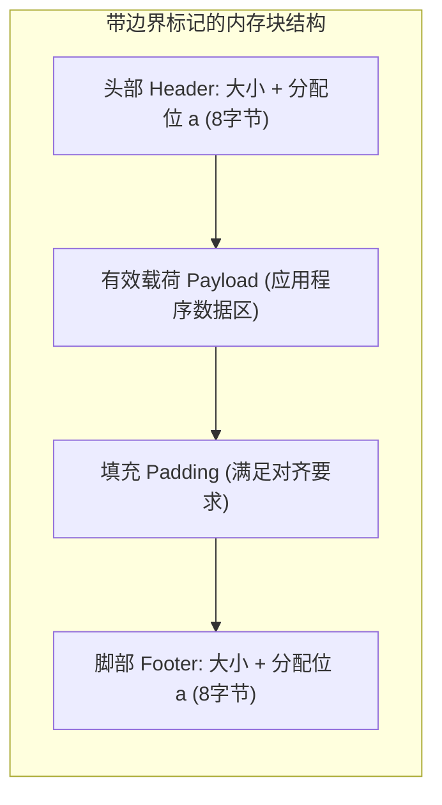

> **讲师**：David R. O'Hallaron ｜ **原视频**：Bilibili 分 P19 ｜ **时长**：01:06:28  
> **所属模块**：Module 8: 动态内存分配 (Dynamic Memory Allocation)（L19 - L20 · Malloc 机制、隐式/显式空闲链表、分离空闲链表与垃圾回收）  
> **原视频地址**：[https://www.bilibili.com/video/BV1iW411d7hd/?p=19](https://www.bilibili.com/video/BV1iW411d7hd/?p=19)  
> **课程官方归属**：Carnegie Mellon University (CMU) 15-213 / 18-213 / 15-513: Introduction to Computer Systems (CSAPP Fall 2015)  
> **对应教材**：*Computer Systems: A Programmer's Perspective (3rd Edition)* by R. Bryant & D. O'Hallaron  
> **字幕与讲义出处**：字幕由 EugeneLiu/translationCSAPP 团队翻译校订（CC BY-NC 4.0 开源协议），幻灯片版权归 CMU 课程组所有。  

---

## 1. 为什么需要动态内存分配？显式分配器的设计目标

*(参考时间：00:02:40 · [视频跳转 (P19 00:02:40)](https://www.bilibili.com/video/BV1iW411d7hd/?p=19&t=160))*

在编写程序时，很多数据结构的大小（如解析未知长度的网络报文、动态图结构节点）在编译时是完全无法确定的。动态内存分配器（如标准 C 库的 `malloc` 与 `free`）负责在运行时管理堆（Heap）内存空间。

显式分配器面临两大互相博弈的核心设计目标：
1. **最大化吞吐率（Maximize Throughput）**：分配器每秒钟能够完成的 `malloc` 和 `free` 请求次数必须极高（开销不能超过数十条机器指令）。
2. **最大化内存利用率（Maximize Memory Utilization）**：在有限的物理虚拟内存中容纳尽可能多的有效载荷，减少浪费。

## 2. 内存碎片化：内部碎片 vs 外部碎片

*(参考时间：00:16:30 · [视频跳转 (P19 00:16:30)](https://www.bilibili.com/video/BV1iW411d7hd/?p=19&t=990))*

造成堆空间利用率低下的核心罪魁祸首是**碎片化（Fragmentation）**：
* **内部碎片（Internal Fragmentation）**：分配的内存块比应用程序实际请求的有效载荷大。产生原因包括：分配器的最小块大小限制、头部/脚部元数据开销、以及为满足 8 字节或 16 字节硬件内存对齐而被迫加入的填充字节。
* **外部碎片（External Fragmentation）**：整个堆中空闲内存的总和完全满足申请需求，但因为这些空闲空间被切割成了一连串零碎分散的小块，**没有任何单个连续空闲块能够满足请求**！

## 3. 隐式空闲链表（Implicit Free List）设计

*(参考时间：00:29:40 · [视频跳转 (P19 00:29:40)](https://www.bilibili.com/video/BV1iW411d7hd/?p=19&t=1780))*

分配器必须能够区分已分配块与空闲块。在**隐式空闲链表**中，每个块的头部（Header，4 字节或 8 字节）保存了**块大小（Block Size）**以及一个**已分配位（Allocated Bit）**：
* 由于块大小必须满足 8 字节对齐，块大小的低 3 位二进制永远为 0。分配器便巧妙地将最低位借用作已分配标志（`0` 表示空闲，`1` 表示已分配）。

**寻找空闲块的策略**：
1. **首次适配（First Fit）**：从头扫描，找到第一个足够大的空闲块。简单，但容易在堆首堆积大量碎小碎片。
2. **下一次适配（Next Fit）**：从上一次搜索结束的位置接着往下找。搜索快，但整体空间利用率通常不如首次适配。
3. **最佳适配（Best Fit）**：扫描所有空闲块，挑选能容纳请求的最小块。空间利用率最高，但搜索慢。

## 4. 边界标记（Boundary Tags）与常数时间双向合并

*(参考时间：00:44:10 · [视频跳转 (P19 00:44:10)](https://www.bilibili.com/video/BV1iW411d7hd/?p=19&t=2650))*

当应用程序 `free(p)` 释放一个块时，如果它相邻的前后也是空闲块，若不合并就会产生假碎片。
* 向后合并很简单：根据当前块的大小加上偏移量，直接读取下一个块的头部。
* **向前合并怎么做？** 在没有反向指针的情况下，向前扫描极其缓慢！

Knuth 提出了天才的**边界标记（Boundary Tags）**机制：
在每个块的尾部复制一份与头部一模一样的**脚部（Footer）**！
当要释放当前块时，只需查看前一个块的脚部（就在当前块头部的前一个字长位置），即可在 **$O(1)$ 常数时间内**知道前一个块是空闲还是已分配、其大小是多少，实现瞬时前后双向四种合并情形的合并！

---

### 本讲小结与核心思考 (Takeaways)

1. **系统视角的本质转变**：本讲从底层机制剖析了「Dynamic Memory Allocation: Basic Concepts：动态内存分配基础与隐式空闲链表」的核心实现原理。
2. **软硬件协同设计**：理解底层规则不仅能消除潜在的难以调试的隐蔽 Bug，更是编写极致性能工业级代码的前提。
3. **动手实践验证**：推荐配合 CSAPP 对应章节课后习题与官方实验（Lab），在 Linux 终端环境下使用 GDB 与性能分析工具亲自印证理论。
