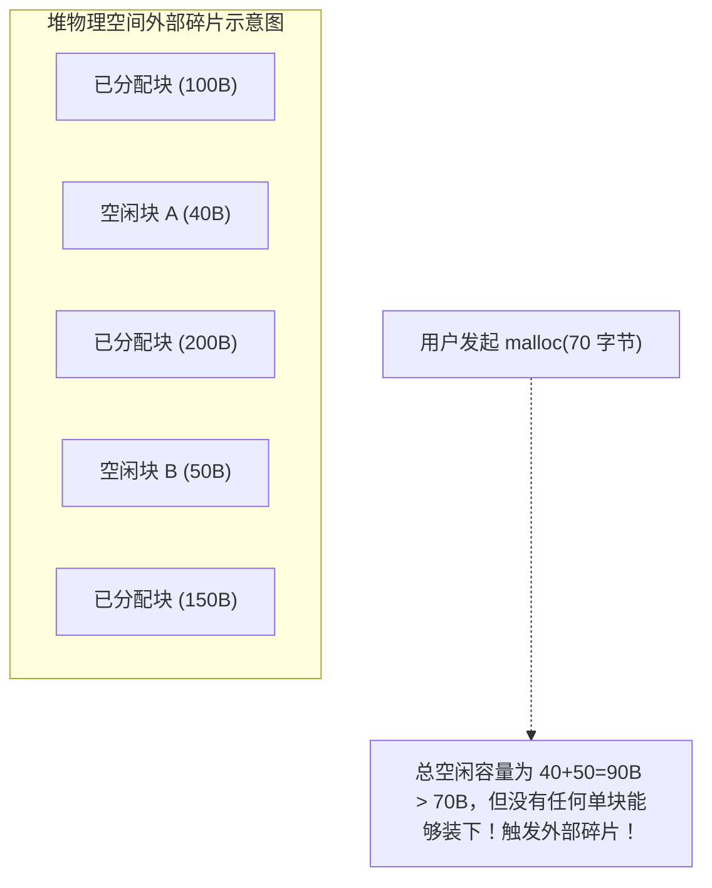

> **讲师**：Randal E. Bryant & David R. O'Hallaron ｜ **原视频**：Bilibili 分 P19 ｜ **时长**：01:06:28  
> **所属模块**：Module 8: 动态内存分配 (Dynamic Memory Allocation)（L19 - L20 · Malloc 机制、隐式/显式空闲链表、分离空闲链表与垃圾回收）  
> **原视频地址**：[https://www.bilibili.com/video/BV1iW411d7hd/?p=19](https://www.bilibili.com/video/BV1iW411d7hd/?p=19)  
> **课程官方归属**：Carnegie Mellon University (CMU) 15-213 / 18-213 / 15-513: Introduction to Computer Systems (CSAPP Fall 2015)  
> **对应教材**：*Computer Systems: A Programmer's Perspective (3rd Edition)* by R. Bryant & D. O'Hallaron  
> **字幕与讲义出处**：字幕由 EugeneLiu/translationCSAPP 团队翻译校订（CC BY-NC 4.0 开源协议），幻灯片版权归 CMU 课程组所有。  

---

## 1. 为什么需要动态内存分配？显式 vs 隐式分配器

*(参考时间：00:02:10 · [视频跳转 (P19 00:02:10)](https://www.bilibili.com/video/BV1iW411d7hd/?p=19&t=130))*

在编写 C 程序时，如果我们在编译期就用硬编码的静态数组（如 `int arr[1000]`）去定义数据结构，面临的必然是两难绝境：
* 如果预设值太小，一旦真实输入数据超出上限，程序立即越界崩溃；
* 如果预设值太大，大部分时间内存都在被白白闲置浪费。
只有在程序真正运行起来时（运行时），我们才能根据具体的网络请求、数据库查询或文件大小确定需要多少存储空间。这就是**动态内存分配（Dynamic Memory Allocation）**的根本价值。

### 显式分配器 vs 隐式分配器
* **显式分配器 (Explicit Allocator)**：
  * 要求应用程序不仅显式申请内存，还必须**显式手动释放（Free）**不再使用的内存；
  * 经典代表：C 语言的 `malloc()` / `free()`，C++ 的 `new` / `delete`。
* **隐式分配器 (Implicit Allocator / Garbage Collector)**：
  * 程序员只负责申请内存，从未手动释放；分配器通过垃圾回收（Garbage Collection, GC）算法自动检测哪些内存不再被引用并代为回收；
  * 经典代表：Java、Python、Go、JavaScript、Lisp。

## 2. 分配器的核心性能博弈：吞吐率 (Throughput) vs 内存利用率 (Memory Utilization)

*(参考时间：00:15:30 · [视频跳转 (P19 00:15:30)](https://www.bilibili.com/video/BV1iW411d7hd/?p=19&t=930))*

设计一个工业级动态内存分配器，本质上是在解决一个极具挑战性的多目标优化权衡问题。

### 严酷的设计约束
1. **不能控制请求的到达序列与大小**：程序可以随时任意调用 `malloc` 和 `free`，分配器无法预知未来；
2. **必须立即响应请求**：`malloc` 必须在被调用的瞬间立刻返回，绝不允许为了等待更好时机而延迟挂起调用者；
3. **分配的内存必须位于堆区**；
4. **必须满足对齐约束**：在 64 位 Linux 上，返回的指针地址必须严格满足 **16 字节对齐（8 字节的倍数）**；
5. **绝不能移动已经分配的块**：一旦返回指针 `p` 给用户，该内存块的物理虚拟地址就必须固定，分配器**绝不能在后台对已分配的块进行内存压缩或位置挪动**！

### 核心性能指标
* **吞吐率 (Throughput)**：分配器每秒钟能够完成的 `malloc` 和 `free` 请求总次数（例如 1000 万次/秒）；
* **峰值内存利用率 (Peak Memory Utilization)**：有效载荷总量与堆实际向操作系统索取的高水位线（High-Water Mark）之间的比例：
  $$U_k = \frac{\max_{i \le k} P_i}{H_k}$$
  * 这两个目标往往是剧烈冲突的：追求极致的利用率需要遍历全堆寻找最完美的契合块（吞吐率暴跌）；追求极致的吞吐率往往粗暴切片（造成严重的内存浪费）。

## 3. 内存碎片化之殇：内部碎片 vs 外部碎片

*(参考时间：00:26:40 · [视频跳转 (P19 00:26:40)](https://www.bilibili.com/video/BV1iW411d7hd/?p=19&t=1600))*

导致堆内存利用率低下的根本罪魁祸首就是**碎片化（Fragmentation）**：

### 1. 内部碎片 (Internal Fragmentation)
* 发生在一个已分配块的**有效载荷严格小于该块本身的总尺寸**时；
* **产生根源**：
  * 分配器为了维护块元数据引入的头部（Header）和脚部（Footer）；
  * 为了满足 16 字节对齐规则而被迫插入的填充字节（Padding）；
  * 分配器设定的最小块尺寸限制。
* 内部碎片的大小完全由当前的分配状态决定，非常容易量化和控制。

### 2. 外部碎片 (External Fragmentation)
* 发生在堆中虽然存在足够多的空闲物理内存总量满足请求，但是**没有哪怕任何一个单一连续的空闲块足够容纳该请求**时！
* **致命后果**：此时分配器被迫调用 `sbrk` 进一步向操作系统扩张堆，导致虚拟内存空间剧烈膨胀。
* 外部碎片是动态内存分配中最难以预防和测量的，因为它极度依赖未来的随机释放序列。

## 4. 隐式空闲链表 (Implicit Free List) 的数据结构与位压缩黑科技

*(参考时间：00:39:10 · [视频跳转 (P19 00:39:10)](https://www.bilibili.com/video/BV1iW411d7hd/?p=19&t=2350))*

为了区分已分配块与空闲块，分配器必须在每个内存块中保存元数据。

### 单个内存块的标准结构 (Block Format)
一个标准的内存块由三部分构成：
1. **块头部 (Header)**：1 个机器字长（64 位系统下为 8 字节）；
2. **有效载荷 (Payload)**：用户真正读写的区域；
3. **对齐填充 (Padding)**：可选的填充字节。

### 8 字节头部中的位级压缩（Bit-Packing）奇迹
一个块需要记录两个关键信息：**该块的总大小（Size）**，以及**该块当前是空闲还是已分配（Allocated Bit, 0 或 1）**。
如果专门用 8 字节存大小，再用 8 字节存标志位，每个块光是元数据就要吃掉 16 字节！
**设计大师的位压缩巧思**：
* 在 64 位体系中，由于所有块都必须按 16 字节对齐（甚至最小 8 字节对齐）；
* 这意味着任何合法块的总大小数值 $S$，其二进制表示的**最低 3 个比特位（Bits 0, 1, 2）永远恒定是 0**！
* 既然最低位永远是 0，我们何不把它当成标志位利用起来？
  * **最低位 Bit 0**：`0` 表示空闲（Free），`1` 表示已分配（Allocated）；
  * **高位（掩去低 3 位）**：记录真正的块总大小！
* 示例：若一个块总大小为 24 字节且已被分配，头部存放的数值为 $24 \mid 1 = 25$（十六进制 `0x19`）。通过 `header & ~0x7` 即可一瞬间提取出真实大小 24！

### 为什么叫“隐式”链表？
因为分配器**并没有在内存中真正维护显式的指针链表**！
分配器仅仅是凭借每个块头部中记录的块大小，像跳棋一样：当前块指针加上本块大小，就能直接算出下一个相邻块的物理起始地址！所有块像串珠一样在堆中无形地链接在一起。

## 5. 空闲块放置策略与高德纳边界标记 (Knuth Boundary Tags) 双向合并

*(参考时间：00:52:40 · [视频跳转 (P19 00:52:40)](https://www.bilibili.com/video/BV1iW411d7hd/?p=19&t=3160))*

### 空闲块放置策略大比拼 (Placement Policies)
当用户调用 `malloc(size)` 时，分配器如何遍历隐式链表寻找合适的空闲块？
1. **首次适应 (First Fit)**：
   * 从堆头开始线性扫描，找到第一个能够容纳该大小的空闲块立即使用；
   * **优缺点**：速度较快；但容易在堆的开头产生大量细小的碎片残渣。
2. **下一次适应 (Next Fit)**：
   * 从上一次搜索结束的位置继续向后查找；
   * **优缺点**：比首次适应更快；但内存利用率通常明显更差。
3. **最佳适应 (Best Fit)**：
   * 彻底扫描全堆所有的空闲块，挑选能够满足要求的**尺寸最小的那个块**；
   * **优缺点**：内存利用率最高，外部碎片极少；但需要全量遍历，吞吐率惨淡。

### 假碎片的救赎：高德纳边界标记 (Knuth's Boundary Tags)
当相邻的两个块先后被 `free` 时，它们在物理上明明是连在一起的，但如果不把它们合二为一，就会形成无法容纳大对象的**假碎片（False Fragmentation）**。
* **向后合并（Next Block）极其容易**：当前块指针加上本块大小，即可读取下一块的头部检查是否空闲；
* **向前合并（Previous Block）的千古难题**：如何能在常数时间 $O(1)$ 内找到物理上排在当前块前面的前一个块？
  * 如果从堆头重新扫描，耗时是极其致命的 $O(N)$！

### 计算机泰斗高德纳（Donald Knuth）的神来之笔：脚部标记 (Footer)
高德纳在每个块的末尾引入了一个**与头部完全一模一样的脚部（Footer / Boundary Tag）**：
* 无论是头部还是脚部，都记录着块的大小和分配位；
* 当我们要检查前一个块时：**直接将当前块头部指针减去 8 个字节，读出来的恰好就是前一个块的脚部！**
* 从脚部中直接读出前一个块的大小，瞬间就能反算出前一个块的起始头部！
* **四种合并情形**（前空后满、前满后空、前后均满、前后均空）全部在 **$O(1)$ 恒定时间** 内优雅解决！

---

### 本讲小结与核心思考 (Takeaways)

1. **系统视角的本质转变**：本讲从底层机制剖析了「Dynamic Memory Allocation: Basic Concepts（动态内存分配基础、吞吐率 vs 利用率与隐式空闲链表）」的核心实现原理。
2. **软硬件协同设计**：理解底层规则不仅能消除潜在的难以调试的隐蔽 Bug，更是编写极致性能工业级代码的前提。
3. **动手实践验证**：推荐配合 CSAPP 对应章节课后习题与官方实验（Lab），在 Linux 终端环境下使用 GDB 与性能分析工具亲自印证理论。
