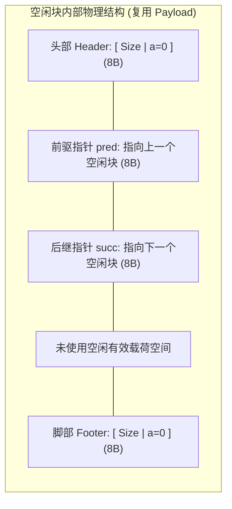

> **讲师**：David R. O'Hallaron ｜ **原视频**：Bilibili 分 P20 ｜ **时长**：01:22:43  
> **所属模块**：Module 8: 动态内存分配 (Dynamic Memory Allocation)（L19 - L20 · Malloc 机制、隐式/显式空闲链表、分离空闲链表与垃圾回收）  
> **原视频地址**：[https://www.bilibili.com/video/BV1iW411d7hd/?p=20](https://www.bilibili.com/video/BV1iW411d7hd/?p=20)  
> **课程官方归属**：Carnegie Mellon University (CMU) 15-213 / 18-213 / 15-513: Introduction to Computer Systems (CSAPP Fall 2015)  
> **对应教材**：*Computer Systems: A Programmer's Perspective (3rd Edition)* by R. Bryant & D. O'Hallaron  
> **字幕与讲义出处**：字幕由 EugeneLiu/translationCSAPP 团队翻译校订（CC BY-NC 4.0 开源协议），幻灯片版权归 CMU 课程组所有。  

---

## 1. 显式空闲链表 (Explicit Free Lists)：彻底摆脱已分配块的拖累

*(参考时间：00:02:15 · [视频跳转 (P20 00:02:15)](https://www.bilibili.com/video/BV1iW411d7hd/?p=20&t=135))*

在隐式空闲链表中，一个致命的性能瓶颈在于：分配器在遍历搜索空闲块时，**不得不逐个跳过所有已经被分配的块**。如果一个堆中分配了数万个对象，搜索一个空闲块的时间复杂度直接受限于**堆中所有块的总数**！

### 显式空闲链表的核心革命：零空间开销指针注入
显式空闲链表的核心思想是：**只把真正的空闲块用指针链接成双向链表**！已分配块完全不参与链表遍历。
但是，额外的 `pred`（前驱）和 `succ`（后继）指针会增加额外的空间开销吗？
**答案是：完全零额外开销！**

* 观察空闲块的内部构造：当一个块处于空闲状态时，原本留给用户的**有效载荷区（Payload）是完全闲置无用的**！
* 分配器直接借用空闲块的 Payload 区域，存入两个 8 字节的指针：
  * `pred`：指向链表中的前一个空闲块；
  * `succ`：指向链表中的后一个空闲块。
* 当该块将来被 `malloc` 分配给用户时，用户数据直接覆盖这两个指针，天衣无缝！
* **性能跃升**：空闲块的查找时间从取决于“全部块总数”，骤降为仅取决于**当前空闲块的数量**！

## 2. 链表维护次序决策：后进先出 (LIFO) vs 地址排序 (Address-Ordered)

*(参考时间：00:15:40 · [视频跳转 (P20 00:15:40)](https://www.bilibili.com/video/BV1iW411d7hd/?p=20&t=940))*

在维护显式双向空闲链表时，当一个被释放的块准备插入链表时，有两种截然不同的策略：

### 1. 后进先出顺序 (LIFO: Last-In-First-Out)
* **规则**：将新释放的块无条件直接插入到**空闲链表的头部**；
* **优点**：`free()` 释放操作具有极致的性能，耗时严格恒定为 **$O(1)$**；如果结合边界标记合并，释放和合并均在微秒内瞬时完成；
* **弱点**：碎片的地址分布较为凌乱，研究表明 LIFO 的内存利用率通常低于地址排序。

### 2. 地址排序顺序 (Address-Ordered Policy)
* **规则**：要求链表中所有空闲块的链接顺序，必须与它们在堆内存中的**物理起始地址高低保持单调递增**！
* **优点**：内存碎片化程度显著降低，更不容易产生难以利用的微小空洞，利用率逼近理论上限；
* **弱点**：每次执行 `free()` 时，必须从头扫描链表以找到其物理前后的正确插入位置，释放操作的开销退化为 **$O(N)$**。

## 3. 工业级分配器的终极形态：分离适配 (Segregated Fits) 与伙伴系统

*(参考时间：00:29:30 · [视频跳转 (P20 00:29:30)](https://www.bilibili.com/video/BV1iW411d7hd/?p=20&t=1770))*

现代工业级的高性能分配器（如 Google TCMalloc、FreeBSD/Facebook 的 jemalloc、以及 Linux glibc 默认的 ptmalloc），其底层核心引擎无一例外都是**分离存储分配器（Segregated Storage Allocator）**。

### 分离空闲链表 (Segregated Free Lists) 架构
分离适配的核心思想是：**维护一个由多个独立空闲链表组成的数组，每个链表专门存放属于特定尺寸类（Size Class）的空闲块**！
* 典型的尺寸类别划分（通常按 2 的幂次方对数递增）：
  * 类 0：$16 \sim 31$ 字节；
  * 类 1：$32 \sim 63$ 字节；
  * 类 2：$64 \sim 127$ 字节；
  * ...
  * 类 $k$：$1024 \sim 2047$ 字节；
  * 大对象类：$\ge 4096$ 字节。

### 分离适配分配的高速三步走
1. 确定请求尺寸所在的 Size Class 索引；
2. 直接定位到对应类别的空闲链表，在其内部执行快速的 First-Fit 搜索；
3. 如果该链表非空且找到匹配块，直接切片分配；如果为空，则向上级更大尺寸的链表搜寻并进行二分切片！
* **神级工业效果**：
  * **搜索时间逼近 $O(1)$**（因为链表极短甚至只有单块）；
  * **内存利用率逼近 Best-Fit**（因为同类链表内的块大小几乎完全匹配，外部碎片几乎被彻底消灭）！

### 伙伴系统 (Buddy System) 经典机制
伙伴系统是分离适配的一种高度数学化的特殊变种（Linux 内核物理页帧分配的核心算法）：
* 所有块的大小必须是 **2 的整数幂（$2^k$）**；
* 每个块都有一个与其唯一的“伙伴（Buddy）”；
* **神奇的二进制位运算寻伴**：
  给定一个大小为 $2^k$、地址为 $A$ 的块，其伙伴块的内存地址可以通过一条极其简单的异或位操作直接算出：
  $$\text{Buddy Address} = A \oplus 2^k$$
* 当伙伴块同样空闲时，两者瞬间合并为一个大小为 $2^{k+1}$ 的大块，运算开销几近于零！

## 4. 垃圾回收 (Garbage Collection) 与 Mark-and-Sweep 标记清除算法

*(参考时间：00:44:15 · [视频跳转 (P20 00:44:15)](https://www.bilibili.com/video/BV1iW411d7hd/?p=20&t=2655))*

在 Java、Python、Go 等高级语言中，动态内存由隐式分配器自动管理。其中最经典、最基础的算法就是图灵奖得主 John McCarthy 发明的 **标记-清除（Mark-and-Sweep）算法**。

### 可达性分析图 (Reachability Graph)
GC 将整个系统的内存模型化为一张有向图：
* **根节点集合 (Root Set)**：程序中无需解引用即可直接访问的指针，包括 CPU 寄存器、栈上的局部指针变量、全局变量；
* **可达节点 (Reachable Nodes)**：从根节点出发，顺着指针引用链条能够遍历到达的任何堆内存块；
* **垃圾 (Garbage)**：任何从根集合出发**不可达的孤岛节点**。这些节点程序再也没有任何合法途径能够访问到它们，必须被回收。

### Mark-and-Sweep 执行两阶段
1. **标记阶段 (Mark Phase)**：
   * 从 Root Set 出发，使用广度优先或深度优先遍历全图；
   * 对每一个遍历到的存活块，将其头部中的标记位（Marked Bit）设为 1；
2. **清除阶段 (Sweep Phase)**：
   * 线性扫描堆中的每一个块；
   * 如果某个块 `Marked == 0`，说明其为不可达的垃圾，调用底层机制将其回收进空闲链表；
   * 如果某个块 `Marked == 1`，则将其标记位重新清零，等待下一次 GC 周期检验。

> [!NOTE] C 语言保守垃圾收集器 (Conservative GC)
> 像 Boehm GC 这样的工具能为 C/C++ 提供垃圾收集。但因为 C 语言允许指针强转为整数、指针运算和联合体，分配器无法确定一个 8 字节数值到底是一个真正的指针还是一个纯整数。因此它采用**保守策略（Conservative）**：只要某个内存单元的值看起来像是一个落在堆区范围内的合法地址，就一律将其视作存活指针，绝不误杀！

## 5. 血泪避坑指南：C 语言十大经典内存悬案与调试心法

*(参考时间：00:58:30 · [视频跳转 (P20 00:58:30)](https://www.bilibili.com/video/BV1iW411d7hd/?p=20&t=3510))*

C 语言赋予了程序员直面物理内存的绝对自由，但这种自由的代价是永恒的警惕。CSAPP 总结了系统编程中导致线上灾难的十大经典内存错误：

1. **间接引用野指针 (Dereferencing Bad Pointers)**：
   * 典型犯错：`scanf("%d", val)` 漏写了取地址符 `&`，导致将 `val` 的数值当成内存地址写入！
2. **读取未初始化的内存 (Reading Uninitialized Memory)**：
   * 误以为 `malloc` 会把内存清零（清零必须显式使用 `calloc` 或 `memset`）。
3. **缓冲区溢出破坏栈/堆 (Buffer Overflow)**：
   * 字符串拷贝超出边界，踩踏相邻元数据。
4. **混淆指针大小与指向对象大小 (Assuming Pointer and Object Size Equivalence)**：
   * `int **p = malloc(N * sizeof(int))`（应该乘以 `sizeof(int *)`！在 64 位下直接少分了一半空间）。
5. **差一错误 (Off-by-One Errors)**：
   * 循环条件写成 `i <= n`，越界读写数组末尾。
6. **引用已释放的局部栈变量 (Referencing Nonexistent Variables)**：
   * 函数返回了一个指向自身栈帧内部局部变量的指针，函数退栈后该指针变成定时炸弹。
7. **使用已释放堆块 (Use-After-Free, UAF)**：
   * 释放了指针 `p` 之后，继续读取或写入 `*p`，现代高危安全漏洞的半壁江山。
8. **重复释放双重崩塌 (Double Free)**：
   * 对同一指针 `free(p)` 两次，彻底破坏空闲链表的闭环元数据，引发 SIGSEGV 或被利用提权。
9. **内存泄漏 (Memory Leaks)**：
   * 持续分配却忘记释放，最终耗尽虚拟地址空间导致系统 OOM 崩溃。
10. **解引用悬挂结构体指针**。

> [!TIP] Malloc Lab 终极通关秘籍
> CSAPP 皇冠实验 **Malloc Lab** 要求同学们亲手用 C 语言手搓一个高性能动态内存分配器（实现 `mm_init`, `mm_malloc`, `mm_free`, `mm_realloc`）：
> * 达到 80 分段：隐式空闲链表 + 边界标记合并；
> * 突破 90 分段：显式双向空闲链表 + LIFO / 最佳适配；
> * 斩获 100 满分段：**显式分离空闲链表（Segregated Fits）+ 极致对齐压缩 + 消除已分配块的脚部标记**！

---

### 本讲小结与核心思考 (Takeaways)

1. **系统视角的本质转变**：本讲从底层机制剖析了「Dynamic Memory Allocation: Advanced Concepts（显式空闲链表、分离存储、GC 垃圾回收与 C 语言十大内存悬案）」的核心实现原理。
2. **软硬件协同设计**：理解底层规则不仅能消除潜在的难以调试的隐蔽 Bug，更是编写极致性能工业级代码的前提。
3. **动手实践验证**：推荐配合 CSAPP 对应章节课后习题与官方实验（Lab），在 Linux 终端环境下使用 GDB 与性能分析工具亲自印证理论。
