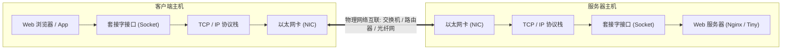

> **讲师**：David R. O'Hallaron ｜ **原视频**：Bilibili 分 P21 ｜ **时长**：01:17:03  
> **所属模块**：Module 9: 网络编程 (Network Programming)（L21 - L22 · 客户端-服务器模型、套接字接口 (Sockets API)、Web 服务器构建）  
> **原视频地址**：[https://www.bilibili.com/video/BV1iW411d7hd/?p=21](https://www.bilibili.com/video/BV1iW411d7hd/?p=21)  
> **课程官方归属**：Carnegie Mellon University (CMU) 15-213 / 18-213 / 15-513: Introduction to Computer Systems (CSAPP Fall 2015)  
> **对应教材**：*Computer Systems: A Programmer's Perspective (3rd Edition)* by R. Bryant & D. O'Hallaron  
> **字幕与讲义出处**：字幕由 EugeneLiu/translationCSAPP 团队翻译校订（CC BY-NC 4.0 开源协议），幻灯片版权归 CMU 课程组所有。  

---

## 1. 客户端-服务器事务模型与网络拓扑演化

*(参考时间：00:02:15 · [视频跳转 (P21 00:02:15)](https://www.bilibili.com/video/BV1iW411d7hd/?p=21&t=135))*


所有的网络应用，在系统级视角下均建立在**客户端-服务器事务模型（Client-Server Transaction Model）** 之上：
* 一个网络应用由一个**服务器进程（Server Process）**和一个或多个**客户端进程（Client Processes）**构成；
* 基本事务三部曲：
  1. 客户端发起：向服务器发送一个**请求（Request）**；
  2. 服务器响应：服务器接收请求，解释其语义并操作自身资源，生成一个**响应（Response）**回传；
  3. 客户端处理：客户端接收响应并在屏幕呈现给用户。

### 从局域网到因特网的硬件层次互连
* **局域网 (LAN - Local Area Network)**：以**以太网（Ethernet）**为典型代表。
  * 主机通过双绞线连接到网络集线器（Hub）或高速交换机（Switch）；
  * 数据以**以太网帧（Frame）**为单位传输，帧包含前导码、源和目标物理 MAC 地址（48 位）、有效载荷（46 到 1500 字节）以及 CRC 循环冗余校验码。
* **广域网 (WAN - Wide Area Network)** 与 **互连网络 (Internetwork / Internet)**：
  * 通过专用的通信计算机——**路由器（Routers）**，将物理特性、电气标准完全不同的异构网络（以太网、WiFi、卫星链路、海底光缆）无缝桥接为一个覆盖全球的统一网络！



## 2. 全球 IP 因特网协议栈：IP、TCP 与 UDP 的系统边界

*(参考时间：00:16:30 · [视频跳转 (P21 00:16:30)](https://www.bilibili.com/video/BV1iW411d7hd/?p=21&t=990))*


全球因特网（Global IP Internet）之所以能够连接全球数十亿台异构设备，全凭一套极其优雅的软件协议分层分级：

1. **网络层：IP 协议 (Internet Protocol)**：
   * 提供**不可靠、无连接的数据报交付服务（Best-Effort Datagram Service）**；
   * IP 协议只管尽最大努力把数据包从源主机路由到目标主机，但**不保证数据包是否丢失、是否重复、以及到达的先后次序**！
2. **传输层：UDP 协议 (User Datagram Protocol)**：
   * 仅在 IP 协议之上增加了微小的“端口（Port）”寻址和数据校验能力；
   * 依然是无连接、不可靠的，适合对延迟极其敏感、允许少量丢包的视频直播与在线语音游戏。
3. **传输层：TCP 协议 (Transmission Control Protocol)**：
   * 构建在不可靠的 IP 协议之上的工业级奇迹！
   * 提供**全双工（Full-Duplex）、可靠的、面向连接的字节流通信通道**；
   * 内部通过序列号确认（ACK）、超时重传、滑动窗口流量控制以及高超的拥塞控制算法（慢启动、拥塞避免），在充满丢包的物理网络上硬生生虚拟出一条毫无差错的完美数据传送带！

## 3. 网络字节序之争：为什么网络传输必须强制大端序 (Big-Endian)？

*(参考时间：00:31:10 · [视频跳转 (P21 00:31:10)](https://www.bilibili.com/video/BV1iW411d7hd/?p=21&t=1870))*


在前序课程中我们知道：x86-64 架构芯片在内存中是**小端序（Little-Endian）**存储的（低有效位存放在低地址处）。
然而在网络协议标准（RFC）制定之初，计算机科学家确立了铁律：**网络协议中的所有多字节整数字段（如 IP 地址、TCP 端口号），在网络上传输时必须严格采用大端序（Big-Endian），即最高有效位存放在首部传输**！

### 字节序转换四大函数
如果一台 x86 电脑直接将自身内存中的端口号 `0x1234` 裸发到网络中，大端序架构的接收端会将它解释为 `0x3412`，通信彻底乱套！
因此，在进行网络编程时，程序员必须显式调用转换函数：
```c
#include <arpa/inet.h>
uint32_t htonl(uint32_t hostlong);  /* Host to Network Long (用于 32 位 IP 地址) */
uint16_t htons(uint16_t hostshort); /* Host to Network Short (用于 16 位端口号) */
uint32_t ntohl(uint32_t netlong);   /* Network to Host Long */
uint16_t ntohs(uint16_t netshort);  /* Network to Host Short */
```
*记忆法则*：`h` 代表 Host（主机本地序），`to` 代表转换，`n` 代表 Network（网络大端序），`s` 代表 16 位 short，`l` 代表 32 位 long。
在 x86 机器上，`htons` 会被翻译为一条极速的字节翻转指令 `rorw $8, %ax` 或 `bswap`。

## 4. IP 地址表达与转换：点分十进制与 inet_pton / inet_ntop

*(参考时间：00:44:20 · [视频跳转 (P21 00:44:20)](https://www.bilibili.com/video/BV1iW411d7hd/?p=21&t=2660))*


一个 IPv4 地址在本质上就是一个 **32 位无符号整数**（占 4 个字节）。
* **点分十进制表示法 (Dotted-Decimal Notation)**：
  人类为了便于阅读，将这 4 个字节分别写成十进制整数（范围 0 到 255），中间用小圆点分隔。例如 `128.2.203.179` 对应的十六进制大端数即为 `0x8002cbb3`。

### 现代化协议无关转换 API
早期使用的 `inet_aton` 和 `inet_ntoa` 既不可重入也不支持 IPv6。现代系统编程必须使用遵循 POSIX 标准的协议族转换函数：
* **`inet_pton(af, src, dst)`**：Presentation to Network（将人类可读的字符串点分十进制，转化为二进制网络字节序整数）；
* **`inet_ntop(af, src, dst, size)`**：Network to Presentation（将二进制网络字节序整数，反解为人类可读的字符串）。
```c
struct in_addr inaddr; // 存放 32 位 IP 的内核结构体
inet_pton(AF_INET, "128.2.203.179", &inaddr); // 字符串转网络字节序
char buf[INET_ADDRSTRLEN];
inet_ntop(AF_INET, &inaddr, buf, sizeof(buf)); // 还原为字符串
```

## 5. 域名系统 (DNS - Domain Name System)：人类记忆与机器寻址的桥梁

*(参考时间：00:58:30 · [视频跳转 (P21 00:58:30)](https://www.bilibili.com/video/BV1iW411d7hd/?p=21&t=3510))*


对于人类而言，记忆一长串冰冷的数字 IP 地址极其困难。人类更习惯使用富有含义的名字（如 `www.cmu.edu`）。
**域名系统（DNS）** 是一个全球分布式、层次化的数据库，负责在域名与 IP 地址之间建立动态双向映射。

### DNS 树形层次空间
* **根域名 (Root Domain)**：顶级树根，由全球分布的根域名服务器集群（Root Servers）管理；
* **顶级域名 (TLD - Top-Level Domains)**：分为通用顶级域（`.com`, `.edu`, `.gov`, `.org`）与国家代码顶级域（`.cn`, `.us`, `.jp`）；
* **二级及子域名**：各机构自主申请管理的域，如 `cmu.edu`；
* **主机名 (Hostname)**：对应具体服务器，如 `cs.cmu.edu`。

### 映射关系的多样性与负载均衡
* **一对多映射（轮询负载均衡 Round-Robin DNS）**：一个域名可以映射到一组不同的物理 IP 地址（如访问 `google.com` 时，DNS 每次轮换返回不同机房的 IP，实现全球流量分流）；
* **多对一映射（虚拟主机 Virtual Hosting）**：成百上千个不同的网站域名可以解析到同一个物理服务器 IP 上，服务器根据 HTTP 请求头中的 `Host` 字段精准分发。


---

### 本讲小结与核心思考 (Takeaways)

1. **系统视角的本质转变**：本讲从底层机制剖析了「Network Programming: Part I（网络体系结构、以太网、IP 协议、大小端字节序与 DNS）」的核心实现原理。
2. **软硬件协同设计**：理解底层规则不仅能消除潜在的难以调试的隐蔽 Bug，更是编写极致性能工业级代码的前提。
3. **动手实践验证**：推荐配合 CSAPP 对应章节课后习题与官方实验（Lab），在 Linux 终端环境下使用 GDB 与性能分析工具亲自印证理论。
