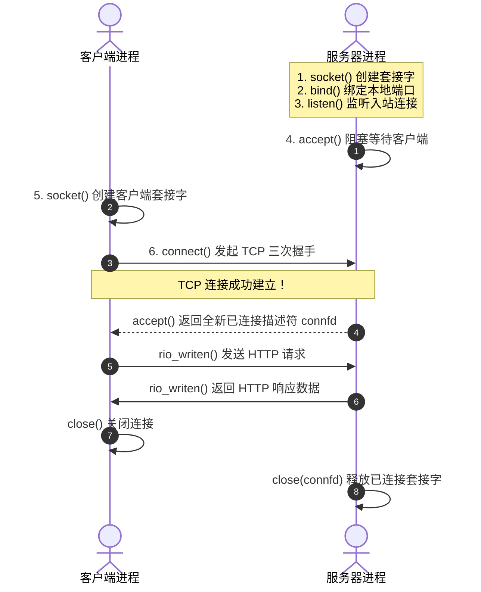

> **讲师**：Randal E. Bryant ｜ **原视频**：Bilibili 分 P22 ｜ **时长**：01:18:00  
> **所属模块**：Module 9: 网络编程 (Network Programming)（L21 - L22 · 客户端-服务器模型、套接字接口 (Sockets API)、Web 服务器构建）  
> **原视频地址**：[https://www.bilibili.com/video/BV1iW411d7hd/?p=22](https://www.bilibili.com/video/BV1iW411d7hd/?p=22)  
> **课程官方归属**：Carnegie Mellon University (CMU) 15-213 / 18-213 / 15-513: Introduction to Computer Systems (CSAPP Fall 2015)  
> **对应教材**：*Computer Systems: A Programmer's Perspective (3rd Edition)* by R. Bryant & D. O'Hallaron  
> **字幕与讲义出处**：字幕由 EugeneLiu/translationCSAPP 团队翻译校订（CC BY-NC 4.0 开源协议），幻灯片版权归 CMU 课程组所有。  

---

## 1. 套接字接口（Sockets API）全流程流转图

*(参考时间：00:03:00 · [视频跳转 (P22 00:03:00)](https://www.bilibili.com/video/BV1iW411d7hd/?p=22&t=180))*

套接字（Socket）是网络通信的端点，对应用程序而言，它就是一个标准的文件描述符。
服务端的生命周期五步曲：
1. **`socket()`**：创建端点描述符。
2. **`bind()`**：将套接字与本地 IP 和知名端口号绑定。
3. **`listen()`**：将主动套接字转换为被动**监听套接字（Listening Socket）**，等待连接。
4. **`accept()`**：阻塞等待客户端连接到来。连接建立后，返回一个全新的**已连接描述符（Connected Socket）**与客户端一对一通信！
5. **客户端 `connect()`**：发起三次握手连接。

## 2. 现代协议无关地址转换：getaddrinfo 与 getnameinfo

*(参考时间：00:18:40 · [视频跳转 (P22 00:18:40)](https://www.bilibili.com/video/BV1iW411d7hd/?p=22&t=1120))*

早期的 `gethostbyname` 既不线程安全，又绑定于 IPv4。现代网络编程必须使用 `getaddrinfo()`：
* 支持完全协议无关（Protocol-Independent），透明无缝兼容 IPv4 与 IPv6。
* 传入主机名和服务名（如 `"www.cmu.edu"`, `"http"`），返回一个由 `struct addrinfo` 构成的链表，每个节点都包含开箱即用的套接字配置。程序只需遍历链表尝试 `socket()` 和 `connect()` / `bind()`，极大提升了网络程序的健壮性与可移植性。

## 3. HTTP 协议解析：请求与响应报文规范

*(参考时间：00:33:15 · [视频跳转 (P22 00:33:15)](https://www.bilibili.com/video/BV1iW411d7hd/?p=22&t=1995))*

万维网（Web）基于文本协议 HTTP：
* **HTTP 请求（Request）**：
  * 请求行：`GET /index.html HTTP/1.1`（方法、URI、协议版本）
  * 请求报头：`Host: www.cmu.edu` 等一系列以空行 `\r\n` 结尾的键值对。
* **HTTP 响应（Response）**：
  * 状态行：`HTTP/1.1 200 OK`（状态码 200 成功，404 未找到，500 服务器内部错误）
  * 响应报头：`Content-Type: text/html`, `Content-Length: 1024`
  * 实体主体（Entity Body）：网页实际 HTML/二进制内容。

## 4. 经典案例拆解：Tiny Web 服务器实战

*(参考时间：00:48:00 · [视频跳转 (P22 00:48:00)](https://www.bilibili.com/video/BV1iW411d7hd/?p=22&t=2880))*

课堂上展示了仅用 250 行 C 语言写成的完整 Web 服务器 **Tiny**：
* 循环调用 `accept()` 接收客户端 HTTP 请求。
* 调用 `rio_readlineb` 解析请求行，判断是静态网页还是动态内容。
* **静态内容提供**：使用 `open()` 打开磁盘文件，调用 `mmap()` 将文件映射到内存，再通过 `rio_writen()` 一口气倒灌发送给客户端套接字！
* **动态内容提供（CGI 标准）**：`fork()` 子进程，调用 `dup2(connfd, 1)` 将标准输出绑定到网络套接字，随后 `execve()` 运行 CGI 程序，其所有的 `printf` 输出自动转化为网络报文发送给浏览器！设计极为惊艳。

---

### 本讲小结与核心思考 (Takeaways)

1. **系统视角的本质转变**：本讲从底层机制剖析了「Network Programming: Part II：Sockets 接口编程与 Tiny Web 服务器」的核心实现原理。
2. **软硬件协同设计**：理解底层规则不仅能消除潜在的难以调试的隐蔽 Bug，更是编写极致性能工业级代码的前提。
3. **动手实践验证**：推荐配合 CSAPP 对应章节课后习题与官方实验（Lab），在 Linux 终端环境下使用 GDB 与性能分析工具亲自印证理论。
